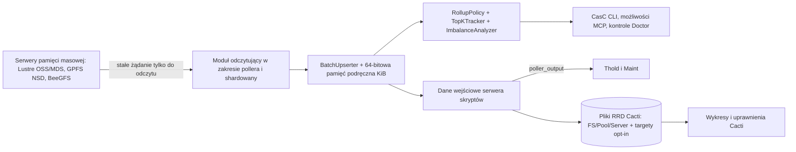

<!-- Source: README.md; SHA256: e88d6875d113220a91cfc0a9d230c829a78477b17e6aa7e44dda38c9591c86ad -->

<!-- translations:start -->
[English](../../../README.md) | [简体中文](../zh-CN/README.md) | [हिन्दी](../hi-IN/README.md) | [Español (España)](../es-ES/README.md) | [Español (Latinoamérica)](../es-419/README.md) | [العربية (السعودية)](../ar-SA/README.md) | [Afrikaans](../af-ZA/README.md) | [አማርኛ](../am-ET/README.md) | [العربية (مصر)](../ar-EG/README.md) | [العربية (المغرب)](../ar-MA/README.md) | [Български](../bg-BG/README.md) | [বাংলা](../bn-BD/README.md) | [Bosanski](../bs-BA/README.md) | [Deutsch](../de-DE/README.md) | [Ελληνικά](../el-GR/README.md) | [فارسی](../fa-IR/README.md) | [Filipino](../fil-PH/README.md) | [Français](../fr-FR/README.md) | [Français (Maroc)](../fr-MA/README.md) | [Français (Sénégal)](../fr-SN/README.md) | [Hausa](../ha-NG/README.md) | [עברית](../he-IL/README.md) | [Hrvatski](../hr-HR/README.md) | [Bahasa Indonesia](../id-ID/README.md) | [Igbo](../ig-NG/README.md) | [Italiano](../it-IT/README.md) | [日本語](../ja-JP/README.md) | [ქართული](../ka-GE/README.md) | [한국어](../ko-KR/README.md) | [Latviešu](../lv-LV/README.md) | [Malagasy](../mg-MG/README.md) | [मराठी](../mr-IN/README.md) | [Bahasa Melayu](../ms-MY/README.md) | [Nederlands](../nl-NL/README.md) | [Polski](README.md) | [Português (Brasil)](../pt-BR/README.md) | [Português (Portugal)](../pt-PT/README.md) | [Русский](../ru-RU/README.md) | [Kinyarwanda](../rw-RW/README.md) | [Soomaali](../so-SO/README.md) | [Српски](../sr-RS/README.md) | [Svenska](../sv-SE/README.md) | [Kiswahili](../sw-KE/README.md) | [தமிழ்](../ta-IN/README.md) | [తెలుగు](../te-IN/README.md) | [ไทย](../th-TH/README.md) | [Türkçe](../tr-TR/README.md) | [Українська](../uk-UA/README.md) | [اردو](../ur-PK/README.md) | [Tiếng Việt](../vi-VN/README.md) | [isiXhosa](../xh-ZA/README.md) | [Yorùbá](../yo-NG/README.md) | [繁體中文](../zh-TW/README.md) | [isiZulu](../zu-ZA/README.md)
<!-- translations:end -->

# plugin_pfs

Wtyczka dla Cacti 1.2 wprowadzająca monitorowanie stanu, pojemności, nierównomierności zapełnienia, przepustowości per target oraz częstości operacji na metadanych równoległych systemów plików do Cacti dla Lustre, IBM Storage Scale (GPFS) i BeeGFS za jednolitym interfejsem `Backend`. Każdy system plików odpowiada standardowemu urządzeniu Cacti z zapytaniami danych, wykresami przeglądowymi i tworzonymi na żądanie wykresami targetów oraz wskaźnikami podsumowującymi, dzięki czemu Thold i Maint generują alerty i wyciszają je bez żadnych modyfikacji.

> **Status: fazy od 1 do 3 oraz prymitywy skalowania eksaskalowego zaimplementowane w kodzie, jeszcze niewydane.** Fundamenty, obserwacja Lustre, alertowanie i wyciszanie Maint, sterowniki tylko do odczytu dla GPFS i BeeGFS, analiza nierównomierności OST/MDT z integracją Maint, zakresowe zdalne zbieranie danych na poziomie pollera (`replicate_out`, `remote_agent`), prymitywy skalowania 100+ PB / eksaskalowego (`FramedReportParser`, schemat v4 `value_kib`, `RollupPolicy`, `TopKTracker`, `ShardAssigner`, `BatchUpserter`), operatorskie CLI CasC (`cli/pfs.php`) oraz punkty rozszerzeń ekosystemu (`abilities_register`, `doctor_register_checks`, `casc_register_providers`) zostały zaimplementowane i zweryfikowane testami jednostkowymi, bezpieczeństwa oraz integracyjnymi w tymczasowej instancji Cacti. Wszystkie dotychczasowe uruchomienia korzystały z wyjść węzłów testowych (fixture), a nie z rzeczywistego sprzętu Lustre, GPFS ani BeeGFS. Przed otagowaniem wydania pozostają otwarte: pilotaże na rzeczywistych systemach plików ([plan pilotażu](../../pilot-plan.md)), zewnętrzny przegląd bezpieczeństwa ([przegląd własny](../../security-review.md)) oraz pomiary skalowalności na udokumentowanym sprzęcie ([skalowanie](../../research/scale.md)). Wersja 0.1.0 została przygotowana w pliku `INFO` oraz [CHANGELOG.md](../../../CHANGELOG.md), ale nie została jeszcze otagowana.

## Role dostępu

| Uprawnienie (Realm) | Dostęp |
| --- | --- |
| Parallel Filesystem View | Istniejące strony monitorowania. |
| Parallel Filesystem Operator | Monitorowanie oraz strona Operations i osobiste potwierdzenia w ramach triażu. |
| Parallel Filesystem Admin | Dostęp Operator oraz istniejące strony konfiguracji i akcje administracyjne. |

Po skopiowaniu plików aktualizacji należy otworzyć stronę Plugins jako administrator, aby zarejestrować nowe uprawnienie (realm). Uprawnienie Operator należy przypisać jawnie w sekcji **Configuration > Users** lub dla grup użytkowników. Aktualizacje zachowują istniejące identyfikatory i nadania uprawnień View oraz Admin. Dostęp Admin dziedziczy dostęp Operator, a dostęp Operator dziedziczy dostęp View przy każdym żądaniu; nie dodaje to zapisanych na stałe nadań dla użytkowników ani grup. Ustawienia wtyczki wymagają również uprawnienia Parallel Filesystem Admin oprócz uprawnienia Settings w Cacti.

Uprawnienia do urządzeń w Cacti nadal ograniczają wiersze i akcje dostępne dla każdego użytkownika; niezmapowane obiekty wymagają administratora. Poświadczenia, konfiguracja, mapowanie, usuwanie oraz inne zmiany administracyjne pozostają na stronach administracyjnych. Potwierdzenia obowiązują wyłącznie w bieżącej sesji użytkownika, maksymalnie przez jedną godzinę i tylko tak długo, jak długo ta sama obserwacja pozostaje aktualna. Nowe lub zmienione obserwacje unieważniają je. Nigdy nie oznaczają one nieudanego pomiaru jako prawidłowego ani nie wyciszają alertów.

## Dlaczego

Gdy współdzielony system plików działa wolno, przyczyny są rozproszone na wielu serwerach. Lustre utrzymuje liczniki per węzeł: `lctl get_param` zwraca wartości „na lokalnym węźle”, więc każdy serwer pamięci obiektowej (OSS) i serwer metadanych (MDS) przechowuje wyłącznie dane dotyczące własnych targetów. Operator analizujący powolne działanie systemu plików potrzebuje trzech odpowiedzi z różnych źródeł:

- **Czy jeden target zapełnia się, podczas gdy inne są puste?** Nierównomierność zapełnienia wpływa na to, gdzie trafiają nowe pliki oraz kiedy pojedynczemu targetowi zabraknie miejsca.
- **Które targety lub operacje są obciążone?** Liczniki bajtów dla poszczególnych targetów oraz liczniki operacji dla poszczególnych MDT pokazują, czy obciążenie wynika z operacji na danych, czy na metadanych.
- **Czy samo monitorowanie jest aktualne?** Płaski wykres daje pewność tylko wtedy, gdy wtyczka miała dostęp do serwerów.

Cacti tworzy wykresy dla hostów i sprawdza progi za pomocą Thold, natomiast w organizacji Cacti na GitHubie nie ma repozytorium do monitorowania Lustre, GPFS ani BeeGFS (stan wyszukiwania na 2026-11-14). Wtyczka wypełnia tę lukę, odczytując z węzłów pamięci masowej wyłącznie dozwolone wartości w trybie tylko do odczytu i reprezentując każdy system plików jako urządzenie Cacti, którego targety stanowią indeksy zapytania danych. Ponownie wykorzystuje mechanizmy Cacti: wykresy, uprawnienia, zdalne kolektory danych, Thold oraz Maint, zamiast tworzyć ich równoległe odpowiedniki.

## Planowany zakres

| Faza | Zakres | Status | Kamienie milowe |
|---|---|---|---|
| 0, badania | Macierz wydań, decyzja o sposobie dostępu do węzłów, potwierdzenie zachowania narzędzi nadrzędnych (upstream), zachowanie liczników i przełączania awaryjnego (failover), pomiary skalowalności | Ukończone | [M1](https://github.com/somethingwithproof/plugin_pfs/milestone/1) |
| 1, obserwacja | Inwentarz Lustre, pojemność i zapełnienie, nierównomierność OST/MDT (`lib/ImbalanceAnalyzer.php`), integracja z Maint (`lib/HealthPage.php`), przepustowość OST, częstość operacji MDT, wykresy, alertowanie Thold, strona stanu | Zaimplementowano (przetestowano na danych fixture) | [M2](https://github.com/somethingwithproof/plugin_pfs/milestone/2), [M3](https://github.com/somethingwithproof/plugin_pfs/milestone/3), [M4](https://github.com/somethingwithproof/plugin_pfs/milestone/4) |
| 2, zdalne i skala | Zdalne zbieranie w zakresie pollera (`lib/Reader.php`, `lib/ReplicationRepository.php`, `replicate_out`, `remote_agent`), prymitywy skalowania 100+ PB (higiena 64-bitowych KiB + schemat v4 `value_kib`, `lib/RollupPolicy.php`, `lib/TopKTracker.php`, `lib/ShardAssigner.php` + `poller_pfs.php --shard=K/N`, `lib/BatchUpserter.php`), CLI CasC (`cli/pfs.php`), punkty rozszerzeń MCP/Doctor/CasC | Zaimplementowano (przetestowano jednostkowo i integracyjnie w CI) | [M5](https://github.com/somethingwithproof/plugin_pfs/milestone/5) |
| 3, backendy | Sterowniki tylko do odczytu dla IBM Storage Scale (GPFS) (`lib/GpfsBackend.php`) oraz BeeGFS (`lib/BeegfsBackend.php`) zarejestrowane w `BackendRegistry::production()` | Zaimplementowano (przetestowano jednostkowo) | [M6](https://github.com/somethingwithproof/plugin_pfs/milestone/6) |

Najważniejsze zaimplementowane prymitywy operatorskie i skalujące:

- **Sterowniki tylko do odczytu dla wielu systemów plików:** `LustreBackend`, `GpfsBackend` (wyłącznie ramkowane `mmpmon` `fs_io_s`/`io_s` z zakazem `reset`, pojemności/stany pul `mmdf` oraz podsumowania wątków oczekujących) oraz `BeegfsBackend` (targety pamięci masowej i metadanych BeeGFS 7.4 i 8.x z dokładną konwersją bajtów na KiB, mapowaniem stanów osiągalności/spójności i semantyką wskaźników na interwał), współdzielące `lib/FramedReportParser.php`.
- **Świadomość nierównomierności, zapasu miejsca i Maint:** `lib/ImbalanceAnalyzer.php` oblicza współczynniki zapełnienia OST/MDT, rozpiętość, indeks nierównomierności oparty na odchyleniu standardowym populacji, zapas miejsca (headroom), wymuszanie aktualności w 1 interwale (`missing_targets`), flagi stanu dla poszczególnych targetów oraz ograniczone do Top-K najbardziej skośne targety. `HealthPage` (`pfs_health.php`) oraz `CascProvider::health()` uwidaczniają okna serwisowe `Maint` w Cacti i wyciszają aktywne ostrzeżenia o awariach podczas zaplanowanych prac serwisowych.
- **Skalowanie 100+ PB i eksaskalowe** ([docs/architecture/exascale-scaling.md](../../architecture/exascale-scaling.md)): dokładna dziesiętna konwersja bajtów na KiB (`FramedReportParser::bytesToKibInt()`) zweryfikowana dla 500 PB i 2 EB wraz z kolumnami `BIGINT UNSIGNED value_kib` (schemat v4); hierarchiczne agregacje RRD `Filesystem -> Pool -> Storage Server` z ograniczoną promocją targetów opt-in/gorących/skośnych (`lib/RollupPolicy.php`); ograniczone do $O(K)$ skośne targety Top-K i wstępnie zagregowane podsumowania obciążających zadań/klientów (`lib/TopKTracker.php`, bez tworzenia urządzeń lub plików RRD per klient); deterministyczne shardowanie kolektorów CRC32 (`lib/ShardAssigner.php`, `php plugins/pfs/poller_pfs.php [--poller=N] [--shard=K/N] [--force] [--debug]`); oraz wsadowe operacje SQL upsert po 500 wierszy wraz z stronicowaniem keyset (`lib/BatchUpserter.php`, `CacheRepository::upsertObservationsBatch()`, `TargetRepository::forFilesystemPage()`).
- **Operatorskie CLI CasC i punkty rozszerzeń ekosystemu:** `cli/pfs.php` obsługuje `export [--format=yaml|xml]`, `validate <file> [--format=yaml|xml]`, `plan <file> [--format=yaml|xml] [--output=text|json]`, `apply <file> --confirm=<PLAN_HASH> [--format=yaml|xml]` oraz `health [--format=text|json]` bez żadnych zewnętrznych zależności Composer. `setup.php` i `lib/EcosystemIntegration.php` rejestrują `abilities_register` (`pfs-list-filesystems`, `pfs-get-imbalance`, `pfs-get-health`; tylko do odczytu, ograniczone przez `Parallel Filesystem View` i uprawnienia urządzeń Cacti), `doctor_register_checks` (`pfs_schema`, `pfs_reader_freshness`, `pfs_capacity_imbalance`), `casc_register_providers`, `replicate_out` i `remote_agent`.

Poza zakresem: wszelkie operacje zapisu, czyszczenia, resetowania lub dostrajania na węźle lub systemie plików; własny silnik alertowania wtyczki; niestandardowy demon lub protokół sieciowy; urządzenia/pliki RRD Cacti per zadanie lub per klient; zmiany w rdzeniu Cacti, Thold lub Maint.

## Docelowa kompatybilność

| Komponent | Wymagania docelowe |
|---|---|
| Cacti | 1.2.31 lub nowsza, bez łatek dla rdzenia |
| PHP | 8.2 lub nowsza; `setup.php`, `poller_pfs.php` i `cli/pfs.php` pozostają poprawne składniowo w PHP 8.0, dzięki czemu nieobsługiwane środowisko wykonawcze otrzymuje odmowę uruchomienia zamiast uszkodzenia interfejsu Cacti |
| Lustre | Źródła i podręczniki sprawdzone dla wersji 2.17.0; przetestowane na danych fixture |
| GPFS, BeeGFS | Sterowniki tylko do odczytu dla IBM Storage Scale (GPFS) 5.x `mmpmon`/`mmdf` oraz BeeGFS 7.4 / 8.x zaimplementowane i przetestowane na danych fixture |
| Thold, Maint | Thold 1.8.2 i Maint 1.3, bez zmian |

## Projekt

- [docs/architecture/exascale-scaling.md](../../architecture/exascale-scaling.md) dokumentuje dwuwarstwową architekturę telemetrii 100+ PB / eksaskalowej (warstwa serwera Cacti/`plugin_pfs` + agregacje + Top-K połączona z pozapasmową telemetrią kliencką LDMS/Darshan/TOKIO) oraz jej kontekst w literaturze naukowej.
- [docs/PLAN.md](../../PLAN.md) zawiera pełny plan: architekturę, założenia oparte na dokumentacji nadrzędnej (wraz ze źródłami oraz elementami wciąż niezweryfikowanymi), semantykę liczników, model stanów, granice bezpieczeństwa, obliczenia wydajnościowe, testowanie i ryzyka.
- [docs/operator-guide.md](../../operator-guide.md) opisuje instalację, wykresy i wartości, aktualizację, kopię zapasową i odtwarzanie, odinstalowanie oraz rozwiązywanie problemów; [docs/alerting.md](../../alerting.md) opisuje integrację z Thold i Maint.
- [docs/node-setup.md](../../node-setup.md) opisuje sposób przygotowania serwera Lustre oraz pollera dla modułu odczytującego.
- [docs/decisions/](../../decisions) zawiera rekordy decyzji architektonicznych (ADR) dla podjętych już wyborów.
- [docs/REQUIREMENTS.md](../../REQUIREMENTS.md) mapuje każdy identyfikator wymagania na odpowiadające mu zgłoszenie.

## Sposób śledzenia prac

- **Kamienie milowe (Milestones)** odpowiadają kamieniom milowym planu. Każdy ma zgłoszenie nadrzędne (epic) zawierające listę podzgłoszeń oraz dowody ukończenia.
- **Zgłoszenia (Issues)** są kategoryzowane etykietami: `type: requirement`, `type: research`, `type: decision`, `type: epic`. Zgłoszenia wymagań określają numerowane, testowalne wymagania (`REQ-AREA-NNN`) oraz kryteria akceptacji.
- **Etykiety (Labels)** zawierają również prefiksy `area:`, `phase:`, `priority:` oraz `status:`. Zobacz [CONTRIBUTING.md](../../../CONTRIBUTING.md#labels).
- [Tablica projektu](https://github.com/users/somethingwithproof/projects/11) prezentuje wszystkie zgłoszenia w podziale na kamienie milowe.

## Współpraca

Zapoznaj się z [CONTRIBUTING.md](../../../CONTRIBUTING.md). Commity wymagają podpisu DCO (sign-off). Dyskusje projektowe odbywają się w zgłoszeniach; otwarte decyzje są oznaczone etykietą `type: decision`.

## Bezpieczeństwo

Podatności należy zgłaszać prywatnie; zobacz [SECURITY.md](../../../SECURITY.md).

## Licencja

GNU General Public License v2.0, ta sama licencja co w przypadku Cacti i jego wtyczek. Zobacz [LICENSE](../../../LICENSE).
