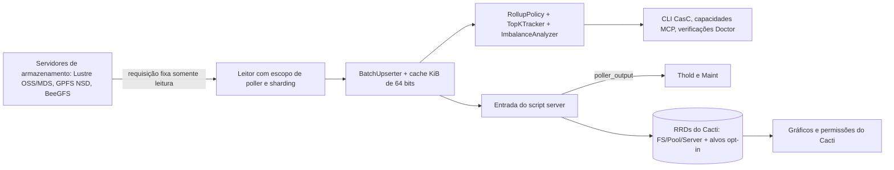

<!-- Source: README.md; SHA256: e88d6875d113220a91cfc0a9d230c829a78477b17e6aa7e44dda38c9591c86ad -->

<!-- translations:start -->
[English](../../../README.md) | [简体中文](../zh-CN/README.md) | [हिन्दी](../hi-IN/README.md) | [Español (España)](../es-ES/README.md) | [Español (Latinoamérica)](../es-419/README.md) | [العربية (السعودية)](../ar-SA/README.md) | [Afrikaans](../af-ZA/README.md) | [አማርኛ](../am-ET/README.md) | [العربية (مصر)](../ar-EG/README.md) | [العربية (المغرب)](../ar-MA/README.md) | [Български](../bg-BG/README.md) | [বাংলা](../bn-BD/README.md) | [Bosanski](../bs-BA/README.md) | [Deutsch](../de-DE/README.md) | [Ελληνικά](../el-GR/README.md) | [فارسی](../fa-IR/README.md) | [Filipino](../fil-PH/README.md) | [Français](../fr-FR/README.md) | [Français (Maroc)](../fr-MA/README.md) | [Français (Sénégal)](../fr-SN/README.md) | [Hausa](../ha-NG/README.md) | [עברית](../he-IL/README.md) | [Hrvatski](../hr-HR/README.md) | [Bahasa Indonesia](../id-ID/README.md) | [Igbo](../ig-NG/README.md) | [Italiano](../it-IT/README.md) | [日本語](../ja-JP/README.md) | [ქართული](../ka-GE/README.md) | [한국어](../ko-KR/README.md) | [Latviešu](../lv-LV/README.md) | [Malagasy](../mg-MG/README.md) | [मराठी](../mr-IN/README.md) | [Bahasa Melayu](../ms-MY/README.md) | [Nederlands](../nl-NL/README.md) | [Polski](../pl-PL/README.md) | [Português (Brasil)](README.md) | [Português (Portugal)](../pt-PT/README.md) | [Русский](../ru-RU/README.md) | [Kinyarwanda](../rw-RW/README.md) | [Soomaali](../so-SO/README.md) | [Српски](../sr-RS/README.md) | [Svenska](../sv-SE/README.md) | [Kiswahili](../sw-KE/README.md) | [தமிழ்](../ta-IN/README.md) | [తెలుగు](../te-IN/README.md) | [ไทย](../th-TH/README.md) | [Türkçe](../tr-TR/README.md) | [Українська](../uk-UA/README.md) | [اردو](../ur-PK/README.md) | [Tiếng Việt](../vi-VN/README.md) | [isiXhosa](../xh-ZA/README.md) | [Yorùbá](../yo-NG/README.md) | [繁體中文](../zh-TW/README.md) | [isiZulu](../zu-ZA/README.md)
<!-- translations:end -->

# plugin_pfs

Um plugin para Cacti 1.2 que traz a integridade, a capacidade, o desequilíbrio de preenchimento, a vazão por alvo e as taxas de operações de metadados de sistemas de arquivos paralelos para o Cacti no Lustre, no IBM Storage Scale (GPFS) e no BeeGFS por trás de uma interface `Backend` unificada. Cada sistema de arquivos é mapeado para um dispositivo comum do Cacti com data queries, gráficos de visão geral e de alvo sob demanda, além de medidores resumidos para que o Thold e o Maint emitam alertas e os suprimam sem alterações.

> **Status: fases 1 a 3 e primitivas de escalonamento em exaescala implementadas em código, ainda não lançado.** Fundação, observação do Lustre, alertas e supressão do Maint, drivers somente leitura de GPFS e BeeGFS, análise de desequilíbrio OST/MDT com integração ao Maint, escopo de coletores remotos (`replicate_out`, `remote_agent`), primitivas de escalonamento de 100+ PB / exaescala (`FramedReportParser`, Esquema v4 `value_kib`, `RollupPolicy`, `TopKTracker`, `ShardAssigner`, `BatchUpserter`), a CLI de CasC para operadores (`cli/pfs.php`) e hooks de ecossistema (`abilities_register`, `doctor_register_checks`, `casc_register_providers`) estão implementados e verificados com testes unitários, de segurança e de integração em Cacti descartável. Todas as execuções até agora usam saída de nó de fixture em vez de hardware real de Lustre, GPFS ou BeeGFS. Ainda em aberto antes de marcar um lançamento: pilotos em sistemas de arquivos reais ([plano de piloto](../../pilot-plan.md)), uma revisão de segurança externa ([autoavaliação](../../security-review.md)) e medições de escala em hardware documentado ([escala](../../research/scale.md)). A versão 0.1.0 está preparada em `INFO` e [CHANGELOG.md](../../../CHANGELOG.md), mas ainda não recebeu tag.

## Papéis de acesso

| Realm | Acesso |
| --- | --- |
| Parallel Filesystem View | Páginas de monitoramento existentes. |
| Parallel Filesystem Operator | Monitoramento, além da página Operations e reconhecimentos pessoais de triagem. |
| Parallel Filesystem Admin | Acesso de operador, além da configuração existente e ações administrativas. |

Após copiar os arquivos de atualização, abra a página Plugins como administrador para registrar
o novo realm. Atribua o realm Operator explicitamente em **Configuration > Users** ou em grupos de usuários.
As atualizações mantêm os IDs e concessões existentes dos realms View e Admin. O acesso Admin
herda o acesso Operator, e o acesso Operator herda o acesso View em cada requisição;
isso não adiciona concessões armazenadas a usuários ou grupos. As configurações do plugin também exigem
acesso Parallel Filesystem Admin além da permissão Settings do Cacti.

As permissões de dispositivo do Cacti ainda limitam as linhas e ações disponíveis para cada usuário; objetos não mapeados exigem um administrador.
Credenciais, configuração, mapeamento, exclusão e outras alterações administrativas
permanecem nas páginas administrativas. Os reconhecimentos duram apenas na sessão atual
do usuário, por no máximo uma hora e somente enquanto a mesma observação permanecer
atualizada (fresh). Observações novas ou alteradas os invalidam. Eles nunca marcam uma medição
com falha como íntegra nem suprimem alertas.

## Por quê

Quando um sistema de arquivos compartilhado está lento, as evidências estão espalhadas pelos servidores. O Lustre mantém seus contadores por nó: `lctl get_param` relata valores "no nó local", portanto cada servidor de armazenamento de objetos (OSS) e servidor de metadados (MDS) guarda apenas os números dos seus próprios alvos. Um operador investigando um sistema de arquivos lento precisa de três respostas de lugares diferentes:

- **Um alvo está enchendo enquanto outros estão vazios?** O desequilíbrio de preenchimento muda onde novos arquivos são gravados e quando um único alvo fica sem espaço.
- **Quais alvos ou operações estão ocupados?** Contadores de bytes por alvo e contadores de operações por MDT mostram se a carga é limitada por dados ou por metadados.
- **O próprio monitoramento está atualizado?** Um gráfico plano só é tranquilizador se o plugin conseguia enxergar os servidores.

O Cacti gera gráficos de hosts e aplica limiares com o Thold, e a organização do Cacti no GitHub não possui repositório para monitoramento de Lustre, GPFS ou BeeGFS (pesquisado em 2026-11-14). O plugin preenche essa lacuna lendo valores somente leitura de uma lista permitida (allowlist) nos nós de armazenamento e representando cada sistema de arquivos como um dispositivo do Cacti cujos alvos são os índices de uma data query. Ele reutiliza gráficos, permissões, coletores de dados remotos, Thold e Maint do Cacti em vez de construir versões paralelas deles.

## Escopo planejado

| Fase | Escopo | Status | Marcos |
|---|---|---|---|
| 0, pesquisa | Matriz de versões, decisão de acesso ao nó, confirmação de comportamento upstream, comportamento de contadores e failover, medições de escala | Concluído | [M1](https://github.com/somethingwithproof/plugin_pfs/milestone/1) |
| 1, observação | Inventário Lustre, capacidade e preenchimento, desequilíbrio OST/MDT (`lib/ImbalanceAnalyzer.php`), integração com Maint (`lib/HealthPage.php`), vazão de OST, taxas de operação de MDT, gráficos, alertas do Thold, página de integridade | Implementado (testado com fixtures) | [M2](https://github.com/somethingwithproof/plugin_pfs/milestone/2), [M3](https://github.com/somethingwithproof/plugin_pfs/milestone/3), [M4](https://github.com/somethingwithproof/plugin_pfs/milestone/4) |
| 2, remoto e escala | Coleta remota com escopo de poller (`lib/Reader.php`, `lib/ReplicationRepository.php`, `replicate_out`, `remote_agent`), primitivas de escalonamento de 100+ PB (higiene de KiB de 64 bits + Esquema v4 `value_kib`, `lib/RollupPolicy.php`, `lib/TopKTracker.php`, `lib/ShardAssigner.php` + `poller_pfs.php --shard=K/N`, `lib/BatchUpserter.php`), CLI CasC (`cli/pfs.php`), hooks MCP/Doctor/CasC | Implementado (testado em unidade e integração CI) | [M5](https://github.com/somethingwithproof/plugin_pfs/milestone/5) |
| 3, backends | Drivers somente leitura de IBM Storage Scale (GPFS) (`lib/GpfsBackend.php`) e BeeGFS (`lib/BeegfsBackend.php`) registrados em `BackendRegistry::production()` | Implementado (testado em unidade) | [M6](https://github.com/somethingwithproof/plugin_pfs/milestone/6) |

Principais primitivas de operação e escalonamento implementadas:

- **Drivers somente leitura multi-sistema de arquivos:** `LustreBackend`, `GpfsBackend` (apenas `mmpmon` enquadrado `fs_io_s`/`io_s` com `reset` proibido, capacidade/estados de pool `mmdf` e resumos de waiters) e `BeegfsBackend` (alvos de armazenamento/metadados BeeGFS 7.4 e 8.x com conversão exata de bytes para KiB, mapeamento de condição de acessibilidade/consistência e semântica de medidor por intervalo) compartilhando `lib/FramedReportParser.php`.
- **Consciência de desequilíbrio, margem livre e Maint:** `lib/ImbalanceAnalyzer.php` calcula razões de preenchimento OST/MDT, amplitude (spread), índice de desequilíbrio por desvio padrão populacional, margem livre (headroom), imposição de frescor de 1 intervalo (`missing_targets`), sinalizadores de estado por alvo e alvos distorcidos Top-K limitados. `HealthPage` (`pfs_health.php`) e `CascProvider::health()` expõem janelas de manutenção `Maint` do Cacti e suprimem avisos ativos de falha durante manutenção programada.
- **Escalonamento para 100+ PB e exaescala** ([docs/architecture/exascale-scaling.md](../../architecture/exascale-scaling.md)): conversão decimal exata de bytes para KiB (`FramedReportParser::bytesToKibInt()`) verificada em 500 PB e 2 EB junto a colunas `BIGINT UNSIGNED value_kib` (Esquema v4); rollups hierárquicos de RRD `Filesystem -> Pool -> Storage Server` com promoção limitada de alvos opt-in/quentes/distorcidos (`lib/RollupPolicy.php`); alvos distorcidos Top-K limitados em $O(K)$ e resumos pré-agregados de jobs/clientes pesados (`lib/TopKTracker.php`, nunca criando dispositivos ou RRDs por cliente); sharding determinístico de coletores via CRC32 (`lib/ShardAssigner.php`, `php plugins/pfs/poller_pfs.php [--poller=N] [--shard=K/N] [--force] [--debug]`); e upserts SQL em lote de 500 linhas com paginação por keyset (`lib/BatchUpserter.php`, `CacheRepository::upsertObservationsBatch()`, `TargetRepository::forFilesystemPage()`).
- **CLI CasC de operador e hooks de ecossistema:** `cli/pfs.php` oferece suporte a `export [--format=yaml|xml]`, `validate <file> [--format=yaml|xml]`, `plan <file> [--format=yaml|xml] [--output=text|json]`, `apply <file> --confirm=<PLAN_HASH> [--format=yaml|xml]` e `health [--format=text|json]` sem dependências externas do Composer. `setup.php` e `lib/EcosystemIntegration.php` registram `abilities_register` (`pfs-list-filesystems`, `pfs-get-imbalance`, `pfs-get-health`; somente leitura, protegidas por `Parallel Filesystem View` e permissões de dispositivo do Cacti), `doctor_register_checks` (`pfs_schema`, `pfs_reader_freshness`, `pfs_capacity_imbalance`), `casc_register_providers`, `replicate_out` e `remote_agent`.

Fora do escopo: qualquer operação de gravação, limpeza, redefinição ou ajuste (tuning) em um nó ou sistema de arquivos; um mecanismo de alertas próprio do plugin; um daemon ou protocolo de rede personalizado; dispositivos/RRDs do Cacti por job ou por cliente; alterações no núcleo do Cacti, no Thold ou no Maint.

## Alvos de compatibilidade

| Componente | Alvo |
|---|---|
| Cacti | 1.2.31 ou posterior, sem patches no núcleo |
| PHP | 8.2 ou posterior; `setup.php`, `poller_pfs.php` e `cli/pfs.php` permanecem analisáveis (parseable) no 8.0 para que um runtime sem suporte receba uma recusa em vez de uma interface do Cacti quebrada |
| Lustre | Código-fonte e manuais verificados em 2.17.0; testado com fixtures |
| GPFS, BeeGFS | Drivers somente leitura para IBM Storage Scale (GPFS) 5.x `mmpmon`/`mmdf` e BeeGFS 7.4 / 8.x implementados e testados com fixtures |
| Thold, Maint | Thold 1.8.2 e Maint 1.3, sem alterações |

## Design

- [docs/architecture/exascale-scaling.md](../../architecture/exascale-scaling.md) documenta a arquitetura de telemetria em duas camadas para 100+ PB / exaescala (servidor Cacti/`plugin_pfs` + rollup + camada Top-K combinada com telemetria de cliente LDMS/Darshan/TOKIO fora de banda) e seu contexto na literatura acadêmica.
- [docs/PLAN.md](../../PLAN.md) é o plano completo: arquitetura, fatos upstream dos quais depende (com fontes e o que ainda não foi verificado), semântica de contadores, modelo de estado, limites de segurança, aritmética de desempenho, testes e riscos.
- [docs/operator-guide.md](../../operator-guide.md) aborda instalação, os gráficos e valores, atualização, backup e restauração, desinstalação e solução de problemas; [docs/alerting.md](../../alerting.md) aborda o Thold e o Maint.
- [docs/node-setup.md](../../node-setup.md) descreve como preparar um servidor Lustre e um poller para o leitor.
- [docs/decisions/](../../decisions) contém registros de decisões de arquitetura para escolhas já feitas.
- [docs/REQUIREMENTS.md](../../REQUIREMENTS.md) mapeia cada ID de requisito para sua issue.

## Como o trabalho é acompanhado

- **Marcos** seguem os marcos do plano. Cada um tem uma issue épica listando suas sub-issues e evidências de saída.
- **Issues** são tipadas por rótulo: `type: requirement`, `type: research`, `type: decision`, `type: epic`. Issues de requisito declaram requisitos numerados e testáveis (`REQ-AREA-NNN`) e critérios de aceitação.
- **Rótulos** também trazem `area:`, `phase:`, `priority:` e `status:`. Veja [CONTRIBUTING.md](../../../CONTRIBUTING.md#labels).
- O [quadro do projeto](https://github.com/users/somethingwithproof/projects/11) mostra todas as issues entre os marcos.

## Contribuição

Leia [CONTRIBUTING.md](../../../CONTRIBUTING.md). Commits precisam de assinatura DCO (DCO sign-off). Discussões de design acontecem nas issues; decisões em aberto carregam o rótulo `type: decision`.

## Segurança

Relate vulnerabilidades de forma privada; veja [SECURITY.md](../../../SECURITY.md).

## Licença

GNU General Public License v2.0, a mesma licença do Cacti e de seus plugins. Veja [LICENSE](../../../LICENSE).
