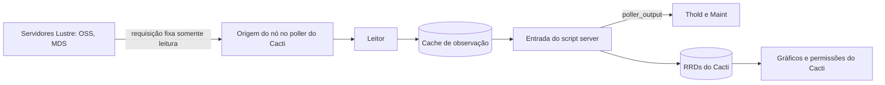

<!-- Source: README.md; SHA256: 40f2c5a5e9be97e4bd2b05a9ebab2a77de51de3af1b1c21dbeb5ee7f936cdd3b -->

<!-- translations:start -->
[English](../../../README.md) | [简体中文](../zh-CN/README.md) | [हिन्दी](../hi-IN/README.md) | [Español (España)](../es-ES/README.md) | [Español (Latinoamérica)](../es-419/README.md) | [العربية (السعودية)](../ar-SA/README.md) | [Afrikaans](../af-ZA/README.md) | [አማርኛ](../am-ET/README.md) | [العربية (مصر)](../ar-EG/README.md) | [العربية (المغرب)](../ar-MA/README.md) | [বাংলা](../bn-BD/README.md) | [Bosanski](../bs-BA/README.md) | [Deutsch](../de-DE/README.md) | [فارسی](../fa-IR/README.md) | [Filipino](../fil-PH/README.md) | [Français](../fr-FR/README.md) | [Français (Maroc)](../fr-MA/README.md) | [Français (Sénégal)](../fr-SN/README.md) | [Hausa](../ha-NG/README.md) | [עברית](../he-IL/README.md) | [Hrvatski](../hr-HR/README.md) | [Bahasa Indonesia](../id-ID/README.md) | [Igbo](../ig-NG/README.md) | [Italiano](../it-IT/README.md) | [日本語](../ja-JP/README.md) | [한국어](../ko-KR/README.md) | [Malagasy](../mg-MG/README.md) | [मराठी](../mr-IN/README.md) | [Bahasa Melayu](../ms-MY/README.md) | [Nederlands](../nl-NL/README.md) | [Polski](../pl-PL/README.md) | [Português (Brasil)](README.md) | [Русский](../ru-RU/README.md) | [Kinyarwanda](../rw-RW/README.md) | [Soomaali](../so-SO/README.md) | [Српски](../sr-RS/README.md) | [Svenska](../sv-SE/README.md) | [Kiswahili](../sw-KE/README.md) | [தமிழ்](../ta-IN/README.md) | [తెలుగు](../te-IN/README.md) | [ไทย](../th-TH/README.md) | [Türkçe](../tr-TR/README.md) | [Українська](../uk-UA/README.md) | [اردو](../ur-PK/README.md) | [Tiếng Việt](../vi-VN/README.md) | [isiXhosa](../xh-ZA/README.md) | [Yorùbá](../yo-NG/README.md) | [繁體中文](../zh-TW/README.md) | [isiZulu](../zu-ZA/README.md)
<!-- translations:end -->

# plugin_pfs

Um plugin para Cacti 1.2 que traz a integridade e a carga de sistemas de arquivos paralelos para o Cacti: capacidade e desequilíbrio de preenchimento entre alvos (targets), vazão por alvo e taxas de operações de metadados. O Lustre é o primeiro backend. GPFS (IBM Storage Scale) e BeeGFS seguem atrás de uma interface de backend. Os dados chegam em dispositivos, fontes de dados (data sources) e gráficos comuns do Cacti, de modo que o Thold e o Maint emitem alertas e os suprimem sem alterações.

> **Status: marco 4, código completo para a fase 1, não lançado.** Os marcos 2 (fundação), 3 (observação do Lustre) e 4 (alertas e preparação de lançamento) estão concluídos na `main` ou em revisão. O plugin instala, atualiza e desinstala por meio da API de plugins do Cacti e recusa PHP inferior à versão 8.2. Um leitor em segundo plano em cada poller lê servidores Lustre via SSH por meio de um script fixo de comando forçado ([node/pfs-read.sh](../../../node/pfs-read.sh)) e armazena em cache inventário, condição, capacidade e contadores com seu frescor (freshness). Cada sistema de arquivos torna-se um dispositivo do Cacti com data queries de OST e MDT, cinco gráficos de visão geral, gráficos por alvo sob demanda e uma fonte de dados resumida para o Thold. O Thold v1.8.2 e o Maint v1.3, sem alterações, emitem alertas e suprimem os medidores (gauges) resumidos na execução ponta a ponta; limiares (thresholds) do Thold em contadores não têm suporte no Thold 1.8.2 ([docs/alerting.md](../../alerting.md)). Todos os testes até o momento são executados em saídas de nó de fixture em um Cacti descartável: o plugin ainda não foi executado contra um nó Lustre real. Ainda em aberto antes de um lançamento: pilotos em sistemas de arquivos reais ([plano de piloto](../../pilot-plan.md)), a revisão de segurança externa ([autoavaliação](../../security-review.md)) e medições de escala em hardware documentado ([escala](../../research/scale.md)). A versão 0.1.0 está preparada em `INFO` e [CHANGELOG.md](../../../CHANGELOG.md), mas ainda não recebeu tag.

## Papéis de acesso

| Realm | Acesso |
| --- | --- |
| Parallel Filesystem View | Páginas de monitoramento existentes. |
| Parallel Filesystem Operator | Monitoramento, além da página Operations e reconhecimentos pessoais de triagem. |
| Parallel Filesystem Admin | Acesso de operador, além da configuração existente e ações administrativas. |

Após copiar os arquivos de atualização, abra a página Plugins como administrador para registrar
o novo realm. Atribua o realm Operator explicitamente em **Configuration > Users** ou em grupos de usuários.
As atualizações mantêm os IDs e concessões existentes dos realms View e Admin. O acesso Admin
herda o acesso Operator, e o acesso Operator herda o acesso View em cada requisição;
isso não adiciona concessões armazenadas a usuários ou grupos. As configurações do plugin também exigem
acesso Parallel Filesystem Admin além da permissão Settings do Cacti.

As permissões de dispositivo do Cacti ainda limitam as linhas e ações disponíveis para cada usuário; objetos não mapeados exigem um administrador.
Credenciais, configuração, mapeamento, exclusão e outras alterações administrativas
permanecem nas páginas administrativas. Os reconhecimentos duram apenas na sessão atual
do usuário, por no máximo uma hora e somente enquanto a mesma observação permanecer
atualizada (fresh). Observações novas ou alteradas os invalidam. Eles nunca marcam uma medição
com falha como íntegra nem suprimem alertas.

## Por quê

Quando um sistema de arquivos compartilhado está lento, as evidências estão espalhadas pelos servidores. O Lustre mantém seus contadores por nó: `lctl get_param` relata valores "no nó local", portanto cada servidor de armazenamento de objetos (OSS) e servidor de metadados (MDS) guarda apenas os números dos seus próprios alvos. Um operador investigando um sistema de arquivos lento precisa de três respostas de lugares diferentes:

- **Um alvo está enchendo enquanto outros estão vazios?** O desequilíbrio de preenchimento muda onde novos arquivos são gravados e quando um único alvo fica sem espaço.
- **Quais alvos ou operações estão ocupados?** Contadores de bytes por alvo e contadores de operações por MDT mostram se a carga é limitada por dados ou por metadados.
- **O próprio monitoramento está atualizado?** Um gráfico plano só é tranquilizador se o plugin conseguia enxergar os servidores.

O Cacti gera gráficos de hosts e aplica limiares com o Thold, e a organização do Cacti no GitHub não possui repositório para monitoramento de Lustre, GPFS ou BeeGFS (pesquisado em 2026-11-14). O plugin preenche essa lacuna lendo valores somente leitura de uma lista permitida (allowlist) nos nós de armazenamento e representando cada sistema de arquivos como um dispositivo do Cacti cujos alvos são os índices de uma data query. Ele reutiliza gráficos, permissões, coletores de dados remotos, Thold e Maint do Cacti em vez de construir versões paralelas deles.

## Escopo planejado

| Fase | Escopo | Marcos |
|---|---|---|
| 0, pesquisa | Matriz de versões, decisão de acesso ao nó, confirmação de comportamento upstream, comportamento de contadores e failover, medições de escala | [M1](https://github.com/somethingwithproof/plugin_pfs/milestone/1) |
| 1, observação | Inventário Lustre, capacidade e preenchimento, vazão de OST, taxas de operação de MDT, gráficos, alertas do Thold, supressão do Maint, página de integridade | [M2](https://github.com/somethingwithproof/plugin_pfs/milestone/2), [M3](https://github.com/somethingwithproof/plugin_pfs/milestone/3), [M4](https://github.com/somethingwithproof/plugin_pfs/milestone/4) |
| 2, profundidade | Coletores de dados remotos do Cacti, visões por job e por cliente dentro de uma contagem limitada de objetos | [M5](https://github.com/somethingwithproof/plugin_pfs/milestone/5) |
| 3, backends | Backends GPFS (IBM Storage Scale) e BeeGFS | [M6](https://github.com/somethingwithproof/plugin_pfs/milestone/6) |

Fora do escopo: qualquer operação de gravação, limpeza, redefinição ou ajuste (tuning) em um nó ou sistema de arquivos; um mecanismo de alertas próprio do plugin; um daemon ou protocolo de rede personalizado; fontes de dados por job; alterações no núcleo do Cacti, no Thold ou no Maint.

## Alvos de compatibilidade

| Componente | Alvo |
|---|---|
| Cacti | 1.2.31 ou posterior, sem patches no núcleo |
| PHP | 8.2 ou posterior; `setup.php` permanece analisável (parseable) no 8.0 para que um runtime sem suporte receba uma recusa em vez de uma interface do Cacti quebrada |
| Lustre | Linhas de lançamento a serem definidas no marco 1; código-fonte e manuais verificados até agora estão na versão 2.17.0 |
| GPFS, BeeGFS | Fase 3; versões a serem definidas por pesquisa |
| Thold, Maint | Nenhuma alteração necessária |

## Design

- [docs/PLAN.md](../../PLAN.md) é o plano completo: arquitetura, fatos upstream dos quais depende (com fontes e o que ainda não foi verificado), semântica de contadores, modelo de estado, limites de segurança, aritmética de desempenho, testes e riscos.
- [docs/operator-guide.md](../../operator-guide.md) aborda instalação, os gráficos e valores, atualização, backup e restauração, desinstalação e solução de problemas; [docs/alerting.md](../../alerting.md) aborda o Thold e o Maint.
- [docs/node-setup.md](../../node-setup.md) descreve como preparar um servidor Lustre e um poller para o leitor.
- [docs/decisions/](../../decisions) contém registros de decisões de arquitetura para escolhas já feitas.
- [docs/REQUIREMENTS.md](../../REQUIREMENTS.md) mapeia cada ID de requisito para sua issue.

## Como o trabalho é acompanhado

- **Marcos** seguem os marcos do plano. Cada um tem uma issue épica listando suas sub-issues e evidências de saída.
- **Issues** são tipadas por rótulo: `type: requirement`, `type: research`, `type: decision`, `type: epic`. Issues de requisito declaram requisitos numerados e testáveis (`REQ-AREA-NNN`) e critérios de aceitação.
- **Rótulos** também trazem `area:`, `phase:`, `priority:` e `status:`. Veja [CONTRIBUTING.md](../../../CONTRIBUTING.md#labels).
- O [quadro do projeto](https://github.com/users/somethingwithproof/projects/11) mostra todas as issues entre os marcos.

## Contribuição

Leia [CONTRIBUTING.md](../../../CONTRIBUTING.md). Commits precisam de assinatura DCO (DCO sign-off). Discussões de design acontecem nas issues; decisões em aberto carregam o rótulo `type: decision`.

## Segurança

Relate vulnerabilidades de forma privada; veja [SECURITY.md](../../../SECURITY.md).

## Licença

GNU General Public License v2.0, a mesma licença do Cacti e de seus plugins. Veja [LICENSE](../../../LICENSE).
