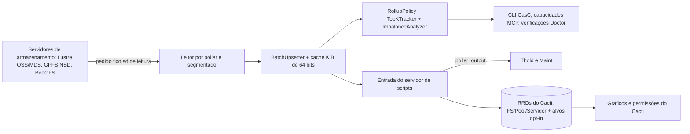

<!-- Source: README.md; SHA256: e88d6875d113220a91cfc0a9d230c829a78477b17e6aa7e44dda38c9591c86ad -->

<!-- translations:start -->
[English](../../../README.md) | [简体中文](../zh-CN/README.md) | [हिन्दी](../hi-IN/README.md) | [Español (España)](../es-ES/README.md) | [Español (Latinoamérica)](../es-419/README.md) | [العربية (السعودية)](../ar-SA/README.md) | [Afrikaans](../af-ZA/README.md) | [አማርኛ](../am-ET/README.md) | [العربية (مصر)](../ar-EG/README.md) | [العربية (المغرب)](../ar-MA/README.md) | [Български](../bg-BG/README.md) | [বাংলা](../bn-BD/README.md) | [Bosanski](../bs-BA/README.md) | [Deutsch](../de-DE/README.md) | [Ελληνικά](../el-GR/README.md) | [فارسی](../fa-IR/README.md) | [Filipino](../fil-PH/README.md) | [Français](../fr-FR/README.md) | [Français (Maroc)](../fr-MA/README.md) | [Français (Sénégal)](../fr-SN/README.md) | [Hausa](../ha-NG/README.md) | [עברית](../he-IL/README.md) | [Hrvatski](../hr-HR/README.md) | [Bahasa Indonesia](../id-ID/README.md) | [Igbo](../ig-NG/README.md) | [Italiano](../it-IT/README.md) | [日本語](../ja-JP/README.md) | [ქართული](../ka-GE/README.md) | [한국어](../ko-KR/README.md) | [Latviešu](../lv-LV/README.md) | [Malagasy](../mg-MG/README.md) | [मराठी](../mr-IN/README.md) | [Bahasa Melayu](../ms-MY/README.md) | [Nederlands](../nl-NL/README.md) | [Polski](../pl-PL/README.md) | [Português (Brasil)](../pt-BR/README.md) | [Português (Portugal)](README.md) | [Русский](../ru-RU/README.md) | [Kinyarwanda](../rw-RW/README.md) | [Soomaali](../so-SO/README.md) | [Српски](../sr-RS/README.md) | [Svenska](../sv-SE/README.md) | [Kiswahili](../sw-KE/README.md) | [தமிழ்](../ta-IN/README.md) | [తెలుగు](../te-IN/README.md) | [ไทย](../th-TH/README.md) | [Türkçe](../tr-TR/README.md) | [Українська](../uk-UA/README.md) | [اردو](../ur-PK/README.md) | [Tiếng Việt](../vi-VN/README.md) | [isiXhosa](../xh-ZA/README.md) | [Yorùbá](../yo-NG/README.md) | [繁體中文](../zh-TW/README.md) | [isiZulu](../zu-ZA/README.md)
<!-- translations:end -->

# plugin_pfs

Um plugin para Cacti 1.2 que integra no Cacti o estado de saúde, capacidade, desequilíbrio de preenchimento, débito por alvo e taxas de operações de metadados de sistemas de ficheiros paralelos, abrangendo Lustre, IBM Storage Scale (GPFS) e BeeGFS sob uma interface unificada `Backend`. Cada sistema de ficheiros é associado a um dispositivo comum do Cacti com consultas de dados, gráficos gerais e gráficos de alvos a pedido, bem como indicadores de resumo, para que o Thold e o Maint gerem e suprimam alertas sem alterações.

> **Estado: fases 1 a 3 e primitivas de escalabilidade à exaescala implementadas em código, ainda sem versão publicada.** A base, observação Lustre, alertas e supressão com Maint, controladores só de leitura para GPFS e BeeGFS, análise de desequilíbrio OST/MDT com integração Maint, âmbito para recoletores de dados remotos (`replicate_out`, `remote_agent`), primitivas de escalabilidade para 100+ PB / exaescala (`FramedReportParser`, Esquema v4 `value_kib`, `RollupPolicy`, `TopKTracker`, `ShardAssigner`, `BatchUpserter`), a CLI de operador CasC (`cli/pfs.php`) e hooks de ecossistema (`abilities_register`, `doctor_register_checks`, `casc_register_providers`) estão implementados e verificados com testes unitários, de segurança e de integração numa instância descartável do Cacti. Todas as execuções até ao momento utilizam saídas de nós simuladas em vez de hardware Lustre, GPFS ou BeeGFS real. Ainda em aberto antes de publicar uma versão: pilotos em sistemas de ficheiros reais ([plano de piloto](../../pilot-plan.md)), uma revisão externa de segurança ([autorrevisão](../../security-review.md)) e medições de escala em hardware documentado ([escala](../../research/scale.md)). A versão 0.1.0 está preparada em `INFO` e em [CHANGELOG.md](../../../CHANGELOG.md), mas ainda não tem etiqueta publicada.

## Funções de acesso

| Âmbito | Acesso |
| --- | --- |
| Parallel Filesystem View | Páginas de monitorização existentes. |
| Parallel Filesystem Operator | Monitorização mais a página Operações e reconhecimentos pessoais de triagem. |
| Parallel Filesystem Admin | Acesso de Operador mais a configuração existente e ações administrativas. |

Após copiar os ficheiros de atualização, abra a página Plugins como administrador para registar
o novo âmbito. Atribua explicitamente o âmbito Operator em **Configuration > Users** ou em grupos de utilizadores.
As atualizações mantêm os IDs e concessões existentes dos âmbitos View e Admin. O acesso Admin
herda o acesso Operator e o acesso Operator herda o acesso View em cada pedido;
isto não adiciona concessões armazenadas a utilizadores nem a grupos. As definições do plugin requerem também
acesso Parallel Filesystem Admin além da permissão Settings do Cacti.

As permissões de dispositivos do Cacti continuam a limitar as linhas e ações disponíveis para cada utilizador; objetos não associados requerem um administrador.
Credenciais, configuração, associação, eliminação e outras alterações administrativas
permanecem nas páginas administrativas. Os reconhecimentos duram apenas na sessão atual
do utilizador, no máximo durante uma hora e apenas enquanto a mesma observação permanecer
atual. Observações novas ou alteradas invalidam-nos. Nunca marcam uma medição falhada
como saudável nem suprimem alertas.

## Porquê

Quando um sistema de ficheiros partilhado está lento, as evidências estão espalhadas por vários servidores. O Lustre mantém os seus contadores por nó: `lctl get_param` comunica valores «no nó local», pelo que cada servidor de armazenamento de objetos (OSS) e servidor de metadados (MDS) detém apenas os números dos seus próprios alvos. Um operador que investiga um sistema de ficheiros lento precisa de três respostas provenientes de locais diferentes:

- **Está um alvo a encher enquanto outros estão vazios?** O desequilíbrio de preenchimento altera o local onde os novos ficheiros são gravados e quando um único alvo fica sem espaço.
- **Que alvos ou operações estão ocupados?** Os contadores de bytes por alvo e os contadores de operações por MDT mostram se a carga é limitada por dados ou por metadados.
- **A própria monitorização está atualizada?** Um gráfico plano só é tranquilizador se o plugin conseguir contactar os servidores.

O Cacti cria gráficos de anfitriões e define limiares com o Thold, e a organização GitHub do Cacti não tem nenhum repositório para monitorização de Lustre, GPFS ou BeeGFS (pesquisado a 2026-11-14). O plugin colmata essa lacuna ao ler valores só de leitura autorizados nos nós de armazenamento e representar cada sistema de ficheiros como um dispositivo do Cacti cujos alvos são os índices de uma consulta de dados. Reutiliza os gráficos, permissões, recoletores de dados remotos, Thold e Maint do Cacti em vez de construir versões paralelas dos mesmos.

## Âmbito planeado

| Fase | Âmbito | Estado | Marcos |
|---|---|---|---|
| 0, investigação | Matriz de versões, decisão de acesso aos nós, confirmação de comportamento a montante, comportamento de contadores e failover, medições de escala | Concluída | [M1](https://github.com/somethingwithproof/plugin_pfs/milestone/1) |
| 1, observação | Inventário Lustre, capacidade e preenchimento, desequilíbrio OST/MDT (`lib/ImbalanceAnalyzer.php`), integração Maint (`lib/HealthPage.php`), débito OST, taxas de operações MDT, gráficos, alertas Thold, página de estado de saúde | Implementada (testada com fixtures) | [M2](https://github.com/somethingwithproof/plugin_pfs/milestone/2), [M3](https://github.com/somethingwithproof/plugin_pfs/milestone/3), [M4](https://github.com/somethingwithproof/plugin_pfs/milestone/4) |
| 2, remoto e escala | Recolha remota por âmbito de poller (`lib/Reader.php`, `lib/ReplicationRepository.php`, `replicate_out`, `remote_agent`), primitivas de escalabilidade 100+ PB (higiene KiB de 64 bits + Esquema v4 `value_kib`, `lib/RollupPolicy.php`, `lib/TopKTracker.php`, `lib/ShardAssigner.php` + `poller_pfs.php --shard=K/N`, `lib/BatchUpserter.php`), CLI CasC (`cli/pfs.php`), hooks MCP/Doctor/CasC | Implementada (testada com testes unitários e de integração em CI) | [M5](https://github.com/somethingwithproof/plugin_pfs/milestone/5) |
| 3, backends | Controladores só de leitura para IBM Storage Scale (GPFS) (`lib/GpfsBackend.php`) e BeeGFS (`lib/BeegfsBackend.php`) registados em `BackendRegistry::production()` | Implementada (testada com testes unitários) | [M6](https://github.com/somethingwithproof/plugin_pfs/milestone/6) |

Principais primitivas implementadas de operação e escalabilidade:

- **Controladores só de leitura para múltiplos sistemas de ficheiros:** `LustreBackend`, `GpfsBackend` (`mmpmon` enquadrado apenas com `fs_io_s`/`io_s`, com `reset` proibido, capacidade/estados de pools `mmdf` e resumos de esperas) e `BeegfsBackend` (alvos de armazenamento/metadados BeeGFS 7.4 e 8.x com conversão exata de bytes para KiB, mapeamento de condições de acessibilidade/consistência e semântica de indicador por intervalo) partilhando `lib/FramedReportParser.php`.
- **Desequilíbrio, margem disponível e reconhecimento do Maint:** `lib/ImbalanceAnalyzer.php` calcula rácios de preenchimento OST/MDT, amplitude, índice de desequilíbrio por desvio padrão populacional, margem disponível, imposição de atualidade de 1 intervalo (`missing_targets`), sinalizadores de estado por alvo e alvos desequilibrados limitados Top-K. `HealthPage` (`pfs_health.php`) e `CascProvider::health()` apresentam janelas de manutenção do Cacti `Maint` e suprimem avisos de falhas ativas durante manutenções agendadas.
- **Escalabilidade para 100+ PB e exaescala** ([docs/architecture/exascale-scaling.md](../../architecture/exascale-scaling.md)): conversão decimal exata de bytes para KiB (`FramedReportParser::bytesToKibInt()`) verificada a 500 PB e 2 EB em conjunto com colunas `BIGINT UNSIGNED value_kib` (Esquema v4); agregações hierárquicas de RRD `Filesystem -> Pool -> Storage Server` com promoção limitada de alvos opt-in/quentes/desequilibrados (`lib/RollupPolicy.php`); alvos desequilibrados Top-K limitados em $O(K)$ e resumos pré-agregados de tarefas/clientes pesados (`lib/TopKTracker.php`, sem nunca criar dispositivos ou RRDs por cliente); segmentação determinística CRC32 de recoletores (`lib/ShardAssigner.php`, `php plugins/pfs/poller_pfs.php [--poller=N] [--shard=K/N] [--force] [--debug]`); e upserts SQL em lotes de 500 linhas com paginação por chave (`lib/BatchUpserter.php`, `CacheRepository::upsertObservationsBatch()`, `TargetRepository::forFilesystemPage()`).
- **CLI de operador CasC e hooks de ecossistema:** `cli/pfs.php` suporta `export [--format=yaml|xml]`, `validate <file> [--format=yaml|xml]`, `plan <file> [--format=yaml|xml] [--output=text|json]`, `apply <file> --confirm=<PLAN_HASH> [--format=yaml|xml]` e `health [--format=text|json]` sem dependências externas do Composer. `setup.php` e `lib/EcosystemIntegration.php` registam `abilities_register` (`pfs-list-filesystems`, `pfs-get-imbalance`, `pfs-get-health`; só de leitura, protegidos por `Parallel Filesystem View` e pelas permissões de dispositivos do Cacti), `doctor_register_checks` (`pfs_schema`, `pfs_reader_freshness`, `pfs_capacity_imbalance`), `casc_register_providers`, `replicate_out` e `remote_agent`.

Fora de âmbito: qualquer operação de escrita, limpeza, reposição ou afinação num nó ou sistema de ficheiros; um motor de alertas próprio do plugin; um daemon ou protocolo de rede personalizado; dispositivos ou RRDs do Cacti por tarefa ou por cliente; alterações ao núcleo do Cacti, Thold ou Maint.

## Alvos de compatibilidade

| Componente | Alvo |
|---|---|
| Cacti | 1.2.31 ou posterior, sem correções ao núcleo |
| PHP | 8.2 ou posterior; `setup.php`, `poller_pfs.php` e `cli/pfs.php` mantêm-se analisáveis em 8.0 para que um ambiente não suportado receba uma recusa em vez de partir a interface do Cacti |
| Lustre | Código-fonte e manuais verificados na versão 2.17.0; testado com fixtures |
| GPFS, BeeGFS | Controladores só de leitura para IBM Storage Scale (GPFS) 5.x `mmpmon`/`mmdf` e BeeGFS 7.4 / 8.x implementados e testados com fixtures |
| Thold, Maint | Thold 1.8.2 e Maint 1.3, sem alterações |

## Arquitetura

- [docs/architecture/exascale-scaling.md](../../architecture/exascale-scaling.md) documenta a arquitetura de telemetria em dois níveis para 100+ PB / exaescala (nível de servidor + agregação + Top-K do Cacti/`plugin_pfs` combinado com telemetria fora de banda de clientes LDMS/Darshan/TOKIO) e o respetivo contexto na literatura académica.
- [docs/PLAN.md](../../PLAN.md) é o plano completo: arquitetura, factos a montante de que depende (com fontes e o que permanece por verificar), semântica de contadores, modelo de estado, fronteiras de segurança, aritmética de desempenho, testes e riscos.
- [docs/operator-guide.md](../../operator-guide.md) aborda a instalação, os gráficos e valores, atualização, cópia de segurança e restauro, desinstalação e resolução de problemas; [docs/alerting.md](../../alerting.md) aborda Thold e Maint.
- [docs/node-setup.md](../../node-setup.md) descreve como preparar um servidor Lustre e um poller para o leitor.
- [docs/decisions/](../../decisions/) contém registos de decisões de arquitetura para escolhas já efetuadas.
- [docs/REQUIREMENTS.md](../../REQUIREMENTS.md) mapeia cada ID de requisito à respetiva issue.

## Como o trabalho é acompanhado

- Os **Marcos (Milestones)** seguem os marcos do plano. Cada um tem uma issue épica que lista as respetivas sub-issues e evidências de conclusão.
- As **Issues** são tipificadas por etiqueta: `type: requirement`, `type: research`, `type: decision`, `type: epic`. As issues de requisitos especificam requisitos numerados e testáveis (`REQ-AREA-NNN`) e critérios de aceitação.
- As **Etiquetas** incluem também `area:`, `phase:`, `priority:` e `status:`. Consulte [CONTRIBUTING.md](../../../CONTRIBUTING.md#labels).
- O [quadro do projeto](https://github.com/users/somethingwithproof/projects/11) mostra todas as issues ao longo dos marcos.

## Contribuir

Leia [CONTRIBUTING.md](../../../CONTRIBUTING.md). Os commits requerem assinatura DCO. A discussão de arquitetura decorre nas issues; as decisões em aberto utilizam a etiqueta `type: decision`.

## Segurança

Comunique vulnerabilidades de forma privada; consulte [SECURITY.md](../../../SECURITY.md).

## Licença

GNU General Public License v2.0, a mesma licença do Cacti e dos seus plugins. Consulte [LICENSE](../../../LICENSE).
