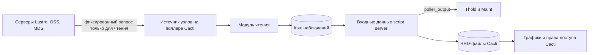

<!-- Source: README.md; SHA256: e88d6875d113220a91cfc0a9d230c829a78477b17e6aa7e44dda38c9591c86ad -->

<!-- translations:start -->
[English](../../../README.md) | [简体中文](../zh-CN/README.md) | [हिन्दी](../hi-IN/README.md) | [Español (España)](../es-ES/README.md) | [Español (Latinoamérica)](../es-419/README.md) | [العربية (السعودية)](../ar-SA/README.md) | [Afrikaans](../af-ZA/README.md) | [አማርኛ](../am-ET/README.md) | [العربية (مصر)](../ar-EG/README.md) | [العربية (المغرب)](../ar-MA/README.md) | [বাংলা](../bn-BD/README.md) | [Bosanski](../bs-BA/README.md) | [Deutsch](../de-DE/README.md) | [فارسی](../fa-IR/README.md) | [Filipino](../fil-PH/README.md) | [Français](../fr-FR/README.md) | [Français (Maroc)](../fr-MA/README.md) | [Français (Sénégal)](../fr-SN/README.md) | [Hausa](../ha-NG/README.md) | [עברית](../he-IL/README.md) | [Hrvatski](../hr-HR/README.md) | [Bahasa Indonesia](../id-ID/README.md) | [Igbo](../ig-NG/README.md) | [Italiano](../it-IT/README.md) | [日本語](../ja-JP/README.md) | [한국어](../ko-KR/README.md) | [Malagasy](../mg-MG/README.md) | [मराठी](../mr-IN/README.md) | [Bahasa Melayu](../ms-MY/README.md) | [Nederlands](../nl-NL/README.md) | [Polski](../pl-PL/README.md) | [Português (Brasil)](../pt-BR/README.md) | [Русский](README.md) | [Kinyarwanda](../rw-RW/README.md) | [Soomaali](../so-SO/README.md) | [Српски](../sr-RS/README.md) | [Svenska](../sv-SE/README.md) | [Kiswahili](../sw-KE/README.md) | [தமிழ்](../ta-IN/README.md) | [తెలుగు](../te-IN/README.md) | [ไทย](../th-TH/README.md) | [Türkçe](../tr-TR/README.md) | [Українська](../uk-UA/README.md) | [اردو](../ur-PK/README.md) | [Tiếng Việt](../vi-VN/README.md) | [isiXhosa](../xh-ZA/README.md) | [Yorùbá](../yo-NG/README.md) | [繁體中文](../zh-TW/README.md) | [isiZulu](../zu-ZA/README.md)
<!-- translations:end -->

# plugin_pfs

Плагин для Cacti 1.2, который передает в Cacti показатели состояния и нагрузки параллельных файловых систем: емкость и дисбаланс заполнения между таргетами, пропускную способность по каждому таргету и частоту операций с метаданными. Первым бэкендом является Lustre. Поддержка GPFS (IBM Storage Scale) и BeeGFS будет реализована через единый интерфейс бэкендов. Данные поступают в обычные устройства, источники данных и графики Cacti, поэтому Thold и Maint выполняют оповещение и подавление уведомлений без каких-либо изменений.

> **Статус: этап 4 (milestone 4), код для фазы 1 завершен, релиз еще не выпущен.** Этапы 2 (базовая архитектура), 3 (мониторинг Lustre) и 4 (оповещения и подготовка к релизу) завершены в ветке `main` или находятся на ревью. Плагин устанавливается, обновляется и удаляется через API плагинов Cacti и отклоняет запуск на версиях PHP ниже 8.2. Фоновый процесс чтения на каждом поллере опрашивает серверы Lustre по SSH через фиксированный скрипт принудительной команды ([node/pfs-read.sh](../../../node/pfs-read.sh)) и кэширует инвентаризацию, состояние, емкость и счетчики вместе с метками их актуальности. Каждая файловая система представляется как устройство Cacti с запросами данных OST и MDT, пятью обзорными графиками, графиками по отдельным таргетам по требованию и сводным источником данных для Thold. Немодифицированные Thold v1.8.2 и Maint v1.3 срабатывают по сводным метрикам типа gauge и подавляют оповещения в сквозном тестовом прогоне; пороги Thold на счетчики не поддерживаются в Thold 1.8.2 ([docs/alerting.md](../../alerting.md)). Все проведенные на данный момент тесты выполнялись на заранее подготовленных выводах узлов во временном экземпляре Cacti: плагин еще не запускался на реальном узле Lustre. До выпуска релиза остаются открытыми: пилотные запуски на реальных файловых системах ([план пилотного тестирования](../../pilot-plan.md)), внешний аудит безопасности ([самопроверка безопасности](../../security-review.md)) и замеры масштабируемости на задокументированном оборудовании ([масштабирование](../../research/scale.md)). Версия 0.1.0 подготовлена в файле `INFO` и в [CHANGELOG.md](../../../CHANGELOG.md), но тег еще не создан.

## Роли доступа

| Область (Realm) | Доступ |
| --- | --- |
| Parallel Filesystem View | Существующие страницы мониторинга. |
| Parallel Filesystem Operator | Мониторинг, а также страница Operations и персональные подтверждения при первичном разборе. |
| Parallel Filesystem Admin | Доступ оператора, а также существующие настройки и административные действия. |

После копирования файлов обновления откройте страницу Plugins от имени администратора, чтобы зарегистрировать
новую область (realm). Назначьте область Operator явно в разделе **Configuration > Users** или в группах пользователей.
При обновлении сохраняются существующие идентификаторы и права доступа для областей View и Admin. Доступ Admin
наследует доступ Operator, а доступ Operator наследует доступ View при каждом запросе;
при этом пользователям или группам не добавляются дополнительные сохраненные права. Для изменения настроек плагина также требуется
доступ Parallel Filesystem Admin в дополнение к праву Settings в Cacti.

Права доступа к устройствам Cacti по-прежнему ограничивают строки и действия, доступные каждому пользователю; для работы с непривязанными объектами требуется администратор.
Учетные данные, конфигурация, сопоставление, удаление и другие административные изменения
остаются на административных страницах. Подтверждения действуют только в рамках текущей
сессии пользователя, не более одного часа и только до тех пор, пока то же самое наблюдение остается
актуальным. Новые или изменившиеся наблюдения аннулируют их. Они никогда не помечают неудавшееся
измерение как исправное и не подавляют оповещения.

## Зачем это нужно

Когда общая файловая система работает медленно, данные о причинах оказываются распределены по серверам. Lustre хранит свои счетчики на каждом узле отдельно: `lctl get_param` возвращает значения «на локальном узле», поэтому каждый сервер объектного хранения (OSS) и сервер метаданных (MDS) содержит показатели только своих таргетов. Оператору, расследующему замедление работы файловой системы, нужны три ответа из разных источников:

- **Один из таргетов заполняется, пока остальные пустуют?** Дисбаланс заполнения влияет на то, куда попадают новые файлы и когда на отдельном таргете закончится место.
- **Какие таргеты или операции перегружены?** Счетчики байтов по каждому таргету и счетчики операций по каждому MDT показывают, чем вызвана нагрузка — операциями с данными или с метаданными.
- **Актуальны ли сами данные мониторинга?** Ровный график обнадеживает только в том случае, если плагин действительно имел доступ к серверам.

Cacti строит графики для хостов и отслеживает пороговые значения через Thold, а в организации Cacti на GitHub отсутствует репозиторий для мониторинга Lustre, GPFS или BeeGFS (по результатам поиска от 2026-11-14). Плагин закрывает этот пробел, считывая с узлов хранения разрешенные значения в режиме «только чтение» и представляя каждую файловую систему как устройство Cacti, таргеты которого являются индексами запроса данных. Он повторно использует подсистемы построения графиков, прав доступа, удаленных сборщиков данных Cacti, а также Thold и Maint, вместо того чтобы создавать их параллельные аналоги.

## Планируемый охват

| Фаза | Охват | Этапы |
|---|---|---|
| 0, исследование | Матрица релизов, выбор способа доступа к узлам, подтверждение поведения апстрима, поведение счетчиков и переключения при отказе, замеры масштабируемости | [M1](https://github.com/somethingwithproof/plugin_pfs/milestone/1) |
| 1, наблюдение | Инвентаризация Lustre, емкость и заполнение, пропускная способность OST, частота операций MDT, графики, оповещения Thold, подавление в Maint, страница состояния | [M2](https://github.com/somethingwithproof/plugin_pfs/milestone/2), [M3](https://github.com/somethingwithproof/plugin_pfs/milestone/3), [M4](https://github.com/somethingwithproof/plugin_pfs/milestone/4) |
| 2, детализация | Удаленные сборщики данных Cacti, представления на уровне заданий и клиентов в пределах ограниченного числа объектов | [M5](https://github.com/somethingwithproof/plugin_pfs/milestone/5) |
| 3, бэкенды | Бэкенды для GPFS (IBM Storage Scale) и BeeGFS | [M6](https://github.com/somethingwithproof/plugin_pfs/milestone/6) |

Вне рамок проекта: любые операции записи, очистки, сброса или тонкой настройки на узле или файловой системе; собственный движок оповещений внутри плагина; отдельный демон или собственный сетевой протокол; источники данных для каждого отдельного задания; изменения в ядре Cacti, Thold или Maint.

## Целевая совместимость

| Компонент | Целевая версия |
|---|---|
| Cacti | 1.2.31 или новее, без патчей ядра |
| PHP | 8.2 или новее; файл `setup.php` сохраняет совместимость по синтаксису с 8.0, чтобы при неподдерживаемой среде выполнения выводился отказ вместо поломки интерфейса Cacti |
| Lustre | Поддерживаемые ветки релизов будут определены к этапу 1; проверенные на данный момент исходный код и руководства относятся к версии 2.17.0 |
| GPFS, BeeGFS | Фаза 3; поддерживаемые релизы будут определены по итогам исследования |
| Thold, Maint | Изменения не требуются |

## Архитектура

- [docs/PLAN.md](../../PLAN.md) — полный план: архитектура, факты об апстриме, на которые она опирается (с указанием источников и того, что еще не проверено), семантика счетчиков, модель состояний, границы безопасности, расчеты производительности, тестирование и риски.
- [docs/operator-guide.md](../../operator-guide.md) охватывает установку, графики и показатели, обновление, резервное копирование и восстановление, удаление и устранение неполадок; [docs/alerting.md](../../alerting.md) описывает работу с Thold и Maint.
- [docs/node-setup.md](../../node-setup.md) описывает подготовку сервера Lustre и поллера для работы модуля чтения.
- В [docs/decisions/](../../decisions) хранятся записи об архитектурных решениях по уже принятым выборам.
- [docs/REQUIREMENTS.md](../../REQUIREMENTS.md) сопоставляет каждый идентификатор требования с соответствующей задачей.

## Отслеживание работы

- **Этапы** соответствуют этапам плана. Для каждого создана обобщающая задача со списком подзадач и критериями завершения.
- **Задачи** типизированы метками: `type: requirement`, `type: research`, `type: decision`, `type: epic`. Задачи с требованиями содержат нумерованные проверяемые требования (`REQ-AREA-NNN`) и критерии приемки.
- **Метки** также указывают на `area:`, `phase:`, `priority:` и `status:`. Подробнее см. [CONTRIBUTING.md](../../../CONTRIBUTING.md#labels).
- На [доске проекта](https://github.com/users/somethingwithproof/projects/11) отображаются все задачи по всем этапам.

## Участие в разработке

Прочитайте [CONTRIBUTING.md](../../../CONTRIBUTING.md). Для коммитов требуется подпись DCO. Обсуждение архитектуры ведется в задачах; открытые решения помечены меткой `type: decision`.

## Безопасность

Сообщайте об уязвимостях конфиденциально; подробнее см. [SECURITY.md](../../../SECURITY.md).

## Лицензия

GNU General Public License v2.0 — та же лицензия, что и у Cacti и ее плагинов. См. [LICENSE](../../../LICENSE).
