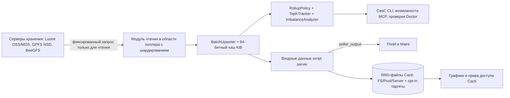

<!-- Source: README.md; SHA256: e88d6875d113220a91cfc0a9d230c829a78477b17e6aa7e44dda38c9591c86ad -->

<!-- translations:start -->
[English](../../../README.md) | [简体中文](../zh-CN/README.md) | [हिन्दी](../hi-IN/README.md) | [Español (España)](../es-ES/README.md) | [Español (Latinoamérica)](../es-419/README.md) | [العربية (السعودية)](../ar-SA/README.md) | [Afrikaans](../af-ZA/README.md) | [አማርኛ](../am-ET/README.md) | [العربية (مصر)](../ar-EG/README.md) | [العربية (المغرب)](../ar-MA/README.md) | [Български](../bg-BG/README.md) | [বাংলা](../bn-BD/README.md) | [Bosanski](../bs-BA/README.md) | [Deutsch](../de-DE/README.md) | [Ελληνικά](../el-GR/README.md) | [فارسی](../fa-IR/README.md) | [Filipino](../fil-PH/README.md) | [Français](../fr-FR/README.md) | [Français (Maroc)](../fr-MA/README.md) | [Français (Sénégal)](../fr-SN/README.md) | [Hausa](../ha-NG/README.md) | [עברית](../he-IL/README.md) | [Hrvatski](../hr-HR/README.md) | [Bahasa Indonesia](../id-ID/README.md) | [Igbo](../ig-NG/README.md) | [Italiano](../it-IT/README.md) | [日本語](../ja-JP/README.md) | [ქართული](../ka-GE/README.md) | [한국어](../ko-KR/README.md) | [Latviešu](../lv-LV/README.md) | [Malagasy](../mg-MG/README.md) | [मराठी](../mr-IN/README.md) | [Bahasa Melayu](../ms-MY/README.md) | [Nederlands](../nl-NL/README.md) | [Polski](../pl-PL/README.md) | [Português (Brasil)](../pt-BR/README.md) | [Português (Portugal)](../pt-PT/README.md) | [Русский](README.md) | [Kinyarwanda](../rw-RW/README.md) | [Soomaali](../so-SO/README.md) | [Српски](../sr-RS/README.md) | [Svenska](../sv-SE/README.md) | [Kiswahili](../sw-KE/README.md) | [தமிழ்](../ta-IN/README.md) | [తెలుగు](../te-IN/README.md) | [ไทย](../th-TH/README.md) | [Türkçe](../tr-TR/README.md) | [Українська](../uk-UA/README.md) | [اردو](../ur-PK/README.md) | [Tiếng Việt](../vi-VN/README.md) | [isiXhosa](../xh-ZA/README.md) | [Yorùbá](../yo-NG/README.md) | [繁體中文](../zh-TW/README.md) | [isiZulu](../zu-ZA/README.md)
<!-- translations:end -->

# plugin_pfs

Плагин для Cacti 1.2, который передает в Cacti показатели состояния, емкости, дисбаланса заполнения, пропускной способности по каждому таргету и частоты операций с метаданными параллельных файловых систем Lustre, IBM Storage Scale (GPFS) и BeeGFS за единым интерфейсом `Backend`. Каждая файловая система отображается в обычное устройство Cacti с запросами данных, обзорными и запрашиваемыми по требованию графиками таргетов, а также сводными метриками, поэтому Thold и Maint выполняют оповещение и подавление уведомлений без каких-либо изменений.

> **Статус: фазы с 1 по 3 и примитивы масштабирования до эксабайтного уровня реализованы в коде, релиз еще не выпущен.** Базовая архитектура, мониторинг Lustre, оповещения и подавление в Maint, драйверы только для чтения для GPFS и BeeGFS, анализ дисбаланса OST/MDT с интеграцией Maint, привязка удаленных сборщиков данных к поллеру (`replicate_out`, `remote_agent`), примитивы масштабирования на 100+ ПБ / эксабайтный уровень (`FramedReportParser`, схема v4 `value_kib`, `RollupPolicy`, `TopKTracker`, `ShardAssigner`, `BatchUpserter`), операторский CasC CLI (`cli/pfs.php`) и точки расширения экосистемы (`abilities_register`, `doctor_register_checks`, `casc_register_providers`) реализованы и проверены модульными тестами, тестами безопасности и интеграционными тестами во временном экземпляре Cacti. Все запуски до настоящего момента выполнялись на тестовых данных узлов (fixture) вместо реального оборудования Lustre, GPFS или BeeGFS. До выпуска тега релиза остаются открытыми: пилотные запуски на реальных файловых системах ([план пилотного тестирования](../../pilot-plan.md)), внешний аудит безопасности ([самопроверка безопасности](../../security-review.md)) и замеры масштабируемости на задокументированном оборудовании ([масштабирование](../../research/scale.md)). Версия 0.1.0 подготовлена в файле `INFO` и в [CHANGELOG.md](../../../CHANGELOG.md), но тег еще не создан.

## Роли доступа

| Область (Realm) | Доступ |
| --- | --- |
| Parallel Filesystem View | Существующие страницы мониторинга. |
| Parallel Filesystem Operator | Мониторинг, а также страница Operations и персональные подтверждения при первичном разборе. |
| Parallel Filesystem Admin | Доступ оператора, а также существующие настройки и административные действия. |

После копирования файлов обновления откройте страницу Plugins от имени администратора, чтобы зарегистрировать
новую область (realm). Назначьте область Operator явно в разделе **Configuration > Users** или в группах пользователей.
При обновлении сохраняются существующие идентификаторы и права доступа для областей View и Admin. Доступ Admin
наследует доступ Operator, а доступ Operator наследует доступ View при каждом запросе;
при этом пользователям или группам не добавляются дополнительные сохраненные права. Для изменения настроек плагина также требуется
доступ Parallel Filesystem Admin в дополнение к праву Settings в Cacti.

Права доступа к устройствам Cacti по-прежнему ограничивают строки и действия, доступные каждому пользователю; для работы с непривязанными объектами требуется администратор.
Учетные данные, конфигурация, сопоставление, удаление и другие административные изменения
остаются на административных страницах. Подтверждения действуют только в рамках текущей
сессии пользователя, не более одного часа и только до тех пор, пока то же самое наблюдение остается
актуальным. Новые или изменившиеся наблюдения аннулируют их. Они никогда не помечают неудавшееся
измерение как исправное и не подавляют оповещения.

## Зачем это нужно

Когда общая файловая система работает медленно, данные о причинах оказываются распределены по серверам. Lustre хранит свои счетчики на каждом узле отдельно: `lctl get_param` возвращает значения «на локальном узле», поэтому каждый сервер объектного хранения (OSS) и сервер метаданных (MDS) содержит показатели только своих таргетов. Оператору, расследующему замедление работы файловой системы, нужны три ответа из разных источников:

- **Один из таргетов заполняется, пока остальные пустуют?** Дисбаланс заполнения влияет на то, куда попадают новые файлы и когда на отдельном таргете закончится место.
- **Какие таргеты или операции перегружены?** Счетчики байтов по каждому таргету и счетчики операций по каждому MDT показывают, чем вызвана нагрузка: операциями с данными или с метаданными.
- **Актуальны ли сами данные мониторинга?** Ровный график обнадеживает только в том случае, если плагин действительно имел доступ к серверам.

Cacti строит графики для хостов и отслеживает пороговые значения через Thold, а в организации Cacti на GitHub отсутствует репозиторий для мониторинга Lustre, GPFS или BeeGFS (по результатам поиска от 2026-11-14). Плагин закрывает этот пробел, считывая с узлов хранения разрешенные значения в режиме «только чтение» и представляя каждую файловую систему как устройство Cacti, таргеты которого являются индексами запроса данных. Он повторно использует подсистемы построения графиков, прав доступа, удаленных сборщиков данных Cacti, а также Thold и Maint, вместо того чтобы создавать их параллельные аналоги.

## Планируемый охват

| Фаза | Охват | Статус | Этапы |
|---|---|---|---|
| 0, исследование | Матрица релизов, выбор способа доступа к узлам, подтверждение поведения апстрима, поведение счетчиков и переключения при отказе, замеры масштабируемости | Завершено | [M1](https://github.com/somethingwithproof/plugin_pfs/milestone/1) |
| 1, наблюдение | Инвентаризация Lustre, емкость и заполнение, дисбаланс OST/MDT (`lib/ImbalanceAnalyzer.php`), интеграция с Maint (`lib/HealthPage.php`), пропускная способность OST, частота операций MDT, графики, оповещения Thold, страница состояния | Реализовано (протестировано на фикстурах) | [M2](https://github.com/somethingwithproof/plugin_pfs/milestone/2), [M3](https://github.com/somethingwithproof/plugin_pfs/milestone/3), [M4](https://github.com/somethingwithproof/plugin_pfs/milestone/4) |
| 2, удаленный сбор и масштаб | Удаленный сбор в области поллера (`lib/Reader.php`, `lib/ReplicationRepository.php`, `replicate_out`, `remote_agent`), примитивы масштабирования на 100+ ПБ (64-битная точность KiB + схема v4 `value_kib`, `lib/RollupPolicy.php`, `lib/TopKTracker.php`, `lib/ShardAssigner.php` + `poller_pfs.php --shard=K/N`, `lib/BatchUpserter.php`), CasC CLI (`cli/pfs.php`), хуки MCP/Doctor/CasC | Реализовано (модульные и интеграционные тесты в CI) | [M5](https://github.com/somethingwithproof/plugin_pfs/milestone/5) |
| 3, бэкенды | Драйверы только для чтения IBM Storage Scale (GPFS) (`lib/GpfsBackend.php`) и BeeGFS (`lib/BeegfsBackend.php`), зарегистрированные в `BackendRegistry::production()` | Реализовано (модульные тесты) | [M6](https://github.com/somethingwithproof/plugin_pfs/milestone/6) |

Ключевые реализованные примитивы эксплуатации и масштабирования:

- **Драйверы только для чтения для нескольких файловых систем:** `LustreBackend`, `GpfsBackend` (только кадрированный вывод `mmpmon` `fs_io_s`/`io_s` с запретом `reset`, емкость/состояния пулов `mmdf` и сводки ожидающих операций) и `BeegfsBackend` (таргеты хранения/метаданных BeeGFS 7.4 и 8.x с точным переводом байтов в KiB, сопоставлением состояний доступности/согласованности и поинтервальной семантикой метрик), использующие общий `lib/FramedReportParser.php`.
- **Учет дисбаланса, запаса емкости и окон Maint:** `lib/ImbalanceAnalyzer.php` вычисляет коэффициенты заполнения OST/MDT, разброс, индекс дисбаланса на основе стандартного отклонения совокупности, запас емкости (headroom), контроль актуальности в 1 интервал (`missing_targets`), флаги состояния по каждому таргету и ограниченный Top-K перегруженных таргетов. `HealthPage` (`pfs_health.php`) и `CascProvider::health()` отображают окна обслуживания Cacti `Maint` и подавляют активные предупреждения о сбоях во время планового обслуживания.
- **Масштабирование до 100+ ПБ и эксабайтного уровня** ([docs/architecture/exascale-scaling.md](../../architecture/exascale-scaling.md)): точный десятичный перевод байтов в KiB (`FramedReportParser::bytesToKibInt()`), проверенный на объемах 500 ПБ и 2 ЭБ, наряду со столбцами `BIGINT UNSIGNED value_kib` (схема v4); иерархические агрегации RRD `Filesystem -> Pool -> Storage Server` с ограниченным повышением opt-in/горячих/перекошенных таргетов (`lib/RollupPolicy.php`); ограниченные $O(K)$ Top-K перекошенных таргетов и предварительно агрегированные сводки тяжелых заданий и клиентов (`lib/TopKTracker.php`, без создания устройств или RRD на каждого клиента); детерминированное шардирование сборщиков на базе CRC32 (`lib/ShardAssigner.php`, `php plugins/pfs/poller_pfs.php [--poller=N] [--shard=K/N] [--force] [--debug]`); и пакетные SQL upsert по 500 строк в сочетании с keyset-пагинацией (`lib/BatchUpserter.php`, `CacheRepository::upsertObservationsBatch()`, `TargetRepository::forFilesystemPage()`).
- **Операторский CasC CLI и хуки экосистемы:** `cli/pfs.php` поддерживает `export [--format=yaml|xml]`, `validate <file> [--format=yaml|xml]`, `plan <file> [--format=yaml|xml] [--output=text|json]`, `apply <file> --confirm=<PLAN_HASH> [--format=yaml|xml]` и `health [--format=text|json]` без внешних зависимостей Composer. `setup.php` и `lib/EcosystemIntegration.php` регистрируют `abilities_register` (`pfs-list-filesystems`, `pfs-get-imbalance`, `pfs-get-health`; только чтение, ограничено правом `Parallel Filesystem View` и правами доступа к устройствам Cacti), `doctor_register_checks` (`pfs_schema`, `pfs_reader_freshness`, `pfs_capacity_imbalance`), `casc_register_providers`, `replicate_out` и `remote_agent`.

Вне рамок проекта: любые операции записи, очистки, сброса или тонкой настройки на узле или файловой системе; собственный движок оповещений внутри плагина; отдельный демон или собственный сетевой протокол; устройства/RRD Cacti для каждого отдельного задания или клиента; изменения в ядре Cacti, Thold или Maint.

## Целевая совместимость

| Компонент | Целевая версия |
|---|---|
| Cacti | 1.2.31 или новее, без патчей ядра |
| PHP | 8.2 или новее; файлы `setup.php`, `poller_pfs.php` и `cli/pfs.php` сохраняют совместимость по синтаксису с 8.0, чтобы при неподдерживаемой среде выполнения выводился отказ вместо поломки интерфейса Cacti |
| Lustre | Исходный код и руководства проверены на версии 2.17.0; протестировано на фикстурах |
| GPFS, BeeGFS | Драйверы только для чтения IBM Storage Scale (GPFS) 5.x `mmpmon`/`mmdf` и BeeGFS 7.4 / 8.x реализованы и протестированы на фикстурах |
| Thold, Maint | Thold 1.8.2 и Maint 1.3, без изменений |

## Архитектура

- [docs/architecture/exascale-scaling.md](../../architecture/exascale-scaling.md) документирует двухуровневую архитектуру телеметрии для 100+ ПБ / эксабайтного уровня (уровень сервера Cacti/`plugin_pfs` + агрегация + Top-K в сочетании с внеполосной клиентской телеметрией LDMS/Darshan/TOKIO) и ее контекст в научной литературе.
- [docs/PLAN.md](../../PLAN.md) представляет собой полный план: архитектура, факты об апстриме, на которые она опирается (с указанием источников и того, что еще не проверено), семантика счетчиков, модель состояний, границы безопасности, расчеты производительности, тестирование и риски.
- [docs/operator-guide.md](../../operator-guide.md) охватывает установку, графики и показатели, обновление, резервное копирование и восстановление, удаление и устранение неполадок; [docs/alerting.md](../../alerting.md) описывает работу с Thold и Maint.
- [docs/node-setup.md](../../node-setup.md) описывает подготовку сервера Lustre и поллера для работы модуля чтения.
- В [docs/decisions/](../../decisions) хранятся записи об архитектурных решениях по уже принятым выборам.
- [docs/REQUIREMENTS.md](../../REQUIREMENTS.md) сопоставляет каждый идентификатор требования с соответствующей задачей.

## Отслеживание работы

- **Этапы** соответствуют этапам плана. Для каждого создана обобщающая задача со списком подзадач и критериями завершения.
- **Задачи** типизированы метками: `type: requirement`, `type: research`, `type: decision`, `type: epic`. Задачи с требованиями содержат нумерованные проверяемые требования (`REQ-AREA-NNN`) и критерии приемки.
- **Метки** также указывают на `area:`, `phase:`, `priority:` и `status:`. Подробнее см. [CONTRIBUTING.md](../../../CONTRIBUTING.md#labels).
- На [доске проекта](https://github.com/users/somethingwithproof/projects/11) отображаются все задачи по всем этапам.

## Участие в разработке

Прочитайте [CONTRIBUTING.md](../../../CONTRIBUTING.md). Для коммитов требуется подпись DCO. Обсуждение архитектуры ведется в задачах; открытые решения помечены меткой `type: decision`.

## Безопасность

Сообщайте об уязвимостях конфиденциально; подробнее см. [SECURITY.md](../../../SECURITY.md).

## Лицензия

GNU General Public License v2.0, та же лицензия, что и у Cacti и ее плагинов. См. [LICENSE](../../../LICENSE).
