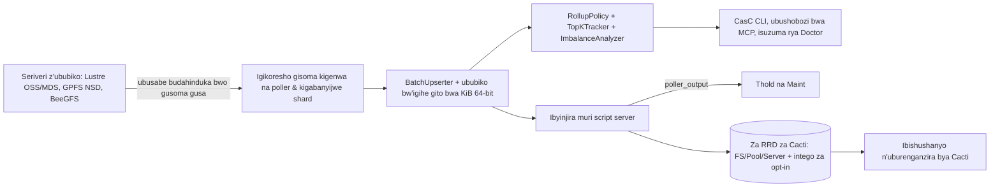

<!-- Source: README.md; SHA256: e88d6875d113220a91cfc0a9d230c829a78477b17e6aa7e44dda38c9591c86ad -->

<!-- translations:start -->
[English](../../../README.md) | [简体中文](../zh-CN/README.md) | [हिन्दी](../hi-IN/README.md) | [Español (España)](../es-ES/README.md) | [Español (Latinoamérica)](../es-419/README.md) | [العربية (السعودية)](../ar-SA/README.md) | [Afrikaans](../af-ZA/README.md) | [አማርኛ](../am-ET/README.md) | [العربية (مصر)](../ar-EG/README.md) | [العربية (المغرب)](../ar-MA/README.md) | [বাংলা](../bn-BD/README.md) | [Bosanski](../bs-BA/README.md) | [Deutsch](../de-DE/README.md) | [فارسی](../fa-IR/README.md) | [Filipino](../fil-PH/README.md) | [Français](../fr-FR/README.md) | [Français (Maroc)](../fr-MA/README.md) | [Français (Sénégal)](../fr-SN/README.md) | [Hausa](../ha-NG/README.md) | [עברית](../he-IL/README.md) | [Hrvatski](../hr-HR/README.md) | [Bahasa Indonesia](../id-ID/README.md) | [Igbo](../ig-NG/README.md) | [Italiano](../it-IT/README.md) | [日本語](../ja-JP/README.md) | [한국어](../ko-KR/README.md) | [Malagasy](../mg-MG/README.md) | [मराठी](../mr-IN/README.md) | [Bahasa Melayu](../ms-MY/README.md) | [Nederlands](../nl-NL/README.md) | [Polski](../pl-PL/README.md) | [Português (Brasil)](../pt-BR/README.md) | [Русский](../ru-RU/README.md) | [Kinyarwanda](README.md) | [Soomaali](../so-SO/README.md) | [Српски](../sr-RS/README.md) | [Svenska](../sv-SE/README.md) | [Kiswahili](../sw-KE/README.md) | [தமிழ்](../ta-IN/README.md) | [తెలుగు](../te-IN/README.md) | [ไทย](../th-TH/README.md) | [Türkçe](../tr-TR/README.md) | [Українська](../uk-UA/README.md) | [اردو](../ur-PK/README.md) | [Tiếng Việt](../vi-VN/README.md) | [isiXhosa](../xh-ZA/README.md) | [Yorùbá](../yo-NG/README.md) | [繁體中文](../zh-TW/README.md) | [isiZulu](../zu-ZA/README.md)
<!-- translations:end -->

# plugin_pfs

Umugereka wa Cacti 1.2 uzana muri Cacti amakuru y'ubuzima, ubushobozi bwo kubika, ubusumbane bw'ikuzura, umuvuduko w'amakuru kuri buri ntego, n'igipimo cy'ibikorwa kuri metadata by'ububiko bw'amadosiye bukora mu buryo buteganye kuri Lustre, IBM Storage Scale (GPFS), na BeeGFS binyuze inyuma y'umurongo uhuza wa `Backend` umwe. Buri bubiko bw'amadosiye buhuzwa n'igikoresho cya Cacti gisanzwe gifite ibibazo by'amakuru, ibishushanyo by'incamake n'ibishushanyo bya buri ntego bisabwe, hamwe n'ibipimo by'incamake ku buryo Thold na Maint bitanga impuruza kandi bikazihagarika by'igihe gito nta gihindutse.

> **Imiterere: ibyiciro kuva ku cya 1 kugeza ku cya 3 n'ibikoresho fatizo byo kwagura kuri exascale byarashyizwe muri kode, ntibirashyirwa hanze.** Urufatiro, ugukurikirana Lustre, gutanga impuruza no guhagarika kwa Maint, za driver zo gusoma gusa za GPFS na BeeGFS, isesengura ry'ubusumbane bwa OST/MDT rihujwe na Maint, kugena urwego rw'abakusanya amakuru ba kure (`replicate_out`, `remote_agent`), ibikoresho fatizo byo kwagura 100+ PB / exascale (`FramedReportParser`, Schema v4 `value_kib`, `RollupPolicy`, `TopKTracker`, `ShardAssigner`, `BatchUpserter`), CLI ya CasC y'umukoresha (`cli/pfs.php`), n'ibyuma by'isano y'uburyo (`abilities_register`, `doctor_register_checks`, `casc_register_providers`) byarashyizweho kandi byemejwe n'isuzuma ry'ibice, iry'umutekano, n'iry'ihurizwa muri Cacti ishobora guhanagurwa. Isuzuma ryose kugeza ubu rikoresha ibisohoka by'imfashanyigisho bya node aho gukoresha ibikoresho nyabyo bya Lustre, GPFS, cyangwa BeeGFS. Ibikirindiriwe mbere yo gutanga ikimenyetso cy'isohora: igerageza ku bubiko bw'amadosiye nyabwo ([gahunda y'igerageza](../../pilot-plan.md)), isuzuma ry'umutekano rikorwa n'abo hanze ([isuzuma bwite](../../security-review.md)), n'ipima ry'ubushobozi ku bikoresho byanditswe ([ubushobozi n'ingano](../../research/scale.md)). Verisiyo 0.1.0 yateguwe muri `INFO` na [CHANGELOG.md](../../../CHANGELOG.md) ariko ntabwo irashyirwaho tag.

## Inshingano z'uburenganzira

| Urwego (Realm) | Uburenganzira |
| --- | --- |
| Parallel Filesystem View | Amapaji yo gukurikirana asanzwe ariho. |
| Parallel Filesystem Operator | Gukurikirana hamwe n'ipaji y'ibikorwa (Operations) no kwemeza ko umuntu ku giti cye yiboneye ikibazo (triage acknowledgments). |
| Parallel Filesystem Admin | Uburenganzira bwa Operator hamwe n'ibikorwa bisanzwe byo gutunganya igenamiterere n'ubuyobozi. |

Nyuma yo gukoporora amadosiye y'ivugurura, fungura ipaji ya Plugins nk'umuyobozi (administrator) kugira ngo wandikishe urwego rushya. Ha umuntu urwego rwa Operator ku buryo bweruye munsi ya **Configuration > Users** cyangwa amatsinda y'abakoresha. Amavugurura agumana nimero ziranga (IDs) n'uburenganzira bisanzwe bya View na Admin. Uburenganzira bwa Admin bukomora ubwa Operator, kandi uburenganzira bwa Operator bukomora ubwa View kuri buri busabe; ibi ntibyiyongeza mu burenganzira bubitswe ku bakoresha cyangwa amatsinda. Igenamiterere ry'umugereka na ryo risaba uburenganzira bwa Parallel Filesystem Admin hiyongereyeho uruhushya rwa Settings rwa Cacti.

Uburenganzira bw'ibikoresho bya Cacti bukomeza kugabanya imirongo n'ibikorwa biboneka kuri buri mukoresha; ibintu bitarahuzwa bisaba umuyobozi. Ibimenyetso by'ibanga (credentials), igenamiterere, guhuza (mapping), gusiba n'izindi mpinduka z'ubuyobozi biguma mu mapaji y'ubuyobozi. Kwemeza ko wabonye ikibazo (acknowledgments) bimara gusa mu gihe cy'ifungura ririho ry'umukoresha, igihe kitarenze isaha imwe kandi gusa mu gihe rya genzura rimwe rikiri rishya. Igenzura rishya cyangwa ryahindutse rirabitesha agaciro. Ntibishobora na rimwe kwerekana ko igipimo cyapfuye kimeze neza cyangwa guhagarika impuruza.

## Impamvu

Iyo ububiko bw'amadosiye buhuriweho bugenda buhoro, ibimenyetso biba bitatanye kuri seriveri zitandukanye. Lustre ibika ibipimo byayo bibara kuri buri node: `lctl get_param` itanga imibare "kuri node y'imbere", bityo buri seriveri ibika ibintu (object storage server - OSS) na seriveri ya metadata (metadata server - MDS) ibika gusa imibare y'intego zayo bwite. Umukoresha ukora isuzuma ku bubiko bw'amadosiye bugenda buhoro aba akeneye ibisubizo bitatu biva ahantu hatandukanye:

- **Ese hari intego imwe irimo kwuzura mu gihe izindi zirimo ubusa?** Ubusumbane bw'ikuzura buhindura aho amadosiye mashya ajya n'igihe intego imwe ishiriramo umwanya.
- **Ni izihe ntego cyangwa ibikorwa bifite akazi kenshi?** Ibipimo bya byte kuri buri ntego n'ibipimo by'ibikorwa kuri buri MDT byerekana niba umutwaro uterwa n'amakuru nyirizina cyangwa metadata.
- **Ese ubwabyo igukurikirana rigezweho?** Igishushanyo kidahinduka gihumuriza gusa iyo umugereka wari ushoboye kubona seriveri.

Cacti ishushanya seriveri kandi igashyiraho imipaka y'imibare ikoresheje Thold, kandi umuryango wa Cacti kuri GitHub nta bubiko (repository) ufite bwo gukurikirana Lustre, GPFS, cyangwa BeeGFS (byashakishijwe ku ya 2026-11-14). Uyu mugereka uziba icyo cyuho usoma imibare yemewe ku rutonde (allowlisted) kandi yo gusoma gusa iturutse kuri za node z'ububiko kandi ukagaragaza buri bubiko bw'amadosiye nk'igikoresho cya Cacti gifite intego ziba ari imibare ndangamimerere (indexes) y'ikibazo cy'amakuru (data query). Ukoresha bundi bushya uburyo bwa Cacti bwo gushushanya, uburenganzira, abakusanya amakuru ba kure (remote data collectors), Thold, na Maint aho kubaka ibindi bisa na byo.

## Ibikorwa biteganyijwe

| Icyiciro | Ibikubiyemo | Imiterere | Intambwe (Milestones) |
|---|---|---|---|
| 0, ubushakashatsi | Urutonde rwa verisiyo zisohoka, icyemezo ku buryo bwo kugera kuri node, kwemeza imikorere y'isoko nkuru (upstream), imikorere y'ibipimo bibara no gusimburana igihe habaye ikibazo (failover), ipima ry'ubushobozi | Byararangiye | [M1](https://github.com/somethingwithproof/plugin_pfs/milestone/1) |
| 1, gukurikirana | Urutonde rw'ibikoresho bya Lustre, ubushobozi n'ikuzura, ubusumbane bwa OST/MDT (`lib/ImbalanceAnalyzer.php`), guhuza na Maint (`lib/HealthPage.php`), umuvuduko wa OST, igipimo cy'ibikorwa bya MDT, ibishushanyo, impuruza za Thold, ipaji y'ubuzima | Byashyizwe mu bikorwa (byasuzumwe kuri fixture) | [M2](https://github.com/somethingwithproof/plugin_pfs/milestone/2), [M3](https://github.com/somethingwithproof/plugin_pfs/milestone/3), [M4](https://github.com/somethingwithproof/plugin_pfs/milestone/4) |
| 2, kure n'ubushobozi | Ikusanya rya kure rigenwa na poller (`lib/Reader.php`, `lib/ReplicationRepository.php`, `replicate_out`, `remote_agent`), ibikoresho fatizo byo kwagura 100+ PB (isuku ya KiB ya 64-bit + Schema v4 `value_kib`, `lib/RollupPolicy.php`, `lib/TopKTracker.php`, `lib/ShardAssigner.php` + `poller_pfs.php --shard=K/N`, `lib/BatchUpserter.php`), CasC CLI (`cli/pfs.php`), ibyuma bya MCP/Doctor/CasC | Byashyizwe mu bikorwa (byasuzumwe mu bice no muri CI) | [M5](https://github.com/somethingwithproof/plugin_pfs/milestone/5) |
| 3, za backend | Za driver zo gusoma gusa za IBM Storage Scale (GPFS) (`lib/GpfsBackend.php`) na BeeGFS (`lib/BeegfsBackend.php`) zanditswe muri `BackendRegistry::production()` | Byashyizwe mu bikorwa (byasuzumwe mu bice) | [M6](https://github.com/somethingwithproof/plugin_pfs/milestone/6) |

Ibikoresho fatizo by'ingenzi by'umukoresha no kwagura byashyizwe mu bikorwa:

- **Za driver zo gusoma gusa z'ububiko bwinshi bw'amadosiye:** `LustreBackend`, `GpfsBackend` (`mmpmon` yubatse mu ruziga ya `fs_io_s`/`io_s` gusa aho `reset` ibujijwe, ubushobozi/imiterere ya pool ya `mmdf`, n'incamake y'ibitegereje), na `BeegfsBackend` (intego zo kubika/metadata za BeeGFS 7.4 na 8.x zifite ihindura nyaryo riva kuri byte rijya kuri KiB, ihuza ry'imiterere y'ubushobozi bwo kugerwaho/ukubana, n'ibisobanuro by'ibipimo muri buri ntera) bisangiye `lib/FramedReportParser.php`.
- **Ubusumbane, umwanya usigaye, no kumenya Maint:** `lib/ImbalanceAnalyzer.php` ibara ibipimo by'ikuzura bya OST/MDT, itandukaniro, igipimo cy'ubusumbane gishingiye ku mibare rusange, umwanya usigaye (headroom), iyubahirizwa ry'ubushya bw'intera 1 (`missing_targets`), amabendera y'imiterere ya buri ntego, n'intego zisumbanye za Top-K zifite umupaka. `HealthPage` (`pfs_health.php`) na `CascProvider::health()` bigaragaza amadirishya y'isana rya `Maint` muri Cacti kandi bigahagarika impuruza z'ibibazo bikiriho mu gihe cy'isana ryateguwe.
- **Kwagura 100+ PB na exascale** ([docs/architecture/exascale-scaling.md](../../architecture/exascale-scaling.md)): ihindura nyaryo ryo mu buryo bwa desimali riva kuri byte rijya kuri KiB (`FramedReportParser::bytesToKibInt()`) ryemejwe kuri 500 PB na 2 EB hamwe n'inkingi za `BIGINT UNSIGNED value_kib` (Schema v4); ibyegeranyo bya RRD mu nzego za `Filesystem -> Pool -> Storage Server` bifite izamuka ry'intego za opt-in/zikoreshwa cyane/zisumbanye rifite umupaka (`lib/RollupPolicy.php`); intego zisumbanye za Top-K zifite umupaka $O(K)$ n'incamake z'imirimo/abakoresha baremereye ziteranijwe mbere (`lib/TopKTracker.php`, zitigera zirema ibikoresho cyangwa za RRD kuri buri mukoresha); igabanya rya sharding rya CRC32 ridahinduka ku bakusanya amakuru (`lib/ShardAssigner.php`, `php plugins/pfs/poller_pfs.php [--poller=N] [--shard=K/N] [--force] [--debug]`); n'iyinjiza rya SQL mu matsinda y'imirongo 500 riherekejwe na pagination ya keyset (`lib/BatchUpserter.php`, `CacheRepository::upsertObservationsBatch()`, `TargetRepository::forFilesystemPage()`).
- **CasC CLI y'umukoresha n'ibyuma by'isano y'uburyo:** `cli/pfs.php` ishyigikira `export [--format=yaml|xml]`, `validate <file> [--format=yaml|xml]`, `plan <file> [--format=yaml|xml] [--output=text|json]`, `apply <file> --confirm=<PLAN_HASH> [--format=yaml|xml]`, na `health [--format=text|json]` nta kindi gice cya Composer cyo hanze isabwa. `setup.php` na `lib/EcosystemIntegration.php` byandikisha `abilities_register` (`pfs-list-filesystems`, `pfs-get-imbalance`, `pfs-get-health`; gusoma gusa, bigenzurwa na `Parallel Filesystem View` n'uburenganzira bw'ibikoresho bya Cacti), `doctor_register_checks` (`pfs_schema`, `pfs_reader_freshness`, `pfs_capacity_imbalance`), `casc_register_providers`, `replicate_out`, na `remote_agent`.

Ibitari mu nshingano: igikorwa icyo ari cyo cyose cyo kwandika, gusiba, gusubiza inyuma (reset), cyangwa gutunganya imikorere kuri node cyangwa ku bubiko bw'amadosiye; moteri y'impuruza yihariwe n'umugereka; porogaramu ikora mu ibanga (daemon) cyangwa porotokole y'urusobemiyoboro yihariye; ibikoresho/za RRD za Cacti kuri buri kazi cyangwa buri mukoresha; impinduka kuri Cacti ubwayo, Thold, cyangwa Maint.

## Intego z'ubwuzuzanye

| Igice | Intego |
|---|---|
| Cacti | 1.2.31 cyangwa verisiyo zikurikiraho, nta mpinduka kuri kode fatizo |
| PHP | 8.2 cyangwa verisiyo zikurikiraho; `setup.php`, `poller_pfs.php`, na `cli/pfs.php` ziguma zisomeka kuri 8.0 kugira ngo igihe hakoreshejwe uburyo butemewe hakirwe ihakana aho kwangiza imigaragarire ya Cacti |
| Lustre | Kode n'ibitabo byasuzumwe kuri 2.17.0; byasuzumwe kuri fixture |
| GPFS, BeeGFS | Za driver zo gusoma gusa za IBM Storage Scale (GPFS) 5.x `mmpmon`/`mmdf` na BeeGFS 7.4 / 8.x zashyizwe mu bikorwa kandi zasuzumwe kuri fixture |
| Thold, Maint | Thold 1.8.2 na Maint 1.3, nta gihindutse |

## Imiterere n'ishusho mbonera

- [docs/architecture/exascale-scaling.md](../../architecture/exascale-scaling.md) yandika imiterere y'ikoranabuhanga rya telemetry ry'inzego ebyiri rya 100+ PB / exascale (seriveri ya Cacti/`plugin_pfs` + icyegeranyo + urwego rwa Top-K bihujwe na telemetry y'abakoresha yo hanze y'umurongo ya LDMS/Darshan/TOKIO) n'imiterere yayo mu nyandiko za kaminuza.
- [docs/PLAN.md](../../PLAN.md) ni gahunda yuzuye: imiterere y'ubwubatsi, amakuru y'isoko nkuru (upstream) ishingiyeho (hamwe n'amasoko n'ibitaragenzurwa), ibisobanuro by'ibipimo bibara, imiterere y'ibihe (state model), imipaka y'umutekano, imibare y'imikorere, isuzuma, n'ibyago.
- [docs/operator-guide.md](../../operator-guide.md) ikubiyemo gushyiramo (install), ibishushanyo n'imibare, kuvugurura, kubika no gusubiranya (backup and restore), gukuramo (uninstall), no gukemura ibibazo; [docs/alerting.md](../../alerting.md) ikubiyemo Thold na Maint.
- [docs/node-setup.md](../../node-setup.md) isobanura uko wategura seriveri ya Lustre na poller ku bw'igikoresho gisoma (reader).
- [docs/decisions/](../../decisions) ibika inyandiko z'ibyemezo by'imiterere y'ubwubatsi ku mahitamo yamaze gukorwa.
- [docs/REQUIREMENTS.md](../../REQUIREMENTS.md) ihuza buri nomero iranga ibisabwa n'ikibazo (issue) cyayo.

## Uko akazi gakurikiranwa

- **Ibyiciro (Milestones)** bikurikira ibyiciro bya gahunda. Buri kimwe gifite ikibazo kigenga (epic issue) kigaragaza ibibazo bito bikigize n'ibimenyetso byo gusohoka.
- **Ibibazo (Issues)** bishyirwa mu byiciro hakoreshejwe uturango (labels): `type: requirement`, `type: research`, `type: decision`, `type: epic`. Ibibazo by'ibisabwa bigaragaza ibisabwa bifite inomero kandi bishobora gusuzumwa (`REQ-AREA-NNN`) hamwe n'ibipimo byo kwemerwa.
- **Uturango (Labels)** tunatwara `area:`, `phase:`, `priority:`, na `status:`. Reba [CONTRIBUTING.md](../../../CONTRIBUTING.md#labels).
- [Ikibaho cy'umushinga](https://github.com/users/somethingwithproof/projects/11) kigaragaza ibibazo byose mu byiciro bitandukanye.

## Gutanga umusanzu

Soma [CONTRIBUTING.md](../../../CONTRIBUTING.md). Buri commit isaba gusinywa na DCO (DCO sign-off). Ibiganiro ku miterere n'ishusho mbonera bibera ku bibazo (issues); ibyemezo bitarafatwa bitwara akamenyetso ka `type: decision`.

## Umutekano

Tanga raporo y'intege nke mu ibanga; reba [SECURITY.md](../../../SECURITY.md).

## Uruhushya

GNU General Public License v2.0, uruhushya rumwe n'urwa Cacti n'imigereka yayo. Reba [LICENSE](../../../LICENSE).
