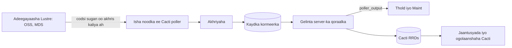

<!-- Source: README.md; SHA256: e88d6875d113220a91cfc0a9d230c829a78477b17e6aa7e44dda38c9591c86ad -->

<!-- translations:start -->
[English](../../../README.md) | [简体中文](../zh-CN/README.md) | [हिन्दी](../hi-IN/README.md) | [Español (España)](../es-ES/README.md) | [Español (Latinoamérica)](../es-419/README.md) | [العربية (السعودية)](../ar-SA/README.md) | [Afrikaans](../af-ZA/README.md) | [አማርኛ](../am-ET/README.md) | [العربية (مصر)](../ar-EG/README.md) | [العربية (المغرب)](../ar-MA/README.md) | [বাংলা](../bn-BD/README.md) | [Bosanski](../bs-BA/README.md) | [Deutsch](../de-DE/README.md) | [فارسی](../fa-IR/README.md) | [Filipino](../fil-PH/README.md) | [Français](../fr-FR/README.md) | [Français (Maroc)](../fr-MA/README.md) | [Français (Sénégal)](../fr-SN/README.md) | [Hausa](../ha-NG/README.md) | [עברית](../he-IL/README.md) | [Hrvatski](../hr-HR/README.md) | [Bahasa Indonesia](../id-ID/README.md) | [Igbo](../ig-NG/README.md) | [Italiano](../it-IT/README.md) | [日本語](../ja-JP/README.md) | [한국어](../ko-KR/README.md) | [Malagasy](../mg-MG/README.md) | [मराठी](../mr-IN/README.md) | [Bahasa Melayu](../ms-MY/README.md) | [Nederlands](../nl-NL/README.md) | [Polski](../pl-PL/README.md) | [Português (Brasil)](../pt-BR/README.md) | [Русский](../ru-RU/README.md) | [Kinyarwanda](../rw-RW/README.md) | [Soomaali](README.md) | [Српски](../sr-RS/README.md) | [Svenska](../sv-SE/README.md) | [Kiswahili](../sw-KE/README.md) | [தமிழ்](../ta-IN/README.md) | [తెలుగు](../te-IN/README.md) | [ไทย](../th-TH/README.md) | [Türkçe](../tr-TR/README.md) | [Українська](../uk-UA/README.md) | [اردو](../ur-PK/README.md) | [Tiếng Việt](../vi-VN/README.md) | [isiXhosa](../xh-ZA/README.md) | [Yorùbá](../yo-NG/README.md) | [繁體中文](../zh-TW/README.md) | [isiZulu](../zu-ZA/README.md)
<!-- translations:end -->

# plugin_pfs

Qalab-ku-xirka (plugin) Cacti 1.2 oo keena caafimaadka iyo culayska nidaamka faylasha barbar-socodka ah (parallel filesystem) gudaha Cacti: awoodda kaydinta iyo dheellitirnaan la'aanta buuxinta ee bartilmaameedyada kala duwan, xawaaraha xog-gudbinta ee bartilmaameed kasta, iyo heerarka hawlgallada metadata. Lustre waa nidaamka dambe (backend) ee ugu horreeya. GPFS (IBM Storage Scale) iyo BeeGFS waxay ku xigaan iyagoo raacaya weji-isku-xirka nidaamka dambe. Xogtu waxay ku dhacdaa aaladaha caadiga ah ee Cacti, ilaha xogta, iyo jaantusyada, sidaas darteed Thold iyo Maint waxay uga digaan una joojiyaan digniinaha sidooda oo aan waxba laga beddelin.

> **Xaaladda: marxaladda 4-aad, koodhku wuu dhammaystiran yahay wajiga 1-aad, weli lama sii dayn.** Marxaladaha 2-aad (aasaaska), 3-aad (kormeerka Lustre), iyo 4-aad (digniinaha iyo diyaarinta sii-daynta) waa la dhammeeyay oo waxay ku jiraan `main` ama dib-u-eegis. Qalab-ku-xirku wuu rakibmaa, wuu cusboonaysiismaa, wuuna tirtirmaa iyadoo loo marayo API-ga qalab-ku-xirka ee Cacti, wuuna diidaa PHP ka hooseeya 8.2. Akhris-wade dambe oo ku yaal poller kasta wuxuu adeegayaasha Lustre ka akhriyaa SSH iyadoo la sii marinayo qoraal amar-qasab ah oo go'an ([node/pfs-read.sh](../../../node/pfs-read.sh)), wuxuuna ku kaydiyaa agabka jira, xaaladda, awoodda kaydinta, iyo tiriyeyaasha oo wata xogta cusubnimadooda. Nidaam faylal kasta wuxuu noqdaa aalad Cacti ah oo leh weydiimaha xogta OST iyo MDT, shan jaantus oo guudmar ah, jaantusyo bartilmaameed kasta ah markii loo baahdo, iyo il xog kooban oo loogu talagalay Thold. Thold v1.8.2 iyo Maint v1.3, iyagoo aan waxba laga beddelin, waxay ka digaan oo hakiyaan cabbirrada kooban inta lagu jiro orodka dhammaadka-ilaa-dhammaadka; xadka digniinta Thold ee tiriyeyaasha laguma taageero Thold 1.8.2 ([docs/alerting.md](../../alerting.md)). Tijaabo kasta oo ilaa hadda la sameeyay waxay ku shaqaysaa xog-tijaabo oo laga soo saaray nood ku jira Cacti ku-meel-gaar ah: qalab-ku-xirku weli kuma shaqayn nood Lustre dhab ah. Waxyaabaha weli furan ka hor sii-daynta: tijaabooyinka hordhaca ah ee nidaamyada faylasha dhabta ah ([qorshaha tijaabada](../../pilot-plan.md)), dib-u-eegista amniga ee dibadda ([is-dib-u-eegista](../../security-review.md)), iyo cabbirrada baaxadda ee qalabka la diiwaangeliyay ([baaxadda](../../research/scale.md)). Nooca 0.1.0 waxaa lagu diyaariyay `INFO` iyo [CHANGELOG.md](../../../CHANGELOG.md) laakiin weli calaamad (tag) looma samayn.

## Doorarka gelitaanka

| Aagga (Realm) | Gelitaanka |
| --- | --- |
| Parallel Filesystem View | Boggaga kormeerka ee jira. |
| Parallel Filesystem Operator | Kormeerka oo lagu daray bogga Hawlgallada iyo oggolaanshaha kala-soocidda shakhsi ahaaneed. |
| Parallel Filesystem Admin | Gelitaanka Operator oo lagu daray habaynta jirta iyo tallaabooyinka maamulka. |

Ka dib markaad nuqul ka samayso faylasha cusboonaysiinta, u fur bogga Plugins adigoo ah maamule si aad u diiwaangeliso aagga cusub. U qoondee aagga Operator si cad qaybta **Configuration > Users** ama kooxaha isticmaalayaasha. Cusboonaysiintu waxay sii haystaan aqoonsiyada iyo deeqaha gelitaanka ee aagagga View iyo Admin ee jira. Gelitaanka Admin wuxuu dhaxlaa gelitaanka Operator, gelitaanka Operator wuxuuna dhaxlaa gelitaanka View codsi kasta; tani kuma kordhiso deeqo kaydsan isticmaalayaasha ama kooxaha. Dejinta qalab-ku-xirka waxay sidoo kale u baahan yihiin gelitaanka Parallel Filesystem Admin marka lagu daro oggolaanshaha Settings ee Cacti.

Oggolaanshaha aaladaha Cacti weli waxay xaddidaan safafka iyo tallaabooyinka u furan isticmaale kasta; walxaha aan la khariidayn waxay u baahan yihiin maamule. Aqoonsiyada sirta ah, habaynta, khariidaynta, tirtirista iyo isbeddellada kale ee maamulka waxay ku sii jiraan boggaga maamulka. Oggolaanshaha kala-soocidda waxay shaqeeyaan oo keliya fadhiga hadda jira ee isticmaalaha, ugu badnaan hal saac iyo oo keliya inta isla kormeerku cusub yahay. Kormeerro cusub ama isbeddelay way buriyaan iyaga. Weligood cabbir fashilmay uma calaamadeeyaan mid caafimaad qaba mana joojiyaan digniinaha.

## Sababta

Marka nidaam faylal la wadaago uu gaabiyo, caddayntu waxay ku baahsan tahay adeegayaal kala duwan. Lustre wuxuu tiriyeyaashiisa ku hayaa nood kasta: `lctl get_param` wuxuu soo sheegaa qiyamka "noodka gudaha", sidaas darteed adeegaha kaydinta walxaha (OSS) kasta iyo adeegaha xogta-sharaxaadda (MDS) kasta wuxuu hayaa oo keliya tirada bartilmaameedyadiisa gaarka ah. Hawlwadeen baaraya nidaam faylal oo gaabis ah wuxuu u baahan yahay saddex jawaabood oo ka imanaya meelo kala duwan:

- **Hal bartilmaameed miyuu buuxsamayaa halka kuwa kale ay madhan yihiin?** Dheellitirnaan la'aanta buuxintu waxay beddeshaa halka ay ku degaan faylasha cusub iyo goorta hal bartilmaameed meel bannaan ka dhammaato.
- **Bartilmaameedyadee ama hawlgalladee baa mashquul ah?** Tiriyeyaasha byte-ka ee bartilmaameed kasta iyo tiriyeyaasha hawlgalka ee MDT kasta waxay muujiyaan in culaysku ku xiran yahay xogta ama metadata.
- **Kormeerka laftiisu ma yahay mid hadda shaqaynaya?** Jaantus siman wuxuu kalsooni leeyahay oo keliya haddii qalab-ku-xirku awooday inuu arko adeegayaasha.

Cacti wuxuu sawiraa martigeliyayaasha wuxuuna u dejiyaa xadka qiimaha isagoo adeegsanaya Thold, ururka GitHub ee Cacti-na ma laha kayd loogu talagalay kormeerka Lustre, GPFS, ama BeeGFS (la baaray 2026-11-14). Qalab-ku-xirku wuxuu buuxiyaa farqigaas isagoo akhrinaya qiyamka la oggol yahay ee akhris-kaliya ah kana soo akhrinaya noodadka kaydinta, wuxuuna u matalaa nidaam faylal kasta sida aalad Cacti ah oo bartilmaameedyadeedu yihiin tusmooyinka weydiinta xogta. Wuxuu dib u adeegsadaa jaantus-samaynta Cacti, oggolaanshaha, ururiyeyaasha xogta ee fog, Thold, iyo Maint halkii uu ka dhisi lahaa noocyo u dhigma oo gooni ah.

## Baaxadda la qorsheeyay

| Wajiga | Baaxadda | Marxaladaha |
|---|---|---|
| 0, cilmi-baaris | Shaxda sii-daynta, go'aanka gelitaanka noodka, xaqiijinta habdhaqanka kor-ka-yimaada, habdhaqanka tiriyaha iyo wareejinta fashilka, cabbirrada baaxadda | [M1](https://github.com/somethingwithproof/plugin_pfs/milestone/1) |
| 1, kormeer | Agabka Lustre, awoodda kaydinta iyo buuxinta, xawaaraha xog-gudbinta OST, heerarka hawlgalka MDT, jaantusyada, digniinaha Thold, joojinta Maint, bogga caafimaadka | [M2](https://github.com/somethingwithproof/plugin_pfs/milestone/2), [M3](https://github.com/somethingwithproof/plugin_pfs/milestone/3), [M4](https://github.com/somethingwithproof/plugin_pfs/milestone/4) |
| 2, qoto-dheeri | Ururiyeyaasha xogta fog ee Cacti, aragtiyaha heerka-shaqada iyo heerka-macmiilka gudaha tirada walxaha xaddidan | [M5](https://github.com/somethingwithproof/plugin_pfs/milestone/5) |
| 3, nidaamyada dambe | Nidaamyada dambe ee GPFS (IBM Storage Scale) iyo BeeGFS | [M6](https://github.com/somethingwithproof/plugin_pfs/milestone/6) |

Ka baxsan baaxadda: wax kasta oo qoris, nadiifin, dib-u-dejin, ama hagaajin ah oo lagu sameeyo nood ama nidaam faylal; matoor digniin oo uu leeyahay qalab-ku-xirku; daemon gaar ah ama borotokool shabakad; ilo xog oo shaqo-kasta ah; isbeddel lagu sameeyo xudunta Cacti, Thold, ama Maint.

## Bartilmaameedyada is-waafajinta

| Qaybta | Bartilmaameedka |
|---|---|
| Cacti | 1.2.31 ama ka dambeeya, iyada oo aan wax balastar ah lagu samayn xudunta |
| PHP | 8.2 ama ka dambeeya; `setup.php` wuxuu sii ahaadaa mid laga baaraandegi karo PHP 8.0 si deegaanka aan la taageerin uu u helo diidmo halkii uu ka jabi lahaa UI-ga Cacti |
| Lustre | Khadadka sii-daynta ee la go'aamin doono marxaladda 1-aad; isha koodhka iyo buugaagta ilaa hadda la hubiyay waxay joogaan 2.17.0 |
| GPFS, BeeGFS | Wajiga 3-aad; sii-daynta waxaa go'aamin doona cilmi-baaris |
| Thold, Maint | Wax isbeddel ah looma baahna |

## Naqshadda

- [docs/PLAN.md](../../PLAN.md) waa qorshaha buuxa: qaab-dhismeedka, xaqiiqooyinka kor-ka-yimaada ee uu ku tiirsan yahay (oo ay la socdaan ilaha iyo waxa aan weli la xaqiijin), macnaha tiriyeyaasha, qaabka xaaladda, xuduudaha amniga, xisaabinta waxqabadka, tijaabinta, iyo khataraha.
- [docs/operator-guide.md](../../operator-guide.md) wuxuu daboolaa rakibidda, jaantusyada iyo qiyamka, cusboonaysiinta, kaydinta iyo soo-celinta, tirtirista, iyo xallinta dhibaatooyinka; [docs/alerting.md](../../alerting.md) wuxuu daboolaa Thold iyo Maint.
- [docs/node-setup.md](../../node-setup.md) wuxuu sharxayaa sida loo diyaariyo adeegaha Lustre iyo poller loogu talagalay akhriyaha.
- [docs/decisions/](../../decisions) wuxuu hayaa diiwaannada go'aannada qaab-dhismeedka ee doorashooyinka horey loo sameeyay.
- [docs/REQUIREMENTS.md](../../REQUIREMENTS.md) wuxuu ku xiraa aqoonsi kasta oo shuruud ah arrinta ku habboon.

## Sida shaqada loola socdo

- **Marxaladuhu** waxay raacaan marxaladaha qorshaha. Mid kasta wuxuu leeyahay arrin weyn (epic issue) oo taxaysa arrimaha hoose iyo caddaynta bixitaanka.
- **Arrimaha (Issues)** waxaa lagu nooceeyaa sumad (label): `type: requirement`, `type: research`, `type: decision`, `type: epic`. Arrimaha shuruuduhu waxay sheegaan shuruudo tiro leh oo la tijaabin karo (`REQ-AREA-NNN`) iyo shuruudaha aqbalaadda.
- **Sumaduhu (Labels)** waxay sidoo kale sitaan `area:`, `phase:`, `priority:`, iyo `status:`. Eeg [CONTRIBUTING.md](../../../CONTRIBUTING.md#labels).
- [Looxa mashruuca](https://github.com/users/somethingwithproof/projects/11) wuxuu muujiyaa dhammaan arrimaha marxaladaha oo dhan.

## Ka-qaybgalka

Akhri [CONTRIBUTING.md](../../../CONTRIBUTING.md). Ballanqaadyada (Commits) waxay u baahan yihiin saxiixa DCO. Doodda naqshadda waxay ka dhacdaa arrimaha (issues); go'aannada furan waxay sitaan sumadda `type: decision`.

## Amniga

Si gaar ah u soo sheeg baylahda amniga; eeg [SECURITY.md](../../../SECURITY.md).

## Shatiga

GNU General Public License v2.0, waa isla shatiga ay leeyihiin Cacti iyo qalab-ku-xirkeeda. Eeg [LICENSE](../../../LICENSE).
