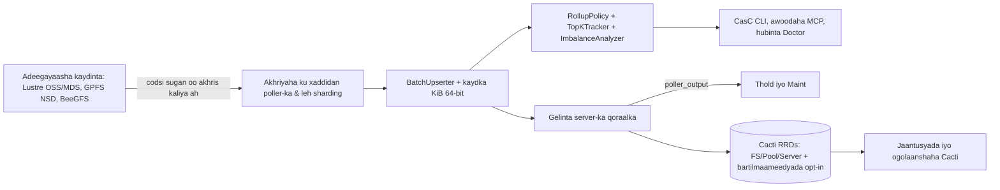

<!-- Source: README.md; SHA256: e88d6875d113220a91cfc0a9d230c829a78477b17e6aa7e44dda38c9591c86ad -->

<!-- translations:start -->
[English](../../../README.md) | [简体中文](../zh-CN/README.md) | [हिन्दी](../hi-IN/README.md) | [Español (España)](../es-ES/README.md) | [Español (Latinoamérica)](../es-419/README.md) | [العربية (السعودية)](../ar-SA/README.md) | [Afrikaans](../af-ZA/README.md) | [አማርኛ](../am-ET/README.md) | [العربية (مصر)](../ar-EG/README.md) | [العربية (المغرب)](../ar-MA/README.md) | [Български](../bg-BG/README.md) | [বাংলা](../bn-BD/README.md) | [Bosanski](../bs-BA/README.md) | [Deutsch](../de-DE/README.md) | [Ελληνικά](../el-GR/README.md) | [فارسی](../fa-IR/README.md) | [Filipino](../fil-PH/README.md) | [Français](../fr-FR/README.md) | [Français (Maroc)](../fr-MA/README.md) | [Français (Sénégal)](../fr-SN/README.md) | [Hausa](../ha-NG/README.md) | [עברית](../he-IL/README.md) | [Hrvatski](../hr-HR/README.md) | [Bahasa Indonesia](../id-ID/README.md) | [Igbo](../ig-NG/README.md) | [Italiano](../it-IT/README.md) | [日本語](../ja-JP/README.md) | [ქართული](../ka-GE/README.md) | [한국어](../ko-KR/README.md) | [Latviešu](../lv-LV/README.md) | [Malagasy](../mg-MG/README.md) | [मराठी](../mr-IN/README.md) | [Bahasa Melayu](../ms-MY/README.md) | [Nederlands](../nl-NL/README.md) | [Polski](../pl-PL/README.md) | [Português (Brasil)](../pt-BR/README.md) | [Português (Portugal)](../pt-PT/README.md) | [Русский](../ru-RU/README.md) | [Kinyarwanda](../rw-RW/README.md) | [Soomaali](README.md) | [Српски](../sr-RS/README.md) | [Svenska](../sv-SE/README.md) | [Kiswahili](../sw-KE/README.md) | [தமிழ்](../ta-IN/README.md) | [తెలుగు](../te-IN/README.md) | [ไทย](../th-TH/README.md) | [Türkçe](../tr-TR/README.md) | [Українська](../uk-UA/README.md) | [اردو](../ur-PK/README.md) | [Tiếng Việt](../vi-VN/README.md) | [isiXhosa](../xh-ZA/README.md) | [Yorùbá](../yo-NG/README.md) | [繁體中文](../zh-TW/README.md) | [isiZulu](../zu-ZA/README.md)
<!-- translations:end -->

# plugin_pfs

Qalab-ku-xirka Cacti 1.2 oo keena caafimaadka, awoodda kaydinta, dheellitirnaan la'aanta buuxinta, xawaaraha xog-gudbinta ee bartilmaameed kasta, iyo heerarka hawlgallada metadata ee nidaamka faylasha barbar-socodka ah gudaha Cacti iyadoo la adeegsanayo Lustre, IBM Storage Scale (GPFS), iyo BeeGFS oo ka dambeeya weji-isku-xirka `Backend` ee mideysan. Nidaam faylal kasta wuxuu ku xirmaa aalad caadi ah oo Cacti ah oo leh weydiimaha xogta, jaantusyada guudmarka iyo kuwa bartilmaameedka markii loo baahdo, iyo cabbirrada kooban si Thold iyo Maint ay uga digaan una joojiyaan iyaga oo aan waxba laga beddelin.

> **Xaaladda: wajiyada 1 ilaa 3 iyo aaladaha aasaasiga ah ee ballaarinta exascale waa lagu hirgeliyay koodhka, weli lama sii dayn.** Aasaaska, kormeerka Lustre, digniinaha iyo joojinta Maint, darawalada akhris-kaliya ee GPFS iyo BeeGFS, falanqaynta dheellitirnaan la'aanta OST/MDT oo leh isdhexgalka Maint, xaddidaadda ururiyaha xogta fog (`replicate_out`, `remote_agent`), aaladaha ballaarinta 100+ PB / exascale (`FramedReportParser`, Schema v4 `value_kib`, `RollupPolicy`, `TopKTracker`, `ShardAssigner`, `BatchUpserter`), CLI-ga hawlwadeenka CasC (`cli/pfs.php`), iyo xirmooyinka nidaamka deegaanka (`abilities_register`, `doctor_register_checks`, `casc_register_providers`) waa la hirgeliyay waxaana lagu xaqiijiyay tijaabooyinka unugga, amniga, iyo isdhexgalka Cacti ku-meel-gaar ah. Dhammaan orodyada ilaa hadda waxay isticmaalaan xog-tijaabo oo nood ah halkii ay ka isticmaali lahaayeen qalab dhab ah oo Lustre, GPFS, ama BeeGFS ah. Waxyaabaha weli furan ka hor calaamadaynta sii-daynta: tijaabooyinka hordhaca ah ee nidaamyada faylasha dhabta ah ([qorshaha tijaabada](../../pilot-plan.md)), dib-u-eegista amniga ee dibadda ([is-dib-u-eegista](../../security-review.md)), iyo cabbirrada baaxadda ee qalabka la diiwaangeliyay ([baaxadda](../../research/scale.md)). Nooca 0.1.0 waxaa lagu diyaariyay `INFO` iyo [CHANGELOG.md](../../../CHANGELOG.md) laakiin weli calaamad looma samayn.

## Doorarka gelitaanka

| Aagga (Realm) | Gelitaanka |
| --- | --- |
| Parallel Filesystem View | Boggaga kormeerka ee jira. |
| Parallel Filesystem Operator | Kormeerka oo lagu daray bogga Hawlgallada iyo oggolaanshaha kala-soocidda shakhsi ahaaneed. |
| Parallel Filesystem Admin | Gelitaanka Operator oo lagu daray habaynta jirta iyo tallaabooyinka maamulka. |

Ka dib markaad nuqul ka samayso faylasha cusboonaysiinta, u fur bogga Plugins adigoo ah maamule si aad u diiwaangeliso aagga cusub. U qoondee aagga Operator si cad qaybta **Configuration > Users** ama kooxaha isticmaalayaasha. Cusboonaysiintu waxay sii haystaan aqoonsiyada iyo deeqaha gelitaanka ee aagagga View iyo Admin ee jira. Gelitaanka Admin wuxuu dhaxlaa gelitaanka Operator, gelitaanka Operator wuxuuna dhaxlaa gelitaanka View codsi kasta; tani kuma kordhiso deeqo kaydsan isticmaalayaasha ama kooxaha. Dejinta qalab-ku-xirka waxay sidoo kale u baahan yihiin gelitaanka Parallel Filesystem Admin marka lagu daro oggolaanshaha Settings ee Cacti.

Oggolaanshaha aaladaha Cacti weli waxay xaddidaan safafka iyo tallaabooyinka u furan isticmaale kasta; walxaha aan la khariidayn waxay u baahan yihiin maamule. Aqoonsiyada sirta ah, habaynta, khariidaynta, tirtirista iyo isbeddellada kale ee maamulka waxay ku sii jiraan boggaga maamulka. Oggolaanshaha kala-soocidda waxay shaqeeyaan oo keliya fadhiga hadda jira ee isticmaalaha, ugu badnaan hal saac iyo oo keliya inta isla kormeerku cusub yahay. Kormeerro cusub ama isbeddelay way buriyaan iyaga. Weligood cabbir fashilmay uma calaamadeeyaan mid caafimaad qaba mana joojiyaan digniinaha.

## Sababta

Marka nidaam faylal la wadaago uu gaabiyo, caddayntu waxay ku baahsan tahay adeegayaal kala duwan. Lustre wuxuu tiriyeyaashiisa ku hayaa nood kasta: `lctl get_param` wuxuu soo sheegaa qiyamka "noodka gudaha", sidaas darteed adeegaha kaydinta walxaha (OSS) kasta iyo adeegaha xogta-sharaxaadda (MDS) kasta wuxuu hayaa oo keliya tirada bartilmaameedyadiisa gaarka ah. Hawlwadeen baaraya nidaam faylal oo gaabis ah wuxuu u baahan yahay saddex jawaabood oo ka imanaya meelo kala duwan:

- **Hal bartilmaameed miyuu buuxsamayaa halka kuwa kale ay madhan yihiin?** Dheellitirnaan la'aanta buuxintu waxay beddeshaa halka ay ku degaan faylasha cusub iyo goorta hal bartilmaameed meel bannaan ka dhammaato.
- **Bartilmaameedyadee ama hawlgalladee baa mashquul ah?** Tiriyeyaasha byte-ka ee bartilmaameed kasta iyo tiriyeyaasha hawlgalka ee MDT kasta waxay muujiyaan in culaysku ku xiran yahay xogta ama metadata.
- **Kormeerka laftiisu ma yahay mid hadda shaqaynaya?** Jaantus siman wuxuu kalsooni leeyahay oo keliya haddii qalab-ku-xirku awooday inuu arko adeegayaasha.

Cacti wuxuu sawiraa martigeliyayaasha wuxuuna u dejiyaa xadka qiimaha isagoo adeegsanaya Thold, ururka GitHub ee Cacti-na ma laha kayd loogu talagalay kormeerka Lustre, GPFS, ama BeeGFS (la baaray 2026-11-14). Qalab-ku-xirku wuxuu buuxiyaa farqigaas isagoo akhrinaya qiyamka la oggol yahay ee akhris-kaliya ah kana soo akhrinaya noodadka kaydinta, wuxuuna u matalaa nidaam faylal kasta sida aalad Cacti ah oo bartilmaameedyadeedu yihiin tusmooyinka weydiinta xogta. Wuxuu dib u adeegsadaa jaantus-samaynta Cacti, oggolaanshaha, ururiyeyaasha xogta ee fog, Thold, iyo Maint halkii uu ka dhisi lahaa noocyo u dhigma oo gooni ah.

## Baaxadda la qorsheeyay

| Wajiga | Baaxadda | Xaaladda | Marxaladaha |
|---|---|---|---|
| 0, cilmi-baaris | Shaxda sii-daynta, go'aanka gelitaanka noodka, xaqiijinta habdhaqanka kor-ka-yimaada, habdhaqanka tiriyaha iyo wareejinta fashilka, cabbirrada baaxadda | Dhammaystiran | [M1](https://github.com/somethingwithproof/plugin_pfs/milestone/1) |
| 1, kormeer | Agabka Lustre, awoodda kaydinta iyo buuxinta, dheellitirnaan la'aanta OST/MDT (`lib/ImbalanceAnalyzer.php`), isdhexgalka Maint (`lib/HealthPage.php`), xawaaraha xog-gudbinta OST, heerarka hawlgalka MDT, jaantusyada, digniinaha Thold, bogga caafimaadka | La hirgeliyay (lagu tijaabiyay fixture) | [M2](https://github.com/somethingwithproof/plugin_pfs/milestone/2), [M3](https://github.com/somethingwithproof/plugin_pfs/milestone/3), [M4](https://github.com/somethingwithproof/plugin_pfs/milestone/4) |
| 2, fogaan iyo baaxad | Ururinta fog ee xaddidan poller-ka (`lib/Reader.php`, `lib/ReplicationRepository.php`, `replicate_out`, `remote_agent`), aaladaha ballaarinta 100+ PB (nadaafadda 64-bit KiB + Schema v4 `value_kib`, `lib/RollupPolicy.php`, `lib/TopKTracker.php`, `lib/ShardAssigner.php` + `poller_pfs.php --shard=K/N`, `lib/BatchUpserter.php`), CasC CLI (`cli/pfs.php`), xirmooyinka MCP/Doctor/CasC | La hirgeliyay (lagu tijaabiyay unug iyo isdhexgalka CI) | [M5](https://github.com/somethingwithproof/plugin_pfs/milestone/5) |
| 3, nidaamyada dambe | Darawalada akhris-kaliya ee IBM Storage Scale (GPFS) (`lib/GpfsBackend.php`) iyo BeeGFS (`lib/BeegfsBackend.php`) ee ka diiwaangashan `BackendRegistry::production()` | La hirgeliyay (lagu tijaabiyay unug) | [M6](https://github.com/somethingwithproof/plugin_pfs/milestone/6) |

Aaladaha muhiimka ah ee hawlwadeenka iyo ballaarinta ee la hirgeliyay:

- **Darawalada akhris-kaliya ee nidaamyada faylasha badan:** `LustreBackend`, `GpfsBackend` (`mmpmon` qaabaysan oo `fs_io_s`/`io_s` oo keliya ah iyadoo `reset` mamnuuc yahay, awoodda/xaaladaha barkadda `mmdf`, iyo soo-koobista sugayaasha), iyo `BeegfsBackend` (bartilmaameedyada kaydinta/metadata ee BeeGFS 7.4 iyo 8.x oo leh beddelaadda saxda ah ee byte-ilaa-KiB, khariidaynta xaaladda gaaritaanka/iswaafaqidda, iyo macnaha cabbirka muddo-kasta) kuwaas oo wadaaga `lib/FramedReportParser.php`.
- **Ogaanshaha dheellitirnaan la'aanta, meesha bannaan, iyo Maint:** `lib/ImbalanceAnalyzer.php` wuxuu xisaabiyaa saamiga buuxinta OST/MDT, kala-baxa, tusmada dheellitirnaan la'aanta leexashada caadiga ah ee dadweynaha, meesha bannaan (headroom), dhaqangelinta cusboonaysiinta 1-muddo (`missing_targets`), calamadaha xaaladda bartilmaameed kasta, iyo bartilmaameedyada qalloocan ee Top-K ee xaddidan. `HealthPage` (`pfs_health.php`) iyo `CascProvider::health()` waxay soo bandhigaan daaqadaha dayactirka `Maint` ee Cacti waxayna joojiyaan digniinaha fashilka firfircoon inta lagu jiro dayactirka qorshaysan.
- **Ballaarinta 100+ PB iyo exascale** ([docs/architecture/exascale-scaling.md](../../architecture/exascale-scaling.md)): beddelaadda tobanlaha saxda ah ee byte-ilaa-KiB (`FramedReportParser::bytesToKibInt()`) oo lagu xaqiijiyay 500 PB iyo 2 EB iyadoo la socota tiirarka `BIGINT UNSIGNED value_kib` (Schema v4); ururinta RRD ee kala-sarreynta `Filesystem -> Pool -> Storage Server` oo leh dallacaadda bartilmaameedka opt-in/kulul/qalloocan ee xaddidan (`lib/RollupPolicy.php`); bartilmaameedyada qalloocan ee Top-K ee xaddidan $O(K)$ iyo soo-koobista shaqooyinka/macaamiisha culus ee horay loo ururiyay (`lib/TopKTracker.php`, iyadoon waligood la abuurin aalado ama RRD-yo macmiil-kasta ah); qaybinta sharding CRC32 ee go'an ee ururiyaha (`lib/ShardAssigner.php`, `php plugins/pfs/poller_pfs.php [--poller=N] [--shard=K/N] [--force] [--debug]`); iyo gelinta SQL ee kooxaysan oo 500-saf ah oo lagu daray bog-u-qaybinta keyset (`lib/BatchUpserter.php`, `CacheRepository::upsertObservationsBatch()`, `TargetRepository::forFilesystemPage()`).
- **CasC CLI-ga hawlwadeenka iyo xirmooyinka nidaamka deegaanka:** `cli/pfs.php` wuxuu taageeraa `export [--format=yaml|xml]`, `validate <file> [--format=yaml|xml]`, `plan <file> [--format=yaml|xml] [--output=text|json]`, `apply <file> --confirm=<PLAN_HASH> [--format=yaml|xml]`, iyo `health [--format=text|json]` iyada oo aan wax ku-tiirsanaan ah oo Composer dibadda ah jirin. `setup.php` iyo `lib/EcosystemIntegration.php` waxay diiwaangeliyaan `abilities_register` (`pfs-list-filesystems`, `pfs-get-imbalance`, `pfs-get-health`; akhris-kaliya, ku xiran `Parallel Filesystem View` iyo oggolaanshaha aaladaha Cacti), `doctor_register_checks` (`pfs_schema`, `pfs_reader_freshness`, `pfs_capacity_imbalance`), `casc_register_providers`, `replicate_out`, iyo `remote_agent`.

Ka baxsan baaxadda: wax kasta oo qoris, nadiifin, dib-u-dejin, ama hagaajin ah oo lagu sameeyo nood ama nidaam faylal; matoor digniin oo uu leeyahay qalab-ku-xirku; daemon gaar ah ama borotokool shabakad; aaladaha/RRD-yada Cacti ee shaqo-kasta ama macmiil-kasta ah; isbeddel lagu sameeyo xudunta Cacti, Thold, ama Maint.

## Bartilmaameedyada is-waafajinta

| Qaybta | Bartilmaameedka |
|---|---|
| Cacti | 1.2.31 ama ka dambeeya, iyada oo aan wax balastar ah lagu samayn xudunta |
| PHP | 8.2 ama ka dambeeya; `setup.php`, `poller_pfs.php`, iyo `cli/pfs.php` waxay sii ahaadaan kuwo laga baaraandegi karo PHP 8.0 si deegaanka aan la taageerin uu u helo diidmo halkii uu ka jabi lahaa UI-ga Cacti |
| Lustre | Isha koodhka iyo buugaagta waxaa lagu hubiyay 2.17.0; lagu tijaabiyay fixture |
| GPFS, BeeGFS | Darawalada akhris-kaliya ee IBM Storage Scale (GPFS) 5.x `mmpmon`/`mmdf` iyo BeeGFS 7.4 / 8.x waa la hirgeliyay waxaana lagu tijaabiyay fixture |
| Thold, Maint | Thold 1.8.2 iyo Maint 1.3, aan waxba laga beddelin |

## Naqshadda

- [docs/architecture/exascale-scaling.md](../../architecture/exascale-scaling.md) wuxuu diiwaangeliyaa qaab-dhismeedka telemetry ee laba-heer ah ee 100+ PB / exascale (adeegaha Cacti/`plugin_pfs` + ururinta + heerka Top-K oo lala lammaaniyay telemetry-ga macmiilka LDMS/Darshan/TOKIO ee ka baxsan xariiqa) iyo macnaha suugaanta tacliinta.
- [docs/PLAN.md](../../PLAN.md) waa qorshaha buuxa: qaab-dhismeedka, xaqiiqooyinka kor-ka-yimaada ee uu ku tiirsan yahay (oo ay la socdaan ilaha iyo waxa aan weli la xaqiijin), macnaha tiriyeyaasha, qaabka xaaladda, xuduudaha amniga, xisaabinta waxqabadka, tijaabinta, iyo khataraha.
- [docs/operator-guide.md](../../operator-guide.md) wuxuu daboolaa rakibidda, jaantusyada iyo qiyamka, cusboonaysiinta, kaydinta iyo soo-celinta, tirtirista, iyo xallinta dhibaatooyinka; [docs/alerting.md](../../alerting.md) wuxuu daboolaa Thold iyo Maint.
- [docs/node-setup.md](../../node-setup.md) wuxuu sharxayaa sida loo diyaariyo adeegaha Lustre iyo poller loogu talagalay akhriyaha.
- [docs/decisions/](../../decisions) wuxuu hayaa diiwaannada go'aannada qaab-dhismeedka ee doorashooyinka horey loo sameeyay.
- [docs/REQUIREMENTS.md](../../REQUIREMENTS.md) wuxuu ku xiraa aqoonsi kasta oo shuruud ah arrinta ku habboon.

## Sida shaqada loola socdo

- **Marxaladuhu** waxay raacaan marxaladaha qorshaha. Mid kasta wuxuu leeyahay arrin weyn (epic issue) oo taxaysa arrimaha hoose iyo caddaynta bixitaanka.
- **Arrimaha (Issues)** waxaa lagu nooceeyaa sumad (label): `type: requirement`, `type: research`, `type: decision`, `type: epic`. Arrimaha shuruuduhu waxay sheegaan shuruudo tiro leh oo la tijaabin karo (`REQ-AREA-NNN`) iyo shuruudaha aqbalaadda.
- **Sumaduhu (Labels)** waxay sidoo kale sitaan `area:`, `phase:`, `priority:`, iyo `status:`. Eeg [CONTRIBUTING.md](../../../CONTRIBUTING.md#labels).
- [Looxa mashruuca](https://github.com/users/somethingwithproof/projects/11) wuxuu muujiyaa dhammaan arrimaha marxaladaha oo dhan.

## Ka-qaybgalka

Akhri [CONTRIBUTING.md](../../../CONTRIBUTING.md). Ballanqaadyada (Commits) waxay u baahan yihiin saxiixa DCO. Doodda naqshadda waxay ka dhacdaa arrimaha (issues); go'aannada furan waxay sitaan sumadda `type: decision`.

## Amniga

Si gaar ah u soo sheeg baylahda amniga; eeg [SECURITY.md](../../../SECURITY.md).

## Shatiga

GNU General Public License v2.0, waa isla shatiga ay leeyihiin Cacti iyo qalab-ku-xirkeeda. Eeg [LICENSE](../../../LICENSE).
