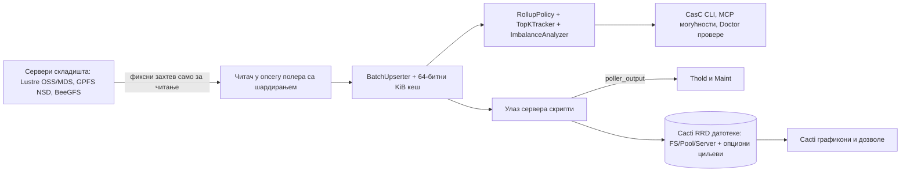

<!-- Source: README.md; SHA256: e88d6875d113220a91cfc0a9d230c829a78477b17e6aa7e44dda38c9591c86ad -->

<!-- translations:start -->
[English](../../../README.md) | [简体中文](../zh-CN/README.md) | [हिन्दी](../hi-IN/README.md) | [Español (España)](../es-ES/README.md) | [Español (Latinoamérica)](../es-419/README.md) | [العربية (السعودية)](../ar-SA/README.md) | [Afrikaans](../af-ZA/README.md) | [አማርኛ](../am-ET/README.md) | [العربية (مصر)](../ar-EG/README.md) | [العربية (المغرب)](../ar-MA/README.md) | [বাংলা](../bn-BD/README.md) | [Bosanski](../bs-BA/README.md) | [Deutsch](../de-DE/README.md) | [فارسی](../fa-IR/README.md) | [Filipino](../fil-PH/README.md) | [Français](../fr-FR/README.md) | [Français (Maroc)](../fr-MA/README.md) | [Français (Sénégal)](../fr-SN/README.md) | [Hausa](../ha-NG/README.md) | [עברית](../he-IL/README.md) | [Hrvatski](../hr-HR/README.md) | [Bahasa Indonesia](../id-ID/README.md) | [Igbo](../ig-NG/README.md) | [Italiano](../it-IT/README.md) | [日本語](../ja-JP/README.md) | [한국어](../ko-KR/README.md) | [Malagasy](../mg-MG/README.md) | [मराठी](../mr-IN/README.md) | [Bahasa Melayu](../ms-MY/README.md) | [Nederlands](../nl-NL/README.md) | [Polski](../pl-PL/README.md) | [Português (Brasil)](../pt-BR/README.md) | [Русский](../ru-RU/README.md) | [Kinyarwanda](../rw-RW/README.md) | [Soomaali](../so-SO/README.md) | [Српски](README.md) | [Svenska](../sv-SE/README.md) | [Kiswahili](../sw-KE/README.md) | [தமிழ்](../ta-IN/README.md) | [తెలుగు](../te-IN/README.md) | [ไทย](../th-TH/README.md) | [Türkçe](../tr-TR/README.md) | [Українська](../uk-UA/README.md) | [اردو](../ur-PK/README.md) | [Tiếng Việt](../vi-VN/README.md) | [isiXhosa](../xh-ZA/README.md) | [Yorùbá](../yo-NG/README.md) | [繁體中文](../zh-TW/README.md) | [isiZulu](../zu-ZA/README.md)
<!-- translations:end -->

# plugin_pfs

Додатак за Cacti 1.2 који у Cacti доноси стање здравља, капацитет, неравнотежу попуњености, проток по циљу и стопе операција метаподатака паралелних система датотека за Lustre, IBM Storage Scale (GPFS) и BeeGFS иза јединственог интерфејса `Backend`. Сваки систем датотека се мапира на обичан Cacti уређај са упитима података, прегледним графиконима и графиконима циљева на захтев, као и збирним мерилима тако да Thold и Maint без икаквих измена шаљу упозорења и потискују аларме.

> **Статус: фазе од 1 до 3 и примитиви за екзаскално скалирање су имплементирани у коду, али још нису објављени.** Основа, праћење система Lustre, алармирање и потискивање у додатку Maint, драјвери само за читање за GPFS и BeeGFS, анализа неравнотеже OST/MDT са интеграцијом за Maint, ограничавање удаљеног сакупљања података по полеру (`replicate_out`, `remote_agent`), примитиви скалирања за 100+ PB / екзаскални ниво (`FramedReportParser`, шема v4 `value_kib`, `RollupPolicy`, `TopKTracker`, `ShardAssigner`, `BatchUpserter`), оператерски CasC CLI (`cli/pfs.php`) и куке екосистема (`abilities_register`, `doctor_register_checks`, `casc_register_providers`) су имплементирани и верификовани јединичним, безбедносним и интеграционим тестовима у привременој Cacti инстанци. Сва досадашња покретања користе тестне излазе чворова уместо живог Lustre, GPFS или BeeGFS хардвера. Пре означавања издања остају отворени: пилот-испитивања на стварним системима датотека ([пилот план](../../pilot-plan.md)), спољни безбедносни преглед ([самопровера](../../security-review.md)) и мерења скалабилности на документованом хардверу ([скалабилност](../../research/scale.md)). Верзија 0.1.0 припремљена је у датотекама `INFO` и [CHANGELOG.md](../../../CHANGELOG.md), али још није означена ознаком издања.

## Улоге приступа

| Подручје овлашћења | Приступ |
| --- | --- |
| Parallel Filesystem View | Постојеће странице за надзор. |
| Parallel Filesystem Operator | Надзор плус страница Операције и личне потврде тријаже. |
| Parallel Filesystem Admin | Приступ оператера плус постојећа подешавања и административне радње. |

Након копирања датотека за надоградњу, отворите страницу Додаци као администратор да региструјете ново подручје овлашћења. Експлицитно доделите подручје Operator под **Configuration > Users** или корисничким групама. Надоградње задржавају постојеће идентификаторе и доделе за подручја View и Admin. Приступ Admin наслеђује приступ Operator, а приступ Operator наслеђује приступ View при сваком захтеву; тиме се корисницима или групама не додају сачуване дозволе. Подешавања додатка такође захтевају приступ Parallel Filesystem Admin поред Cacti дозволе за подешавања.

Cacti дозволе за уређаје и даље ограничавају редове и радње доступне сваком кориснику; за немапиране објекте потребан је администратор. Акредитиви, конфигурација, мапирање, брисање и остале административне измене остају на административним страницама. Потврде трају само у тренутној корисничкој сесији, најдуже један сат и само док исто опажање остаје свеже. Нова или промењена опажања их поништавају. Оне никада не означавају неуспешно мерење као исправно нити потискују аларме.

## Зашто

Када је дељени систем датотека спор, докази су распоређени на више сервера. Lustre чува своје бројаче по чвору: `lctl get_param` исписује вредности "на локалном чвору", тако да сваки сервер за складиштење објеката (OSS) и сервер метаподатака (MDS) држи само податке својих циљева. Оператер који истражује спор систем датотека треба три одговора са различитих места:

- **Пуни ли се један циљ док су остали празни?** Неравнотежа попуњености мења место где се смештају нове датотеке и одређује када ће појединачни циљ остати без простора.
- **Који су циљеви или операције оптерећени?** Бројачи бајтова по циљу и бројачи операција по MDT-у показују да ли је оптерећење ограничено подацима или метаподацима.
- **Да ли је сам надзор ажуран?** Раван графикон је умирујући само ако је додатак заиста могао да види сервере.

Cacti црта графиконе за рачунаре и прати прагове путем додатка Thold, а Cacti GitHub организација нема репозиторијум за надзор система Lustre, GPFS или BeeGFS (претражено 2026-11-14). Овај додатак попуњава ту празнину читањем унапред дозвољених вредности само за читање са чворова за складиштење и представљањем сваког система датотека као Cacti уређаја чији су циљеви индекси упита података. Поново користи Cacti графиконе, дозволе, удаљене сакупљаче података, Thold и Maint уместо прављења њихових паралелних верзија.

## Планирани опсег

| Фаза | Опсег | Статус | Прекретнице |
|---|---|---|---|
| 0, истраживање | Матрица издања, одлука о приступу чворовима, потврда узводног понашања, понашање бројача и пребацивања при квару, мерења скалабилности | Завршено | [M1](https://github.com/somethingwithproof/plugin_pfs/milestone/1) |
| 1, праћење | Lustre инвентар, капацитет и попуњеност, неравнотежа OST/MDT (`lib/ImbalanceAnalyzer.php`), интеграција са Maint (`lib/HealthPage.php`), OST проток, MDT стопе операција, графикони, Thold алармирање, страница здравља | Имплементирано (тестирано на тестним излазима) | [M2](https://github.com/somethingwithproof/plugin_pfs/milestone/2), [M3](https://github.com/somethingwithproof/plugin_pfs/milestone/3), [M4](https://github.com/somethingwithproof/plugin_pfs/milestone/4) |
| 2, удаљено сакупљање и скала | Удаљено сакупљање у опсегу полера (`lib/Reader.php`, `lib/ReplicationRepository.php`, `replicate_out`, `remote_agent`), примитиви скалирања за 100+ PB (64-битна KiB хигијена + шема v4 `value_kib`, `lib/RollupPolicy.php`, `lib/TopKTracker.php`, `lib/ShardAssigner.php` + `poller_pfs.php --shard=K/N`, `lib/BatchUpserter.php`), CasC CLI (`cli/pfs.php`), куке MCP/Doctor/CasC | Имплементирано (тестирано јединично и у CI интеграцији) | [M5](https://github.com/somethingwithproof/plugin_pfs/milestone/5) |
| 3, позадински системи | Драјвери само за читање за IBM Storage Scale (GPFS) (`lib/GpfsBackend.php`) и BeeGFS (`lib/BeegfsBackend.php`) регистровани у `BackendRegistry::production()` | Имплементирано (јединично тестирано) | [M6](https://github.com/somethingwithproof/plugin_pfs/milestone/6) |

Кључни имплементирани оператерски примитиви и примитиви за скалирање:

- **Драјвери само за читање за више система датотека:** `LustreBackend`, `GpfsBackend` (само уоквирени `mmpmon` `fs_io_s`/`io_s` уз забрану наредбе `reset`, капацитет/стања пулова `mmdf` и сажеци чекања) и `BeegfsBackend` (циљеви складиштења/метаподатака за BeeGFS 7.4 и 8.x са тачном конверзијом бајтова у KiB, мапирањем стања доступности/конзистентности и семантиком мерила по интервалу) који деле `lib/FramedReportParser.php`.
- **Свест о неравнотежи, слободном простору и прозорима Maint:** `lib/ImbalanceAnalyzer.php` рачуна односе попуњености OST/MDT, распон, индекс неравнотеже на основу стандардне девијације популације, слободни простор (headroom), принудну свежину у 1 интервалу (`missing_targets`), заставице стања по циљу и ограничени скуп Top-K нагнутих циљева. `HealthPage` (`pfs_health.php`) и `CascProvider::health()` приказују Cacti `Maint` прозоре одржавања и потискују активна упозорења о отказима током планираног одржавања.
- **Скалирање за 100+ PB и екзаскални ниво** ([docs/architecture/exascale-scaling.md](../../architecture/exascale-scaling.md)): тачна децимална конверзија бајтова у KiB (`FramedReportParser::bytesToKibInt()`) верификована на 500 PB и 2 EB уз колоне `BIGINT UNSIGNED value_kib` (шема v4); хијерархијске RRD агрегације `Filesystem -> Pool -> Storage Server` са ограниченим унапређивањем опционих/оптерећених/нагнутих циљева (`lib/RollupPolicy.php`); ограничени $O(K)$ Top-K нагнути циљеви и унапред агрегирани сажеци тешких послова/клијената (`lib/TopKTracker.php`, никада не креира уређаје или RRD датотеке по клијенту); детерминистичко CRC32 шардирање сакупљача (`lib/ShardAssigner.php`, `php plugins/pfs/poller_pfs.php [--poller=N] [--shard=K/N] [--force] [--debug]`); и групни SQL upsert уноси од по 500 редова уз keyset пагинацију (`lib/BatchUpserter.php`, `CacheRepository::upsertObservationsBatch()`, `TargetRepository::forFilesystemPage()`).
- **Оператерски CasC CLI и куке екосистема:** `cli/pfs.php` подржава `export [--format=yaml|xml]`, `validate <file> [--format=yaml|xml]`, `plan <file> [--format=yaml|xml] [--output=text|json]`, `apply <file> --confirm=<PLAN_HASH> [--format=yaml|xml]` и `health [--format=text|json]` без икаквих спољних Composer зависности. `setup.php` и `lib/EcosystemIntegration.php` региструју `abilities_register` (`pfs-list-filesystems`, `pfs-get-imbalance`, `pfs-get-health`; само за читање, ограничено дозволом `Parallel Filesystem View` и Cacti дозволама уређаја), `doctor_register_checks` (`pfs_schema`, `pfs_reader_freshness`, `pfs_capacity_imbalance`), `casc_register_providers`, `replicate_out` и `remote_agent`.

Изван опсега: било какве операције писања, брисања, ресетовања или подешавања на чвору или систему датотека; сопствени систем алармирања у додатку; прилагођени демон или мрежни протокол; Cacti уређаји или RRD датотеке по послу или по клијенту; измене језгра система Cacti, додатка Thold или додатка Maint.

## Циљеви компатибилности

| Компонента | Циљ |
|---|---|
| Cacti | 1.2.31 или новији, без закрпа језгра |
| PHP | 8.2 или новији; `setup.php`, `poller_pfs.php` и `cli/pfs.php` остају синтаксно читљиви на верзији 8.0 како би неподржано окружење добило уредно одбијање уместо поквареног Cacti интерфејса |
| Lustre | Изворни код и приручници проверени на верзији 2.17.0; тестирано на тестним излазима |
| GPFS, BeeGFS | Драјвери само за читање за IBM Storage Scale (GPFS) 5.x `mmpmon`/`mmdf` и BeeGFS 7.4 / 8.x имплементирани и тестирани на тестним излазима |
| Thold, Maint | Thold 1.8.2 и Maint 1.3, неизмењени |

## Дизајн

- [docs/architecture/exascale-scaling.md](../../architecture/exascale-scaling.md) документује двослојну телеметријску архитектуру за 100+ PB / екзаскални ниво (слој Cacti/`plugin_pfs` сервера + агрегације + Top-K упарен са ванпојасном клијентском телеметријом LDMS/Darshan/TOKIO) и њен контекст у научној литератури.
- [docs/PLAN.md](../../PLAN.md) садржи потпуни план: архитектуру, узводне чињенице на које се ослања (са изворима и назнаком шта још није проверено), семантику бројача, модел стања, безбедносне границе, прорачун перформанси, тестирање и ризике.
- [docs/operator-guide.md](../../operator-guide.md) покрива инсталацију, графиконе и вредности, надоградњу, резервну копију и враћање, деинсталацију и решавање грешака; [docs/alerting.md](../../alerting.md) покрива Thold и Maint.
- [docs/node-setup.md](../../node-setup.md) описује како припремити Lustre сервер и полер за читач.
- [docs/decisions/](../../decisions) садржи записе о архитектонским одлукама које су већ донете.
- [docs/REQUIREMENTS.md](../../REQUIREMENTS.md) повезује сваки ID захтева са припадајућим тикетом.

## Како се прати рад

- **Прекретнице** прате прекретнице из плана. Свака има кровни тикет са списком подтикета и доказима завршетка.
- **Тикети** су означени по типу: `type: requirement`, `type: research`, `type: decision`, `type: epic`. Тикети захтева наводе нумерисане, проверљиве захтеве (`REQ-AREA-NNN`) и критеријуме прихватања.
- **Ознаке** такође носе `area:`, `phase:`, `priority:` и `status:`. Погледајте [CONTRIBUTING.md](../../../CONTRIBUTING.md#labels).
- [Пројектна табла](https://github.com/users/somethingwithproof/projects/11) приказује све тикете кроз све прекретнице.

## Допринос

Прочитајте [CONTRIBUTING.md](../../../CONTRIBUTING.md). Commit поруке захтевају DCO потпис. Расправе о дизајну воде се у тикетима; отворене одлуке носе ознаку `type: decision`.

## Безбедност

Безбедносне рањивости пријавите поверљиво; погледајте [SECURITY.md](../../../SECURITY.md).

## Лиценца

GNU General Public License v2.0, иста лиценца као за Cacti и његове додатке. Погледајте [LICENSE](../../../LICENSE).
