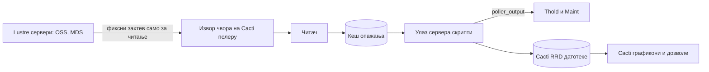

<!-- Source: README.md; SHA256: e88d6875d113220a91cfc0a9d230c829a78477b17e6aa7e44dda38c9591c86ad -->

<!-- translations:start -->
[English](../../../README.md) | [简体中文](../zh-CN/README.md) | [हिन्दी](../hi-IN/README.md) | [Español (España)](../es-ES/README.md) | [Español (Latinoamérica)](../es-419/README.md) | [العربية (السعودية)](../ar-SA/README.md) | [Afrikaans](../af-ZA/README.md) | [አማርኛ](../am-ET/README.md) | [العربية (مصر)](../ar-EG/README.md) | [العربية (المغرب)](../ar-MA/README.md) | [বাংলা](../bn-BD/README.md) | [Bosanski](../bs-BA/README.md) | [Deutsch](../de-DE/README.md) | [فارسی](../fa-IR/README.md) | [Filipino](../fil-PH/README.md) | [Français](../fr-FR/README.md) | [Français (Maroc)](../fr-MA/README.md) | [Français (Sénégal)](../fr-SN/README.md) | [Hausa](../ha-NG/README.md) | [עברית](../he-IL/README.md) | [Hrvatski](../hr-HR/README.md) | [Bahasa Indonesia](../id-ID/README.md) | [Igbo](../ig-NG/README.md) | [Italiano](../it-IT/README.md) | [日本語](../ja-JP/README.md) | [한국어](../ko-KR/README.md) | [Malagasy](../mg-MG/README.md) | [मराठी](../mr-IN/README.md) | [Bahasa Melayu](../ms-MY/README.md) | [Nederlands](../nl-NL/README.md) | [Polski](../pl-PL/README.md) | [Português (Brasil)](../pt-BR/README.md) | [Русский](../ru-RU/README.md) | [Kinyarwanda](../rw-RW/README.md) | [Soomaali](../so-SO/README.md) | [Српски](README.md) | [Svenska](../sv-SE/README.md) | [Kiswahili](../sw-KE/README.md) | [தமிழ்](../ta-IN/README.md) | [తెలుగు](../te-IN/README.md) | [ไทย](../th-TH/README.md) | [Türkçe](../tr-TR/README.md) | [Українська](../uk-UA/README.md) | [اردو](../ur-PK/README.md) | [Tiếng Việt](../vi-VN/README.md) | [isiXhosa](../xh-ZA/README.md) | [Yorùbá](../yo-NG/README.md) | [繁體中文](../zh-TW/README.md) | [isiZulu](../zu-ZA/README.md)
<!-- translations:end -->

# plugin_pfs

Додатак за Cacti 1.2 који у Cacti доноси стање здравља и оптерећење паралелних система датотека: капацитет и неравнотежу попуњености по циљевима, проток по циљу и стопе операција метаподатака. Lustre је први позадински систем. GPFS (IBM Storage Scale) и BeeGFS следе иза интерфејса позадинског система. Подаци завршавају у стандардним Cacti уређајима, изворима података и графиконима, тако да Thold и Maint без икаквих измена шаљу упозорења и потискују аларме.

> **Статус: прекретница 4, код завршен за фазу 1, још није објављено.** Прекретнице 2 (темељи), 3 (праћење система Lustre) и 4 (алармирање и припрема издања) завршене су на грани `main` или су у прегледу. Додатак се инсталира, надограђује и деинсталира кроз Cacti API за додатке и одбија PHP верзије старије од 8.2. Позадински читач на сваком полеру чита Lustre сервере преко SSH везе помоћу фиксне принудне команде ([node/pfs-read.sh](../../../node/pfs-read.sh)) и кешира инвентар, услов, капацитет и бројаче заједно са њиховом свежином. Сваки систем датотека постаје Cacti уређај са OST и MDT упитима података, пет прегледних графикона, графиконима по циљу на захтев и збирним извором података за Thold. Неизмењени Thold v1.8.2 и Maint v1.3 у целокупном тестном покретању алармирају и потискују аларме на збирним мерењима; Thold прагови на бројачима нису подржани у верзији Thold 1.8.2 ([docs/alerting.md](../../alerting.md)). Сви досадашњи тестови покрећу се на тестним излазима чворова у привременој Cacti инстанци: додатак још није покренут на стварном Lustre чвору. Пре објаве остају отворени: пилот-испитивања на стварним системима датотека ([пилот план](../../pilot-plan.md)), спољни безбедносни преглед ([самопровера](../../security-review.md)) и мерења скалабилности на документованом хардверу ([скалабилност](../../research/scale.md)). Верзија 0.1.0 припремљена је у датотекама `INFO` и [CHANGELOG.md](../../../CHANGELOG.md), али још није означена ознаком издања.

## Улоге приступа

| Подручје овлашћења | Приступ |
| --- | --- |
| Parallel Filesystem View | Постојеће странице за надзор. |
| Parallel Filesystem Operator | Надзор плус страница Операције и личне потврде тријаже. |
| Parallel Filesystem Admin | Приступ оператера плус постојећа подешавања и административне радње. |

Након копирања датотека за надоградњу, отворите страницу Додаци као администратор да региструјете ново подручје овлашћења. Експлицитно доделите подручје Operator под **Configuration > Users** или корисничким групама. Надоградње задржавају постојеће идентификаторе и доделе за подручја View и Admin. Приступ Admin наслеђује приступ Operator, а приступ Operator наслеђује приступ View при сваком захтеву; тиме се корисницима или групама не додају сачуване дозволе. Подешавања додатка такође захтевају приступ Parallel Filesystem Admin поред Cacti дозволе за подешавања.

Cacti дозволе за уређаје и даље ограничавају редове и радње доступне сваком кориснику; за немапиране објекте потребан је администратор. Акредитиви, конфигурација, мапирање, брисање и остале административне измене остају на административним страницама. Потврде трају само у тренутној корисничкој сесији, најдуже један сат и само док исто опажање остаје свеже. Нова или промењена опажања их поништавају. Оне никада не означавају неуспешно мерење као исправно нити потискују аларме.

## Зашто

Када је дељени систем датотека спор, докази су распоређени на више сервера. Lustre чува своје бројаче по чвору: `lctl get_param` исписује вредности "на локалном чвору", тако да сваки сервер за складиштење објеката (OSS) и сервер метаподатака (MDS) држи само податке својих циљева. Оператер који истражује спор систем датотека треба три одговора са различитих места:

- **Пуни ли се један циљ док су остали празни?** Неравнотежа попуњености мења место где се смештају нове датотеке и одређује када ће појединачни циљ остати без простора.
- **Који су циљеви или операције оптерећени?** Бројачи бајтова по циљу и бројачи операција по MDT-у показују да ли је оптерећење ограничено подацима или метаподацима.
- **Да ли је сам надзор ажуран?** Раван графикон је умирујући само ако је додатак заиста могао да види сервере.

Cacti црта графиконе за рачунаре и прати прагове путем додатка Thold, а Cacti GitHub организација нема репозиторијум за надзор система Lustre, GPFS или BeeGFS (претражено 2026-11-14). Овај додатак попуњава ту празнину читањем унапред дозвољених вредности само за читање са чворова за складиштење и представљањем сваког система датотека као Cacti уређаја чији су циљеви индекси упита података. Поново користи Cacti графиконе, дозволе, удаљене сакупљаче података, Thold и Maint уместо прављења њихових паралелних верзија.

## Планирани опсег

| Фаза | Опсег | Прекретнице |
|---|---|---|
| 0, истраживање | Матрица издања, одлука о приступу чворовима, потврда узводног понашања, понашање бројача и пребацивања при квару, мерења скалабилности | [M1](https://github.com/somethingwithproof/plugin_pfs/milestone/1) |
| 1, праћење | Lustre инвентар, капацитет и попуњеност, OST проток, MDT стопе операција, графикони, Thold алармирање, Maint потискивање, страница здравља | [M2](https://github.com/somethingwithproof/plugin_pfs/milestone/2), [M3](https://github.com/somethingwithproof/plugin_pfs/milestone/3), [M4](https://github.com/somethingwithproof/plugin_pfs/milestone/4) |
| 2, дубина | Cacti удаљени сакупљачи података, прикази на нивоу послова и клијената унутар ограниченог броја објеката | [M5](https://github.com/somethingwithproof/plugin_pfs/milestone/5) |
| 3, позадински системи | Позадински системи GPFS (IBM Storage Scale) и BeeGFS | [M6](https://github.com/somethingwithproof/plugin_pfs/milestone/6) |

Изван опсега: било какве операције писања, брисања, ресетовања или подешавања на чвору или систему датотека; сопствени систем алармирања у додатку; прилагођени демон или мрежни протокол; извори података по послу; измене језгра система Cacti, додатка Thold или додатка Maint.

## Циљеви компатибилности

| Компонента | Циљ |
|---|---|
| Cacti | 1.2.31 или новији, без закрпа језгра |
| PHP | 8.2 или новији; `setup.php` остаје синтаксно читљив на верзији 8.0 како би неподржано окружење добило уредно одбијање уместо поквареног Cacti интерфејса |
| Lustre | Линије издања које ће бити дефинисане до прекретнице 1; досад проверени изворни код и приручници су на верзији 2.17.0 |
| GPFS, BeeGFS | Фаза 3; издања ће бити дефинисана истраживањем |
| Thold, Maint | Нису потребне никакве измене |

## Дизајн

- [docs/PLAN.md](../../PLAN.md) садржи потпуни план: архитектуру, узводне чињенице на које се ослања (са изворима и назнаком шта још није проверено), семантику бројача, модел стања, безбедносне границе, прорачун перформанси, тестирање и ризике.
- [docs/operator-guide.md](../../operator-guide.md) покрива инсталацију, графиконе и вредности, надоградњу, резервну копију и враћање, деинсталацију и решавање грешака; [docs/alerting.md](../../alerting.md) покрива Thold и Maint.
- [docs/node-setup.md](../../node-setup.md) описује како припремити Lustre сервер и полер за читач.
- [docs/decisions/](../../decisions) садржи записе о архитектонским одлукама које су већ донете.
- [docs/REQUIREMENTS.md](../../REQUIREMENTS.md) повезује сваки ID захтева са припадајућим тикетом.

## Како се прати рад

- **Прекретнице** прате прекретнице из плана. Свака има кровни тикет са списком подтикета и доказима завршетка.
- **Тикети** су означени по типу: `type: requirement`, `type: research`, `type: decision`, `type: epic`. Тикети захтева наводе нумерисане, проверљиве захтеве (`REQ-AREA-NNN`) и критеријуме прихватања.
- **Ознаке** такође носе `area:`, `phase:`, `priority:` и `status:`. Погледајте [CONTRIBUTING.md](../../../CONTRIBUTING.md#labels).
- [Пројектна табла](https://github.com/users/somethingwithproof/projects/11) приказује све тикете кроз све прекретнице.

## Допринос

Прочитајте [CONTRIBUTING.md](../../../CONTRIBUTING.md). Commit поруке захтевају DCO потпис. Расправе о дизајну воде се у тикетима; отворене одлуке носе ознаку `type: decision`.

## Безбедност

Безбедносне рањивости пријавите поверљиво; погледајте [SECURITY.md](../../../SECURITY.md).

## Лиценца

GNU General Public License v2.0, иста лиценца као за Cacti и његове додатке. Погледајте [LICENSE](../../../LICENSE).
