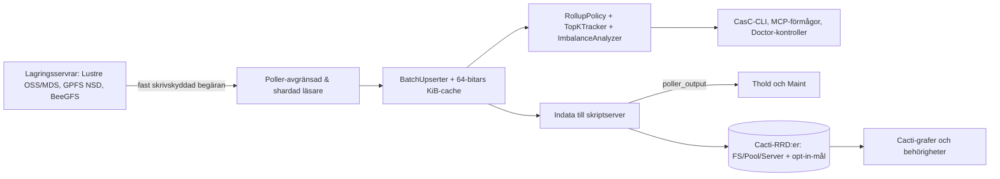

<!-- Source: README.md; SHA256: e88d6875d113220a91cfc0a9d230c829a78477b17e6aa7e44dda38c9591c86ad -->

<!-- translations:start -->
[English](../../../README.md) | [简体中文](../zh-CN/README.md) | [हिन्दी](../hi-IN/README.md) | [Español (España)](../es-ES/README.md) | [Español (Latinoamérica)](../es-419/README.md) | [العربية (السعودية)](../ar-SA/README.md) | [Afrikaans](../af-ZA/README.md) | [አማርኛ](../am-ET/README.md) | [العربية (مصر)](../ar-EG/README.md) | [العربية (المغرب)](../ar-MA/README.md) | [বাংলা](../bn-BD/README.md) | [Bosanski](../bs-BA/README.md) | [Deutsch](../de-DE/README.md) | [فارسی](../fa-IR/README.md) | [Filipino](../fil-PH/README.md) | [Français](../fr-FR/README.md) | [Français (Maroc)](../fr-MA/README.md) | [Français (Sénégal)](../fr-SN/README.md) | [Hausa](../ha-NG/README.md) | [עברית](../he-IL/README.md) | [Hrvatski](../hr-HR/README.md) | [Bahasa Indonesia](../id-ID/README.md) | [Igbo](../ig-NG/README.md) | [Italiano](../it-IT/README.md) | [日本語](../ja-JP/README.md) | [한국어](../ko-KR/README.md) | [Malagasy](../mg-MG/README.md) | [मराठी](../mr-IN/README.md) | [Bahasa Melayu](../ms-MY/README.md) | [Nederlands](../nl-NL/README.md) | [Polski](../pl-PL/README.md) | [Português (Brasil)](../pt-BR/README.md) | [Русский](../ru-RU/README.md) | [Kinyarwanda](../rw-RW/README.md) | [Soomaali](../so-SO/README.md) | [Српски](../sr-RS/README.md) | [Svenska](README.md) | [Kiswahili](../sw-KE/README.md) | [தமிழ்](../ta-IN/README.md) | [తెలుగు](../te-IN/README.md) | [ไทย](../th-TH/README.md) | [Türkçe](../tr-TR/README.md) | [Українська](../uk-UA/README.md) | [اردو](../ur-PK/README.md) | [Tiếng Việt](../vi-VN/README.md) | [isiXhosa](../xh-ZA/README.md) | [Yorùbá](../yo-NG/README.md) | [繁體中文](../zh-TW/README.md) | [isiZulu](../zu-ZA/README.md)
<!-- translations:end -->

# plugin_pfs

Ett Cacti 1.2-plugin som tar in hälsa, kapacitet, fyllnadsobalans, genomströmning per mål samt frekvens för metadataoperationer för parallella filsystem i Cacti över Lustre, IBM Storage Scale (GPFS) och BeeGFS bakom ett enhetligt `Backend`-gränssnitt. Varje filsystem mappas till en vanlig Cacti-enhet med datafrågor, översikts- och behovsstyrda målgrafer samt sammanfattande mätare så att Thold och Maint larmar på och undertrycker dem oförändrat.

> **Status: fas 1 till och med 3 samt exascale-skalningsprimitiver implementerade i kod, ej släppt ännu.** Grund, Lustre-observation, larm och Maint-undertryckning, skrivskyddade drivrutiner för GPFS och BeeGFS, OST/MDT-obalansanalys med Maint-integration, poller-avgränsad fjärrinsamling (`replicate_out`, `remote_agent`), skalningsprimitiver för 100+ PB / exascale (`FramedReportParser`, Schema v4 `value_kib`, `RollupPolicy`, `TopKTracker`, `ShardAssigner`, `BatchUpserter`), CasC-operatörs-CLI (`cli/pfs.php`) och ekosystem-hooks (`abilities_register`, `doctor_register_checks`, `casc_register_providers`) är implementerade och verifierade med enhets-, säkerhets- och integrationstester i engångsinstanser av Cacti. Alla körningar hittills använder fixturutdata från noder i stället för skarp Lustre-, GPFS- eller BeeGFS-hårdvara. Fortfarande öppet före taggning av en release: pilottester på riktiga filsystem ([pilotplanen](../../pilot-plan.md)), en extern säkerhetsgranskning ([egengranskningen](../../security-review.md)) och skalningsmätningar på dokumenterad hårdvara ([skalning](../../research/scale.md)). Version 0.1.0 är förberedd i `INFO` och [CHANGELOG.md](../../../CHANGELOG.md) men ännu inte taggad.

## Åtkomstroller

| Behörighetsområde | Åtkomst |
| --- | --- |
| Parallel Filesystem View | Befintliga övervakningssidor. |
| Parallel Filesystem Operator | Övervakning plus sidan Operations samt personliga kvittenser vid felsökning. |
| Parallel Filesystem Admin | Operatörsåtkomst plus befintliga konfigurations- och administrationsåtgärder. |

Efter att uppgraderingsfilerna har kopierats öppnar du sidan Plugins som administratör för att registrera det nya behörighetsområdet. Tilldela behörighetsområdet Operator uttryckligen under **Configuration > Users** eller användargrupper. Uppgraderingar behåller de befintliga ID:na och tilldelningarna för View och Admin. Admin-åtkomst ärver Operator-åtkomst, och Operator-åtkomst ärver View-åtkomst vid varje begäran; detta lägger inte till lagrade behörigheter på användare eller grupper. Plugininställningar kräver också behörigheten Parallel Filesystem Admin utöver Cactis Settings-behörighet.

Cactis enhetsbehörigheter begränsar fortfarande vilka rader och åtgärder som är tillgängliga för varje användare; omappade objekt kräver en administratör. Inloggningsuppgifter, konfiguration, mappning, borttagning och andra administrativa ändringar finns kvar på administrationssidorna. Kvittenser gäller endast i den aktuella användarens session, i högst en timme och bara så länge samma observation förblir aktuell. Nya eller ändrade observationer gör dem ogiltiga. De markerar aldrig en misslyckad mätning som frisk och undertrycker aldrig larm.

## Varför

När ett delat filsystem är långsamt är underlaget utspritt över flera servrar. Lustre lagrar sina räknare per nod: `lctl get_param` rapporterar värden "på den lokala noden", så varje objektlagringsserver (OSS) och metadataserver (MDS) har bara siffrorna för sina egna mål. En operatör som utreder ett långsamt filsystem behöver tre svar från olika håll:

- **Fylls ett mål medan andra är tomma?** Fyllnadsobalans påverkar var nya filer hamnar och när ett enskilt mål får slut på utrymme.
- **Vilka mål eller operationer är hårt belastade?** Byteräknare per mål och operationsräknare per MDT visar om belastningen är databunden eller metadatabunden.
- **Är själva övervakningen aktuell?** En platt graf är bara lugnande om pluginet faktiskt kunde nå servrarna.

Cacti ritar grafer för värdar och sätter tröskelvärden med Thold, och Cactis GitHub-organisation har inget arkiv för övervakning av Lustre, GPFS eller BeeGFS (sökt 2026-11-14). Pluginet täpper till den luckan genom att läsa tillåtelselistade, skrivskyddade värden från lagringsnoderna och representera varje filsystem som en Cacti-enhet vars mål är indexen i en datafråga. Det återanvänder Cactis grafritning, behörigheter, fjärrdatainsamlare, Thold och Maint i stället för att bygga parallella versioner av dem.

## Planerad omfattning

| Fas | Omfattning | Status | Milstolpar |
|---|---|---|---|
| 0, research | Releasematris, beslut om nodåtkomst, bekräftelse av uppströmsbeteende, räknar- och failoverbeteende, skalningsmätningar | Klar | [M1](https://github.com/somethingwithproof/plugin_pfs/milestone/1) |
| 1, observera | Lustre-inventering, kapacitet och fyllnadsgrad, OST/MDT-obalans (`lib/ImbalanceAnalyzer.php`), Maint-integration (`lib/HealthPage.php`), OST-genomströmning, MDT-operationsfrekvenser, grafer, Thold-larm, hälsosida | Implementerad (fixturtestad) | [M2](https://github.com/somethingwithproof/plugin_pfs/milestone/2), [M3](https://github.com/somethingwithproof/plugin_pfs/milestone/3), [M4](https://github.com/somethingwithproof/plugin_pfs/milestone/4) |
| 2, fjärr och skala | Poller-avgränsad fjärrinsamling (`lib/Reader.php`, `lib/ReplicationRepository.php`, `replicate_out`, `remote_agent`), skalningsprimitiver för 100+ PB (64-bitars KiB-hygien + Schema v4 `value_kib`, `lib/RollupPolicy.php`, `lib/TopKTracker.php`, `lib/ShardAssigner.php` + `poller_pfs.php --shard=K/N`, `lib/BatchUpserter.php`), CasC-CLI (`cli/pfs.php`), MCP/Doctor/CasC-hooks | Implementerad (enhets- och CI-integrationstestad) | [M5](https://github.com/somethingwithproof/plugin_pfs/milestone/5) |
| 3, backends | Skrivskyddade drivrutiner för IBM Storage Scale (GPFS) (`lib/GpfsBackend.php`) och BeeGFS (`lib/BeegfsBackend.php`) registrerade i `BackendRegistry::production()` | Implementerad (enhetstestad) | [M6](https://github.com/somethingwithproof/plugin_pfs/milestone/6) |

Viktiga implementerade operatörs- och skalningsprimitiver:

- **Skrivskyddade drivrutiner för flera filsystem:** `LustreBackend`, `GpfsBackend` (endast inramad `mmpmon` `fs_io_s`/`io_s` med `reset` förbjuden, `mmdf`-poolkapacitet/-tillstånd och väntesammanfattningar) och `BeegfsBackend` (lagrings-/metadatamål för BeeGFS 7.4 och 8.x med exakt byte-till-KiB-konvertering, mappning av nåbarhets-/konsistenstillstånd och mätarsemantik per intervall) som delar `lib/FramedReportParser.php`.
- **Medvetenhet om obalans, utrymme och Maint:** `lib/ImbalanceAnalyzer.php` beräknar OST/MDT-fyllnadskvoter, spridning, obalansindex baserat på populationens standardavvikelse, tillgängligt utrymme (headroom), aktualitetskontroll över 1 intervall (`missing_targets`), statusflaggor per mål och begränsade Top-K skeva mål. `HealthPage` (`pfs_health.php`) och `CascProvider::health()` exponerar Cactis underhållsfönster i `Maint` och undertrycker aktiva felvarningar under schemalagt underhåll.
- **Skalning för 100+ PB och exascale** ([docs/architecture/exascale-scaling.md](../../architecture/exascale-scaling.md)): exakt decimal byte-till-KiB-konvertering (`FramedReportParser::bytesToKibInt()`) verifierad vid 500 PB och 2 EB tillsammans med kolumner av typen `BIGINT UNSIGNED value_kib` (Schema v4); hierarkiska RRD-aggregeringar `Filesystem -> Pool -> Storage Server` med begränsad uppflyttning av opt-in/heta/skeva mål (`lib/RollupPolicy.php`); begränsade $O(K)$ Top-K skeva mål och föraggregerade sammanfattningar av tunga jobb/klienter (`lib/TopKTracker.php`, skapar aldrig enheter eller RRD:er per klient); deterministisk CRC32-insamlings-sharding (`lib/ShardAssigner.php`, `php plugins/pfs/poller_pfs.php [--poller=N] [--shard=K/N] [--force] [--debug]`); samt batchade SQL-upserts om 500 rader plus keyset-paginering (`lib/BatchUpserter.php`, `CacheRepository::upsertObservationsBatch()`, `TargetRepository::forFilesystemPage()`).
- **Operatörs-CLI för CasC och ekosystem-hooks:** `cli/pfs.php` stöder `export [--format=yaml|xml]`, `validate <file> [--format=yaml|xml]`, `plan <file> [--format=yaml|xml] [--output=text|json]`, `apply <file> --confirm=<PLAN_HASH> [--format=yaml|xml]` och `health [--format=text|json]` utan externa Composer-beroenden. `setup.php` och `lib/EcosystemIntegration.php` registrerar `abilities_register` (`pfs-list-filesystems`, `pfs-get-imbalance`, `pfs-get-health`; skrivskyddade, skyddade av `Parallel Filesystem View` och Cactis enhetsbehörigheter), `doctor_register_checks` (`pfs_schema`, `pfs_reader_freshness`, `pfs_capacity_imbalance`), `casc_register_providers`, `replicate_out` och `remote_agent`.

Utanför omfattningen: varje åtgärd som skriver, rensar, återställer eller finjusterar på en nod eller ett filsystem; en plugin-ägd larmmotor; en egen daemon eller ett eget nätverksprotokoll; Cacti-enheter/RRD:er per jobb eller per klient; ändringar i Cactis kärna, Thold eller Maint.

## Kompatibilitetsmål

| Komponent | Mål |
|---|---|
| Cacti | 1.2.31 eller senare, inga patchar i kärnan |
| PHP | 8.2 eller senare; `setup.php`, `poller_pfs.php` och `cli/pfs.php` förblir tolkningsbara på 8.0 så att en körtidsmiljö som inte stöds får ett avslag i stället för ett trasigt Cacti-gränssnitt |
| Lustre | Källkod och manualer kontrollerade vid 2.17.0; fixturtestad |
| GPFS, BeeGFS | Skrivskyddade drivrutiner för IBM Storage Scale (GPFS) 5.x `mmpmon`/`mmdf` och BeeGFS 7.4 / 8.x implementerade och fixturtestade |
| Thold, Maint | Thold 1.8.2 och Maint 1.3, oförändrade |

## Design

- [docs/architecture/exascale-scaling.md](../../architecture/exascale-scaling.md) dokumenterar telemetriarkitekturen i två nivåer för 100+ PB / exascale (Cacti/`plugin_pfs`-server + aggregering + Top-K-lager parat med out-of-band LDMS/Darshan/TOKIO-klienttelemetri) och dess akademiska litteraturkontext.
- [docs/PLAN.md](../../PLAN.md) är den fullständiga planen: arkitektur, uppströmsfakta den bygger på (med källor och vad som fortfarande är overifierat), räknarsemantik, tillståndsmodell, säkerhetsgränser, prestandaaritmetik, testning och risker.
- [docs/operator-guide.md](../../operator-guide.md) täcker installation, graferna och värdena, uppgradering, säkerhetskopiering och återställning, avinstallation och felsökning; [docs/alerting.md](../../alerting.md) täcker Thold och Maint.
- [docs/node-setup.md](../../node-setup.md) beskriver hur man förbereder en Lustre-server och en poller för läsaren.
- [docs/decisions/](../../decisions) innehåller Architecture Decision Records (ADR) för val som redan gjorts.
- [docs/REQUIREMENTS.md](../../REQUIREMENTS.md) mappar varje krav-ID till sitt ärende.

## Hur arbetet spåras

- **Milstolpar** följer planens milstolpar. Varje milstolpe har ett epic-ärende som listar dess delärenden och slutbevis.
- **Ärenden** typas med etikett: `type: requirement`, `type: research`, `type: decision`, `type: epic`. Krävärenden anger numrerade, testbara krav (`REQ-AREA-NNN`) och acceptanskriterier.
- **Etiketter** bär även `area:`, `phase:`, `priority:` och `status:`. Se [CONTRIBUTING.md](../../../CONTRIBUTING.md#labels).
- [Projekttavlan](https://github.com/users/somethingwithproof/projects/11) visar alla ärenden över milstolparna.

## Bidra

Läs [CONTRIBUTING.md](../../../CONTRIBUTING.md). Commits behöver en DCO-signering (DCO sign-off). Designdiskussioner förs i ärenden; öppna beslut har etiketten `type: decision`.

## Säkerhet

Rapportera sårbarheter privat; se [SECURITY.md](../../../SECURITY.md).

## Licens

GNU General Public License v2.0, samma licens som Cacti och dess plugins. Se [LICENSE](../../../LICENSE).
