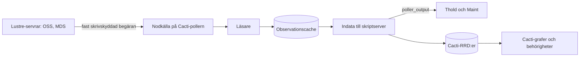

<!-- Source: README.md; SHA256: 40f2c5a5e9be97e4bd2b05a9ebab2a77de51de3af1b1c21dbeb5ee7f936cdd3b -->

<!-- translations:start -->
[English](../../../README.md) | [简体中文](../zh-CN/README.md) | [हिन्दी](../hi-IN/README.md) | [Español (España)](../es-ES/README.md) | [Español (Latinoamérica)](../es-419/README.md) | [العربية (السعودية)](../ar-SA/README.md) | [Afrikaans](../af-ZA/README.md) | [አማርኛ](../am-ET/README.md) | [العربية (مصر)](../ar-EG/README.md) | [العربية (المغرب)](../ar-MA/README.md) | [বাংলা](../bn-BD/README.md) | [Deutsch](../de-DE/README.md) | [فارسی](../fa-IR/README.md) | [Filipino](../fil-PH/README.md) | [Français](../fr-FR/README.md) | [Français (Maroc)](../fr-MA/README.md) | [Français (Sénégal)](../fr-SN/README.md) | [Hausa](../ha-NG/README.md) | [עברית](../he-IL/README.md) | [Bahasa Indonesia](../id-ID/README.md) | [Igbo](../ig-NG/README.md) | [Italiano](../it-IT/README.md) | [日本語](../ja-JP/README.md) | [한국어](../ko-KR/README.md) | [Malagasy](../mg-MG/README.md) | [मराठी](../mr-IN/README.md) | [Bahasa Melayu](../ms-MY/README.md) | [Nederlands](../nl-NL/README.md) | [Polski](../pl-PL/README.md) | [Português (Brasil)](../pt-BR/README.md) | [Русский](../ru-RU/README.md) | [Kinyarwanda](../rw-RW/README.md) | [Soomaali](../so-SO/README.md) | [Svenska](README.md) | [Kiswahili](../sw-KE/README.md) | [தமிழ்](../ta-IN/README.md) | [తెలుగు](../te-IN/README.md) | [ไทย](../th-TH/README.md) | [Türkçe](../tr-TR/README.md) | [Українська](../uk-UA/README.md) | [اردو](../ur-PK/README.md) | [Tiếng Việt](../vi-VN/README.md) | [isiXhosa](../xh-ZA/README.md) | [Yorùbá](../yo-NG/README.md) | [繁體中文](../zh-TW/README.md) | [isiZulu](../zu-ZA/README.md)
<!-- translations:end -->

# plugin_pfs

Ett Cacti 1.2-plugin som tar in hälsa och belastning för parallella filsystem i Cacti: kapacitet och fyllnadsobalans mellan mål, genomströmning per mål samt frekvens för metadataoperationer. Lustre är den första backend-modulen. GPFS (IBM Storage Scale) och BeeGFS följer bakom ett backend-gränssnitt. Data landar i vanliga Cacti-enheter, datakällor och grafer, så Thold och Maint larmar på och undertrycker den oförändrat.

> **Status: milstolpe 4, kodmässigt färdig för fas 1, ej släppt.** Milstolparna 2 (grund), 3 (Lustre-observation) och 4 (larm och releaseförberedelser) är klara på `main` eller under granskning. Pluginet installeras, uppgraderas och avinstalleras via Cactis plugin-API och nekar PHP under 8.2. En bakgrundsläsare på varje poller läser Lustre-servrar över SSH genom ett fast forced-command-skript ([node/pfs-read.sh](../../../node/pfs-read.sh)) och cachar inventering, tillstånd, kapacitet och räknare tillsammans med deras aktualitet. Varje filsystem blir en Cacti-enhet med OST- och MDT-datafrågor, fem översiktsgrafer, grafer per mål vid behov samt en sammanfattande datakälla för Thold. Thold v1.8.2 och Maint v1.3, oförändrade, larmar på och undertrycker de sammanfattande mätvärdena i end-to-end-körningen; Thold-tröskelvärden på räknare stöds inte med Thold 1.8.2 ([docs/alerting.md](../../alerting.md)). Alla tester hittills körs på fixturutdata från noder i en engångsinstans av Cacti: pluginet har inte körts mot en riktig Lustre-nod. Fortfarande öppet före en release: pilottester på riktiga filsystem ([pilotplanen](../../pilot-plan.md)), den externa säkerhetsgranskningen ([egengranskningen](../../security-review.md)) och skalningsmätningar på dokumenterad hårdvara ([skalning](../../research/scale.md)). Version 0.1.0 är förberedd i `INFO` och [CHANGELOG.md](../../../CHANGELOG.md) men ännu inte taggad.

## Åtkomstroller

| Behörighetsområde | Åtkomst |
| --- | --- |
| Parallel Filesystem View | Befintliga övervakningssidor. |
| Parallel Filesystem Operator | Övervakning plus sidan Operations samt personliga kvittenser vid felsökning. |
| Parallel Filesystem Admin | Operatörsåtkomst plus befintliga konfigurations- och administrationsåtgärder. |

Efter att uppgraderingsfilerna har kopierats öppnar du sidan Plugins som administratör för att registrera det nya behörighetsområdet. Tilldela behörighetsområdet Operator uttryckligen under **Configuration > Users** eller användargrupper. Uppgraderingar behåller de befintliga ID:na och tilldelningarna för View och Admin. Admin-åtkomst ärver Operator-åtkomst, och Operator-åtkomst ärver View-åtkomst vid varje begäran; detta lägger inte till lagrade behörigheter på användare eller grupper. Plugininställningar kräver också behörigheten Parallel Filesystem Admin utöver Cactis Settings-behörighet.

Cactis enhetsbehörigheter begränsar fortfarande vilka rader och åtgärder som är tillgängliga för varje användare; omappade objekt kräver en administratör. Inloggningsuppgifter, konfiguration, mappning, borttagning och andra administrativa ändringar finns kvar på administrationssidorna. Kvittenser gäller endast i den aktuella användarens session, i högst en timme och bara så länge samma observation förblir aktuell. Nya eller ändrade observationer gör dem ogiltiga. De markerar aldrig en misslyckad mätning som frisk och undertrycker aldrig larm.

## Varför

När ett delat filsystem är långsamt är underlaget utspritt över flera servrar. Lustre lagrar sina räknare per nod: `lctl get_param` rapporterar värden "på den lokala noden", så varje objektlagringsserver (OSS) och metadataserver (MDS) har bara siffrorna för sina egna mål. En operatör som utreder ett långsamt filsystem behöver tre svar från olika håll:

- **Fylls ett mål medan andra är tomma?** Fyllnadsobalans påverkar var nya filer hamnar och när ett enskilt mål får slut på utrymme.
- **Vilka mål eller operationer är hårt belastade?** Byteräknare per mål och operationsräknare per MDT visar om belastningen är databunden eller metadatabunden.
- **Är själva övervakningen aktuell?** En platt graf är bara lugnande om pluginet faktiskt kunde nå servrarna.

Cacti ritar grafer för värdar och sätter tröskelvärden med Thold, och Cactis GitHub-organisation har inget arkiv för övervakning av Lustre, GPFS eller BeeGFS (sökt 2026-11-14). Pluginet täpper till den luckan genom att läsa tillåtelselistade, skrivskyddade värden från lagringsnoderna och representera varje filsystem som en Cacti-enhet vars mål är indexen i en datafråga. Det återanvänder Cactis grafritning, behörigheter, fjärrdatainsamlare, Thold och Maint i stället för att bygga parallella versioner av dem.

## Planerad omfattning

| Fas | Omfattning | Milstolpar |
|---|---|---|
| 0, research | Releasematris, beslut om nodåtkomst, bekräftelse av uppströmsbeteende, räknar- och failoverbeteende, skalningsmätningar | [M1](https://github.com/somethingwithproof/plugin_pfs/milestone/1) |
| 1, observera | Lustre-inventering, kapacitet och fyllnadsgrad, OST-genomströmning, MDT-operationsfrekvenser, grafer, Thold-larm, Maint-undertryckning, hälsosida | [M2](https://github.com/somethingwithproof/plugin_pfs/milestone/2), [M3](https://github.com/somethingwithproof/plugin_pfs/milestone/3), [M4](https://github.com/somethingwithproof/plugin_pfs/milestone/4) |
| 2, djup | Fjärrdatainsamlare i Cacti, vyer på jobb- och klientnivå inom ett begränsat objektantal | [M5](https://github.com/somethingwithproof/plugin_pfs/milestone/5) |
| 3, backends | Backends för GPFS (IBM Storage Scale) och BeeGFS | [M6](https://github.com/somethingwithproof/plugin_pfs/milestone/6) |

Utanför omfattningen: varje åtgärd som skriver, rensar, återställer eller finjusterar på en nod eller ett filsystem; en plugin-ägd larmmotor; en egen daemon eller ett eget nätverksprotokoll; datakällor per jobb; ändringar i Cactis kärna, Thold eller Maint.

## Kompatibilitetsmål

| Komponent | Mål |
|---|---|
| Cacti | 1.2.31 eller senare, inga patchar i kärnan |
| PHP | 8.2 eller senare; `setup.php` förblir tolkningsbar på 8.0 så att en körtidsmiljö som inte stöds får ett avslag i stället för ett trasigt Cacti-gränssnitt |
| Lustre | Releasegrenar fastställs i milstolpe 1; källkod och manualer som kontrollerats hittills gäller 2.17.0 |
| GPFS, BeeGFS | Fas 3; releaser fastställs genom research |
| Thold, Maint | Inga ändringar krävs |

## Design

- [docs/PLAN.md](../../PLAN.md) är den fullständiga planen: arkitektur, uppströmsfakta den bygger på (med källor och vad som fortfarande är overifierat), räknarsemantik, tillståndsmodell, säkerhetsgränser, prestandaaritmetik, testning och risker.
- [docs/operator-guide.md](../../operator-guide.md) täcker installation, graferna och värdena, uppgradering, säkerhetskopiering och återställning, avinstallation och felsökning; [docs/alerting.md](../../alerting.md) täcker Thold och Maint.
- [docs/node-setup.md](../../node-setup.md) beskriver hur man förbereder en Lustre-server och en poller för läsaren.
- [docs/decisions/](../../decisions) innehåller Architecture Decision Records (ADR) för val som redan gjorts.
- [docs/REQUIREMENTS.md](../../REQUIREMENTS.md) mappar varje krav-ID till sitt ärende.

## Hur arbetet spåras

- **Milstolpar** följer planens milstolpar. Varje milstolpe har ett epic-ärende som listar dess delärenden och slutbevis.
- **Ärenden** typas med etikett: `type: requirement`, `type: research`, `type: decision`, `type: epic`. Krävärenden anger numrerade, testbara krav (`REQ-AREA-NNN`) och acceptanskriterier.
- **Etiketter** bär även `area:`, `phase:`, `priority:` och `status:`. Se [CONTRIBUTING.md](../../../CONTRIBUTING.md#labels).
- [Projekttavlan](https://github.com/users/somethingwithproof/projects/11) visar alla ärenden över milstolparna.

## Bidra

Läs [CONTRIBUTING.md](../../../CONTRIBUTING.md). Commits behöver en DCO-signering (DCO sign-off). Designdiskussioner förs i ärenden; öppna beslut har etiketten `type: decision`.

## Säkerhet

Rapportera sårbarheter privat; se [SECURITY.md](../../../SECURITY.md).

## Licens

GNU General Public License v2.0, samma licens som Cacti och dess plugins. Se [LICENSE](../../../LICENSE).
