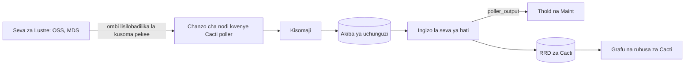

<!-- Source: README.md; SHA256: 40f2c5a5e9be97e4bd2b05a9ebab2a77de51de3af1b1c21dbeb5ee7f936cdd3b -->

<!-- translations:start -->
[English](../../../README.md) | [简体中文](../zh-CN/README.md) | [हिन्दी](../hi-IN/README.md) | [Español (España)](../es-ES/README.md) | [Español (Latinoamérica)](../es-419/README.md) | [العربية (السعودية)](../ar-SA/README.md) | [Afrikaans](../af-ZA/README.md) | [አማርኛ](../am-ET/README.md) | [العربية (مصر)](../ar-EG/README.md) | [العربية (المغرب)](../ar-MA/README.md) | [বাংলা](../bn-BD/README.md) | [Bosanski](../bs-BA/README.md) | [Deutsch](../de-DE/README.md) | [فارسی](../fa-IR/README.md) | [Filipino](../fil-PH/README.md) | [Français](../fr-FR/README.md) | [Français (Maroc)](../fr-MA/README.md) | [Français (Sénégal)](../fr-SN/README.md) | [Hausa](../ha-NG/README.md) | [עברית](../he-IL/README.md) | [Hrvatski](../hr-HR/README.md) | [Bahasa Indonesia](../id-ID/README.md) | [Igbo](../ig-NG/README.md) | [Italiano](../it-IT/README.md) | [日本語](../ja-JP/README.md) | [한국어](../ko-KR/README.md) | [Malagasy](../mg-MG/README.md) | [मराठी](../mr-IN/README.md) | [Bahasa Melayu](../ms-MY/README.md) | [Nederlands](../nl-NL/README.md) | [Polski](../pl-PL/README.md) | [Português (Brasil)](../pt-BR/README.md) | [Русский](../ru-RU/README.md) | [Kinyarwanda](../rw-RW/README.md) | [Soomaali](../so-SO/README.md) | [Српски](../sr-RS/README.md) | [Svenska](../sv-SE/README.md) | [Kiswahili](README.md) | [தமிழ்](../ta-IN/README.md) | [తెలుగు](../te-IN/README.md) | [ไทย](../th-TH/README.md) | [Türkçe](../tr-TR/README.md) | [Українська](../uk-UA/README.md) | [اردو](../ur-PK/README.md) | [Tiếng Việt](../vi-VN/README.md) | [isiXhosa](../xh-ZA/README.md) | [Yorùbá](../yo-NG/README.md) | [繁體中文](../zh-TW/README.md) | [isiZulu](../zu-ZA/README.md)
<!-- translations:end -->

# plugin_pfs

Programu-jalizi ya Cacti 1.2 inayoleta afya na mzigo wa mfumo wa faili sambamba katika Cacti: uwezo na usawa wa ujazaji katika shabaha mbalimbali, kasi ya upitishaji kwa kila shabaha, na viwango vya utendakazi wa metadata. Lustre ndiyo mazingira ya nyuma ya kwanza. GPFS (IBM Storage Scale) na BeeGFS zinafuata kupitia kiolesura cha mazingira ya nyuma. Data huwekwa katika vifaa vya kawaida vya Cacti, vyanzo vya data, na grafu, ili Thold na Maint ziweze kutoa tahadhari na kuzizuia bila mabadiliko yoyote.

> **Hali: hatua ya 4, msimbo umekamilika kwa awamu ya 1, haujatolewa rasmi.** Hatua ya 2 (msingi), 3 (uchunguzi wa Lustre), na 4 (utoaji wa tahadhari na maandalizi ya toleo) zimekamilika kwenye `main` au ziko katika ukaguzi. Programu-jalizi husakinishwa, husasishwa, na kuondolewa kupitia API ya programu-jalizi ya Cacti na hukataa PHP chini ya 8.2. Kisomaji cha chinichini kwenye kila poller husoma seva za Lustre kupitia SSH kwa kutumia hati maalum ya amri iliyofungwa ([node/pfs-read.sh](../../../node/pfs-read.sh)) na huhifadhi kwenye akiba orodha ya vipengee, hali, uwezo, na vihesabu pamoja na upya wake. Kila mfumo wa faili unakuwa kifaa cha Cacti chenye maulizo ya data ya OST na MDT, grafu tano za muhtasari, grafu za kila shabaha inapohitajika, na chanzo cha data cha muhtasari kwa ajili ya Thold. Thold v1.8.2 na Maint v1.3, bila kubadilishwa, hutoa tahadhari na kuzuia vipimo vya muhtasari katika uendeshaji wa mwanzo hadi mwisho; viwango vya tahadhari vya Thold kwenye vihesabu havitumiki na Thold 1.8.2 ([docs/alerting.md](../../alerting.md)). Kila jaribio hadi sasa limeendeshwa kwenye matokeo ya mfano ya nodi ndani ya Cacti ya muda: programu-jalizi haijawahi kuendeshwa dhidi ya nodi halisi ya Lustre. Yanayosalia kabla ya kutolewa: majaribio kwenye mifumo halisi ya faili ([mpango wa majaribio](../../pilot-plan.md)), ukaguzi wa nje wa usalama ([ukaguzi wa binafsi](../../security-review.md)), na vipimo vya kiwango kwenye maunzi yaliyoandikwa ([kipimo cha kiwango](../../research/scale.md)). Toleo la 0.1.0 limeandaliwa katika `INFO` na [CHANGELOG.md](../../../CHANGELOG.md) lakini halijawekewa lebo ya toleo.

## Majukumu ya ufikiaji

| Eneo la ufikiaji | Ufikiaji |
| --- | --- |
| Parallel Filesystem View | Kurasa zilizopo za ufuatiliaji. |
| Parallel Filesystem Operator | Ufuatiliaji pamoja na ukurasa wa Uendeshaji (Operations) na uthibitisho wa uchunguzi wa awali wa kibinafsi. |
| Parallel Filesystem Admin | Ufikiaji wa Operator pamoja na usanidi uliopo na vitendo vya kiutawala. |

Baada ya kunakili faili za sasisho, fungua ukurasa wa Plugins kama msimamizi ili kusajili
eneo jipya la ufikiaji. Weka eneo la Operator waziwazi chini ya **Configuration > Users** au makundi ya watumiaji.
Masasisho huhifadhi vitambulisho na ruhusa zilizopo za maeneo ya View na Admin. Ufikiaji wa Admin
hurithi ufikiaji wa Operator, na ufikiaji wa Operator hurithi ufikiaji wa View kwa kila ombi;
hii haiongezi ruhusa zilizohifadhiwa kwa watumiaji au makundi. Mipangilio ya programu-jalizi pia huhitaji
ufikiaji wa Parallel Filesystem Admin pamoja na ruhusa ya Settings ya Cacti.

Ruhusa za vifaa za Cacti bado hupunguza safu mlalo na vitendo vinavyopatikana kwa kila mtumiaji; vipengee visivyooanishwa huhitaji msimamizi.
Vitambulisho vya kuingia, usanidi, uoanishaji, ufutaji na mabadiliko mengine ya kiutawala
hubaki katika kurasa za kiutawala. Uthibitisho hudumu tu katika kipindi cha sasa cha
mtumiaji, kwa muda usiozidi saa moja na tu mradi uchunguzi uleule unabaki kuwa
mpya. Uchunguzi mpya au uliobadilika huufanya ubatilike. Kamwe hauweki kipimo
kilichoshindwa kuwa chenye afya wala kuzuia tahadhari.

## Kwa nini

Wakati mfumo wa faili unaotumika kwa pamoja unapokuwa wa polepole, ushahidi huwa umetawanyika katika seva mbalimbali. Lustre huhifadhi vihesabu vyake kwa kila nodi: `lctl get_param` huripoti thamani "kwenye nodi ya ndani", hivyo kila seva ya hifadhi ya vipengee (OSS) na seva ya metadata (MDS) hushikilia nambari za shabaha zake pekee. Mwendeshaji anayechunguza mfumo wa faili wa polepole anahitaji majibu matatu kutoka sehemu tofauti:

- **Je, shabaha moja inajaa huku nyingine zikiwa tupu?** Kutokuwepo kwa usawa wa ujazaji hubadilisha mahali ambapo faili mpya huwekwa na wakati ambapo shabaha moja huishiwa na nafasi.
- **Ni shabaha zipi au shughuli zipi zilizo na shughuli nyingi?** Vihesabu vya baiti kwa kila shabaha na vihesabu vya shughuli kwa kila MDT huonyesha kama mzigo unatokana na data au metadata.
- **Je, ufuatiliaji wenyewe ni wa kisasa?** Grafu iliyonyooka inatuliza tu iwapo programu-jalizi iliweza kuona seva.

Cacti huchora grafu za seva na kuweka viwango vya tahadhari kwa thamani kupitia Thold, na shirika la Cacti kwenye GitHub halina hazina ya ufuatiliaji wa Lustre, GPFS, au BeeGFS (ilitafutwa 2026-11-14). Programu-jalizi hii huziba pengo hilo kwa kusoma thamani zilizoruhusiwa, za kusoma pekee kutoka kwa nodi za hifadhi na kuwakilisha kila mfumo wa faili kama kifaa cha Cacti ambacho shabaha zake ni faharasa za ulizo la data. Inatumia tena uchoreaji wa grafu wa Cacti, ruhusa, wakusanyaji wa data wa mbali, Thold, na Maint badala ya kujenga matoleo yake sambamba.

## Wigo uliopangwa

| Awamu | Wigo | Hatua muhimu |
|---|---|---|
| 0, utafiti | Jedwali la matoleo, uamuzi wa ufikiaji wa nodi, uthibitisho wa tabia ya chanzo kikuu, tabia ya vihesabu na ubadilishaji hitilafu, vipimo vya kiwango | [M1](https://github.com/somethingwithproof/plugin_pfs/milestone/1) |
| 1, uchunguzi | Orodha ya vipengee vya Lustre, uwezo na ujazaji, kasi ya upitishaji ya OST, viwango vya shughuli za MDT, grafu, tahadhari za Thold, uzuiaji wa Maint, ukurasa wa afya | [M2](https://github.com/somethingwithproof/plugin_pfs/milestone/2), [M3](https://github.com/somethingwithproof/plugin_pfs/milestone/3), [M4](https://github.com/somethingwithproof/plugin_pfs/milestone/4) |
| 2, kina | Wakusanyaji wa data wa mbali wa Cacti, mitazamo ya kiwango cha kazi na kiwango cha mteja ndani ya idadi iliyodhibitiwa ya vipengee | [M5](https://github.com/somethingwithproof/plugin_pfs/milestone/5) |
| 3, mazingira ya nyuma | Mazingira ya nyuma ya GPFS (IBM Storage Scale) na BeeGFS | [M6](https://github.com/somethingwithproof/plugin_pfs/milestone/6) |

Nje ya wigo: operesheni yoyote ya kuandika, kufuta, kuweka upya, au kurekebisha mipangilio kwenye nodi au mfumo wa faili; injini ya tahadhari inayomilikiwa na programu-jalizi; huduma maalum ya chinichini au itifaki ya mtandao; vyanzo vya data kwa kila kazi; mabadiliko kwenye kiini cha Cacti, Thold, au Maint.

## Malengo ya uoanifu

| Kipengele | Lengo |
|---|---|
| Cacti | 1.2.31 au baadaye, bila viraka vya kiini |
| PHP | 8.2 au baadaye; `setup.php` hubaki ikichanganulika kwenye 8.0 ili mazingira ya uendeshaji yasiyotumika yapate katazo badala ya kiolesura cha Cacti kilichoharibika |
| Lustre | Mistari ya matoleo itakayowekwa rasmi kufikia hatua ya 1; msimbo chanzo na miongozo iliyokaguliwa hadi sasa iko katika 2.17.0 |
| GPFS, BeeGFS | Awamu ya 3; matoleo yatawekwa rasmi kupitia utafiti |
| Thold, Maint | Hakuna mabadiliko yanayohitajika |

## Muundo

- [docs/PLAN.md](../../PLAN.md) ni mpango kamili: usanifu wa mfumo, ukweli wa chanzo kikuu unaotegemewa (pamoja na vyanzo na yale ambayo bado hayajathibitishwa), maana ya vihesabu, muundo wa hali, mipaka ya usalama, hesabu ya utendakazi, majaribio, na hatari.
- [docs/operator-guide.md](../../operator-guide.md) inashughulikia usakinishaji, grafu na thamani, usasishaji, nakala rudufu na urejeshaji, uondoaji, na utatuzi wa matatizo; [docs/alerting.md](../../alerting.md) inashughulikia Thold na Maint.
- [docs/node-setup.md](../../node-setup.md) inaeleza jinsi ya kuandaa seva ya Lustre na poller kwa ajili ya kisomaji.
- [docs/decisions/](../../decisions) ina kumbukumbu za maamuzi ya usanifu kwa chaguo ambazo tayari zimefanywa.
- [docs/REQUIREMENTS.md](../../REQUIREMENTS.md) huoanisha kila kitambulisho cha hitaji na suala lake.

## Jinsi kazi inavyofuatiliwa

- **Hatua muhimu (Milestones)** hufuata hatua muhimu za mpango. Kila moja ina suala kuu (epic) linaloorodhesha masuala yake madogo na ushahidi wa kukamilika.
- **Masuala** yanaainishwa kwa lebo: `type: requirement`, `type: research`, `type: decision`, `type: epic`. Masuala ya mahitaji hubainisha mahitaji yenye nambari yanayoweza kupimwa (`REQ-AREA-NNN`) na vigezo vya kukubalika.
- **Lebo** pia hubeba `area:`, `phase:`, `priority:`, na `status:`. Tazama [CONTRIBUTING.md](../../../CONTRIBUTING.md#labels).
- [Ubao wa mradi](https://github.com/users/somethingwithproof/projects/11) huonyesha masuala yote katika hatua zote muhimu.

## Kuchangia

Soma [CONTRIBUTING.md](../../../CONTRIBUTING.md). Ahadi za mabadiliko (commits) zinahitaji sahihi ya DCO. Majadiliano ya muundo hufanyika kwenye masuala; maamuzi yaliyo wazi hubeba lebo ya `type: decision`.

## Usalama

Ripoti udhaifu wa kiusalama kwa faragha; tazama [SECURITY.md](../../../SECURITY.md).

## Leseni

GNU General Public License v2.0, leseni ileile ya Cacti na programu-jalizi zake. Tazama [LICENSE](../../../LICENSE).
