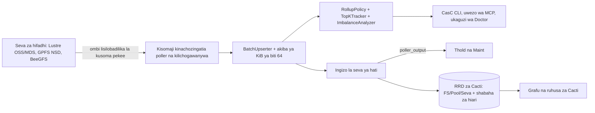

<!-- Source: README.md; SHA256: e88d6875d113220a91cfc0a9d230c829a78477b17e6aa7e44dda38c9591c86ad -->

<!-- translations:start -->
[English](../../../README.md) | [简体中文](../zh-CN/README.md) | [हिन्दी](../hi-IN/README.md) | [Español (España)](../es-ES/README.md) | [Español (Latinoamérica)](../es-419/README.md) | [العربية (السعودية)](../ar-SA/README.md) | [Afrikaans](../af-ZA/README.md) | [አማርኛ](../am-ET/README.md) | [العربية (مصر)](../ar-EG/README.md) | [العربية (المغرب)](../ar-MA/README.md) | [Български](../bg-BG/README.md) | [বাংলা](../bn-BD/README.md) | [Bosanski](../bs-BA/README.md) | [Deutsch](../de-DE/README.md) | [Ελληνικά](../el-GR/README.md) | [فارسی](../fa-IR/README.md) | [Filipino](../fil-PH/README.md) | [Français](../fr-FR/README.md) | [Français (Maroc)](../fr-MA/README.md) | [Français (Sénégal)](../fr-SN/README.md) | [Hausa](../ha-NG/README.md) | [עברית](../he-IL/README.md) | [Hrvatski](../hr-HR/README.md) | [Bahasa Indonesia](../id-ID/README.md) | [Igbo](../ig-NG/README.md) | [Italiano](../it-IT/README.md) | [日本語](../ja-JP/README.md) | [ქართული](../ka-GE/README.md) | [한국어](../ko-KR/README.md) | [Latviešu](../lv-LV/README.md) | [Malagasy](../mg-MG/README.md) | [मराठी](../mr-IN/README.md) | [Bahasa Melayu](../ms-MY/README.md) | [Nederlands](../nl-NL/README.md) | [Polski](../pl-PL/README.md) | [Português (Brasil)](../pt-BR/README.md) | [Português (Portugal)](../pt-PT/README.md) | [Русский](../ru-RU/README.md) | [Kinyarwanda](../rw-RW/README.md) | [Soomaali](../so-SO/README.md) | [Српски](../sr-RS/README.md) | [Svenska](../sv-SE/README.md) | [Kiswahili](README.md) | [தமிழ்](../ta-IN/README.md) | [తెలుగు](../te-IN/README.md) | [ไทย](../th-TH/README.md) | [Türkçe](../tr-TR/README.md) | [Українська](../uk-UA/README.md) | [اردو](../ur-PK/README.md) | [Tiếng Việt](../vi-VN/README.md) | [isiXhosa](../xh-ZA/README.md) | [Yorùbá](../yo-NG/README.md) | [繁體中文](../zh-TW/README.md) | [isiZulu](../zu-ZA/README.md)
<!-- translations:end -->

# plugin_pfs

Programu-jalizi ya Cacti 1.2 inayoleta afya ya mfumo wa faili sambamba, uwezo, kutokuwepo kwa usawa wa ujazaji, kasi ya upitishaji kwa kila shabaha, na viwango vya utendakazi wa metadata katika Cacti kwenye Lustre, IBM Storage Scale (GPFS), na BeeGFS nyuma ya kiolesura kimoja cha `Backend`. Kila mfumo wa faili huunganishwa na kifaa cha kawaida cha Cacti chenye maulizo ya data, grafu za muhtasari na grafu za shabaha zinapohitajika, na vipimo vya muhtasari ili Thold na Maint ziweze kutoa tahadhari na kuzizuia bila mabadiliko yoyote.

> **Hali: awamu ya 1 hadi ya 3 na vipengele vya msingi vya upanuzi wa kiwango cha exascale vimetekelezwa kwenye msimbo, bado havijatolewa rasmi.** Msingi, uchunguzi wa Lustre, utoaji wa tahadhari na uzuiaji wa Maint, viendeshi vya kusoma pekee vya GPFS na BeeGFS, uchambuzi wa kutokuwepo kwa usawa wa OST/MDT ukiwa na muunganisho wa Maint, upimaji wa ukusanyaji wa data wa mbali (`replicate_out`, `remote_agent`), vipengele vya msingi vya upanuzi wa 100+ PB / exascale (`FramedReportParser`, Schema v4 `value_kib`, `RollupPolicy`, `TopKTracker`, `ShardAssigner`, `BatchUpserter`), kiolesura cha amri cha waendeshaji cha CasC (`cli/pfs.php`), na ndoano za mfumo ikolojia (`abilities_register`, `doctor_register_checks`, `casc_register_providers`) vimetekelezwa na kuthibitishwa kwa majaribio ya sehemu, usalama, na ujumuishaji katika Cacti ya muda. Majaribio yote hadi sasa yanatumia matokeo ya mfano ya nodi badala ya maunzi halisi ya Lustre, GPFS, au BeeGFS. Yanayosalia kabla ya kuweka lebo ya toleo: majaribio kwenye mifumo halisi ya faili ([mpango wa majaribio](../../pilot-plan.md)), ukaguzi wa nje wa usalama ([ukaguzi wa binafsi](../../security-review.md)), na vipimo vya kiwango kwenye maunzi yaliyoandikwa ([kipimo cha kiwango](../../research/scale.md)). Toleo la 0.1.0 limeandaliwa katika `INFO` na [CHANGELOG.md](../../../CHANGELOG.md) lakini halijawekewa lebo ya toleo.

## Majukumu ya ufikiaji

| Eneo la ufikiaji | Ufikiaji |
| --- | --- |
| Parallel Filesystem View | Kurasa zilizopo za ufuatiliaji. |
| Parallel Filesystem Operator | Ufuatiliaji pamoja na ukurasa wa Uendeshaji (Operations) na uthibitisho wa uchunguzi wa awali wa kibinafsi. |
| Parallel Filesystem Admin | Ufikiaji wa Operator pamoja na usanidi uliopo na vitendo vya kiutawala. |

Baada ya kunakili faili za sasisho, fungua ukurasa wa Plugins kama msimamizi ili kusajili
eneo jipya la ufikiaji. Weka eneo la Operator waziwazi chini ya **Configuration > Users** au makundi ya watumiaji.
Masasisho huhifadhi vitambulisho na ruhusa zilizopo za maeneo ya View na Admin. Ufikiaji wa Admin
hurithi ufikiaji wa Operator, na ufikiaji wa Operator hurithi ufikiaji wa View kwa kila ombi;
hii haiongezi ruhusa zilizohifadhiwa kwa watumiaji au makundi. Mipangilio ya programu-jalizi pia huhitaji
ufikiaji wa Parallel Filesystem Admin pamoja na ruhusa ya Settings ya Cacti.

Ruhusa za vifaa za Cacti bado hupunguza safu mlalo na vitendo vinavyopatikana kwa kila mtumiaji; vipengee visivyooanishwa huhitaji msimamizi.
Vitambulisho vya kuingia, usanidi, uoanishaji, ufutaji na mabadiliko mengine ya kiutawala
hubaki katika kurasa za kiutawala. Uthibitisho hudumu tu katika kipindi cha sasa cha
mtumiaji, kwa muda usiozidi saa moja na tu mradi uchunguzi uleule unabaki kuwa
mpya. Uchunguzi mpya au uliobadilika huufanya ubatilike. Kamwe hauweki kipimo
kilichoshindwa kuwa chenye afya wala kuzuia tahadhari.

## Kwa nini

Wakati mfumo wa faili unaotumika kwa pamoja unapokuwa wa polepole, ushahidi huwa umetawanyika katika seva mbalimbali. Lustre huhifadhi vihesabu vyake kwa kila nodi: `lctl get_param` huripoti thamani "kwenye nodi ya ndani", hivyo kila seva ya hifadhi ya vipengee (OSS) na seva ya metadata (MDS) hushikilia nambari za shabaha zake pekee. Mwendeshaji anayechunguza mfumo wa faili wa polepole anahitaji majibu matatu kutoka sehemu tofauti:

- **Je, shabaha moja inajaa huku nyingine zikiwa tupu?** Kutokuwepo kwa usawa wa ujazaji hubadilisha mahali ambapo faili mpya huwekwa na wakati ambapo shabaha moja huishiwa na nafasi.
- **Ni shabaha zipi au shughuli zipi zilizo na shughuli nyingi?** Vihesabu vya baiti kwa kila shabaha na vihesabu vya shughuli kwa kila MDT huonyesha kama mzigo unatokana na data au metadata.
- **Je, ufuatiliaji wenyewe ni wa kisasa?** Grafu iliyonyooka inatuliza tu iwapo programu-jalizi iliweza kuona seva.

Cacti huchora grafu za seva na kuweka viwango vya tahadhari kwa thamani kupitia Thold, na shirika la Cacti kwenye GitHub halina hazina ya ufuatiliaji wa Lustre, GPFS, au BeeGFS (ilitafutwa 2026-11-14). Programu-jalizi hii huziba pengo hilo kwa kusoma thamani zilizoruhusiwa, za kusoma pekee kutoka kwa nodi za hifadhi na kuwakilisha kila mfumo wa faili kama kifaa cha Cacti ambacho shabaha zake ni faharasa za ulizo la data. Inatumia tena uchoreaji wa grafu wa Cacti, ruhusa, wakusanyaji wa data wa mbali, Thold, na Maint badala ya kujenga matoleo yake sambamba.

## Wigo uliopangwa

| Awamu | Wigo | Hali | Hatua muhimu |
|---|---|---|---|
| 0, utafiti | Jedwali la matoleo, uamuzi wa ufikiaji wa nodi, uthibitisho wa tabia ya chanzo kikuu, tabia ya vihesabu na ubadilishaji hitilafu, vipimo vya kiwango | Imekamilika | [M1](https://github.com/somethingwithproof/plugin_pfs/milestone/1) |
| 1, uchunguzi | Orodha ya vipengee vya Lustre, uwezo na ujazaji, kutokuwepo kwa usawa wa OST/MDT (`lib/ImbalanceAnalyzer.php`), muunganisho wa Maint (`lib/HealthPage.php`), kasi ya upitishaji ya OST, viwango vya shughuli za MDT, grafu, tahadhari za Thold, ukurasa wa afya | Imetekelezwa (imejaribiwa kwa data za mfano) | [M2](https://github.com/somethingwithproof/plugin_pfs/milestone/2), [M3](https://github.com/somethingwithproof/plugin_pfs/milestone/3), [M4](https://github.com/somethingwithproof/plugin_pfs/milestone/4) |
| 2, mbali na kiwango | Ukusanyaji wa mbali unaozingatia poller (`lib/Reader.php`, `lib/ReplicationRepository.php`, `replicate_out`, `remote_agent`), vipengele vya upanuzi wa 100+ PB (usafi wa KiB wa biti 64 + Schema v4 `value_kib`, `lib/RollupPolicy.php`, `lib/TopKTracker.php`, `lib/ShardAssigner.php` + `poller_pfs.php --shard=K/N`, `lib/BatchUpserter.php`), CasC CLI (`cli/pfs.php`), ndoano za MCP/Doctor/CasC | Imetekelezwa (imejaribiwa kwa majaribio ya sehemu na ujumuishaji wa CI) | [M5](https://github.com/somethingwithproof/plugin_pfs/milestone/5) |
| 3, mazingira ya nyuma | Viendeshi vya kusoma pekee vya IBM Storage Scale (GPFS) (`lib/GpfsBackend.php`) na BeeGFS (`lib/BeegfsBackend.php`) vilivyosajiliwa katika `BackendRegistry::production()` | Imetekelezwa (imejaribiwa kwa majaribio ya sehemu) | [M6](https://github.com/somethingwithproof/plugin_pfs/milestone/6) |

Vipengele muhimu vya uendeshaji na upanuzi vilivyotekelezwa:

- **Viendeshi vya kusoma pekee vya mifumo mingi ya faili:** `LustreBackend`, `GpfsBackend` (iliyoundwa kwa muundo wa fremu ya `mmpmon` `fs_io_s`/`io_s` pekee huku `reset` ikiwa imezuiwa, uwezo na hali za hifadhi za `mmdf`, na muhtasari wa wasubiri), na `BeegfsBackend` (shabaha za hifadhi na metadata za BeeGFS 7.4 na 8.x zenye ubadilishaji kamili wa baiti kwenda KiB, uoanishaji wa hali za ufikiaji na uthabiti, na maana za vipimo kwa kila muda) vikishirikiana `lib/FramedReportParser.php`.
- **Utambuzi wa kutokuwepo kwa usawa, nafasi iliyosalia, na Maint:** `lib/ImbalanceAnalyzer.php` hukokotoa uwiano wa ujazaji wa OST/MDT, mtawanyiko, kielelezo cha kutokuwepo kwa usawa cha mchepuko wa kawaida wa idadi ya watu, nafasi iliyosalia, utekelezaji wa upya wa muda wa kipindi 1 (`missing_targets`), alama za hali kwa kila shabaha, na shabaha zenye mwelekeo mbaya zaidi za Top-K zilizopunguzwa mipaka. `HealthPage` (`pfs_health.php`) na `CascProvider::health()` huonyesha madirisha ya matengenezo ya Cacti `Maint` na kuzuia maonyo ya hitilafu zinazoendelea wakati wa matengenezo yaliyopangwa.
- **Upanuzi wa 100+ PB na kiwango cha exascale** ([docs/architecture/exascale-scaling.md](../../architecture/exascale-scaling.md)): ubadilishaji kamili wa desimali wa baiti kwenda KiB (`FramedReportParser::bytesToKibInt()`) uliothibitishwa katika 500 PB na 2 EB pamoja na safuwima za `BIGINT UNSIGNED value_kib` (Schema v4); mikusanyiko ya RRD ya ngazi ya `Filesystem -> Pool -> Storage Server` yenye upandishaji uliodhibitiwa wa shabaha za hiari, zenye shughuli nyingi, au zenye mwelekeo mbaya (`lib/RollupPolicy.php`); shabaha zenye mwelekeo mbaya za Top-K zilizopunguzwa mipaka kwa $O(K)$ na muhtasari uliokusanywa mapema wa kazi na wateja wenye mzigo mkubwa (`lib/TopKTracker.php`, bila kamwe kuunda vifaa au RRD kwa kila mteja); ugawaji wa mkusanyaji wa CRC32 wenye matokeo thabiti (`lib/ShardAssigner.php`, `php plugins/pfs/poller_pfs.php [--poller=N] [--shard=K/N] [--force] [--debug]`); na uingizaji na usasishaji wa SQL kwa mafungu ya safumlalo 500 pamoja na upitiaji wa kurasa kwa ufunguo (`lib/BatchUpserter.php`, `CacheRepository::upsertObservationsBatch()`, `TargetRepository::forFilesystemPage()`).
- **Kiolesura cha amri cha waendeshaji cha CasC na ndoano za mfumo ikolojia:** `cli/pfs.php` inaauni `export [--format=yaml|xml]`, `validate <file> [--format=yaml|xml]`, `plan <file> [--format=yaml|xml] [--output=text|json]`, `apply <file> --confirm=<PLAN_HASH> [--format=yaml|xml]`, na `health [--format=text|json]` bila vitegemezi vyovyote vya nje vya Composer. `setup.php` na `lib/EcosystemIntegration.php` husajili `abilities_register` (`pfs-list-filesystems`, `pfs-get-imbalance`, `pfs-get-health`; za kusoma pekee, zikidhibitiwa na `Parallel Filesystem View` na ruhusa za vifaa za Cacti), `doctor_register_checks` (`pfs_schema`, `pfs_reader_freshness`, `pfs_capacity_imbalance`), `casc_register_providers`, `replicate_out`, na `remote_agent`.

Nje ya wigo: operesheni yoyote ya kuandika, kufuta, kuweka upya, au kurekebisha mipangilio kwenye nodi au mfumo wa faili; injini ya tahadhari inayomilikiwa na programu-jalizi; huduma maalum ya chinichini au itifaki ya mtandao; vifaa au RRD za Cacti kwa kila kazi au kwa kila mteja; mabadiliko kwenye kiini cha Cacti, Thold, au Maint.

## Malengo ya uoanifu

| Kipengele | Lengo |
|---|---|
| Cacti | 1.2.31 au baadaye, bila viraka vya kiini |
| PHP | 8.2 au baadaye; `setup.php`, `poller_pfs.php`, na `cli/pfs.php` hubaki zikichanganulika kwenye 8.0 ili mazingira ya uendeshaji yasiyotumika yapate katazo badala ya kiolesura cha Cacti kilichoharibika |
| Lustre | Msimbo chanzo na miongozo iliyokaguliwa katika 2.17.0; imejaribiwa kwa data za mfano |
| GPFS, BeeGFS | Viendeshi vya kusoma pekee vya IBM Storage Scale (GPFS) 5.x `mmpmon`/`mmdf` na BeeGFS 7.4 / 8.x vimetekelezwa na kujaribiwa kwa data za mfano |
| Thold, Maint | Thold 1.8.2 na Maint 1.3, bila mabadiliko |

## Muundo

- [docs/architecture/exascale-scaling.md](../../architecture/exascale-scaling.md) inaeleza usanifu wa vipimo vya ngazi mbili vya 100+ PB / exascale (seva ya Cacti/`plugin_pfs` + mkusanyiko wa ngazi + ngazi ya Top-K pamoja na vipimo vya mteja vya nje ya bendi vya LDMS/Darshan/TOKIO) na muktadha wake wa maandiko ya kitaaluma.
- [docs/PLAN.md](../../PLAN.md) ni mpango kamili: usanifu wa mfumo, ukweli wa chanzo kikuu unaotegemewa (pamoja na vyanzo na yale ambayo bado hayajathibitishwa), maana ya vihesabu, muundo wa hali, mipaka ya usalama, hesabu ya utendakazi, majaribio, na hatari.
- [docs/operator-guide.md](../../operator-guide.md) inashughulikia usakinishaji, grafu na thamani, usasishaji, nakala rudufu na urejeshaji, uondoaji, na utatuzi wa matatizo; [docs/alerting.md](../../alerting.md) inashughulikia Thold na Maint.
- [docs/node-setup.md](../../node-setup.md) inaeleza jinsi ya kuandaa seva ya Lustre na poller kwa ajili ya kisomaji.
- [docs/decisions/](../../decisions) ina kumbukumbu za maamuzi ya usanifu kwa chaguo ambazo tayari zimefanywa.
- [docs/REQUIREMENTS.md](../../REQUIREMENTS.md) huoanisha kila kitambulisho cha hitaji na suala lake.

## Jinsi kazi inavyofuatiliwa

- **Hatua muhimu (Milestones)** hufuata hatua muhimu za mpango. Kila moja ina suala kuu (epic) linaloorodhesha masuala yake madogo na ushahidi wa kukamilika.
- **Masuala** yanaainishwa kwa lebo: `type: requirement`, `type: research`, `type: decision`, `type: epic`. Masuala ya mahitaji hubainisha mahitaji yenye nambari yanayoweza kupimwa (`REQ-AREA-NNN`) na vigezo vya kukubalika.
- **Lebo** pia hubeba `area:`, `phase:`, `priority:`, na `status:`. Tazama [CONTRIBUTING.md](../../../CONTRIBUTING.md#labels).
- [Ubao wa mradi](https://github.com/users/somethingwithproof/projects/11) huonyesha masuala yote katika hatua zote muhimu.

## Kuchangia

Soma [CONTRIBUTING.md](../../../CONTRIBUTING.md). Ahadi za mabadiliko (commits) zinahitaji sahihi ya DCO. Majadiliano ya muundo hufanyika kwenye masuala; maamuzi yaliyo wazi hubeba lebo ya `type: decision`.

## Usalama

Ripoti udhaifu wa kiusalama kwa faragha; tazama [SECURITY.md](../../../SECURITY.md).

## Leseni

GNU General Public License v2.0, leseni ileile ya Cacti na programu-jalizi zake. Tazama [LICENSE](../../../LICENSE).
