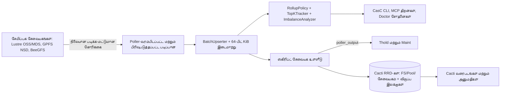

<!-- Source: README.md; SHA256: e88d6875d113220a91cfc0a9d230c829a78477b17e6aa7e44dda38c9591c86ad -->

<!-- translations:start -->
[English](../../../README.md) | [简体中文](../zh-CN/README.md) | [हिन्दी](../hi-IN/README.md) | [Español (España)](../es-ES/README.md) | [Español (Latinoamérica)](../es-419/README.md) | [العربية (السعودية)](../ar-SA/README.md) | [Afrikaans](../af-ZA/README.md) | [አማርኛ](../am-ET/README.md) | [العربية (مصر)](../ar-EG/README.md) | [العربية (المغرب)](../ar-MA/README.md) | [বাংলা](../bn-BD/README.md) | [Bosanski](../bs-BA/README.md) | [Deutsch](../de-DE/README.md) | [فارسی](../fa-IR/README.md) | [Filipino](../fil-PH/README.md) | [Français](../fr-FR/README.md) | [Français (Maroc)](../fr-MA/README.md) | [Français (Sénégal)](../fr-SN/README.md) | [Hausa](../ha-NG/README.md) | [עברית](../he-IL/README.md) | [Hrvatski](../hr-HR/README.md) | [Bahasa Indonesia](../id-ID/README.md) | [Igbo](../ig-NG/README.md) | [Italiano](../it-IT/README.md) | [日本語](../ja-JP/README.md) | [한국어](../ko-KR/README.md) | [Malagasy](../mg-MG/README.md) | [मराठी](../mr-IN/README.md) | [Bahasa Melayu](../ms-MY/README.md) | [Nederlands](../nl-NL/README.md) | [Polski](../pl-PL/README.md) | [Português (Brasil)](../pt-BR/README.md) | [Русский](../ru-RU/README.md) | [Kinyarwanda](../rw-RW/README.md) | [Soomaali](../so-SO/README.md) | [Српски](../sr-RS/README.md) | [Svenska](../sv-SE/README.md) | [Kiswahili](../sw-KE/README.md) | [தமிழ்](README.md) | [తెలుగు](../te-IN/README.md) | [ไทย](../th-TH/README.md) | [Türkçe](../tr-TR/README.md) | [Українська](../uk-UA/README.md) | [اردو](../ur-PK/README.md) | [Tiếng Việt](../vi-VN/README.md) | [isiXhosa](../xh-ZA/README.md) | [Yorùbá](../yo-NG/README.md) | [繁體中文](../zh-TW/README.md) | [isiZulu](../zu-ZA/README.md)
<!-- translations:end -->

# plugin_pfs

Lustre, IBM Storage Scale (GPFS), மற்றும் BeeGFS ஆகியவற்றில் ஒரே `Backend` இடைமுகத்தின் கீழ் இணைக் கோப்புமுறைமையின் (parallel filesystem) நலன், கொள்ளளவு, நிரப்புதல் சமநிலையின்மை, ஒரு இலக்கிற்கான தரவுப் பரிமாற்ற வேகம் (throughput), மற்றும் மெட்டாடேட்டா செயல்பாட்டு விகிதங்களை Cacti-க்குள் கொண்டுவரும் Cacti 1.2 செருகுநிரல். ஒவ்வொரு கோப்புமுறைமையும் தரவு வினவல்கள், மேலோட்ட மற்றும் தேவைக்கேற்ப இலக்கு வரைபடங்கள், மற்றும் சுருக்க அளவீடுகளுடன் கூடிய சாதாரண Cacti சாதனமாக இணைக்கப்படுகிறது; இதனால் Thold மற்றும் Maint ஆகியவை எந்த மாற்றமும் இன்றி எச்சரிக்கைகளை அனுப்பவும் கட்டுப்படுத்தவும் முடியும்.

> **நிலை: கட்டம் 1 முதல் 3 வரை மற்றும் exascale அளவிடுதல் அடிப்படைக் கூறுகள் குறியீட்டில் செயல்படுத்தப்பட்டுள்ளன, இன்னும் வெளியிடப்படவில்லை.** அடித்தளம், Lustre கண்காணிப்பு, எச்சரிக்கை மற்றும் Maint கட்டுப்பாடு, GPFS மற்றும் BeeGFS படிக்க-மட்டுமான இயக்கிகள், Maint ஒருங்கிணைப்புடன் OST/MDT சமநிலையின்மைப் பகுப்பாய்வு, தொலைநிலைத் தரவு சேகரிப்பாளர் வரம்பிடல் (`replicate_out`, `remote_agent`), 100+ PB / exascale அளவிடுதல் அடிப்படைக் கூறுகள் (`FramedReportParser`, Schema v4 `value_kib`, `RollupPolicy`, `TopKTracker`, `ShardAssigner`, `BatchUpserter`), CasC இயக்குநர் CLI (`cli/pfs.php`), மற்றும் சூழலமைப்பு hooks (`abilities_register`, `doctor_register_checks`, `casc_register_providers`) ஆகியவை செயல்படுத்தப்பட்டு அலகு, பாதுகாப்பு மற்றும் தற்காலிக Cacti ஒருங்கிணைப்புச் சோதனைகள் மூலம் சரிபார்க்கப்பட்டுள்ளன. இதுவரையிலான அனைத்து ஓட்டங்களும் நேரடி Lustre, GPFS, அல்லது BeeGFS வன்பொருளுக்குப் பதிலாக மாதிரி முனைய வெளியீட்டைப் பயன்படுத்துகின்றன. வெளியீட்டிற்கு tag இடுவதற்கு முன் இன்னும் நிலுவையில் உள்ளவை: உண்மையான கோப்புமுறைமைகளில் முன்னோட்டச் சோதனைகள் ([முன்னோட்டத் திட்டம்](../../pilot-plan.md)), வெளிப்புறப் பாதுகாப்பு மதிப்பாய்வு ([சுய-மதிப்பாய்வு](../../security-review.md)), மற்றும் ஆவணப்படுத்தப்பட்ட வன்பொருளில் அளவிடுதல் அளவீடுகள் ([அளவிடுதல்](../../research/scale.md)). பதிப்பு 0.1.0 `INFO` மற்றும் [CHANGELOG.md](../../../CHANGELOG.md) ஆகியவற்றில் தயார் செய்யப்பட்டுள்ளது, ஆனால் இன்னும் tag செய்யப்படவில்லை.

## அணுகல் பாத்திரங்கள்

| பகுதி | அணுகல் |
| --- | --- |
| Parallel Filesystem View | தற்போதுள்ள கண்காணிப்புப் பக்கங்கள். |
| Parallel Filesystem Operator | கண்காணிப்பு, மேலும் Operations பக்கம் மற்றும் தனிப்பட்ட வகைப்படுத்தல் ஒப்புதல்கள். |
| Parallel Filesystem Admin | Operator அணுகல், மேலும் தற்போதுள்ள கட்டமைப்பு மற்றும் நிர்வாகச் செயல்கள். |

மேம்படுத்தல் கோப்புகளை நகலெடுத்த பிறகு, புதிய பகுதியைப் பதிவு செய்ய நிர்வாகியாக Plugins பக்கத்தைத் திறக்கவும். **Configuration > Users** அல்லது பயனர் குழுக்களின் கீழ் Operator பகுதியை வெளிப்படையாக ஒதுக்கவும். மேம்படுத்தல்கள் தற்போதுள்ள View மற்றும் Admin பகுதி ID-களையும் அனுமதிகளையும் தக்கவைத்துக் கொள்கின்றன. ஒவ்வொரு கோரிக்கையிலும் Admin அணுகல் Operator அணுகலையும், Operator அணுகல் View அணுகலையும் மரபுரிமையாகப் பெறுகிறது; இது பயனர்கள் அல்லது குழுக்களுக்குச் சேமிக்கப்பட்ட அனுமதிகளைச் சேர்க்காது. செருகுநிரல் அமைப்புகளுக்கு Cacti-யின் Settings அனுமதியுடன் கூடுதலாக Parallel Filesystem Admin அணுகலும் தேவை.

Cacti சாதன அனுமதிகள் ஒவ்வொரு பயனருக்கும் கிடைக்கும் வரிசைகளையும் செயல்களையும் தொடர்ந்து கட்டுப்படுத்துகின்றன; இணைக்கப்படாத பொருட்களுக்கு நிர்வாகி தேவை. நற்சான்றிதழ்கள், கட்டமைப்பு, இணைப்பு, நீக்கம் மற்றும் பிற நிர்வாக மாற்றங்கள் நிர்வாகப் பக்கங்களிலேயே இருக்கும். ஒப்புதல்கள் தற்போதைய பயனரின் அமர்வில் மட்டுமே, அதிகபட்சம் ஒரு மணி நேரத்திற்கும், அதே கண்காணிப்புத் தரவு புதியதாக இருக்கும் வரை மட்டுமே நீடிக்கும். புதிய அல்லது மாற்றியமைக்கப்பட்ட கண்காணிப்புகள் அவற்றைச் செல்லாததாக்கிவிடும். அவை ஒருபோதும் தோல்வியடைந்த அளவீட்டை ஆரோக்கியமானதாகக் குறிக்கவோ எச்சரிக்கைகளை அடக்கவோ செய்யாது.

## ஏன்

ஒரு பகிரப்பட்ட கோப்புமுறைமை மெதுவாக இயங்கும்போது, அதற்கான ஆதாரங்கள் பல்வேறு சேவையகங்களில் பரவியிருக்கும். Lustre அதன் எண்ணிகளை ஒரு முனையத்திற்கு ஒன்றாக வைத்திருக்கிறது: `lctl get_param` என்பது "உள்ளூர் முனையத்தில்" உள்ள மதிப்புகளை மட்டுமே அறிக்கையிடுகிறது, எனவே ஒவ்வொரு object storage server (OSS) மற்றும் metadata server (MDS) ஆகியவையும் தத்தம் இலக்குகளின் எண்களை மட்டுமே வைத்திருக்கின்றன. மெதுவாக இயங்கும் கோப்புமுறைமையை ஆராயும் ஒரு இயக்குநருக்கு வெவ்வேறு இடங்களிலிருந்து மூன்று பதில்கள் தேவைப்படுகின்றன:

- **மற்றவை காலியாக இருக்கும்போது ஒரு இலக்கு மட்டும் நிரம்புகிறதா?** நிரப்புதல் சமநிலையின்மை புதிய கோப்புகள் எங்கு சேமிக்கப்படுகின்றன என்பதையும், ஒரு தனிப்பட்ட இலக்கில் எப்போது இடம் தீர்ந்துவிடும் என்பதையும் மாற்றுகிறது.
- **எந்த இலக்குகள் அல்லது செயல்பாடுகள் அதிக சுமையில் உள்ளன?** ஒரு இலக்கிற்கான பைட் எண்ணிகளும் ஒரு MDT-க்கான செயல்பாட்டு எண்ணிகளும், சுமை தரவு சார்ந்ததா அல்லது மெட்டாடேட்டா சார்ந்ததா என்பதைக் காட்டுகின்றன.
- **கண்காணிப்புத் தரவு தற்போதையதா?** செருகுநிரலால் சேவையகங்களை அணுக முடிந்தால் மட்டுமே சமமான வரைபடம் நம்பகமானதாக இருக்கும்.

Cacti புரவலன்களை வரைபடமாக்கி Thold மூலம் மதிப்புகளுக்கு வரம்புகளை அமைக்கிறது, மேலும் Cacti GitHub நிறுவனத்தில் Lustre, GPFS, அல்லது BeeGFS கண்காணிப்புக்கான களஞ்சியம் எதுவும் இல்லை (தேடல் தேதி: 2026-11-14). சேமிப்பக முனையங்களிலிருந்து அனுமதிப்பட்டியலிடப்பட்ட, படிக்க-மட்டுமான மதிப்புகளைப் படித்து, ஒவ்வொரு கோப்புமுறைமையையும் ஒரு தரவு வினவலின் குறியீடுகளாக அதன் இலக்குகளைக் கொண்ட Cacti சாதனமாகப் பிரதிநிதித்துவப்படுத்துவதன் மூலம் இந்தச் செருகுநிரல் அந்த இடைவெளியை நிரப்புகிறது. இது Cacti-யின் வரைபடமாக்கல், அனுமதிகள், தொலைநிலைத் தரவு சேகரிப்பாளர்கள், Thold மற்றும் Maint ஆகியவற்றிற்கு இணையான புதிய பதிப்புகளை உருவாக்குவதற்குப் பதிலாக அவற்றையே மீண்டும் பயன்படுத்துகிறது.

## திட்டமிடப்பட்ட வரம்பு

| கட்டம் | வரம்பு | நிலை | மைல்கற்கள் |
|---|---|---|---|
| 0, ஆய்வு | வெளியீட்டு அணி, முனைய அணுகல் முடிவு, அப்ஸ்ட்ரீம் செயல்பாட்டு உறுதிப்படுத்தல், எண்ணி மற்றும் தோல்வி-மாற்றச் செயல்பாடு, அளவிடுதல் அளவீடுகள் | முடிந்தது | [M1](https://github.com/somethingwithproof/plugin_pfs/milestone/1) |
| 1, கண்காணிப்பு | Lustre சரக்கு விவரம், கொள்ளளவு மற்றும் நிரப்புதல், OST/MDT சமநிலையின்மை (`lib/ImbalanceAnalyzer.php`), Maint ஒருங்கிணைப்பு (`lib/HealthPage.php`), OST தரவுப் பரிமாற்ற வேகம், MDT செயல்பாட்டு விகிதங்கள், வரைபடங்கள், Thold எச்சரிக்கை, நலப் பக்கம் | செயல்படுத்தப்பட்டது (மாதிரித் தரவில் சோதிக்கப்பட்டது) | [M2](https://github.com/somethingwithproof/plugin_pfs/milestone/2), [M3](https://github.com/somethingwithproof/plugin_pfs/milestone/3), [M4](https://github.com/somethingwithproof/plugin_pfs/milestone/4) |
| 2, தொலைநிலை மற்றும் அளவிடுதல் | Poller-வரம்பிடப்பட்ட தொலைநிலைச் சேகரிப்பு (`lib/Reader.php`, `lib/ReplicationRepository.php`, `replicate_out`, `remote_agent`), 100+ PB அளவிடுதல் அடிப்படைக் கூறுகள் (64-பிட் KiB சுத்தம் + Schema v4 `value_kib`, `lib/RollupPolicy.php`, `lib/TopKTracker.php`, `lib/ShardAssigner.php` + `poller_pfs.php --shard=K/N`, `lib/BatchUpserter.php`), CasC CLI (`cli/pfs.php`), MCP/Doctor/CasC hooks | செயல்படுத்தப்பட்டது (அலகு மற்றும் CI ஒருங்கிணைப்பில் சோதிக்கப்பட்டது) | [M5](https://github.com/somethingwithproof/plugin_pfs/milestone/5) |
| 3, பின்புலங்கள் | `BackendRegistry::production()`-இல் பதிவுசெய்யப்பட்ட படிக்க-மட்டுமான IBM Storage Scale (GPFS) (`lib/GpfsBackend.php`) மற்றும் BeeGFS (`lib/BeegfsBackend.php`) இயக்கிகள் | செயல்படுத்தப்பட்டது (அலகுச் சோதனையில் சோதிக்கப்பட்டது) | [M6](https://github.com/somethingwithproof/plugin_pfs/milestone/6) |

செயல்படுத்தப்பட்ட முக்கிய இயக்குநர் மற்றும் அளவிடுதல் அடிப்படைக் கூறுகள்:

- **பல-கோப்புமுறைமை படிக்க-மட்டுமான இயக்கிகள்:** `lib/FramedReportParser.php`-ஐப் பகிரும் `LustreBackend`, `GpfsBackend` (`reset` தடைசெய்யப்பட்ட நிலையில் கட்டமைக்கப்பட்ட `mmpmon` `fs_io_s`/`io_s` மட்டும், `mmdf` தொகுப்பு கொள்ளளவு/நிலைகள் மற்றும் காத்திருப்புச் சுருக்கங்கள்), மற்றும் `BeegfsBackend` (துல்லியமான byte-to-KiB மாற்றம், அணுகக்கூடிய/நிலைத்தன்மை நிபந்தனை இணைப்பு மற்றும் இடைவெளி அளவீடு பொருண்மையுடன் BeeGFS 7.4 மற்றும் 8.x சேமிப்பக/மெட்டாடேட்டா இலக்குகள்).
- **சமநிலையின்மை, மீதமுள்ள இடம் மற்றும் Maint விழிப்புணர்வு:** `lib/ImbalanceAnalyzer.php` ஆனது OST/MDT நிரப்புதல் விகிதங்கள், பரவல், மக்கள்தொகைத் திட்ட விலக்க சமநிலையின்மைக் குறியீடு, மீதமுள்ள இடம், 1-இடைவெளி புதுமைத்தன்மை அமலாக்கம் (`missing_targets`), இலக்கு-வாரியான நிலைக் கொடிகள் மற்றும் வரம்பிடப்பட்ட Top-K சாய்வான இலக்குகளைக் கணக்கிடுகிறது. `HealthPage` (`pfs_health.php`) மற்றும் `CascProvider::health()` ஆகியவை Cacti `Maint` பராமரிப்பு நேரங்களைக் காண்பித்து, திட்டமிடப்பட்ட பராமரிப்பின் போது செயலில் உள்ள தோல்வி எச்சரிக்கைகளைக் கட்டுப்படுத்துகின்றன.
- **100+ PB மற்றும் exascale அளவிடுதல்** ([docs/architecture/exascale-scaling.md](../../architecture/exascale-scaling.md)): `BIGINT UNSIGNED value_kib` நெடுவரிசைகளுடன் (Schema v4) 500 PB மற்றும் 2 EB-இல் சரிபார்க்கப்பட்ட துல்லியமான தசம byte-to-KiB மாற்றம் (`FramedReportParser::bytesToKibInt()`); வரம்பிடப்பட்ட விருப்ப/சூடான/சாய்வான இலக்கு மேம்பாட்டுடன் படிநிலை `Filesystem -> Pool -> Storage Server` RRD தொகுப்புகள் (`lib/RollupPolicy.php`); வரம்பிடப்பட்ட $O(K)$ Top-K சாய்வான இலக்குகள் மற்றும் முன்-திரட்டப்பட்ட அதிக சுமை பணி/கிளையன்ட் சுருக்கங்கள் (`lib/TopKTracker.php`, ஒருபோதும் ஒரு கிளையன்ட்டிற்கான சாதனங்கள் அல்லது RRD-களை உருவாக்காது); தீர்மானகரமான CRC32 சேகரிப்பாளர் பிரிவுபடுத்தல் (`lib/ShardAssigner.php`, `php plugins/pfs/poller_pfs.php [--poller=N] [--shard=K/N] [--force] [--debug]`); மற்றும் 500-வரிசைத் தொகுதி SQL upsert-கள் மற்றும் keyset பக்கவாக்கம் (`lib/BatchUpserter.php`, `CacheRepository::upsertObservationsBatch()`, `TargetRepository::forFilesystemPage()`).
- **இயக்குநர் CasC CLI மற்றும் சூழலமைப்பு hooks:** `cli/pfs.php` ஆனது வெளிப்புற Composer சார்புகள் எதுவும் இன்றி `export [--format=yaml|xml]`, `validate <file> [--format=yaml|xml]`, `plan <file> [--format=yaml|xml] [--output=text|json]`, `apply <file> --confirm=<PLAN_HASH> [--format=yaml|xml]`, மற்றும் `health [--format=text|json]` ஆகியவற்றை ஆதரிக்கிறது. `setup.php` மற்றும் `lib/EcosystemIntegration.php` ஆகியவை `abilities_register` (`pfs-list-filesystems`, `pfs-get-imbalance`, `pfs-get-health`; படிக்க-மட்டுமானவை, `Parallel Filesystem View` மற்றும் Cacti சாதன அனுமதிகளால் கட்டுப்படுத்தப்பட்டவை), `doctor_register_checks` (`pfs_schema`, `pfs_reader_freshness`, `pfs_capacity_imbalance`), `casc_register_providers`, `replicate_out`, மற்றும் `remote_agent` ஆகியவற்றைப் பதிவுசெய்கின்றன.

வரம்பிற்கு அப்பாற்பட்டவை: முனையம் அல்லது கோப்புமுறைமையில் எந்தவொரு எழுதும், அழிக்கும், மீட்டமைக்கும் அல்லது மாற்றும் செயல்பாடும்; செருகுநிரலுக்குச் சொந்தமான எச்சரிக்கை இயந்திரம்; தனிப்பயன் டீமான் அல்லது பிணைய நெறிமுறை; ஒரு பணி அல்லது ஒரு கிளையன்ட்டிற்கான Cacti சாதனங்கள்/RRD-கள்; Cacti கோர், Thold அல்லது Maint ஆகியவற்றிற்கான மாற்றங்கள்.

## இணக்கத்தன்மை இலக்குகள்

| கூறு | இலக்கு |
|---|---|
| Cacti | 1.2.31 அல்லது அதற்குப் பிந்தையது, கோர் மாற்றங்கள் தேவையில்லை |
| PHP | 8.2 அல்லது அதற்குப் பிந்தையது; ஆதரிக்கப்படாத இயக்கநேரத்தில் Cacti UI உடைவதற்குப் பதிலாக மறுப்பைக் காட்ட `setup.php`, `poller_pfs.php`, மற்றும் `cli/pfs.php` ஆகியவை 8.0-இல் பாகுபடுத்தக்கூடியதாக இருக்கும் |
| Lustre | 2.17.0-இல் சரிபார்க்கப்பட்ட மூலம் மற்றும் கையேடுகள்; மாதிரித் தரவில் சோதிக்கப்பட்டது |
| GPFS, BeeGFS | IBM Storage Scale (GPFS) 5.x `mmpmon`/`mmdf` மற்றும் BeeGFS 7.4 / 8.x படிக்க-மட்டுமான இயக்கிகள் செயல்படுத்தப்பட்டு மாதிரித் தரவில் சோதிக்கப்பட்டன |
| Thold, Maint | Thold 1.8.2 மற்றும் Maint 1.3, மாற்றங்கள் எதுவும் இல்லை |

## வடிவமைப்பு

- [docs/architecture/exascale-scaling.md](../../architecture/exascale-scaling.md) இரு-அடுக்கு 100+ PB / exascale தொலைஅளவீட்டுக் கட்டமைப்பை (அவுட்-ஆஃப்-பேண்ட் LDMS/Darshan/TOKIO கிளையன்ட் தொலைஅளவீட்டுடன் இணைக்கப்பட்ட Cacti/`plugin_pfs` சேவையகம் + தொகுப்பு + Top-K அடுக்கு) மற்றும் அதன் கல்வி இலக்கியச் சூழலை ஆவணப்படுத்துகிறது.
- [docs/PLAN.md](../../PLAN.md) என்பது முழுமையான திட்டமாகும்: கட்டமைப்பு, அது சார்ந்துள்ள அப்ஸ்ட்ரீம் உண்மைகள் (ஆதாரங்கள் மற்றும் இன்னும் சரிபார்க்கப்படாதவற்றுடன்), எண்ணிப் பொருள்கள், நிலை மாதிரி, பாதுகாப்பு எல்லைகள், செயல்திறன் கணக்கீடுகள், சோதனை மற்றும் அபாயங்கள்.
- [docs/operator-guide.md](../../operator-guide.md) நிறுவல், வரைபடங்கள் மற்றும் மதிப்புகள், மேம்படுத்தல், காப்புப்பிரதி மற்றும் மீட்டெடுப்பு, நீக்கம் மற்றும் சிக்கல் தீர்த்தல் ஆகியவற்றை உள்ளடக்கியது; [docs/alerting.md](../../alerting.md) Thold மற்றும் Maint ஆகியவற்றை விளக்குகிறது.
- [docs/node-setup.md](../../node-setup.md) படிப்பானுக்காக ஒரு Lustre சேவையகத்தையும் poller-ஐயும் எவ்வாறு தயார் செய்வது என்பதை விவரிக்கிறது.
- [docs/decisions/](../../decisions) ஏற்கனவே எடுக்கப்பட்ட தேர்வுகளுக்கான கட்டமைப்பு முடிவுப் பதிவுகளைக் கொண்டுள்ளது.
- [docs/REQUIREMENTS.md](../../REQUIREMENTS.md) ஒவ்வொரு தேவை ID-ஐயும் அதன் சிக்கலுடன் இணைக்கிறது.

## பணிகள் எவ்வாறு கண்காணிக்கப்படுகின்றன

- **மைல்கற்கள்** திட்டத்தின் மைல்கல்களைப் பின்பற்றுகின்றன. ஒவ்வொன்றும் அதன் துணைச் சிக்கல்களையும் நிறைவுச் சான்றுகளையும் பட்டியலிடும் ஒரு காவியச் சிக்கலைக் கொண்டுள்ளது.
- **சிக்கல்கள்** லேபிள்களின் மூலம் வகைப்படுத்தப்படுகின்றன: `type: requirement`, `type: research`, `type: decision`, `type: epic`. தேவைச் சிக்கல்கள் எண்ணிடப்பட்ட, சோதிக்கக்கூடிய தேவைகள் (`REQ-AREA-NNN`) மற்றும் ஏற்பு அளவுகோல்களைக் குறிப்பிடுகின்றன.
- **லேபிள்கள்** `area:`, `phase:`, `priority:`, மற்றும் `status:` ஆகியவற்றையும் கொண்டுள்ளன. பார்க்கவும்: [CONTRIBUTING.md](../../../CONTRIBUTING.md#labels).
- [திட்டப் பலகை](https://github.com/users/somethingwithproof/projects/11) மைல்கல்கள் முழுவதும் உள்ள அனைத்துச் சிக்கல்களையும் காட்டுகிறது.

## பங்களித்தல்

[CONTRIBUTING.md](../../../CONTRIBUTING.md) கோப்பைப் படிக்கவும். commit-களுக்கு DCO கையொப்பம் தேவை. வடிவமைப்பு விவாதங்கள் சிக்கல்களில் நடைபெறுகின்றன; திறந்த முடிவுகள் `type: decision` லேபிளைக் கொண்டிருக்கும்.

## பாதுகாப்பு

பாதிப்புகளைத் தனிப்பட்ட முறையில் புகாரளிக்கவும்; பார்க்கவும்: [SECURITY.md](../../../SECURITY.md).

## உரிமம்

GNU General Public License v2.0, இது Cacti மற்றும் அதன் செருகுநிரல்களுக்கான அதே உரிமமாகும். பார்க்கவும்: [LICENSE](../../../LICENSE).
