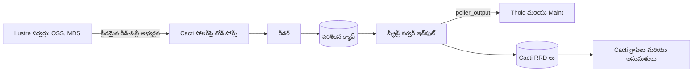

<!-- Source: README.md; SHA256: 40f2c5a5e9be97e4bd2b05a9ebab2a77de51de3af1b1c21dbeb5ee7f936cdd3b -->

<!-- translations:start -->
[English](../../../README.md) | [简体中文](../zh-CN/README.md) | [हिन्दी](../hi-IN/README.md) | [Español (España)](../es-ES/README.md) | [Español (Latinoamérica)](../es-419/README.md) | [العربية (السعودية)](../ar-SA/README.md) | [Afrikaans](../af-ZA/README.md) | [አማርኛ](../am-ET/README.md) | [العربية (مصر)](../ar-EG/README.md) | [العربية (المغرب)](../ar-MA/README.md) | [বাংলা](../bn-BD/README.md) | [Bosanski](../bs-BA/README.md) | [Deutsch](../de-DE/README.md) | [فارسی](../fa-IR/README.md) | [Filipino](../fil-PH/README.md) | [Français](../fr-FR/README.md) | [Français (Maroc)](../fr-MA/README.md) | [Français (Sénégal)](../fr-SN/README.md) | [Hausa](../ha-NG/README.md) | [עברית](../he-IL/README.md) | [Hrvatski](../hr-HR/README.md) | [Bahasa Indonesia](../id-ID/README.md) | [Igbo](../ig-NG/README.md) | [Italiano](../it-IT/README.md) | [日本語](../ja-JP/README.md) | [한국어](../ko-KR/README.md) | [Malagasy](../mg-MG/README.md) | [मराठी](../mr-IN/README.md) | [Bahasa Melayu](../ms-MY/README.md) | [Nederlands](../nl-NL/README.md) | [Polski](../pl-PL/README.md) | [Português (Brasil)](../pt-BR/README.md) | [Русский](../ru-RU/README.md) | [Kinyarwanda](../rw-RW/README.md) | [Soomaali](../so-SO/README.md) | [Српски](../sr-RS/README.md) | [Svenska](../sv-SE/README.md) | [Kiswahili](../sw-KE/README.md) | [தமிழ்](../ta-IN/README.md) | [తెలుగు](README.md) | [ไทย](../th-TH/README.md) | [Türkçe](../tr-TR/README.md) | [Українська](../uk-UA/README.md) | [اردو](../ur-PK/README.md) | [Tiếng Việt](../vi-VN/README.md) | [isiXhosa](../xh-ZA/README.md) | [Yorùbá](../yo-NG/README.md) | [繁體中文](../zh-TW/README.md) | [isiZulu](../zu-ZA/README.md)
<!-- translations:end -->

# plugin_pfs

పారలల్ ఫైల్‌సిస్టమ్ ఆరోగ్యం మరియు లోడ్‌ను Cacti లోకి తీసుకువచ్చే Cacti 1.2 ప్లగిన్: టార్గెట్‌ల వ్యాప్తంగా సామర్థ్యం మరియు ఫిల్ అసమతుల్యత, ప్రతి-టార్గెట్ త్రూపుట్, మరియు మెటాడేటా ఆపరేషన్ రేట్లు. Lustre మొదటి బ్యాకెండ్. GPFS (IBM Storage Scale) మరియు BeeGFS బ్యాకెండ్ ఇంటర్‌ఫేస్ వెనుక అనుసరిస్తాయి. డేటా సాధారణ Cacti పరికరాలు, డేటా సోర్స్‌లు మరియు గ్రాఫ్‌లలోకి చేరుతుంది, కాబట్టి Thold మరియు Maint ఎటువంటి మార్పు లేకుండా దీనిపై అలర్ట్‌లు పంపిస్తాయి మరియు సప్రెస్ చేస్తాయి.

> **స్థితి: మైలురాయి 4, దశ 1 కోసం కోడ్ పూర్తయింది, ఇంకా విడుదల కాలేదు.** మైలురాళ్ళు 2 (పునాది), 3 (Lustre పరిశీలన), మరియు 4 (అలర్టింగ్ మరియు విడుదల సన్నాహాలు) `main` పై పూర్తయ్యాయి లేదా సమీక్షలో ఉన్నాయి. ఈ ప్లగిన్ Cacti యొక్క ప్లగిన్ API ద్వారా ఇన్‌స్టాల్, అప్‌గ్రేడ్ మరియు అన్‌ఇన్‌స్టాల్ అవుతుంది మరియు 8.2 కంటే తక్కువ PHP ని తిరస్కరిస్తుంది. ప్రతి పోలర్‌పై ఉండే బ్యాక్‌గ్రౌండ్ రీడర్ ఒక స్థిరమైన ఫోర్స్డ్-కమాండ్ స్క్రిప్ట్ ([node/pfs-read.sh](../../../node/pfs-read.sh)) ద్వారా SSH మీదుగా Lustre సర్వర్‌లను చదువుతుంది మరియు ఇన్వెంటరీ, పరిస్థితి, సామర్థ్యం మరియు కౌంటర్‌లను వాటి తాజాదనంతో పాటు క్యాష్ చేస్తుంది. ప్రతి ఫైల్‌సిస్టమ్ OST మరియు MDT డేటా క్వెరీలు, ఐదు అవలోకన గ్రాఫ్‌లు, అవసరానుగుణంగా ప్రతి-టార్గెట్ గ్రాఫ్‌లు మరియు Thold కోసం సారాంశ డేటా సోర్స్‌తో కూడిన Cacti పరికరంగా మారుతుంది. ఎటువంటి మార్పు లేని Thold v1.8.2 మరియు Maint v1.3 ఎండ్-టు-ఎండ్ రన్‌లో సారాంశ గేజ్‌లపై అలర్ట్‌లు పంపిస్తాయి మరియు సప్రెస్ చేస్తాయి; Thold 1.8.2 తో కౌంటర్‌లపై Thold థ్రెషోల్డ్‌లకు మద్దతు లేదు ([docs/alerting.md](../../alerting.md)). ఇప్పటివరకు జరిగిన ప్రతి పరీక్షా డిస్పోజబుల్ Cacti లో ఫిక్చర్ నోడ్ అవుట్‌పుట్‌పై నడిచింది: ఈ ప్లగిన్ నిజమైన Lustre నోడ్‌పై ఇంకా నడపబడలేదు. విడుదలకు ముందు ఇంకా పెండింగ్‌లో ఉన్నవి: నిజమైన ఫైల్‌సిస్టమ్‌లపై పైలట్ పరీక్షలు ([పైలట్ ప్రణాళిక](../../pilot-plan.md)), బాహ్య భద్రతా సమీక్ష ([స్వీయ-సమీక్ష](../../security-review.md)), మరియు డాక్యుమెంట్ చేయబడిన హార్డ్‌వేర్‌పై స్కేల్ కొలతలు ([స్కేల్](../../research/scale.md)). వెర్షన్ 0.1.0 `INFO` మరియు [CHANGELOG.md](../../../CHANGELOG.md) లో సిద్ధం చేయబడింది కానీ ఇంకా ట్యాగ్ చేయబడలేదు.

## యాక్సెస్ పాత్రలు

| రెల్మ్ | యాక్సెస్ |
| --- | --- |
| Parallel Filesystem View | ప్రస్తుత పర్యవేక్షణ పేజీలు. |
| Parallel Filesystem Operator | పర్యవేక్షణతో పాటు ఆపరేషన్స్ పేజీ మరియు వ్యక్తిగత ట్రయాజ్ నిర్ధారణలు. |
| Parallel Filesystem Admin | ఆపరేటర్ యాక్సెస్‌తో పాటు ప్రస్తుత కాన్ఫిగరేషన్ మరియు పరిపాలనా చర్యలు. |

అప్‌గ్రేడ్ ఫైళ్లను కాపీ చేసిన తర్వాత, కొత్త రెల్మ్‌ను నమోదు చేయడానికి నిర్వాహకుడిగా Plugins పేజీని తెరవండి. **Configuration > Users** లేదా వినియోగదారు సమూహాల క్రింద Operator రెల్మ్‌ను స్పష్టంగా కేటాయించండి.
అప్‌గ్రేడ్‌లు ప్రస్తుత View మరియు Admin రెల్మ్ ID లు మరియు అనుమతులను అలాగే ఉంచుతాయి. ప్రతి అభ్యర్థనపై Admin యాక్సెస్ Operator యాక్సెస్‌ను వారసత్వంగా పొందుతుంది, మరియు Operator యాక్సెస్ View యాక్సెస్‌ను వారసత్వంగా పొందుతుంది; ఇది వినియోగదారులు లేదా సమూహాలకు నిల్వ చేసిన అనుమతులను జోడించదు. ప్లగిన్ సెట్టింగ్‌లకు Cacti యొక్క Settings అనుమతితో పాటు Parallel Filesystem Admin యాక్సెస్ కూడా అవసరం.

Cacti పరికర అనుమతులు ఇప్పటికీ ప్రతి వినియోగదారుకు అందుబాటులో ఉన్న వరుసలు మరియు చర్యలను పరిమితం చేస్తాయి; మ్యాప్ చేయని ఆబ్జెక్ట్‌లకు నిర్వాహకుడు అవసరం.
క్రెడెన్షియల్స్, కాన్ఫిగరేషన్, మ్యాపింగ్, తొలగింపు మరియు ఇతర పరిపాలనా మార్పులు పరిపాలనా పేజీలలోనే ఉంటాయి. నిర్ధారణలు ప్రస్తుత వినియోగదారు సెషన్‌లో మాత్రమే, గరిష్టంగా ఒక గంట పాటు మరియు అదే పరిశీలన తాజాగా ఉన్నంత వరకు మాత్రమే ఉంటాయి. కొత్త లేదా మారిన పరిశీలనలు వాటిని చెల్లుబాటు కాకుండా చేస్తాయి. అవి ఎప్పుడూ విఫలమైన కొలతను ఆరోగ్యకరమైనదిగా గుర్తించవు లేదా అలర్ట్‌లను సప్రెస్ చేయవు.

## ఎందుకు

షేర్డ్ ఫైల్‌సిస్టమ్ నెమ్మదిగా ఉన్నప్పుడు, ఆధారాలు సర్వర్‌లన్నింటిలో విస్తరించి ఉంటాయి. Lustre తన కౌంటర్‌లను ప్రతి నోడ్‌కు విడిగా ఉంచుతుంది: `lctl get_param` "స్థానిక నోడ్‌పై" ఉన్న విలువలను నివేదిస్తుంది, కాబట్టి ప్రతి ఆబ్జెక్ట్ స్టోరేజ్ సర్వర్ (OSS) మరియు మెటాడేటా సర్వర్ (MDS) తన స్వంత టార్గెట్‌ల సంఖ్యలను మాత్రమే కలిగి ఉంటుంది. నెమ్మదిగా ఉన్న ఫైల్‌సిస్టమ్‌ను పరిశోధించే ఆపరేటర్‌కు వేర్వేరు ప్రదేశాల నుండి మూడు సమాధానాలు అవసరం:

- **ఇతర టార్గెట్‌లు ఖాళీగా ఉండగా ఒక టార్గెట్ నిండిపోతోందా?** ఫిల్ అసమతుల్యత కొత్త ఫైళ్లు ఎక్కడ చేరతాయో మరియు ఒకే టార్గెట్‌లో స్థలం ఎప్పుడు అయిపోతుందో మారుస్తుంది.
- **ఏ టార్గెట్‌లు లేదా ఆపరేషన్‌లు బిజీగా ఉన్నాయి?** ప్రతి-టార్గెట్ బైట్ కౌంటర్లు మరియు ప్రతి-MDT ఆపరేషన్ కౌంటర్లు లోడ్ డేటా-బౌండ్‌గా ఉందా లేదా మెటాడేటా-బౌండ్‌గా ఉందా అనేది చూపుతాయి.
- **పర్యవేక్షణే తాజాగా ఉందా?** ప్లగిన్ సర్వర్‌లను చూడగలిగితేనే సమతల గ్రాఫ్ భరోసానిస్తుంది.

Cacti హోస్ట్‌లను గ్రాఫ్ చేస్తుంది మరియు Thold తో విలువలకు థ్రెషోల్డ్‌లను పెడుతుంది, మరియు Cacti GitHub సంస్థలో Lustre, GPFS, లేదా BeeGFS పర్యవేక్షణ కోసం ఎటువంటి రిపోజిటరీ లేదు (2026-11-14 న శోధించబడింది). స్టోరేజ్ నోడ్‌ల నుండి అనుమతించబడిన, రీడ్-ఓన్లీ విలువలను చదవడం ద్వారా మరియు ప్రతి ఫైల్‌సిస్టమ్‌ను దాని టార్గెట్‌లు డేటా క్వెరీ యొక్క ఇండెక్స్‌లుగా ఉండే Cacti పరికరంగా చూపడం ద్వారా ఈ ప్లగిన్ ఆ లోటును పూడ్చుతుంది. ఇది సమాంతర సంస్కరణలను నిర్మించడానికి బదులుగా Cacti యొక్క గ్రాఫింగ్, అనుమతులు, రిమోట్ డేటా కలెక్టర్లు, Thold మరియు Maint లను తిరిగి ఉపయోగిస్తుంది.

## ప్రణాళికాబద్ధమైన పరిధి

| దశ | పరిధి | మైలురాళ్ళు |
|---|---|---|
| 0, పరిశోధన | విడుదల మ్యాట్రిక్స్, నోడ్ యాక్సెస్ నిర్ణయం, అప్‌స్ట్రీమ్ ప్రవర్తన నిర్ధారణ, కౌంటర్ మరియు ఫెయిల్‌ఓవర్ ప్రవర్తన, స్కేల్ కొలతలు | [M1](https://github.com/somethingwithproof/plugin_pfs/milestone/1) |
| 1, పరిశీలన | Lustre ఇన్వెంటరీ, సామర్థ్యం మరియు ఫిల్, OST త్రూపుట్, MDT ఆపరేషన్ రేట్లు, గ్రాఫ్‌లు, Thold అలర్టింగ్, Maint సప్రెషన్, ఆరోగ్య పేజీ | [M2](https://github.com/somethingwithproof/plugin_pfs/milestone/2), [M3](https://github.com/somethingwithproof/plugin_pfs/milestone/3), [M4](https://github.com/somethingwithproof/plugin_pfs/milestone/4) |
| 2, లోతు | Cacti రిమోట్ డేటా కలెక్టర్లు, పరిమిత ఆబ్జెక్ట్ సంఖ్య లోపల జాబ్-స్థాయి మరియు క్లయింట్-స్థాయి వీక్షణలు | [M5](https://github.com/somethingwithproof/plugin_pfs/milestone/5) |
| 3, బ్యాకెండ్‌లు | GPFS (IBM Storage Scale) మరియు BeeGFS బ్యాకెండ్‌లు | [M6](https://github.com/somethingwithproof/plugin_pfs/milestone/6) |

పరిధి వెలుపల ఉన్నవి: నోడ్ లేదా ఫైల్‌సిస్టమ్‌పై ఏదైనా వ్రాయడం, క్లియర్ చేయడం, రీసెట్ చేయడం లేదా ట్యూనింగ్ ఆపరేషన్; ప్లగిన్-యాజమాన్యంలోని అలర్టింగ్ ఇంజిన్; కస్టమ్ డీమన్ లేదా నెట్‌వర్క్ ప్రోటోకాల్; ప్రతి-జాబ్ డేటా సోర్స్‌లు; Cacti కోర్, Thold, లేదా Maint లకు మార్పులు.

## అనుకూలత లక్ష్యాలు

| భాగం | లక్ష్యం |
|---|---|
| Cacti | 1.2.31 లేదా ఆ తర్వాతిది, కోర్ ప్యాచ్‌లు లేవు |
| PHP | 8.2 లేదా ఆ తర్వాతిది; మద్దతు లేని రన్‌టైమ్‌కు విరిగిన Cacti UI బదులు తిరస్కరణ అందేలా `setup.php` 8.0 పై కూడా పార్స్ చేయదగినదిగా ఉంటుంది |
| Lustre | మైలురాయి 1 ద్వారా నిర్ణయించబడే విడుదల శ్రేణులు; ఇప్పటివరకు తనిఖీ చేసిన సోర్స్ మరియు మాన్యువల్‌లు 2.17.0 వద్ద ఉన్నాయి |
| GPFS, BeeGFS | దశ 3; పరిశోధన ద్వారా నిర్ణయించబడే విడుదలలు |
| Thold, Maint | మార్పులు అవసరం లేదు |

## రూపకల్పన

- [docs/PLAN.md](../../PLAN.md) పూర్తి ప్రణాళిక: ఆర్కిటెక్చర్, అది ఆధారపడే అప్‌స్ట్రీమ్ వాస్తవాలు (సోర్స్‌లు మరియు ఇంకా ధృవీకరించని వాటితో), కౌంటర్ సెమాంటిక్స్, స్టేట్ మోడల్, భద్రతా సరిహద్దులు, పనితీరు గణనలు, పరీక్షలు మరియు ప్రమాదాలు.
- [docs/operator-guide.md](../../operator-guide.md) ఇన్‌స్టాల్, గ్రాఫ్‌లు మరియు విలువలు, అప్‌గ్రేడ్, బ్యాకప్ మరియు పునరుద్ధరణ, అన్‌ఇన్‌స్టాల్ మరియు ట్రబుల్‌షూటింగ్‌లను వివరిస్తుంది; [docs/alerting.md](../../alerting.md) Thold మరియు Maint లను వివరిస్తుంది.
- [docs/node-setup.md](../../node-setup.md) రీడర్ కోసం Lustre సర్వర్ మరియు పోలర్‌ను ఎలా సిద్ధం చేయాలో వివరిస్తుంది.
- [docs/decisions/](../../decisions) ఇప్పటికే తీసుకున్న ఎంపికల కోసం ఆర్కిటెక్చర్ నిర్ణయ రికార్డులను కలిగి ఉంటుంది.
- [docs/REQUIREMENTS.md](../../REQUIREMENTS.md) ప్రతి అవసర ID ని దాని ఇష్యూకు మ్యాప్ చేస్తుంది.

## పనిని ఎలా ట్రాక్ చేస్తారు

- **మైలురాళ్ళు** ప్రణాళిక యొక్క మైలురాళ్ళను అనుసరిస్తాయి. ప్రతి ఒక్కటి దాని ఉప-ఇష్యూలు మరియు నిష్క్రమణ ఆధారాలను జాబితా చేసే ఎపిక్ ఇష్యూను కలిగి ఉంటుంది.
- **ఇష్యూలు** లేబుల్ ద్వారా వర్గీకరించబడ్డాయి: `type: requirement`, `type: research`, `type: decision`, `type: epic`. అవసర ఇష్యూలు సంఖ్యలతో కూడిన, పరీక్షించదగిన అవసరాలు (`REQ-AREA-NNN`) మరియు ఆమోద ప్రమాణాలను పేర్కొంటాయి.
- **లేబుళ్లు** `area:`, `phase:`, `priority:`, మరియు `status:` లను కూడా కలిగి ఉంటాయి. [CONTRIBUTING.md](../../../CONTRIBUTING.md#labels) చూడండి.
- [ప్రాజెక్ట్ బోర్డు](https://github.com/users/somethingwithproof/projects/11) మైలురాళ్ళన్నింటిలోని ఇష్యూలను చూపుతుంది.

## సహకారం

[CONTRIBUTING.md](../../../CONTRIBUTING.md) చదవండి. కమిట్‌లకు DCO సైన్-ఆఫ్ అవసరం. డిజైన్ చర్చ ఇష్యూలపై జరుగుతుంది; ఓపెన్ నిర్ణయాలకు `type: decision` లేబుల్ ఉంటుంది.

## భద్రత

లోపాలను ప్రైవేట్‌గా నివేదించండి; [SECURITY.md](../../../SECURITY.md) చూడండి.

## లైసెన్స్

GNU General Public License v2.0, Cacti మరియు దాని ప్లగిన్‌ల మాదిరిగానే అదే లైసెన్స్. [LICENSE](../../../LICENSE) చూడండి.
