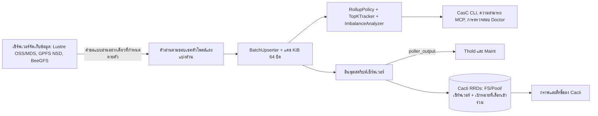

<!-- Source: README.md; SHA256: e88d6875d113220a91cfc0a9d230c829a78477b17e6aa7e44dda38c9591c86ad -->

<!-- translations:start -->
[English](../../../README.md) | [简体中文](../zh-CN/README.md) | [हिन्दी](../hi-IN/README.md) | [Español (España)](../es-ES/README.md) | [Español (Latinoamérica)](../es-419/README.md) | [العربية (السعودية)](../ar-SA/README.md) | [Afrikaans](../af-ZA/README.md) | [አማርኛ](../am-ET/README.md) | [العربية (مصر)](../ar-EG/README.md) | [العربية (المغرب)](../ar-MA/README.md) | [বাংলা](../bn-BD/README.md) | [Bosanski](../bs-BA/README.md) | [Deutsch](../de-DE/README.md) | [فارسی](../fa-IR/README.md) | [Filipino](../fil-PH/README.md) | [Français](../fr-FR/README.md) | [Français (Maroc)](../fr-MA/README.md) | [Français (Sénégal)](../fr-SN/README.md) | [Hausa](../ha-NG/README.md) | [עברית](../he-IL/README.md) | [Hrvatski](../hr-HR/README.md) | [Bahasa Indonesia](../id-ID/README.md) | [Igbo](../ig-NG/README.md) | [Italiano](../it-IT/README.md) | [日本語](../ja-JP/README.md) | [한국어](../ko-KR/README.md) | [Malagasy](../mg-MG/README.md) | [मराठी](../mr-IN/README.md) | [Bahasa Melayu](../ms-MY/README.md) | [Nederlands](../nl-NL/README.md) | [Polski](../pl-PL/README.md) | [Português (Brasil)](../pt-BR/README.md) | [Русский](../ru-RU/README.md) | [Kinyarwanda](../rw-RW/README.md) | [Soomaali](../so-SO/README.md) | [Српски](../sr-RS/README.md) | [Svenska](../sv-SE/README.md) | [Kiswahili](../sw-KE/README.md) | [தமிழ்](../ta-IN/README.md) | [తెలుగు](../te-IN/README.md) | [ไทย](README.md) | [Türkçe](../tr-TR/README.md) | [Українська](../uk-UA/README.md) | [اردو](../ur-PK/README.md) | [Tiếng Việt](../vi-VN/README.md) | [isiXhosa](../xh-ZA/README.md) | [Yorùbá](../yo-NG/README.md) | [繁體中文](../zh-TW/README.md) | [isiZulu](../zu-ZA/README.md)
<!-- translations:end -->

# plugin_pfs

ปลั๊กอินสำหรับ Cacti 1.2 ที่นำข้อมูลสุขภาพ ความจุ ความไม่สมดุลของการเติมข้อมูล ปริมาณงานต่อเป้าหมาย และอัตราการดำเนินการเมทาดาทาของระบบไฟล์แบบขนานเข้ามาใน Cacti ครอบคลุม Lustre, IBM Storage Scale (GPFS) และ BeeGFS ภายใต้อินเทอร์เฟซ `Backend` เดียวกัน ระบบไฟล์แต่ละระบบจะจับคู่กับอุปกรณ์ Cacti ปกติที่มีคิวรีข้อมูล กราฟภาพรวม กราฟรายเป้าหมายตามต้องการ และเกจสรุป เพื่อให้ Thold และ Maint แจ้งเตือนและระงับการแจ้งเตือนได้โดยไม่ต้องแก้ไข

> **สถานะ: ระยะที่ 1 ถึง 3 และองค์ประกอบพื้นฐานสำหรับการขยายระดับ exascale ถูกพัฒนาในโค้ดแล้ว ยังไม่ได้เผยแพร่** โครงสร้างพื้นฐาน, การสังเกตการณ์ Lustre, การแจ้งเตือนและการระงับของ Maint, ไดรเวอร์แบบอ่านอย่างเดียวของ GPFS และ BeeGFS, การวิเคราะห์ความไม่สมดุลของ OST/MDT ที่เชื่อมต่อกับ Maint, การกำหนดขอบเขตตัวเก็บข้อมูลระยะไกล (`replicate_out`, `remote_agent`), องค์ประกอบพื้นฐานสำหรับการขยาย 100+ PB / exascale (`FramedReportParser`, Schema v4 `value_kib`, `RollupPolicy`, `TopKTracker`, `ShardAssigner`, `BatchUpserter`), CLI ของ CasC สำหรับผู้ดูแลระบบ (`cli/pfs.php`) และฮุกระบบนิเวศ (`abilities_register`, `doctor_register_checks`, `casc_register_providers`) ได้รับการพัฒนาและทวนสอบด้วยการทดสอบระดับยูนิต ความปลอดภัย และการบูรณาการใน Cacti แบบใช้แล้วทิ้งแล้ว การทดสอบทั้งหมดจนถึงขณะนี้ใช้ผลลัพธ์จำลองของโหนดแทนฮาร์ดแวร์ Lustre, GPFS หรือ BeeGFS จริง สิ่งที่ยังเปิดค้างอยู่ก่อนติดแท็กรุ่นเผยแพร่: การนำร่องบนระบบไฟล์จริง ([แผนการนำร่อง](../../pilot-plan.md)), การตรวจสอบความปลอดภัยจากภายนอก ([การตรวจสอบด้วยตนเอง](../../security-review.md)) และการวัดขนาดการทำงานบนฮาร์ดแวร์ที่มีเอกสารอ้างอิง ([ขนาดการทำงาน](../../research/scale.md)) เวอร์ชัน 0.1.0 ถูกเตรียมไว้ใน `INFO` และ [CHANGELOG.md](../../../CHANGELOG.md) แล้ว แต่ยังไม่ได้ติดแท็ก

## บทบาทการเข้าถึง

| ขอบเขตสิทธิ์ | การเข้าถึง |
| --- | --- |
| Parallel Filesystem View | หน้าติดตามสถานะที่มีอยู่ |
| Parallel Filesystem Operator | การติดตามสถานะ รวมถึงหน้าปฏิบัติการและการรับทราบการคัดกรองเฉพาะบุคคล |
| Parallel Filesystem Admin | สิทธิ์ของ Operator รวมถึงการตั้งค่าและการดำเนินการด้านการดูแลระบบที่มีอยู่ |

หลังจากคัดลอกไฟล์อัปเกรดแล้ว ให้เปิดหน้า Plugins ในฐานะผู้ดูแลระบบเพื่อลงทะเบียนขอบเขตสิทธิ์ใหม่
กำหนดขอบเขตสิทธิ์ Operator อย่างชัดเจนภายใต้ **Configuration > Users** หรือกลุ่มผู้ใช้
การอัปเกรดจะยังคงรหัสและสิทธิ์ที่อนุญาตของขอบเขตสิทธิ์ View และ Admin เดิมไว้ สิทธิ์ Admin
จะสืบทอดสิทธิ์ Operator และสิทธิ์ Operator จะสืบทอดสิทธิ์ View ในแต่ละคำขอ
ทั้งนี้ไม่ได้เพิ่มสิทธิ์ที่บันทึกไว้ให้กับผู้ใช้หรือกลุ่ม การตั้งค่าปลั๊กอินยังต้องใช้สิทธิ์
Parallel Filesystem Admin นอกเหนือจากสิทธิ์ Settings ของ Cacti ด้วย

สิทธิ์อุปกรณ์ของ Cacti ยังคงจำกัดแถวและการดำเนินการที่ผู้ใช้แต่ละคนเข้าถึงได้ วัตถุที่ยังไม่ได้จับคู่ต้องให้ผู้ดูแลระบบจัดการ
ข้อมูลรับรอง การตั้งค่า การจับคู่ การลบ และการเปลี่ยนแปลงด้านการดูแลระบบอื่นๆ
ยังคงอยู่ในหน้าการดูแลระบบ การรับทราบจะมีผลเฉพาะในเซสชันปัจจุบันของผู้ใช้
นานที่สุดไม่เกิน 1 ชั่วโมง และเฉพาะในขณะที่ข้อมูลสังเกตการณ์เดิมยังคงสดใหม่อยู่
ข้อมูลสังเกตการณ์ใหม่หรือที่เปลี่ยนแปลงจะทำให้การรับทราบสิ้นสุดลง และจะไม่ระบุว่าค่าที่วัดล้มเหลว
มีสถานะปกติหรือไม่ระงับการแจ้งเตือน

## เหตุผล

เมื่อระบบไฟล์ที่ใช้ร่วมกันทำงานช้า หลักฐานจะกระจายอยู่ตามเซิร์ฟเวอร์ต่างๆ Lustre เก็บตัวนับไว้ตามแต่ละโหนด โดย `lctl get_param` รายงานค่า "บนโหนดภายใน" ดังนั้นเซิร์ฟเวอร์จัดเก็บออบเจกต์ (OSS) และเซิร์ฟเวอร์เมทาดาทา (MDS) แต่ละเครื่องจึงเก็บเฉพาะตัวเลขของเป้าหมายตนเองเท่านั้น ผู้ดูแลระบบที่ตรวจสอบระบบไฟล์ที่ทำงานช้าต้องการคำตอบ 3 ประการจากคนละส่วน:

- **มีเป้าหมายใดกำลังเต็มในขณะที่เป้าหมายอื่นว่างอยู่หรือไม่?** ความไม่สมดุลของการเติมข้อมูลส่งผลต่อตำแหน่งที่ไฟล์ใหม่ถูกจัดเก็บ และเวลาที่เป้าหมายเดียวจะพื้นที่เต็ม
- **เป้าหมายใดหรือการดำเนินการใดมีภาระงานหนาแน่น?** ตัวนับไบต์ต่อเป้าหมายและตัวนับการดำเนินการต่อ MDT แสดงให้เห็นว่าภาระงานติดขัดที่ข้อมูลหรือเมทาดาทา
- **การติดตามสถานะเองยังเป็นปัจจุบันอยู่หรือไม่?** กราฟที่ราบเรียบจะน่าไว้วางใจได้ก็ต่อเมื่อปลั๊กอินสามารถมองเห็นเซิร์ฟเวอร์ได้จริง

Cacti สร้างกราฟโฮสต์และตั้งค่าเกณฑ์เตือนด้วย Thold และองค์กร GitHub ของ Cacti ไม่มีคลังโค้ดสำหรับการติดตามสถานะ Lustre, GPFS หรือ BeeGFS (ค้นหาเมื่อ 2026-11-14) ปลั๊กอินนี้ช่วยเติมเต็มช่องว่างดังกล่าวโดยการอ่านค่าแบบอ่านอย่างเดียวตามรายการที่อนุญาตจากโหนดจัดเก็บข้อมูล และแสดงระบบไฟล์แต่ละระบบเป็นอุปกรณ์ Cacti ที่มีเป้าหมายเป็นดัชนีของคิวรีข้อมูล โดยนำระบบสร้างกราฟ สิทธิ์ ตัวเก็บข้อมูลระยะไกล Thold และ Maint ของ Cacti มาใช้ซ้ำแทนการสร้างระบบคู่ขนานขึ้นมาใหม่

## ขอบเขตที่วางแผนไว้

| ระยะ | ขอบเขต | สถานะ | ไมล์สโตน |
|---|---|---|---|
| 0, การวิจัย | เมทริกซ์การเผยแพร่, การตัดสินใจการเข้าถึงโหนด, การยืนยันพฤติกรรมต้นน้ำ, พฤติกรรมของตัวนับและการสลับการทำงานเมื่อล้มเหลว, การวัดขนาดการทำงาน | เสร็จสมบูรณ์ | [M1](https://github.com/somethingwithproof/plugin_pfs/milestone/1) |
| 1, การสังเกตการณ์ | รายการทรัพยากร Lustre, ความจุและการเติมข้อมูล, ความไม่สมดุลของ OST/MDT (`lib/ImbalanceAnalyzer.php`), การเชื่อมต่อ Maint (`lib/HealthPage.php`), ปริมาณงาน OST, อัตราการดำเนินการ MDT, กราฟ, การแจ้งเตือน Thold, หน้าสุขภาพระบบ | พัฒนาแล้ว (ทดสอบด้วยข้อมูลจำลอง) | [M2](https://github.com/somethingwithproof/plugin_pfs/milestone/2), [M3](https://github.com/somethingwithproof/plugin_pfs/milestone/3), [M4](https://github.com/somethingwithproof/plugin_pfs/milestone/4) |
| 2, ระยะไกลและขนาดใหญ่ | การเก็บรวบรวมระยะไกลตามขอบเขตตัวโพลล์ (`lib/Reader.php`, `lib/ReplicationRepository.php`, `replicate_out`, `remote_agent`), องค์ประกอบพื้นฐานสำหรับการขยาย 100+ PB (การจัดการ KiB 64 บิต + Schema v4 `value_kib`, `lib/RollupPolicy.php`, `lib/TopKTracker.php`, `lib/ShardAssigner.php` + `poller_pfs.php --shard=K/N`, `lib/BatchUpserter.php`), CasC CLI (`cli/pfs.php`), ฮุก MCP/Doctor/CasC | พัฒนาแล้ว (ทดสอบระดับยูนิตและการบูรณาการ CI) | [M5](https://github.com/somethingwithproof/plugin_pfs/milestone/5) |
| 3, แบ็กเอนด์ | ไดรเวอร์แบบอ่านอย่างเดียวของ IBM Storage Scale (GPFS) (`lib/GpfsBackend.php`) และ BeeGFS (`lib/BeegfsBackend.php`) ที่ลงทะเบียนใน `BackendRegistry::production()` | พัฒนาแล้ว (ทดสอบระดับยูนิต) | [M6](https://github.com/somethingwithproof/plugin_pfs/milestone/6) |

องค์ประกอบพื้นฐานที่สำคัญด้านปฏิบัติการและการขยายขนาดซึ่งพัฒนาแล้ว:

- **ไดรเวอร์แบบอ่านอย่างเดียวสำหรับระบบไฟล์หลายชนิด:** `LustreBackend`, `GpfsBackend` (เฉพาะ `mmpmon` `fs_io_s`/`io_s` แบบจัดเฟรมโดยห้าม `reset`, ความจุและสถานะพูลจาก `mmdf` และสรุปรายการรอ) และ `BeegfsBackend` (เป้าหมายจัดเก็บข้อมูลและเมทาดาทาของ BeeGFS 7.4 และ 8.x พร้อมการแปลงไบต์เป็น KiB ที่แม่นยำ การจับคู่เงื่อนไขการเข้าถึงและความสอดคล้อง และความหมายแบบเกจต่อช่วงเวลา) โดยใช้ `lib/FramedReportParser.php` ร่วมกัน
- **การวิเคราะห์ความไม่สมดุล พื้นที่เหลือ และ Maint:** `lib/ImbalanceAnalyzer.php` คำนวณอัตราส่วนการเติมข้อมูลของ OST/MDT, ช่วงต่าง, ดัชนีความไม่สมดุลจากส่วนเบี่ยงเบนมาตรฐานประชากร, พื้นที่เหลือ, การบังคับความสดใหม่ 1 ช่วงเวลา (`missing_targets`), ธงสถานะรายเป้าหมาย และเป้าหมายเอียงสูงสุดแบบจำกัดจำนวน Top-K ส่วน `HealthPage` (`pfs_health.php`) และ `CascProvider::health()` จะแสดงช่วงเวลาบำรุงรักษาของ Cacti `Maint` และระงับคำเตือนความล้มเหลวที่ยังทำงานอยู่ระหว่างการบำรุงรักษาตามกำหนด
- **การขยายขนาด 100+ PB และ exascale** ([docs/architecture/exascale-scaling.md](../../architecture/exascale-scaling.md)): การแปลงเลขฐานสิบจากไบต์เป็น KiB ที่แม่นยำ (`FramedReportParser::bytesToKibInt()`) ซึ่งทวนสอบแล้วที่ 500 PB และ 2 EB ควบคู่กับคอลัมน์ `BIGINT UNSIGNED value_kib` (Schema v4); การรวมข้อมูล RRD แบบลำดับชั้น `Filesystem -> Pool -> Storage Server` พร้อมการเลื่อนระดับเป้าหมายแบบเลือกเข้าร่วม ร้อนแรง หรือเอียงอย่างจำกัดจำนวน (`lib/RollupPolicy.php`); เป้าหมายเอียง Top-K ที่จำกัด $O(K)$ และสรุปงาน/ไคลเอนต์หนักที่รวมข้อมูลล่วงหน้า (`lib/TopKTracker.php` โดยไม่สร้างอุปกรณ์หรือ RRD รายไคลเอนต์); การแบ่งส่วนตัวเก็บข้อมูลด้วย CRC32 แบบกำหนดผลแน่นอน (`lib/ShardAssigner.php`, `php plugins/pfs/poller_pfs.php [--poller=N] [--shard=K/N] [--force] [--debug]`); และการอัปเซิร์ต SQL แบบแบ่งชุด 500 แถวพร้อมการแบ่งหน้าด้วย keyset (`lib/BatchUpserter.php`, `CacheRepository::upsertObservationsBatch()`, `TargetRepository::forFilesystemPage()`)
- **CLI ของ CasC สำหรับผู้ดูแลระบบและฮุกระบบนิเวศ:** `cli/pfs.php` รองรับ `export [--format=yaml|xml]`, `validate <file> [--format=yaml|xml]`, `plan <file> [--format=yaml|xml] [--output=text|json]`, `apply <file> --confirm=<PLAN_HASH> [--format=yaml|xml]` และ `health [--format=text|json]` โดยไม่มีการพึ่งพา Composer ภายนอก `setup.php` และ `lib/EcosystemIntegration.php` ลงทะเบียน `abilities_register` (`pfs-list-filesystems`, `pfs-get-imbalance`, `pfs-get-health`; แบบอ่านอย่างเดียว ควบคุมด้วย `Parallel Filesystem View` และสิทธิ์อุปกรณ์ Cacti), `doctor_register_checks` (`pfs_schema`, `pfs_reader_freshness`, `pfs_capacity_imbalance`), `casc_register_providers`, `replicate_out` และ `remote_agent`

นอกขอบเขต: การเขียน ล้าง รีเซ็ต หรือปรับแต่งใดๆ บนโหนดหรือระบบไฟล์; กลไกการแจ้งเตือนที่ปลั๊กอินสร้างขึ้นเอง; ดีมอนหรือโปรโตคอลเครือข่ายเฉพาะ; อุปกรณ์หรือ RRD ของ Cacti ต่อหนึ่งงานหรือต่อหนึ่งไคลเอนต์; และการแก้ไขแกนหลักของ Cacti, Thold หรือ Maint

## เป้าหมายความเข้ากันได้

| องค์ประกอบ | เป้าหมาย |
|---|---|
| Cacti | 1.2.31 หรือใหม่กว่า โดยไม่ต้องแพตช์แกนหลัก |
| PHP | 8.2 หรือใหม่กว่า; `setup.php`, `poller_pfs.php` และ `cli/pfs.php` ยังคงแยกวิเคราะห์ได้บน 8.0 เพื่อให้รันไทม์ที่ไม่รองรับได้รับการปฏิเสธแทนที่จะทำให้ UI ของ Cacti เสียหาย |
| Lustre | ตรวจสอบซอร์สโค้ดและคู่มือที่เวอร์ชัน 2.17.0; ทดสอบด้วยข้อมูลจำลอง |
| GPFS, BeeGFS | พัฒนาไดรเวอร์แบบอ่านอย่างเดียวของ IBM Storage Scale (GPFS) 5.x `mmpmon`/`mmdf` และ BeeGFS 7.4 / 8.x แล้ว และทดสอบด้วยข้อมูลจำลอง |
| Thold, Maint | Thold 1.8.2 และ Maint 1.3 โดยไม่ต้องแก้ไข |

## การออกแบบ

- [docs/architecture/exascale-scaling.md](../../architecture/exascale-scaling.md) อธิบายสถาปัตยกรรมเทเลเมทรีสองระดับสำหรับ 100+ PB / exascale (ระดับเซิร์ฟเวอร์ Cacti/`plugin_pfs` + การรวมข้อมูล + Top-K จับคู่กับเทเลเมทรีไคลเอนต์นอกแบนด์อย่าง LDMS/Darshan/TOKIO) และบริบททางวรรณกรรมวิชาการ
- [docs/PLAN.md](../../PLAN.md) คือแผนฉบับเต็ม: สถาปัตยกรรม ข้อเท็จจริงต้นน้ำที่ต้องพึ่งพา (พร้อมแหล่งที่มาและสิ่งที่ยังไม่ผ่านการยืนยัน) ความหมายของตัวนับ โมเดลสถานะ ขอบเขตความปลอดภัย การคำนวณประสิทธิภาพ การทดสอบ และความเสี่ยง
- [docs/operator-guide.md](../../operator-guide.md) ครอบคลุมการติดตั้ง กราฟและค่าต่างๆ การอัปเกรด การสำรองและกู้คืน การถอนการติดตั้ง และการแก้ไขปัญหา; [docs/alerting.md](../../alerting.md) ครอบคลุม Thold และ Maint
- [docs/node-setup.md](../../node-setup.md) อธิบายวิธีเตรียมเซิร์ฟเวอร์ Lustre และตัวโพลล์สำหรับตัวอ่านข้อมูล
- [docs/decisions/](../../decisions) เก็บบันทึกการตัดสินใจด้านสถาปัตยกรรมสำหรับทางเลือกที่ได้ตัดสินใจไปแล้ว
- [docs/REQUIREMENTS.md](../../REQUIREMENTS.md) จับคู่รหัสข้อกำหนดทุกรายการกับ Issue ที่เกี่ยวข้อง

## วิธีการติดตามงาน

- **ไมล์สโตน** อ้างอิงตามไมล์สโตนในแผน โดยแต่ละไมล์สโตนจะมี Epic Issue ที่แสดงรายการ Issue ย่อยและหลักฐานการปิดงาน
- **Issue** ถูกจัดประเภทด้วยป้ายกำกับ: `type: requirement`, `type: research`, `type: decision`, `type: epic` โดย Issue ประเภทข้อกำหนดจะระบุข้อกำหนดที่มีหมายเลขและทดสอบได้ (`REQ-AREA-NNN`) พร้อมเกณฑ์การยอมรับ
- **ป้ายกำกับ** ยังระบุ `area:`, `phase:`, `priority:` และ `status:` ด้วย ดูที่ [CONTRIBUTING.md](../../../CONTRIBUTING.md#labels)
- [กระดานโครงการ](https://github.com/users/somethingwithproof/projects/11) แสดง Issue ทั้งหมดในทุกไมล์สโตน

## การมีส่วนร่วม

อ่าน [CONTRIBUTING.md](../../../CONTRIBUTING.md) คอมมิตต้องมีการลงนามรับรอง DCO การอภิปรายด้านการออกแบบเกิดขึ้นบน Issue ส่วนการตัดสินใจที่ยังเปิดอยู่จะมีป้ายกำกับ `type: decision`

## ความปลอดภัย

รายงานช่องโหว่แบบส่วนตัว; ดูที่ [SECURITY.md](../../../SECURITY.md)

## สัญญาอนุญาต

GNU General Public License v2.0 ซึ่งเป็นสัญญาอนุญาตเดียวกับ Cacti และปลั๊กอินของ Cacti ดูที่ [LICENSE](../../../LICENSE)
