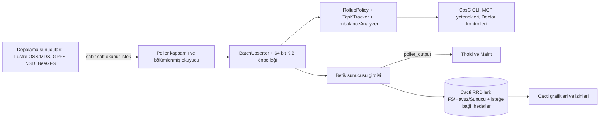

<!-- Source: README.md; SHA256: e88d6875d113220a91cfc0a9d230c829a78477b17e6aa7e44dda38c9591c86ad -->

<!-- translations:start -->
[English](../../../README.md) | [简体中文](../zh-CN/README.md) | [हिन्दी](../hi-IN/README.md) | [Español (España)](../es-ES/README.md) | [Español (Latinoamérica)](../es-419/README.md) | [العربية (السعودية)](../ar-SA/README.md) | [Afrikaans](../af-ZA/README.md) | [አማርኛ](../am-ET/README.md) | [العربية (مصر)](../ar-EG/README.md) | [العربية (المغرب)](../ar-MA/README.md) | [বাংলা](../bn-BD/README.md) | [Bosanski](../bs-BA/README.md) | [Deutsch](../de-DE/README.md) | [فارسی](../fa-IR/README.md) | [Filipino](../fil-PH/README.md) | [Français](../fr-FR/README.md) | [Français (Maroc)](../fr-MA/README.md) | [Français (Sénégal)](../fr-SN/README.md) | [Hausa](../ha-NG/README.md) | [עברית](../he-IL/README.md) | [Hrvatski](../hr-HR/README.md) | [Bahasa Indonesia](../id-ID/README.md) | [Igbo](../ig-NG/README.md) | [Italiano](../it-IT/README.md) | [日本語](../ja-JP/README.md) | [한국어](../ko-KR/README.md) | [Malagasy](../mg-MG/README.md) | [मराठी](../mr-IN/README.md) | [Bahasa Melayu](../ms-MY/README.md) | [Nederlands](../nl-NL/README.md) | [Polski](../pl-PL/README.md) | [Português (Brasil)](../pt-BR/README.md) | [Русский](../ru-RU/README.md) | [Kinyarwanda](../rw-RW/README.md) | [Soomaali](../so-SO/README.md) | [Српски](../sr-RS/README.md) | [Svenska](../sv-SE/README.md) | [Kiswahili](../sw-KE/README.md) | [தமிழ்](../ta-IN/README.md) | [తెలుగు](../te-IN/README.md) | [ไทย](../th-TH/README.md) | [Türkçe](README.md) | [Українська](../uk-UA/README.md) | [اردو](../ur-PK/README.md) | [Tiếng Việt](../vi-VN/README.md) | [isiXhosa](../xh-ZA/README.md) | [Yorùbá](../yo-NG/README.md) | [繁體中文](../zh-TW/README.md) | [isiZulu](../zu-ZA/README.md)
<!-- translations:end -->

# plugin_pfs

Tek bir `Backend` arayüzünün arkasında Lustre, IBM Storage Scale (GPFS) ve BeeGFS genelindeki paralel dosya sistemi sağlık durumunu, kapasiteyi, doluluk dengesizliğini, hedef başına aktarım hızını ve üstveri işlem oranlarını Cacti'ye aktaran bir Cacti 1.2 eklentisi. Her dosya sistemi veri sorguları, genel bakış ve isteğe bağlı hedef grafikleri ile özet göstergeler içeren standart bir Cacti aygıtına eşlenir; böylece Thold ve Maint herhangi bir değişiklik gerektirmeden uyarı verir ve uyarıları bastırır.

> **Durum: 1'den 3'e kadar olan fazlar ve exascale ölçeklendirme temel bileşenleri kodda tamamlandı, henüz yayımlanmadı.** Temel yapı, Lustre gözlemi, uyarılar ve Maint bastırması, GPFS ve BeeGFS salt okunur sürücüleri, Maint entegrasyonlu OST/MDT dengesizlik analizi, uzak veri toplayıcı kapsamlandırması (`replicate_out`, `remote_agent`), 100+ PB / exascale ölçeklendirme temel bileşenleri (`FramedReportParser`, Şema v4 `value_kib`, `RollupPolicy`, `TopKTracker`, `ShardAssigner`, `BatchUpserter`), CasC operatör CLI aracı (`cli/pfs.php`) ve ekosistem kancaları (`abilities_register`, `doctor_register_checks`, `casc_register_providers`) geliştirilmiş ve birim, güvenlik ve tek kullanımlık Cacti entegrasyon testleriyle doğrulanmıştır. Şimdiye kadarki tüm çalıştırmalarda gerçek Lustre, GPFS veya BeeGFS donanımı yerine sabit düğüm çıktıları kullanılmıştır. Sürüm etiketi basılmadan önce hâlâ açık olan konular: gerçek dosya sistemleri üzerinde pilot çalışmalar ([pilot planı](../../pilot-plan.md)), haricî güvenlik incelemesi ([öz değerlendirme](../../security-review.md)) ve belgelenmiş donanım üzerinde ölçek ölçümleri ([ölçek](../../research/scale.md)). Sürüm 0.1.0 `INFO` ve [CHANGELOG.md](../../../CHANGELOG.md) dosyalarında hazırlanmıştır ancak henüz etiketlenmemiştir.

## Erişim rolleri

| Yetki Alanı | Erişim |
| --- | --- |
| Parallel Filesystem View | Mevcut izleme sayfaları. |
| Parallel Filesystem Operator | İzleme sayfalarına ek olarak Operations sayfası ve kişisel önceliklendirme onayları. |
| Parallel Filesystem Admin | Operator erişimine ek olarak mevcut yapılandırma ve yönetim eylemleri. |

Yükseltme dosyalarını kopyaladıktan sonra yeni yetki alanını kaydetmek için yönetici olarak Plugins sayfasını açın. Operator yetki alanını **Configuration > Users** veya kullanıcı grupları altından açıkça atayın. Yükseltmeler mevcut View ve Admin yetki alanı kimliklerini ve yetkilerini korur. Her istekte Admin erişimi Operator erişimini, Operator erişimi ise View erişimini devralır; bu durum kullanıcılara veya gruplara kalıcı olarak ek yetkiler yazmaz. Eklenti ayarları ayrıca Cacti'nin Settings iznine ek olarak Parallel Filesystem Admin erişimi de gerektirir.

Cacti aygıt izinleri her kullanıcının görebileceği satırları ve yapabileceği eylemleri kısıtlamaya devam eder; eşlenmemiş nesneler için yönetici gerekir. Kimlik bilgileri, yapılandırma, eşleme, silme ve diğer yönetim değişiklikleri yönetim sayfalarında kalır. Onaylar yalnızca geçerli kullanıcının oturumu süresince, en fazla bir saat boyunca ve yalnızca aynı gözlem güncel kaldığı sürece geçerlidir. Yeni veya değişmiş gözlemler bu onayları geçersiz kılar. Onaylar hiçbir zaman başarısız bir ölçümü sağlıklı olarak işaretlemez veya uyarıları bastırmaz.

## Neden

Paylaşımlı bir dosya sistemi yavaşladığında, bunun kanıtları sunuculara dağılmış durumdadır. Lustre sayaçlarını düğüm başına tutar: `lctl get_param` değerleri "yerel düğüm üzerinde" raporlar; bu nedenle her nesne depolama sunucusu (OSS) ve üstveri sunucusu (MDS) yalnızca kendi hedeflerine ait sayıları barındırır. Yavaşlayan bir dosya sistemini inceleyen bir operatörün farklı yerlerden üç yanıt alması gerekir:

- **Bir hedef dolarken diğerleri boş mu kalıyor?** Doluluk dengesizliği, yeni dosyaların nereye yazılacağını ve tek bir hedefin alanının ne zaman tükeneceğini etkiler.
- **Hangi hedefler veya işlemler yoğun?** Hedef başına bayt sayaçları ve MDT başına işlem sayaçları, yükün veri kaynaklı mı yoksa üstveri kaynaklı mı olduğunu gösterir.
- **İzleme sisteminin kendisi güncel mi?** Düz bir grafik, yalnızca eklenti sunucuları görebiliyorsa güven vericidir.

Cacti ana makinelerin grafiklerini çizer ve değerleri Thold ile eşik denetimine tabi tutar; Cacti GitHub kuruluşunda Lustre, GPFS veya BeeGFS izlemeye yönelik bir depo bulunmamaktadır (2026-11-14 tarihinde arandı). Eklenti, depolama düğümlerinden izin verilenler listesindeki salt okunur değerleri okuyarak ve her dosya sistemini hedefleri bir veri sorgusunun dizinleri olan bir Cacti aygıtı olarak temsil ederek bu boşluğu kapatır. Bunların paralel sürümlerini sıfırdan geliştirmek yerine Cacti'nin grafikleme, izinler, uzak veri toplayıcılar, Thold ve Maint özelliklerini yeniden kullanır.

## Planlanan kapsam

| Faz | Kapsam | Durum | Kilometre Taşları |
|---|---|---|---|
| 0, araştırma | Sürüm matrisi, düğüm erişim kararı, yukarı akış davranış doğrulaması, sayaç ve yük devretme davranışı, ölçek ölçümleri | Tamamlandı | [M1](https://github.com/somethingwithproof/plugin_pfs/milestone/1) |
| 1, gözlem | Lustre envanteri, kapasite ve doluluk, OST/MDT dengesizliği (`lib/ImbalanceAnalyzer.php`), Maint entegrasyonu (`lib/HealthPage.php`), OST aktarım hızı, MDT işlem oranları, grafikler, Thold uyarıları, sağlık durumu sayfası | Uygulandı (sabit verilerle test edildi) | [M2](https://github.com/somethingwithproof/plugin_pfs/milestone/2), [M3](https://github.com/somethingwithproof/plugin_pfs/milestone/3), [M4](https://github.com/somethingwithproof/plugin_pfs/milestone/4) |
| 2, uzak ve ölçek | Poller kapsamlı uzak toplama (`lib/Reader.php`, `lib/ReplicationRepository.php`, `replicate_out`, `remote_agent`), 100+ PB ölçeklendirme temel bileşenleri (64 bit KiB hijyeni + Şema v4 `value_kib`, `lib/RollupPolicy.php`, `lib/TopKTracker.php`, `lib/ShardAssigner.php` + `poller_pfs.php --shard=K/N`, `lib/BatchUpserter.php`), CasC CLI (`cli/pfs.php`), MCP/Doctor/CasC kancaları | Uygulandı (birim ve CI entegrasyon testleri yapıldı) | [M5](https://github.com/somethingwithproof/plugin_pfs/milestone/5) |
| 3, arka uçlar | `BackendRegistry::production()` içinde kayıtlı salt okunur IBM Storage Scale (GPFS) (`lib/GpfsBackend.php`) ve BeeGFS (`lib/BeegfsBackend.php`) sürücüleri | Uygulandı (birim testleri yapıldı) | [M6](https://github.com/somethingwithproof/plugin_pfs/milestone/6) |

Uygulanan temel operatör ve ölçeklendirme bileşenleri:

- **Çoklu dosya sistemi salt okunur sürücüleri:** `lib/FramedReportParser.php` bileşenini paylaşan `LustreBackend`, `GpfsBackend` (`reset` yasaklı çerçeveli `mmpmon` `fs_io_s`/`io_s`, `mmdf` havuz kapasitesi/durumları ve bekleyen iş özetleri) ve `BeegfsBackend` (kesin bayt-KiB dönüştürme, erişilebilirlik/tutarlılık durum eşlemesi ve aralık başına gösterge semantiğine sahip BeeGFS 7.4 ve 8.x depolama/üstveri hedefleri).
- **Dengesizlik, boş kapasite ve Maint farkındalığı:** `lib/ImbalanceAnalyzer.php` OST/MDT doluluk oranlarını, yayılımı, popülasyon standart sapması dengesizlik indeksini, kalan kapasiteyi, 1 aralıklı güncellik denetimini (`missing_targets`), hedef başına durum bayraklarını ve sınırlı Top-K dengesiz hedefleri hesaplar. `HealthPage` (`pfs_health.php`) ve `CascProvider::health()`, Cacti `Maint` bakım pencerelerini görünür kılar ve planlı bakım sırasında etkin arıza uyarılarını bastırır.
- **100+ PB ve exascale ölçeklendirme** ([docs/architecture/exascale-scaling.md](../../architecture/exascale-scaling.md)): `BIGINT UNSIGNED value_kib` sütunları (Şema v4) ile birlikte 500 PB ve 2 EB düzeyinde doğrulanmış kesin ondalık bayt-KiB dönüşümü (`FramedReportParser::bytesToKibInt()`); sınırlı isteğe bağlı/yoğun/dengesiz hedef yükseltmesiyle hiyerarşik `Filesystem -> Pool -> Storage Server` RRD toplamaları (`lib/RollupPolicy.php`); sınırlı $O(K)$ Top-K dengesiz hedefler ve önceden toplanmış yoğun iş/istemci özetleri (`lib/TopKTracker.php`, hiçbir zaman istemci başına aygıt veya RRD oluşturmaz); deterministik CRC32 toplayıcı bölümleme (`lib/ShardAssigner.php`, `php plugins/pfs/poller_pfs.php [--poller=N] [--shard=K/N] [--force] [--debug]`); ve 500 satırlık toplu SQL upsert işlemleri ile keyset sayfalama (`lib/BatchUpserter.php`, `CacheRepository::upsertObservationsBatch()`, `TargetRepository::forFilesystemPage()`).
- **Operatör CasC CLI ve ekosistem kancaları:** `cli/pfs.php` haricî Composer bağımlılığı olmadan `export [--format=yaml|xml]`, `validate <file> [--format=yaml|xml]`, `plan <file> [--format=yaml|xml] [--output=text|json]`, `apply <file> --confirm=<PLAN_HASH> [--format=yaml|xml]` ve `health [--format=text|json]` komutlarını destekler. `setup.php` ve `lib/EcosystemIntegration.php`, `abilities_register` (`pfs-list-filesystems`, `pfs-get-imbalance`, `pfs-get-health`; salt okunur, `Parallel Filesystem View` ve Cacti aygıt izinleriyle denetlenir), `doctor_register_checks` (`pfs_schema`, `pfs_reader_freshness`, `pfs_capacity_imbalance`), `casc_register_providers`, `replicate_out` ve `remote_agent` kancalarını kaydeder.

Kapsam dışı: bir düğüm veya dosya sistemi üzerinde herhangi bir yazma, temizleme, sıfırlama veya ince ayar işlemi; eklentiye özgü bir uyarı motoru; özel bir arka plan programı veya ağ protokolü; iş başına veya istemci başına Cacti aygıtları/RRD dosyaları; Cacti çekirdeğinde, Thold'da veya Maint'te değişiklikler.

## Uyumluluk hedefleri

| Bileşen | Hedef |
|---|---|
| Cacti | 1.2.31 veya üzeri, çekirdek yaması gerektirmez |
| PHP | 8.2 veya üzeri; `setup.php`, `poller_pfs.php` ve `cli/pfs.php` dosyaları 8.0 üzerinde ayrıştırılabilir kalır, böylece desteklenmeyen bir çalışma zamanı bozuk bir Cacti arayüzü yerine bir reddetme mesajı alır |
| Lustre | Kaynak kod ve kılavuzlar 2.17.0 sürümünde kontrol edildi; sabit verilerle test edildi |
| GPFS, BeeGFS | IBM Storage Scale (GPFS) 5.x `mmpmon`/`mmdf` ve BeeGFS 7.4 / 8.x salt okunur sürücüleri uygulandı ve sabit verilerle test edildi |
| Thold, Maint | Thold 1.8.2 ve Maint 1.3, değişiklik yok |

## Tasarım

- [docs/architecture/exascale-scaling.md](../../architecture/exascale-scaling.md) iki katmanlı 100+ PB / exascale telemetri mimarisini (bant dışı LDMS/Darshan/TOKIO istemci telemetrisi ile eşleştirilmiş Cacti/`plugin_pfs` sunucu + toplama + Top-K katmanı) ve akademik literatür bağlamını belgeler.
- [docs/PLAN.md](../../PLAN.md) tam plandır: mimari, dayandığı yukarı akış gerçekleri (kaynakları ve henüz doğrulanmamış kısımlarıyla birlikte), sayaç semantiği, durum modeli, güvenlik sınırları, performans aritmetiği, testler ve riskler.
- [docs/operator-guide.md](../../operator-guide.md) kurulum, grafikler ve değerler, yükseltme, yedekleme ve geri yükleme, kaldırma ve sorun giderme konularını kapsar; [docs/alerting.md](../../alerting.md) ise Thold ve Maint'i kapsar.
- [docs/node-setup.md](../../node-setup.md) bir Lustre sunucusunun ve bir poller'ın okuyucu için nasıl hazırlanacağını açıklar.
- [docs/decisions/](../../decisions) hâlihazırda verilmiş kararlar için mimari karar kayıtlarını içerir.
- [docs/REQUIREMENTS.md](../../REQUIREMENTS.md) her gereksinim kimliğini ilgili iş kaydıyla eşler.

## İş takibi nasıl yapılır

- **Kilometre taşları** planın kilometre taşlarını izler. Her birinin, alt iş kayıtlarını ve çıkış kanıtlarını listeleyen bir epik iş kaydı vardır.
- **İş kayıtları** etiketlerle türlere ayrılır: `type: requirement`, `type: research`, `type: decision`, `type: epic`. Gereksinim iş kayıtları numaralandırılmış, test edilebilir gereksinimleri (`REQ-AREA-NNN`) ve kabul ölçütlerini belirtir.
- **Etiketler** ayrıca `area:`, `phase:`, `priority:` ve `status:` öneklerini taşır. Bkz. [CONTRIBUTING.md](../../../CONTRIBUTING.md#labels).
- [Proje panosu](https://github.com/users/somethingwithproof/projects/11), tüm kilometre taşlarındaki bütün iş kayıtlarını gösterir.

## Katkıda bulunma

[CONTRIBUTING.md](../../../CONTRIBUTING.md) dosyasını okuyun. Commit'ler için DCO imzası gereklidir. Tasarım tartışmaları iş kayıtları üzerinden yürütülür; açık kararlar `type: decision` etiketini taşır.

## Güvenlik

Güvenlik açıklarını gizli olarak bildirin; bkz. [SECURITY.md](../../../SECURITY.md).

## Lisans

Cacti ve eklentileriyle aynı lisans olan GNU Genel Kamu Lisansı v2.0. Bkz. [LICENSE](../../../LICENSE).
