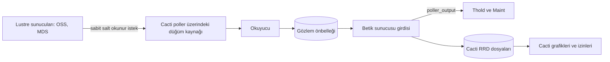

<!-- Source: README.md; SHA256: e88d6875d113220a91cfc0a9d230c829a78477b17e6aa7e44dda38c9591c86ad -->

<!-- translations:start -->
[English](../../../README.md) | [简体中文](../zh-CN/README.md) | [हिन्दी](../hi-IN/README.md) | [Español (España)](../es-ES/README.md) | [Español (Latinoamérica)](../es-419/README.md) | [العربية (السعودية)](../ar-SA/README.md) | [Afrikaans](../af-ZA/README.md) | [አማርኛ](../am-ET/README.md) | [العربية (مصر)](../ar-EG/README.md) | [العربية (المغرب)](../ar-MA/README.md) | [বাংলা](../bn-BD/README.md) | [Bosanski](../bs-BA/README.md) | [Deutsch](../de-DE/README.md) | [فارسی](../fa-IR/README.md) | [Filipino](../fil-PH/README.md) | [Français](../fr-FR/README.md) | [Français (Maroc)](../fr-MA/README.md) | [Français (Sénégal)](../fr-SN/README.md) | [Hausa](../ha-NG/README.md) | [עברית](../he-IL/README.md) | [Hrvatski](../hr-HR/README.md) | [Bahasa Indonesia](../id-ID/README.md) | [Igbo](../ig-NG/README.md) | [Italiano](../it-IT/README.md) | [日本語](../ja-JP/README.md) | [한국어](../ko-KR/README.md) | [Malagasy](../mg-MG/README.md) | [मराठी](../mr-IN/README.md) | [Bahasa Melayu](../ms-MY/README.md) | [Nederlands](../nl-NL/README.md) | [Polski](../pl-PL/README.md) | [Português (Brasil)](../pt-BR/README.md) | [Русский](../ru-RU/README.md) | [Kinyarwanda](../rw-RW/README.md) | [Soomaali](../so-SO/README.md) | [Српски](../sr-RS/README.md) | [Svenska](../sv-SE/README.md) | [Kiswahili](../sw-KE/README.md) | [தமிழ்](../ta-IN/README.md) | [తెలుగు](../te-IN/README.md) | [ไทย](../th-TH/README.md) | [Türkçe](README.md) | [Українська](../uk-UA/README.md) | [اردو](../ur-PK/README.md) | [Tiếng Việt](../vi-VN/README.md) | [isiXhosa](../xh-ZA/README.md) | [Yorùbá](../yo-NG/README.md) | [繁體中文](../zh-TW/README.md) | [isiZulu](../zu-ZA/README.md)
<!-- translations:end -->

# plugin_pfs

Paralel dosya sistemlerinin sağlık durumunu ve yükünü Cacti'ye aktaran bir Cacti 1.2 eklentisi: hedefler genelindeki kapasite ve doluluk dengesizliği, hedef başına aktarım hızı ve üstveri işlem oranları. İlk arka uç Lustre'dır. GPFS (IBM Storage Scale) ve BeeGFS bir arka uç arayüzünün arkasından gelir. Veriler standart Cacti aygıtlarına, veri kaynaklarına ve grafiklerine aktarılır; böylece Thold ve Maint herhangi bir değişiklik gerektirmeden bu veriler üzerinde uyarı üretir ve uyarıları bastırır.

> **Durum: kilometre taşı 4, faz 1 için kod tamamlandı, henüz yayımlanmadı.** Kilometre taşı 2 (temel yapı), 3 (Lustre gözlemi) ve 4 (uyarılar ve sürüm hazırlığı) `main` dalında tamamlanmıştır veya inceleme aşamasındadır. Eklenti, Cacti'nin eklenti API'si üzerinden kurulur, yükseltilir ve kaldırılır; 8.2'nin altındaki PHP sürümlerini reddeder. Her poller üzerindeki bir arka plan okuyucusu, Lustre sunucularını SSH üzerinden sabit bir zorunlu komut betiği ([node/pfs-read.sh](../../../node/pfs-read.sh)) aracılığıyla okur ve envanteri, durumu, kapasiteyi ve sayaçları güncellik bilgileriyle birlikte önbelleğe alır. Her dosya sistemi; OST ve MDT veri sorguları, beş genel bakış grafiği, isteğe bağlı hedef başına grafikler ve Thold için bir özet veri kaynağı ile bir Cacti aygıtı hâline gelir. Değiştirilmemiş Thold v1.8.2 ve Maint v1.3, uçtan uca çalıştırmada özet gösterge değerleri üzerinde uyarı verir ve bunları bastırır; sayaçlar üzerindeki Thold eşikleri Thold 1.8.2 ile desteklenmemektedir ([docs/alerting.md](../../alerting.md)). Şimdiye kadarki tüm testler, tek kullanımlık bir Cacti ortamında sabit düğüm çıktılarıyla çalıştırılmıştır: eklenti henüz gerçek bir Lustre düğümüne karşı çalıştırılmamıştır. Sürüm öncesinde hâlâ açık olan konular: gerçek dosya sistemleri üzerinde pilot çalışmalar ([pilot planı](../../pilot-plan.md)), haricî güvenlik incelemesi ([öz değerlendirme](../../security-review.md)) ve belgelenmiş donanım üzerinde ölçek ölçümleri ([ölçek](../../research/scale.md)). Sürüm 0.1.0 `INFO` ve [CHANGELOG.md](../../../CHANGELOG.md) dosyalarında hazırlanmıştır ancak henüz etiketlenmemiştir.

## Erişim rolleri

| Yetki Alanı | Erişim |
| --- | --- |
| Parallel Filesystem View | Mevcut izleme sayfaları. |
| Parallel Filesystem Operator | İzleme sayfalarına ek olarak Operations sayfası ve kişisel önceliklendirme onayları. |
| Parallel Filesystem Admin | Operator erişimine ek olarak mevcut yapılandırma ve yönetim eylemleri. |

Yükseltme dosyalarını kopyaladıktan sonra yeni yetki alanını kaydetmek için yönetici olarak Plugins sayfasını açın. Operator yetki alanını **Configuration > Users** veya kullanıcı grupları altından açıkça atayın. Yükseltmeler mevcut View ve Admin yetki alanı kimliklerini ve yetkilerini korur. Her istekte Admin erişimi Operator erişimini, Operator erişimi ise View erişimini devralır; bu durum kullanıcılara veya gruplara kalıcı olarak ek yetkiler yazmaz. Eklenti ayarları ayrıca Cacti'nin Settings iznine ek olarak Parallel Filesystem Admin erişimi de gerektirir.

Cacti aygıt izinleri her kullanıcının görebileceği satırları ve yapabileceği eylemleri kısıtlamaya devam eder; eşlenmemiş nesneler için yönetici gerekir. Kimlik bilgileri, yapılandırma, eşleme, silme ve diğer yönetim değişiklikleri yönetim sayfalarında kalır. Onaylar yalnızca geçerli kullanıcının oturumu süresince, en fazla bir saat boyunca ve yalnızca aynı gözlem güncel kaldığı sürece geçerlidir. Yeni veya değişmiş gözlemler bu onayları geçersiz kılar. Onaylar hiçbir zaman başarısız bir ölçümü sağlıklı olarak işaretlemez veya uyarıları bastırmaz.

## Neden

Paylaşımlı bir dosya sistemi yavaşladığında, bunun kanıtları sunuculara dağılmış durumdadır. Lustre sayaçlarını düğüm başına tutar: `lctl get_param` değerleri "yerel düğüm üzerinde" raporlar; bu nedenle her nesne depolama sunucusu (OSS) ve üstveri sunucusu (MDS) yalnızca kendi hedeflerine ait sayıları barındırır. Yavaşlayan bir dosya sistemini inceleyen bir operatörün farklı yerlerden üç yanıt alması gerekir:

- **Bir hedef dolarken diğerleri boş mu kalıyor?** Doluluk dengesizliği, yeni dosyaların nereye yazılacağını ve tek bir hedefin alanının ne zaman tükeneceğini etkiler.
- **Hangi hedefler veya işlemler yoğun?** Hedef başına bayt sayaçları ve MDT başına işlem sayaçları, yükün veri kaynaklı mı yoksa üstveri kaynaklı mı olduğunu gösterir.
- **İzleme sisteminin kendisi güncel mi?** Düz bir grafik, yalnızca eklenti sunucuları görebiliyorsa güven vericidir.

Cacti ana makinelerin grafiklerini çizer ve değerleri Thold ile eşik denetimine tabi tutar; Cacti GitHub kuruluşunda Lustre, GPFS veya BeeGFS izlemeye yönelik bir depo bulunmamaktadır (2026-11-14 tarihinde arandı). Eklenti, depolama düğümlerinden izin verilenler listesindeki salt okunur değerleri okuyarak ve her dosya sistemini hedefleri bir veri sorgusunun dizinleri olan bir Cacti aygıtı olarak temsil ederek bu boşluğu kapatır. Bunların paralel sürümlerini sıfırdan geliştirmek yerine Cacti'nin grafikleme, izinler, uzak veri toplayıcılar, Thold ve Maint özelliklerini yeniden kullanır.

## Planlanan kapsam

| Faz | Kapsam | Kilometre Taşları |
|---|---|---|
| 0, araştırma | Sürüm matrisi, düğüm erişim kararı, yukarı akış davranış doğrulaması, sayaç ve yük devretme davranışı, ölçek ölçümleri | [M1](https://github.com/somethingwithproof/plugin_pfs/milestone/1) |
| 1, gözlem | Lustre envanteri, kapasite ve doluluk, OST aktarım hızı, MDT işlem oranları, grafikler, Thold uyarıları, Maint bastırması, sağlık durumu sayfası | [M2](https://github.com/somethingwithproof/plugin_pfs/milestone/2), [M3](https://github.com/somethingwithproof/plugin_pfs/milestone/3), [M4](https://github.com/somethingwithproof/plugin_pfs/milestone/4) |
| 2, derinlik | Cacti uzak veri toplayıcıları, sınırlı bir nesne sayısı içinde iş düzeyi ve istemci düzeyi görünümler | [M5](https://github.com/somethingwithproof/plugin_pfs/milestone/5) |
| 3, arka uçlar | GPFS (IBM Storage Scale) ve BeeGFS arka uçları | [M6](https://github.com/somethingwithproof/plugin_pfs/milestone/6) |

Kapsam dışı: bir düğüm veya dosya sistemi üzerinde herhangi bir yazma, temizleme, sıfırlama veya ince ayar işlemi; eklentiye özgü bir uyarı motoru; özel bir arka plan programı veya ağ protokolü; iş başına veri kaynakları; Cacti çekirdeğinde, Thold'da veya Maint'te değişiklikler.

## Uyumluluk hedefleri

| Bileşen | Hedef |
|---|---|
| Cacti | 1.2.31 veya üzeri, çekirdek yaması gerektirmez |
| PHP | 8.2 veya üzeri; `setup.php` dosyası 8.0 üzerinde ayrıştırılabilir kalır, böylece desteklenmeyen bir çalışma zamanı bozuk bir Cacti arayüzü yerine bir reddetme mesajı alır |
| Lustre | Sürüm serileri kilometre taşı 1 ile kesinleştirilecektir; şimdiye kadar kontrol edilen kaynak kod ve kılavuzlar 2.17.0 sürümündedir |
| GPFS, BeeGFS | Faz 3; sürümler araştırma sonucunda kesinleştirilecektir |
| Thold, Maint | Değişiklik gerektirmez |

## Tasarım

- [docs/PLAN.md](../../PLAN.md) tam plandır: mimari, dayandığı yukarı akış gerçekleri (kaynakları ve henüz doğrulanmamış kısımlarıyla birlikte), sayaç semantiği, durum modeli, güvenlik sınırları, performans aritmetiği, testler ve riskler.
- [docs/operator-guide.md](../../operator-guide.md) kurulum, grafikler ve değerler, yükseltme, yedekleme ve geri yükleme, kaldırma ve sorun giderme konularını kapsar; [docs/alerting.md](../../alerting.md) ise Thold ve Maint'i kapsar.
- [docs/node-setup.md](../../node-setup.md) bir Lustre sunucusunun ve bir poller'ın okuyucu için nasıl hazırlanacağını açıklar.
- [docs/decisions/](../../decisions) hâlihazırda verilmiş kararlar için mimari karar kayıtlarını içerir.
- [docs/REQUIREMENTS.md](../../REQUIREMENTS.md) her gereksinim kimliğini ilgili iş kaydıyla eşler.

## İş takibi nasıl yapılır

- **Kilometre taşları** planın kilometre taşlarını izler. Her birinin, alt iş kayıtlarını ve çıkış kanıtlarını listeleyen bir epik iş kaydı vardır.
- **İş kayıtları** etiketlerle türlere ayrılır: `type: requirement`, `type: research`, `type: decision`, `type: epic`. Gereksinim iş kayıtları numaralandırılmış, test edilebilir gereksinimleri (`REQ-AREA-NNN`) ve kabul ölçütlerini belirtir.
- **Etiketler** ayrıca `area:`, `phase:`, `priority:` ve `status:` öneklerini taşır. Bkz. [CONTRIBUTING.md](../../../CONTRIBUTING.md#labels).
- [Proje panosu](https://github.com/users/somethingwithproof/projects/11), tüm kilometre taşlarındaki bütün iş kayıtlarını gösterir.

## Katkıda bulunma

[CONTRIBUTING.md](../../../CONTRIBUTING.md) dosyasını okuyun. Commit'ler için DCO imzası gereklidir. Tasarım tartışmaları iş kayıtları üzerinden yürütülür; açık kararlar `type: decision` etiketini taşır.

## Güvenlik

Güvenlik açıklarını gizli olarak bildirin; bkz. [SECURITY.md](../../../SECURITY.md).

## Lisans

Cacti ve eklentileriyle aynı lisans olan GNU Genel Kamu Lisansı v2.0. Bkz. [LICENSE](../../../LICENSE).
