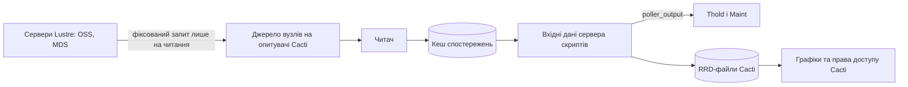

<!-- Source: README.md; SHA256: e88d6875d113220a91cfc0a9d230c829a78477b17e6aa7e44dda38c9591c86ad -->

<!-- translations:start -->
[English](../../../README.md) | [简体中文](../zh-CN/README.md) | [हिन्दी](../hi-IN/README.md) | [Español (España)](../es-ES/README.md) | [Español (Latinoamérica)](../es-419/README.md) | [العربية (السعودية)](../ar-SA/README.md) | [Afrikaans](../af-ZA/README.md) | [አማርኛ](../am-ET/README.md) | [العربية (مصر)](../ar-EG/README.md) | [العربية (المغرب)](../ar-MA/README.md) | [বাংলা](../bn-BD/README.md) | [Bosanski](../bs-BA/README.md) | [Deutsch](../de-DE/README.md) | [فارسی](../fa-IR/README.md) | [Filipino](../fil-PH/README.md) | [Français](../fr-FR/README.md) | [Français (Maroc)](../fr-MA/README.md) | [Français (Sénégal)](../fr-SN/README.md) | [Hausa](../ha-NG/README.md) | [עברית](../he-IL/README.md) | [Hrvatski](../hr-HR/README.md) | [Bahasa Indonesia](../id-ID/README.md) | [Igbo](../ig-NG/README.md) | [Italiano](../it-IT/README.md) | [日本語](../ja-JP/README.md) | [한국어](../ko-KR/README.md) | [Malagasy](../mg-MG/README.md) | [मराठी](../mr-IN/README.md) | [Bahasa Melayu](../ms-MY/README.md) | [Nederlands](../nl-NL/README.md) | [Polski](../pl-PL/README.md) | [Português (Brasil)](../pt-BR/README.md) | [Русский](../ru-RU/README.md) | [Kinyarwanda](../rw-RW/README.md) | [Soomaali](../so-SO/README.md) | [Српски](../sr-RS/README.md) | [Svenska](../sv-SE/README.md) | [Kiswahili](../sw-KE/README.md) | [தமிழ்](../ta-IN/README.md) | [తెలుగు](../te-IN/README.md) | [ไทย](../th-TH/README.md) | [Türkçe](../tr-TR/README.md) | [Українська](README.md) | [اردو](../ur-PK/README.md) | [Tiếng Việt](../vi-VN/README.md) | [isiXhosa](../xh-ZA/README.md) | [Yorùbá](../yo-NG/README.md) | [繁體中文](../zh-TW/README.md) | [isiZulu](../zu-ZA/README.md)
<!-- translations:end -->

# plugin_pfs

Плагін для Cacti 1.2, що передає до Cacti показники стану та навантаження паралельних файлових систем: ємність і дисбаланс заповнення між цілями зберігання, пропускну здатність кожної цілі та частоту операцій з метаданими. Першою підтримуваною системою є Lustre. Підтримка GPFS (IBM Storage Scale) та BeeGFS реалізується далі через інтерфейс бекенду. Дані потрапляють до звичайних пристроїв, джерел даних і графіків Cacti, тому Thold і Maint створюють сповіщення на їхній основі та приглушують їх без жодних змін.

> **Статус: етап 4, код для фази 1 завершено, реліз іще не випущено.** Етапи 2 (базова основа), 3 (спостереження за Lustre) та 4 (сповіщення й підготовка до релізу) завершено у гілці `main` або перебувають на рев'ю. Плагін встановлюється, оновлюється та видаляється через API плагінів Cacti і відмовляється працювати з PHP нижче версії 8.2. Фоновий читач на кожному опитувачі зчитує дані із серверів Lustre через SSH за допомогою фіксованого скрипту з примусовим виконанням команди ([node/pfs-read.sh](../../../node/pfs-read.sh)) і кешує інвентар, стан, ємність та лічильники разом із часом їхньої актуальності. Кожна файлова система стає пристроєм Cacti із запитами даних OST та MDT, п'ятьма оглядовими графіками, графіками за окремими цілями на вимогу та зведеним джерелом даних для Thold. Thold v1.8.2 та Maint v1.3 без змін спрацьовують і приглушують сповіщення за зведеними показниками типу gauge під час наскрізного прогону; пороги Thold для лічильників не підтримуються у Thold 1.8.2 ([docs/alerting.md](../../alerting.md)). Усі проведені досі тести виконувалися на фіктивних вихідних даних вузлів у тимчасовому екземплярі Cacti: плагін ще не запускався на реальному вузлі Lustre. До випуску релізу залишаються відкритими такі завдання: пілотні запуски на реальних файлових системах ([план пілотного впровадження](../../pilot-plan.md)), зовнішній аудит безпеки ([самоперевірка](../../security-review.md)) та вимірювання масштабування на задокументованому обладнанні ([масштабування](../../research/scale.md)). Версію 0.1.0 підготовлено в `INFO` та [CHANGELOG.md](../../../CHANGELOG.md), але тег ще не створено.

## Ролі доступу

| Область доступу (Realm) | Доступ |
| --- | --- |
| Перегляд паралельних файлових систем (Parallel Filesystem View) | Наявні сторінки моніторингу. |
| Оператор паралельних файлових систем (Parallel Filesystem Operator) | Моніторинг, а також сторінка операцій і персональні підтвердження опрацювання (triage). |
| Адміністратор паралельних файлових систем (Parallel Filesystem Admin) | Доступ оператора, а також наявні налаштування та адміністративні дії. |

Після копіювання файлів оновлення відкрийте сторінку плагінів від імені адміністратора, щоб зареєструвати нову область доступу. Призначте роль Operator явно в розділі **Configuration > Users** («Налаштування > Користувачі») або для груп користувачів.
Оновлення зберігають наявні ідентифікатори та права для областей View і Admin. Доступ Admin успадковує доступ Operator, а доступ Operator успадковує доступ View під час кожного запиту; це не додає збережених прав користувачам чи групам. Налаштування плагіна також вимагають доступу Parallel Filesystem Admin на додачу до дозволу Settings у Cacti.

Дозволи на пристрої в Cacti, як і раніше, обмежують рядки та дії, доступні кожному користувачеві; для незіставлених об'єктів потрібен адміністратор.
Облікові дані, конфігурація, зіставлення, видалення та інші адміністративні зміни залишаються на сторінках адміністрування. Підтвердження опрацювання діють лише протягом поточної сесії користувача, щонайбільше одну годину і лише доти, доки те саме спостереження залишається актуальним. Нові або змінені спостереження роблять їх недійсними. Вони ніколи не позначають невдале вимірювання як справне і не приглушують сповіщення.

## Навіщо потрібен цей плагін

Коли спільна файлова система працює повільно, ознаки проблеми розподілені між різними серверами. Lustre зберігає свої лічильники на кожному вузлі окремо: `lctl get_param` повертає значення «на локальному вузлі», тож кожен сервер об'єктного зберігання (OSS) і сервер метаданих (MDS) містить показники лише власних цілей. Оператору, який досліджує уповільнення файлової системи, потрібні три відповіді з різних місць:

- **Чи заповнюється одна ціль, поки інші порожні?** Дисбаланс заповнення впливає на те, куди потрапляють нові файли та коли в окремої цілі закінчиться вільне місце.
- **Які цілі чи операції навантажені?** Лічильники байтів для кожної цілі та лічильники операцій для кожного MDT показують, чи обмежена продуктивність операціями з даними, чи з метаданими.
- **Чи є сам моніторинг актуальним?** Рівний графік заспокоює лише тоді, коли плагін справді бачить сервери.

Cacti будує графіки для хостів і відстежує порогові значення за допомогою Thold, а в організації Cacti на GitHub немає репозиторію для моніторингу Lustre, GPFS чи BeeGFS (перевірено 2026-11-14). Плагін закриває цю прогалину, зчитуючи з вузлів зберігання дозволені значення, доступні лише для читання, і представляючи кожну файлову систему як пристрій Cacti, цілі якого є індексами запиту даних. Він повторно використовує побудову графіків, систему прав, віддалені збирачі даних, Thold і Maint самого Cacti замість створення їхніх паралельних аналогів.

## Запланований обсяг

| Фаза | Обсяг | Етапи |
|---|---|---|
| 0, дослідження | Матриця релізів, рішення щодо доступу до вузлів, підтвердження поведінки апстріму, поведінка лічильників і перемикання при відмові, вимірювання масштабування | [M1](https://github.com/somethingwithproof/plugin_pfs/milestone/1) |
| 1, спостереження | Інвентар Lustre, ємність і заповнення, пропускна здатність OST, частота операцій MDT, графіки, сповіщення Thold, приглушення Maint, сторінка стану | [M2](https://github.com/somethingwithproof/plugin_pfs/milestone/2), [M3](https://github.com/somethingwithproof/plugin_pfs/milestone/3), [M4](https://github.com/somethingwithproof/plugin_pfs/milestone/4) |
| 2, деталізація | Віддалені збирачі даних Cacti, подання на рівні завдань (job) і клієнтів у межах обмеженої кількості об'єктів | [M5](https://github.com/somethingwithproof/plugin_pfs/milestone/5) |
| 3, бекенди | Бекенди для GPFS (IBM Storage Scale) та BeeGFS | [M6](https://github.com/somethingwithproof/plugin_pfs/milestone/6) |

Поза межами проєкту: будь-які операції запису, очищення, скидання чи налаштування на вузлі або файловій системі; власний рушій сповіщень плагіна; спеціальний демон або мережевий протокол; окремі джерела даних для кожного завдання; зміни в ядрі Cacti, Thold або Maint.

## Цільова сумісність

| Компонент | Ціль |
|---|---|
| Cacti | 1.2.31 або новіша, без патчів ядра |
| PHP | 8.2 або новіша; `setup.php` залишається придатним для розбору на 8.0, щоб непідтримуване середовище виконання видавало відмову замість пошкодження інтерфейсу Cacti |
| Lustre | Гілки релізів буде зафіксовано на етапі 1; перевірені досі вихідний код і посібники належать до версії 2.17.0 |
| GPFS, BeeGFS | Фаза 3; релізи буде визначено за результатами дослідження |
| Thold, Maint | Зміни не потрібні |

## Проєктування

- [docs/PLAN.md](../../PLAN.md) — повний план: архітектура, факти апстріму, від яких вона залежить (із джерелами та тим, що ще не перевірено), семантика лічильників, модель станів, межі безпеки, розрахунки продуктивності, тестування та ризики.
- [docs/operator-guide.md](../../operator-guide.md) описує встановлення, графіки та значення, оновлення, резервне копіювання й відновлення, видалення та усунення несправностей; [docs/alerting.md](../../alerting.md) описує роботу з Thold і Maint.
- [docs/node-setup.md](../../node-setup.md) описує, як підготувати сервер Lustre та опитувач для роботи читача.
- [docs/decisions/](../../decisions) містить записи архітектурних рішень (ADR) для вже зроблених виборів.
- [docs/REQUIREMENTS.md](../../REQUIREMENTS.md) зіставляє кожен ідентифікатор вимоги з відповідним issue.

## Як відстежується робота

- **Етапи (Milestones)** відповідають етапам плану. Кожен має епік-issue з переліком підепіків/підзадач і підтверджувальних свідчень завершення.
- **Завдання (Issues)** типізуються за допомогою міток: `type: requirement`, `type: research`, `type: decision`, `type: epic`. Випуски вимог містять нумеровані тестовані вимоги (`REQ-AREA-NNN`) і критерії приймання.
- **Мітки** також мають префікси `area:`, `phase:`, `priority:` та `status:`. Див. [CONTRIBUTING.md](../../../CONTRIBUTING.md#labels).
- [Дошка проєкту](https://github.com/users/somethingwithproof/projects/11) показує всі issues за етапами.

## Участь у розробці

Прочитайте [CONTRIBUTING.md](../../../CONTRIBUTING.md). Коміти потребують підпису DCO (DCO sign-off). Обговорення проєктних рішень відбувається в issues; відкриті рішення позначаються міткою `type: decision`.

## Безпека

Повідомляйте про вразливості приватно; див. [SECURITY.md](../../../SECURITY.md).

## Ліцензія

GNU General Public License v2.0 — та сама ліцензія, що й у Cacti та його плагінів. Див. [LICENSE](../../../LICENSE).
