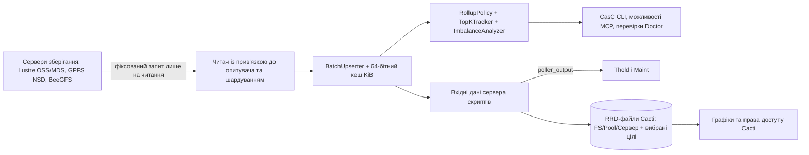

<!-- Source: README.md; SHA256: e88d6875d113220a91cfc0a9d230c829a78477b17e6aa7e44dda38c9591c86ad -->

<!-- translations:start -->
[English](../../../README.md) | [简体中文](../zh-CN/README.md) | [हिन्दी](../hi-IN/README.md) | [Español (España)](../es-ES/README.md) | [Español (Latinoamérica)](../es-419/README.md) | [العربية (السعودية)](../ar-SA/README.md) | [Afrikaans](../af-ZA/README.md) | [አማርኛ](../am-ET/README.md) | [العربية (مصر)](../ar-EG/README.md) | [العربية (المغرب)](../ar-MA/README.md) | [Български](../bg-BG/README.md) | [বাংলা](../bn-BD/README.md) | [Bosanski](../bs-BA/README.md) | [Deutsch](../de-DE/README.md) | [Ελληνικά](../el-GR/README.md) | [فارسی](../fa-IR/README.md) | [Filipino](../fil-PH/README.md) | [Français](../fr-FR/README.md) | [Français (Maroc)](../fr-MA/README.md) | [Français (Sénégal)](../fr-SN/README.md) | [Hausa](../ha-NG/README.md) | [עברית](../he-IL/README.md) | [Hrvatski](../hr-HR/README.md) | [Bahasa Indonesia](../id-ID/README.md) | [Igbo](../ig-NG/README.md) | [Italiano](../it-IT/README.md) | [日本語](../ja-JP/README.md) | [ქართული](../ka-GE/README.md) | [한국어](../ko-KR/README.md) | [Latviešu](../lv-LV/README.md) | [Malagasy](../mg-MG/README.md) | [मराठी](../mr-IN/README.md) | [Bahasa Melayu](../ms-MY/README.md) | [Nederlands](../nl-NL/README.md) | [Polski](../pl-PL/README.md) | [Português (Brasil)](../pt-BR/README.md) | [Português (Portugal)](../pt-PT/README.md) | [Русский](../ru-RU/README.md) | [Kinyarwanda](../rw-RW/README.md) | [Soomaali](../so-SO/README.md) | [Српски](../sr-RS/README.md) | [Svenska](../sv-SE/README.md) | [Kiswahili](../sw-KE/README.md) | [தமிழ்](../ta-IN/README.md) | [తెలుగు](../te-IN/README.md) | [ไทย](../th-TH/README.md) | [Türkçe](../tr-TR/README.md) | [Українська](README.md) | [اردو](../ur-PK/README.md) | [Tiếng Việt](../vi-VN/README.md) | [isiXhosa](../xh-ZA/README.md) | [Yorùbá](../yo-NG/README.md) | [繁體中文](../zh-TW/README.md) | [isiZulu](../zu-ZA/README.md)
<!-- translations:end -->

# plugin_pfs

Плагін для Cacti 1.2, що передає до Cacti показники стану, ємності, дисбалансу заповнення, пропускної здатності кожної цілі та частоти операцій з метаданими паралельних файлових систем у Lustre, IBM Storage Scale (GPFS) і BeeGFS за єдиним інтерфейсом `Backend`. Кожна файлова система зіставляється зі звичайним пристроєм Cacti із запитами даних, оглядовими графіками та графіками окремих цілей за запитом, а також зведеними показниками, щоб Thold і Maint створювали сповіщення та приглушували їх без жодних змін.

> **Статус: фази з 1 по 3 та базові примітиви масштабування до екзамасштабу реалізовано в коді, реліз іще не випущено.** Базова основа, спостереження за Lustre, сповіщення та приглушення Maint, драйвери лише для читання для GPFS та BeeGFS, аналіз дисбалансу OST/MDT з інтеграцією Maint, обмеження області дії віддаленого збирача даних (`replicate_out`, `remote_agent`), примітиви масштабування 100+ ПБ / екзамасштабу (`FramedReportParser`, схема v4 `value_kib`, `RollupPolicy`, `TopKTracker`, `ShardAssigner`, `BatchUpserter`), операторський CLI для CasC (`cli/pfs.php`) та хуки екосистеми (`abilities_register`, `doctor_register_checks`, `casc_register_providers`) реалізовані та перевірені модульними тестами, тестами безпеки й інтеграційними тестами на тимчасовому екземплярі Cacti. Усі запуски досі використовують фіктивні вихідні дані вузлів замість реального обладнання Lustre, GPFS чи BeeGFS. До позначення релізу тегом залишаються відкритими такі завдання: пілотні запуски на реальних файлових системах ([план пілотного впровадження](../../pilot-plan.md)), зовнішній аудит безпеки ([самоперевірка](../../security-review.md)) та вимірювання масштабування на задокументованому обладнанні ([масштабування](../../research/scale.md)). Версію 0.1.0 підготовлено в `INFO` та [CHANGELOG.md](../../../CHANGELOG.md), але тег ще не створено.

## Ролі доступу

| Область доступу (Realm) | Доступ |
| --- | --- |
| Перегляд паралельних файлових систем (Parallel Filesystem View) | Наявні сторінки моніторингу. |
| Оператор паралельних файлових систем (Parallel Filesystem Operator) | Моніторинг, а також сторінка операцій і персональні підтвердження опрацювання (triage). |
| Адміністратор паралельних файлових систем (Parallel Filesystem Admin) | Доступ оператора, а також наявні налаштування та адміністративні дії. |

Після копіювання файлів оновлення відкрийте сторінку плагінів від імені адміністратора, щоб зареєструвати нову область доступу. Призначте роль Operator явно в розділі **Configuration > Users** («Налаштування > Користувачі») або для груп користувачів.
Оновлення зберігають наявні ідентифікатори та права для областей View і Admin. Доступ Admin успадковує доступ Operator, а доступ Operator успадковує доступ View під час кожного запиту; це не додає збережених прав користувачам чи групам. Налаштування плагіна також вимагають доступу Parallel Filesystem Admin на додачу до дозволу Settings у Cacti.

Дозволи на пристрої в Cacti, як і раніше, обмежують рядки та дії, доступні кожному користувачеві; для незіставлених об'єктів потрібен адміністратор.
Облікові дані, конфігурація, зіставлення, видалення та інші адміністративні зміни залишаються на сторінках адміністрування. Підтвердження опрацювання діють лише протягом поточної сесії користувача, щонайбільше одну годину і лише доти, доки те саме спостереження залишається актуальним. Нові або змінені спостереження роблять їх недійсними. Вони ніколи не позначають невдале вимірювання як справне і не приглушують сповіщення.

## Навіщо потрібен цей плагін

Коли спільна файлова система працює повільно, ознаки проблеми розподілені між різними серверами. Lustre зберігає свої лічильники на кожному вузлі окремо: `lctl get_param` повертає значення «на локальному вузлі», тож кожен сервер об'єктного зберігання (OSS) і сервер метаданих (MDS) містить показники лише власних цілей. Оператору, який досліджує уповільнення файлової системи, потрібні три відповіді з різних місць:

- **Чи заповнюється одна ціль, поки інші порожні?** Дисбаланс заповнення впливає на те, куди потрапляють нові файли та коли в окремої цілі закінчиться вільне місце.
- **Які цілі чи операції навантажені?** Лічильники байтів для кожної цілі та лічильники операцій для кожного MDT показують, чи обмежена продуктивність операціями з даними, чи з метаданими.
- **Чи є сам моніторинг актуальним?** Рівний графік заспокоює лише тоді, коли плагін справді бачить сервери.

Cacti будує графіки для хостів і відстежує порогові значення за допомогою Thold, а в організації Cacti на GitHub немає репозиторію для моніторингу Lustre, GPFS чи BeeGFS (перевірено 2026-11-14). Плагін закриває цю прогалину, зчитуючи з вузлів зберігання дозволені значення, доступні лише для читання, і представляючи кожну файлову систему як пристрій Cacti, цілі якого є індексами запиту даних. Він повторно використовує побудову графіків, систему прав, віддалені збирачі даних, Thold і Maint самого Cacti замість створення їхніх паралельних аналогів.

## Запланований обсяг

| Фаза | Обсяг | Статус | Етапи |
|---|---|---|---|
| 0, дослідження | Матриця релізів, рішення щодо доступу до вузлів, підтвердження поведінки апстріму, поведінка лічильників і перемикання при відмові, вимірювання масштабування | Завершено | [M1](https://github.com/somethingwithproof/plugin_pfs/milestone/1) |
| 1, спостереження | Інвентар Lustre, ємність і заповнення, дисбаланс OST/MDT (`lib/ImbalanceAnalyzer.php`), інтеграція з Maint (`lib/HealthPage.php`), пропускна здатність OST, частота операцій MDT, графіки, сповіщення Thold, сторінка стану | Реалізовано (перевірено на фіктивних даних) | [M2](https://github.com/somethingwithproof/plugin_pfs/milestone/2), [M3](https://github.com/somethingwithproof/plugin_pfs/milestone/3), [M4](https://github.com/somethingwithproof/plugin_pfs/milestone/4) |
| 2, віддалений збір і масштаб | Віддалений збір у межах опитувача (`lib/Reader.php`, `lib/ReplicationRepository.php`, `replicate_out`, `remote_agent`), примітиви масштабування 100+ ПБ (64-бітна гігієна KiB + схема v4 `value_kib`, `lib/RollupPolicy.php`, `lib/TopKTracker.php`, `lib/ShardAssigner.php` + `poller_pfs.php --shard=K/N`, `lib/BatchUpserter.php`), CasC CLI (`cli/pfs.php`), хуки MCP/Doctor/CasC | Реалізовано (перевірено модульними та інтеграційними CI-тестами) | [M5](https://github.com/somethingwithproof/plugin_pfs/milestone/5) |
| 3, бекенди | Драйвери лише для читання IBM Storage Scale (GPFS) (`lib/GpfsBackend.php`) та BeeGFS (`lib/BeegfsBackend.php`), зареєстровані в `BackendRegistry::production()` | Реалізовано (перевірено модульними тестами) | [M6](https://github.com/somethingwithproof/plugin_pfs/milestone/6) |

Основні реалізовані операторські примітиви та примітиви масштабування:

- **Драйвери лише для читання для кількох файлових систем:** `LustreBackend`, `GpfsBackend` (лише фреймовані `mmpmon` `fs_io_s`/`io_s` із забороною `reset`, ємність/стани пулів `mmdf` та зведення очікувань) і `BeegfsBackend` (цілі зберігання й метаданих BeeGFS 7.4 та 8.x із точним перетворенням байтів у KiB, зіставленням умов досяжності й узгодженості та поінтервальною семантикою gauge), які спільно використовують `lib/FramedReportParser.php`.
- **Аналіз дисбалансу, запасу ємності та інтеграція з Maint:** `lib/ImbalanceAnalyzer.php` обчислює коефіцієнти заповнення OST/MDT, розкид, індекс дисбалансу за стандартним відхиленням сукупності, запас ємності, контроль актуальності за 1 інтервал (`missing_targets`), прапорці стану для кожної цілі та обмежений список Top-K найбільш перекошених цілей. `HealthPage` (`pfs_health.php`) та `CascProvider::health()` відображають вікна обслуговування Cacti `Maint` і приглушують активні попередження про збої під час планового обслуговування.
- **Масштабування до 100+ ПБ та екзамасштабу** ([docs/architecture/exascale-scaling.md](../../architecture/exascale-scaling.md)): точне десяткове перетворення байтів у KiB (`FramedReportParser::bytesToKibInt()`), перевірене на обсягах 500 ПБ і 2 ЕБ разом зі стовпцями `BIGINT UNSIGNED value_kib` (схема v4); ієрархічна агрегація RRD `Filesystem -> Pool -> Storage Server` із обмеженим просуванням вибраних, навантажених або перекошених цілей (`lib/RollupPolicy.php`); обмежені $O(K)$ Top-K перекошені цілі та попередньо агреговані зведення щодо важких завдань і клієнтів (`lib/TopKTracker.php`, без створення окремих пристроїв чи RRD для кожного клієнта); детерміноване шардування збирача за CRC32 (`lib/ShardAssigner.php`, `php plugins/pfs/poller_pfs.php [--poller=N] [--shard=K/N] [--force] [--debug]`); а також пакетні SQL-операції upsert по 500 рядків і keyset-пагінація (`lib/BatchUpserter.php`, `CacheRepository::upsertObservationsBatch()`, `TargetRepository::forFilesystemPage()`).
- **Операторський CasC CLI та хуки екосистеми:** `cli/pfs.php` підтримує `export [--format=yaml|xml]`, `validate <file> [--format=yaml|xml]`, `plan <file> [--format=yaml|xml] [--output=text|json]`, `apply <file> --confirm=<PLAN_HASH> [--format=yaml|xml]` та `health [--format=text|json]` без зовнішніх залежностей Composer. `setup.php` та `lib/EcosystemIntegration.php` реєструють `abilities_register` (`pfs-list-filesystems`, `pfs-get-imbalance`, `pfs-get-health`; лише для читання, обмежені правами `Parallel Filesystem View` і правами доступу до пристроїв Cacti), `doctor_register_checks` (`pfs_schema`, `pfs_reader_freshness`, `pfs_capacity_imbalance`), `casc_register_providers`, `replicate_out` та `remote_agent`.

Поза межами проєкту: будь-які операції запису, очищення, скидання чи налаштування на вузлі або файловій системі; власний рушій сповіщень плагіна; спеціальний демон або мережевий протокол; окремі пристрої чи RRD Cacti для кожного завдання або клієнта; зміни в ядрі Cacti, Thold або Maint.

## Цільова сумісність

| Компонент | Ціль |
|---|---|
| Cacti | 1.2.31 або новіша, без патчів ядра |
| PHP | 8.2 або новіша; `setup.php`, `poller_pfs.php` та `cli/pfs.php` залишаються придатними для розбору на 8.0, щоб непідтримуване середовище виконання видавало відмову замість пошкодження інтерфейсу Cacti |
| Lustre | Вихідний код і посібники перевірено на версії 2.17.0; перевірено на фіктивних даних |
| GPFS, BeeGFS | Драйвери лише для читання IBM Storage Scale (GPFS) 5.x `mmpmon`/`mmdf` та BeeGFS 7.4 / 8.x реалізовано та перевірено на фіктивних даних |
| Thold, Maint | Thold 1.8.2 та Maint 1.3, без змін |

## Проєктування

- [docs/architecture/exascale-scaling.md](../../architecture/exascale-scaling.md) документує дворівневу архітектуру телеметрії для 100+ ПБ / екзамасштабу (рівень сервера Cacti/`plugin_pfs` + агрегація + Top-K у поєднанні з позасмуговою клієнтською телеметрією LDMS/Darshan/TOKIO) та її контекст у науковій літературі.
- [docs/PLAN.md](../../PLAN.md) це повний план: архітектура, факти апстріму, від яких вона залежить (із джерелами та тим, що ще не перевірено), семантика лічильників, модель станів, межі безпеки, розрахунки продуктивності, тестування та ризики.
- [docs/operator-guide.md](../../operator-guide.md) описує встановлення, графіки та значення, оновлення, резервне копіювання й відновлення, видалення та усунення несправностей; [docs/alerting.md](../../alerting.md) описує роботу з Thold і Maint.
- [docs/node-setup.md](../../node-setup.md) описує, як підготувати сервер Lustre та опитувач для роботи читача.
- [docs/decisions/](../../decisions) містить записи архітектурних рішень (ADR) для вже зроблених виборів.
- [docs/REQUIREMENTS.md](../../REQUIREMENTS.md) зіставляє кожен ідентифікатор вимоги з відповідним issue.

## Як відстежується робота

- **Етапи (Milestones)** відповідають етапам плану. Кожен має епік-issue з переліком підепіків/підзадач і підтверджувальних свідчень завершення.
- **Завдання (Issues)** типізуються за допомогою міток: `type: requirement`, `type: research`, `type: decision`, `type: epic`. Випуски вимог містять нумеровані тестовані вимоги (`REQ-AREA-NNN`) і критерії приймання.
- **Мітки** також мають префікси `area:`, `phase:`, `priority:` та `status:`. Див. [CONTRIBUTING.md](../../../CONTRIBUTING.md#labels).
- [Дошка проєкту](https://github.com/users/somethingwithproof/projects/11) показує всі issues за етапами.

## Участь у розробці

Прочитайте [CONTRIBUTING.md](../../../CONTRIBUTING.md). Коміти потребують підпису DCO (DCO sign-off). Обговорення проєктних рішень відбувається в issues; відкриті рішення позначаються міткою `type: decision`.

## Безпека

Повідомляйте про вразливості приватно; див. [SECURITY.md](../../../SECURITY.md).

## Ліцензія

GNU General Public License v2.0, та сама ліцензія, що й у Cacti та його плагінів. Див. [LICENSE](../../../LICENSE).
