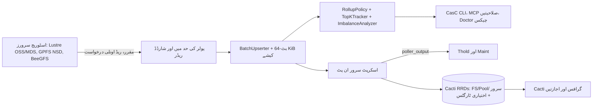

<!-- Source: README.md; SHA256: e88d6875d113220a91cfc0a9d230c829a78477b17e6aa7e44dda38c9591c86ad -->

<!-- translations:start -->
[English](../../../README.md) | [简体中文](../zh-CN/README.md) | [हिन्दी](../hi-IN/README.md) | [Español (España)](../es-ES/README.md) | [Español (Latinoamérica)](../es-419/README.md) | [العربية (السعودية)](../ar-SA/README.md) | [Afrikaans](../af-ZA/README.md) | [አማርኛ](../am-ET/README.md) | [العربية (مصر)](../ar-EG/README.md) | [العربية (المغرب)](../ar-MA/README.md) | [বাংলা](../bn-BD/README.md) | [Bosanski](../bs-BA/README.md) | [Deutsch](../de-DE/README.md) | [فارسی](../fa-IR/README.md) | [Filipino](../fil-PH/README.md) | [Français](../fr-FR/README.md) | [Français (Maroc)](../fr-MA/README.md) | [Français (Sénégal)](../fr-SN/README.md) | [Hausa](../ha-NG/README.md) | [עברית](../he-IL/README.md) | [Hrvatski](../hr-HR/README.md) | [Bahasa Indonesia](../id-ID/README.md) | [Igbo](../ig-NG/README.md) | [Italiano](../it-IT/README.md) | [日本語](../ja-JP/README.md) | [한국어](../ko-KR/README.md) | [Malagasy](../mg-MG/README.md) | [मराठी](../mr-IN/README.md) | [Bahasa Melayu](../ms-MY/README.md) | [Nederlands](../nl-NL/README.md) | [Polski](../pl-PL/README.md) | [Português (Brasil)](../pt-BR/README.md) | [Русский](../ru-RU/README.md) | [Kinyarwanda](../rw-RW/README.md) | [Soomaali](../so-SO/README.md) | [Српски](../sr-RS/README.md) | [Svenska](../sv-SE/README.md) | [Kiswahili](../sw-KE/README.md) | [தமிழ்](../ta-IN/README.md) | [తెలుగు](../te-IN/README.md) | [ไทย](../th-TH/README.md) | [Türkçe](../tr-TR/README.md) | [Українська](../uk-UA/README.md) | [اردو](README.md) | [Tiếng Việt](../vi-VN/README.md) | [isiXhosa](../xh-ZA/README.md) | [Yorùbá](../yo-NG/README.md) | [繁體中文](../zh-TW/README.md) | [isiZulu](../zu-ZA/README.md)
<!-- translations:end -->

# plugin_pfs

ایک Cacti 1.2 پلگ اِن جو ایک متحد `Backend` انٹرفیس کے تحت Lustre، IBM Storage Scale (GPFS)، اور BeeGFS میں متوازی فائل سسٹم کی صحت، گنجائش، بھراؤ کا عدم توازن، فی ٹارگٹ تھرو پٹ، اور میٹا ڈیٹا آپریشن کی شرحوں کو Cacti میں لاتا ہے۔ ہر فائل سسٹم ڈیٹا کوئریز، اوورویو اور طلب پر فی ٹارگٹ گرافس، اور خلاصہ گیجز کے ساتھ ایک عام Cacti ڈیوائس سے میپ ہوتا ہے، اس لیے Thold اور Maint بغیر کسی تبدیلی کے اس پر الرٹ بھیجتے اور انہیں دباتے ہیں۔

> **حالت: فیز 1 سے 3 اور exascale اسکیلنگ کے بنیادی اجزاء کوڈ میں نافذ ہو چکے ہیں، ابھی جاری نہیں کیے گئے۔** بنیاد، Lustre مشاہدہ، الرٹنگ اور Maint سپریشن، GPFS اور BeeGFS ریڈ اونلی ڈرائیورز، Maint انضمام کے ساتھ OST/MDT عدم توازن کا تجزیہ، ریموٹ ڈیٹا کلیکٹر اسکوپنگ (`replicate_out`, `remote_agent`)، 100+ PB / exascale اسکیلنگ کے بنیادی اجزاء (`FramedReportParser`، Schema v4 `value_kib`، `RollupPolicy`، `TopKTracker`، `ShardAssigner`، `BatchUpserter`)، CasC آپریٹر CLI (`cli/pfs.php`)، اور ایکو سسٹم ہکس (`abilities_register`, `doctor_register_checks`, `casc_register_providers`) نافذ کیے جا چکے ہیں اور یونٹ، سیکیورٹی، اور عارضی Cacti انٹیگریشن ٹیسٹس کے ذریعے تصدیق شدہ ہیں۔ اب تک کے تمام رنز براہِ راست Lustre، GPFS، یا BeeGFS ہارڈویئر کے بجائے فکسچر نوڈ آؤٹ پٹ استعمال کرتے ہیں۔ ریلیز کو ٹیگ کرنے سے پہلے ابھی یہ کام باقی ہیں: حقیقی فائل سسٹمز پر پائلٹ ٹیسٹ ([پائلٹ پلان](../../pilot-plan.md))، بیرونی سیکیورٹی جائزہ ([ذاتی جائزہ](../../security-review.md))، اور دستاویزی ہارڈویئر پر اسکیل پیمائشیں ([اسکیل](../../research/scale.md))۔ ورژن 0.1.0 `INFO` اور [CHANGELOG.md](../../../CHANGELOG.md) میں تیار ہے لیکن ابھی ٹیگ نہیں کیا گیا۔

## رسائی کے کردار

| ریلم | رسائی |
| --- | --- |
| Parallel Filesystem View | موجودہ مانیٹرنگ صفحات۔ |
| Parallel Filesystem Operator | مانیٹرنگ کے ساتھ آپریشنز کا صفحہ اور ذاتی ٹرائیج کی توثیقیں۔ |
| Parallel Filesystem Admin | آپریٹر کی رسائی کے ساتھ موجودہ کنفیگریشن اور انتظامی کارروائیاں۔ |

اپ گریڈ فائلیں کاپی کرنے کے بعد، نیا ریلم رجسٹر کرنے کے لیے بطور ایڈمنسٹریٹر Plugins صفحہ کھولیں۔ **Configuration > Users** یا صارف گروپس کے تحت واضح طور پر Operator ریلم تفویض کریں۔
اپ گریڈز موجودہ View اور Admin ریلم آئی ڈیز اور اجازتوں کو برقرار رکھتے ہیں۔ Admin رسائی کو
Operator رسائی وراثت میں ملتی ہے، اور ہر درخواست پر Operator رسائی کو View رسائی وراثت میں ملتی ہے؛
اس سے صارفین یا گروپس میں محفوظ شدہ اجازتیں شامل نہیں ہوتیں۔ پلگ اِن کی ترتیبات کے لیے
Cacti کی Settings اجازت کے علاوہ Parallel Filesystem Admin رسائی بھی درکار ہوتی ہے۔

Cacti کی ڈیوائس اجازتیں اب بھی ہر صارف کو دستیاب قطاروں اور کارروائیوں کو محدود رکھتی ہیں؛ غیر میپ شدہ اشیاء کے لیے ایڈمنسٹریٹر درکار ہوتا ہے۔
اسناد، کنفیگریشن، میپنگ، حذف کرنے اور دیگر انتظامی تبدیلیاں
بدستور انتظامی صفحات میں رہتی ہیں۔ توثیقیں صرف موجودہ صارف کے
سیشن میں، زیادہ سے زیادہ ایک گھنٹے کے لیے اور صرف اس وقت تک برقرار رہتی ہیں جب تک وہی مشاہدہ
تازہ رہے۔ نئے یا تبدیل شدہ مشاہدات انہیں کالعدم کر دیتے ہیں۔ یہ کبھی کسی ناکام
پیمائش کو صحت مند قرار نہیں دیتیں اور نہ ہی الرٹس کو دباتی ہیں۔

## کیوں

جب کوئی مشترکہ فائل سسٹم سست ہوتا ہے، تو اس کے شواہد مختلف سرورز پر بکھرے ہوتے ہیں۔ Lustre اپنے کاؤنٹرز فی نوڈ رکھتا ہے: `lctl get_param` "مقامی نوڈ پر" قدریں رپورٹ کرتا ہے، اس لیے ہر آبجیکٹ اسٹوریج سرور (OSS) اور میٹا ڈیٹا سرور (MDS) کے پاس صرف اپنے ٹارگٹس کے اعداد و شمار ہوتے ہیں۔ سست فائل سسٹم کی تحقیقات کرنے والے آپریٹر کو مختلف جگہوں سے تین جوابات درکار ہوتے ہیں:

- **کیا ایک ٹارگٹ بھر رہا ہے جبکہ دیگر خالی ہیں؟** بھراؤ کا عدم توازن اس بات کو بدل دیتا ہے کہ نئی فائلیں کہاں جاتی ہیں اور کب کوئی ایک ٹارگٹ جگہ سے خالی ہو جاتا ہے۔
- **کون سے ٹارگٹس یا آپریشنز مصروف ہیں؟** فی ٹارگٹ بائٹ کاؤنٹرز اور فی MDT آپریشن کاؤنٹرز ظاہر کرتے ہیں کہ آیا لوڈ ڈیٹا کی وجہ سے ہے یا میٹا ڈیٹا کی وجہ سے۔
- **کیا مانیٹرنگ خود تازہ ترین ہے؟** ایک ہموار گراف تبھی تسلی بخش ہوتا ہے جب پلگ اِن سرورز کو دیکھ پا رہا ہو۔

Cacti میزبانوں کے گراف بناتا ہے اور Thold کے ساتھ قدروں پر تھریشولڈز لگاتا ہے، اور Cacti GitHub آرگنائزیشن میں Lustre، GPFS، یا BeeGFS مانیٹرنگ کے لیے کوئی ریپوزٹری موجود نہیں ہے (2026-11-14 کو تلاش کیا گیا)۔ یہ پلگ اِن اسٹوریج نوڈز سے اجازت یافتہ، صرف پڑھنے کے قابل قدریں پڑھ کر اور ہر فائل سسٹم کو ایک ایسے Cacti ڈیوائس کے طور پر پیش کر کے اس خلا کو پُر کرتا ہے جس کے ٹارگٹس ڈیٹا کوئری کے انڈیکس ہوتے ہیں۔ یہ Cacti کے اپنے گرافنگ، اجازتوں، ریموٹ ڈیٹا کلیکٹرز، Thold، اور Maint کی متوازی نقول بنانے کے بجائے انہیں ہی دوبارہ استعمال کرتا ہے۔

## منصوبہ بند دائرہ کار

| مرحلہ | دائرہ کار | حالت | مائل اسٹونز |
|---|---|---|---|
| 0، تحقیق | ریلیز میٹرکس، نوڈ تک رسائی کا فیصلہ، اپ اسٹریم طرزِ عمل کی تصدیق، کاؤنٹر اور فیل اوور طرزِ عمل، اسکیل پیمائشیں | مکمل | [M1](https://github.com/somethingwithproof/plugin_pfs/milestone/1) |
| 1، مشاہدہ | Lustre انونٹری، گنجائش اور بھراؤ، OST/MDT عدم توازن (`lib/ImbalanceAnalyzer.php`)، Maint انضمام (`lib/HealthPage.php`)، OST تھرو پٹ، MDT آپریشن کی شرحیں، گرافس، Thold الرٹنگ، صحت کا صفحہ | نافذ شدہ (فکسچر پر ٹیسٹ شدہ) | [M2](https://github.com/somethingwithproof/plugin_pfs/milestone/2), [M3](https://github.com/somethingwithproof/plugin_pfs/milestone/3), [M4](https://github.com/somethingwithproof/plugin_pfs/milestone/4) |
| 2، ریموٹ اور اسکیل | پولر کی حد میں ریموٹ کلیکشن (`lib/Reader.php`, `lib/ReplicationRepository.php`, `replicate_out`, `remote_agent`)، 100+ PB اسکیلنگ بنیادی اجزاء (64-بٹ KiB حفظانِ صحت + Schema v4 `value_kib`, `lib/RollupPolicy.php`, `lib/TopKTracker.php`, `lib/ShardAssigner.php` + `poller_pfs.php --shard=K/N`, `lib/BatchUpserter.php`)، CasC CLI (`cli/pfs.php`)، MCP/Doctor/CasC ہکس | نافذ شدہ (یونٹ اور CI انٹیگریشن ٹیسٹ شدہ) | [M5](https://github.com/somethingwithproof/plugin_pfs/milestone/5) |
| 3، بیک اینڈز | `BackendRegistry::production()` میں رجسٹرڈ ریڈ اونلی IBM Storage Scale (GPFS) (`lib/GpfsBackend.php`) اور BeeGFS (`lib/BeegfsBackend.php`) ڈرائیورز | نافذ شدہ (یونٹ ٹیسٹ شدہ) | [M6](https://github.com/somethingwithproof/plugin_pfs/milestone/6) |

نافذ شدہ کلیدی آپریٹر اور اسکیلنگ بنیادی اجزاء:

- **ملٹی فائل سسٹم ریڈ اونلی ڈرائیورز:** `lib/FramedReportParser.php` کا اشتراک کرنے والے `LustreBackend`، `GpfsBackend` (`reset` کی ممانعت کے ساتھ صرف فریم شدہ `mmpmon` `fs_io_s`/`io_s`، `mmdf` پول کی گنجائش/حالتیں، اور ویٹر خلاصے)، اور `BeegfsBackend` (درست بائٹ-تا-KiB تبدیلی، رسائی/یکسانیت کی شرائط کی میپنگ، اور فی وقفہ گیج معانی کے ساتھ BeeGFS 7.4 اور 8.x اسٹوریج/میٹا ڈیٹا ٹارگٹس)۔
- **عدم توازن، ہیڈ روم، اور Maint آگاہی:** `lib/ImbalanceAnalyzer.php` OST/MDT بھراؤ کے تناسب، پھیلاؤ، آبادی کے معیاری انحراف کا عدم توازن اشاریہ، ہیڈ روم، 1-وقفہ تازگی کا نفاذ (`missing_targets`)، فی ٹارگٹ اسٹیٹس فلیگز، اور محدود Top-K جھکاؤ والے ٹارگٹس کا حساب لگاتا ہے۔ `HealthPage` (`pfs_health.php`) اور `CascProvider::health()` Cacti `Maint` مینٹیننس ونڈوز دکھاتے ہیں اور طے شدہ مینٹیننس کے دوران فعال ناکامی کی وارننگز کو دباتے ہیں۔
- **100+ PB اور exascale اسکیلنگ** ([docs/architecture/exascale-scaling.md](../../architecture/exascale-scaling.md)): `BIGINT UNSIGNED value_kib` کالمز (Schema v4) کے ساتھ 500 PB اور 2 EB پر تصدیق شدہ درست اعشاری بائٹ-تا-KiB تبدیلی (`FramedReportParser::bytesToKibInt()`)؛ محدود اختیاری/گرم/جھکاؤ والے ٹارگٹ پروموشن کے ساتھ درجہ بندی `Filesystem -> Pool -> Storage Server` RRD رول اپس (`lib/RollupPolicy.php`)؛ محدود $O(K)$ Top-K جھکاؤ والے ٹارگٹس اور پہلے سے جمع شدہ بھاری جاب/کلائنٹ خلاصے (`lib/TopKTracker.php`، جو کبھی فی کلائنٹ ڈیوائسز یا RRDs نہیں بناتا)؛ متعین CRC32 کلیکٹر شارڈنگ (`lib/ShardAssigner.php`، `php plugins/pfs/poller_pfs.php [--poller=N] [--shard=K/N] [--force] [--debug]`)؛ اور 500 قطاروں کے بیچڈ SQL اپ سرٹس مع کی سیٹ پیجینیشن (`lib/BatchUpserter.php`، `CacheRepository::upsertObservationsBatch()`، `TargetRepository::forFilesystemPage()`)۔
- **آپریٹر CasC CLI اور ایکو سسٹم ہکس:** `cli/pfs.php` بغیر کسی بیرونی Composer انحصار کے `export [--format=yaml|xml]`، `validate <file> [--format=yaml|xml]`، `plan <file> [--format=yaml|xml] [--output=text|json]`، `apply <file> --confirm=<PLAN_HASH> [--format=yaml|xml]`، اور `health [--format=text|json]` کو سپورٹ کرتا ہے۔ `setup.php` اور `lib/EcosystemIntegration.php` `abilities_register` (`pfs-list-filesystems`، `pfs-get-imbalance`، `pfs-get-health`؛ صرف پڑھنے کے قابل، `Parallel Filesystem View` اور Cacti ڈیوائس اجازتوں کے تابع)، `doctor_register_checks` (`pfs_schema`، `pfs_reader_freshness`، `pfs_capacity_imbalance`)، `casc_register_providers`، `replicate_out`، اور `remote_agent` رجسٹر کرتے ہیں۔

دائرہ کار سے باہر: کسی نوڈ یا فائل سسٹم پر کوئی بھی لکھنے، صاف کرنے، ری سیٹ کرنے، یا ٹیوننگ کرنے کا آپریشن؛ پلگ اِن کا اپنا الرٹنگ انجن؛ کوئی کسٹم ڈیمن یا نیٹ ورک پروٹوکول؛ فی جاب یا فی کلائنٹ Cacti ڈیوائسز/RRDs؛ Cacti کور، Thold، یا Maint میں تبدیلیاں۔

## مطابقت کے اہداف

| جزو | ہدف |
|---|---|
| Cacti | 1.2.31 یا اس کے بعد کا، کوئی کور پیچ نہیں |
| PHP | 8.2 یا اس کے بعد کا؛ `setup.php`، `poller_pfs.php`، اور `cli/pfs.php` 8.0 پر پارس ہونے کے قابل رہتے ہیں تاکہ غیر معاون رن ٹائم کو ٹوٹے ہوئے Cacti UI کے بجائے انکار موصول ہو |
| Lustre | سورس اور مینوئلز 2.17.0 پر چیک کیے گئے؛ فکسچر پر ٹیسٹ شدہ |
| GPFS، BeeGFS | IBM Storage Scale (GPFS) 5.x `mmpmon`/`mmdf` اور BeeGFS 7.4 / 8.x ریڈ اونلی ڈرائیورز نافذ اور فکسچر پر ٹیسٹ شدہ |
| Thold، Maint | Thold 1.8.2 اور Maint 1.3، بغیر تبدیلی |

## ڈیزائن

- [docs/architecture/exascale-scaling.md](../../architecture/exascale-scaling.md) دو سطحی 100+ PB / exascale ٹیلی میٹری آرکیٹیکچر (Cacti/`plugin_pfs` سرور + رول اپ + Top-K سطح بمقابلہ آؤٹ آف بینڈ LDMS/Darshan/TOKIO کلائنٹ ٹیلی میٹری) اور اس کے علمی ادبی سیاق و سباق کو دستاویزی شکل دیتا ہے۔
- [docs/PLAN.md](../../PLAN.md) مکمل منصوبہ ہے: فنِ تعمیر، اپ اسٹریم حقائق جن پر یہ منحصر ہے (ذرائع اور جو ابھی غیر تصدیق شدہ ہے اس کے ساتھ)، کاؤنٹر کے معانی، اسٹیٹ ماڈل، سیکیورٹی حدود، کارکردگی کا حساب، ٹیسٹنگ، اور خطرات۔
- [docs/operator-guide.md](../../operator-guide.md) انسٹال، گرافس اور قدروں، اپ گریڈ، بیک اپ اور بحالی، اَن انسٹال، اور مسائل کے حل کا احاطہ کرتا ہے؛ [docs/alerting.md](../../alerting.md) Thold اور Maint کا احاطہ کرتا ہے۔
- [docs/node-setup.md](../../node-setup.md) بیان کرتا ہے کہ ریڈر کے لیے Lustre سرور اور پولر کو کیسے تیار کیا جائے۔
- [docs/decisions/](../../decisions) میں پہلے سے کیے گئے انتخاب کے لیے آرکیٹیکچر کے فیصلوں کے ریکارڈز موجود ہیں۔
- [docs/REQUIREMENTS.md](../../REQUIREMENTS.md) ہر تقاضے کی ID کو اس کے ایشو سے جوڑتا ہے۔

## کام کی نگرانی کا طریقہ

- **مائل اسٹونز** منصوبے کے مائل اسٹونز کی پیروی کرتے ہیں۔ ہر ایک کا ایک ایپک ایشو ہے جس میں اس کے ذیلی ایشوز اور اختتامی شواہد درج ہیں۔
- **ایشوز** کی درجہ بندی لیبل سے کی جاتی ہے: `type: requirement`، `type: research`، `type: decision`، `type: epic`۔ تقاضے کے ایشوز میں نمبر شدہ، قابلِ ٹیسٹ تقاضے (`REQ-AREA-NNN`) اور قبولیت کے معیار بیان کیے جاتے ہیں۔
- **لیبلز** میں `area:`، `phase:`، `priority:`، اور `status:` بھی شامل ہوتے ہیں۔ دیکھیں [CONTRIBUTING.md](../../../CONTRIBUTING.md#labels)۔
- [پروجیکٹ بورڈ](https://github.com/users/somethingwithproof/projects/11) تمام مائل اسٹونز کے تمام ایشوز دکھاتا ہے۔

## شراکت داری

[CONTRIBUTING.md](../../../CONTRIBUTING.md) پڑھیں۔ کمٹس کے لیے DCO دستخط درکار ہوتا ہے۔ ڈیزائن پر بحث ایشوز پر ہوتی ہے؛ کھلے فیصلوں پر `type: decision` لیبل لگا ہوتا ہے۔

## سیکیورٹی

کمزوریوں کی اطلاع نجی طور پر دیں؛ دیکھیں [SECURITY.md](../../../SECURITY.md)۔

## لائسنس

GNU General Public License v2.0، وہی لائسنس جو Cacti اور اس کے پلگ اِنز کا ہے۔ دیکھیں [LICENSE](../../../LICENSE)۔
