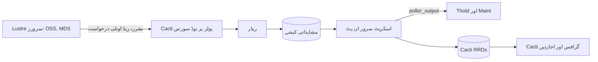

<!-- Source: README.md; SHA256: 40f2c5a5e9be97e4bd2b05a9ebab2a77de51de3af1b1c21dbeb5ee7f936cdd3b -->

<!-- translations:start -->
[English](../../../README.md) | [简体中文](../zh-CN/README.md) | [हिन्दी](../hi-IN/README.md) | [Español (España)](../es-ES/README.md) | [Español (Latinoamérica)](../es-419/README.md) | [العربية (السعودية)](../ar-SA/README.md) | [Afrikaans](../af-ZA/README.md) | [አማርኛ](../am-ET/README.md) | [العربية (مصر)](../ar-EG/README.md) | [العربية (المغرب)](../ar-MA/README.md) | [বাংলা](../bn-BD/README.md) | [Deutsch](../de-DE/README.md) | [فارسی](../fa-IR/README.md) | [Filipino](../fil-PH/README.md) | [Français](../fr-FR/README.md) | [Français (Maroc)](../fr-MA/README.md) | [Français (Sénégal)](../fr-SN/README.md) | [Hausa](../ha-NG/README.md) | [עברית](../he-IL/README.md) | [Bahasa Indonesia](../id-ID/README.md) | [Igbo](../ig-NG/README.md) | [Italiano](../it-IT/README.md) | [日本語](../ja-JP/README.md) | [한국어](../ko-KR/README.md) | [Malagasy](../mg-MG/README.md) | [मराठी](../mr-IN/README.md) | [Bahasa Melayu](../ms-MY/README.md) | [Nederlands](../nl-NL/README.md) | [Polski](../pl-PL/README.md) | [Português (Brasil)](../pt-BR/README.md) | [Русский](../ru-RU/README.md) | [Kinyarwanda](../rw-RW/README.md) | [Soomaali](../so-SO/README.md) | [Svenska](../sv-SE/README.md) | [Kiswahili](../sw-KE/README.md) | [தமிழ்](../ta-IN/README.md) | [తెలుగు](../te-IN/README.md) | [ไทย](../th-TH/README.md) | [Türkçe](../tr-TR/README.md) | [Українська](../uk-UA/README.md) | [اردو](README.md) | [Tiếng Việt](../vi-VN/README.md) | [isiXhosa](../xh-ZA/README.md) | [Yorùbá](../yo-NG/README.md) | [繁體中文](../zh-TW/README.md) | [isiZulu](../zu-ZA/README.md)
<!-- translations:end -->

# plugin_pfs

ایک Cacti 1.2 پلگ اِن جو متوازی فائل سسٹم کی صحت اور لوڈ کو Cacti میں لاتا ہے: تمام ٹارگٹس میں گنجائش اور بھراؤ کا عدم توازن، فی ٹارگٹ تھرو پٹ، اور میٹا ڈیٹا آپریشن کی شرحیں۔ Lustre پہلا بیک اینڈ ہے۔ GPFS (IBM Storage Scale) اور BeeGFS ایک بیک اینڈ انٹرفیس کے تحت اس کے بعد آتے ہیں۔ یہ ڈیٹا عام Cacti ڈیوائسز، ڈیٹا سورسز، اور گرافس میں آتا ہے، اس لیے Thold اور Maint بغیر کسی تبدیلی کے اس پر الرٹ بھیجتے اور انہیں دباتے ہیں۔

> **حالت: مائل اسٹون 4، فیز 1 کے لیے کوڈ مکمل، جاری نہیں کیا گیا۔** مائل اسٹونز 2 (بنیاد)، 3 (Lustre مشاہدہ)، اور 4 (الرٹنگ اور ریلیز کی تیاری) `main` پر مکمل ہو چکے ہیں یا زیرِ جائزہ ہیں۔ یہ پلگ اِن Cacti کے پلگ اِن API کے ذریعے انسٹال، اپ گریڈ، اور اَن انسٹال ہوتا ہے اور 8.2 سے کم PHP کو مسترد کر دیتا ہے۔ ہر پولر پر ایک بیک گراؤنڈ ریڈر ایک مقررہ فورسڈ کمانڈ اسکرپٹ ([node/pfs-read.sh](../../../node/pfs-read.sh)) کے ذریعے SSH پر Lustre سرورز کو پڑھتا ہے اور انونٹری، حالت، گنجائش، اور کاؤنٹرز کو ان کی تازگی کے ساتھ کیشے کرتا ہے۔ ہر فائل سسٹم OST اور MDT ڈیٹا کوئریز، پانچ اوورویو گرافس، طلب پر فی ٹارگٹ گرافس، اور Thold کے لیے ایک خلاصہ ڈیٹا سورس کے ساتھ ایک Cacti ڈیوائس بن جاتا ہے۔ Thold v1.8.2 اور Maint v1.3، بغیر کسی تبدیلی کے، اینڈ ٹو اینڈ رن میں خلاصہ گیجز پر الرٹ جاری کرتے اور انہیں دباتے ہیں؛ Thold 1.8.2 کے ساتھ کاؤنٹرز پر Thold تھریشولڈز کی سپورٹ موجود نہیں ہے ([docs/alerting.md](../../alerting.md))۔ اب تک کے تمام ٹیسٹ ایک عارضی Cacti میں فکسچر نوڈ آؤٹ پٹ پر چلائے گئے ہیں: یہ پلگ اِن ابھی کسی حقیقی Lustre نوڈ پر نہیں چلایا گیا۔ ریلیز سے قبل ابھی یہ کام باقی ہیں: حقیقی فائل سسٹمز پر پائلٹ ٹیسٹ ([پائلٹ پلان](../../pilot-plan.md))، بیرونی سیکیورٹی جائزہ ([ذاتی جائزہ](../../security-review.md))، اور دستاویزی ہارڈویئر پر اسکیل پیمائشیں ([اسکیل](../../research/scale.md))۔ ورژن 0.1.0 `INFO` اور [CHANGELOG.md](../../../CHANGELOG.md) میں تیار ہے لیکن ابھی ٹیگ نہیں کیا گیا۔

## رسائی کے کردار

| ریلم | رسائی |
| --- | --- |
| Parallel Filesystem View | موجودہ مانیٹرنگ صفحات۔ |
| Parallel Filesystem Operator | مانیٹرنگ کے ساتھ آپریشنز کا صفحہ اور ذاتی ٹرائیج کی توثیقیں۔ |
| Parallel Filesystem Admin | آپریٹر کی رسائی کے ساتھ موجودہ کنفیگریشن اور انتظامی کارروائیاں۔ |

اپ گریڈ فائلیں کاپی کرنے کے بعد، نیا ریلم رجسٹر کرنے کے لیے بطور ایڈمنسٹریٹر Plugins صفحہ کھولیں۔ **Configuration > Users** یا صارف گروپس کے تحت واضح طور پر Operator ریلم تفویض کریں۔
اپ گریڈز موجودہ View اور Admin ریلم آئی ڈیز اور اجازتوں کو برقرار رکھتے ہیں۔ Admin رسائی کو
Operator رسائی وراثت میں ملتی ہے، اور ہر درخواست پر Operator رسائی کو View رسائی وراثت میں ملتی ہے؛
اس سے صارفین یا گروپس میں محفوظ شدہ اجازتیں شامل نہیں ہوتیں۔ پلگ اِن کی ترتیبات کے لیے
Cacti کی Settings اجازت کے علاوہ Parallel Filesystem Admin رسائی بھی درکار ہوتی ہے۔

Cacti کی ڈیوائس اجازتیں اب بھی ہر صارف کو دستیاب قطاروں اور کارروائیوں کو محدود رکھتی ہیں؛ غیر میپ شدہ اشیاء کے لیے ایڈمنسٹریٹر درکار ہوتا ہے۔
اسناد، کنفیگریشن، میپنگ، حذف کرنے اور دیگر انتظامی تبدیلیاں
بدستور انتظامی صفحات میں رہتی ہیں۔ توثیقیں صرف موجودہ صارف کے
سیشن میں، زیادہ سے زیادہ ایک گھنٹے کے لیے اور صرف اس وقت تک برقرار رہتی ہیں جب تک وہی مشاہدہ
تازہ رہے۔ نئے یا تبدیل شدہ مشاہدات انہیں کالعدم کر دیتے ہیں۔ یہ کبھی کسی ناکام
پیمائش کو صحت مند قرار نہیں دیتیں اور نہ ہی الرٹس کو دباتی ہیں۔

## کیوں

جب کوئی مشترکہ فائل سسٹم سست ہوتا ہے، تو اس کے شواہد مختلف سرورز پر بکھرے ہوتے ہیں۔ Lustre اپنے کاؤنٹرز فی نوڈ رکھتا ہے: `lctl get_param` "مقامی نوڈ پر" قدریں رپورٹ کرتا ہے، اس لیے ہر آبجیکٹ اسٹوریج سرور (OSS) اور میٹا ڈیٹا سرور (MDS) کے پاس صرف اپنے ٹارگٹس کے اعداد و شمار ہوتے ہیں۔ سست فائل سسٹم کی تحقیقات کرنے والے آپریٹر کو مختلف جگہوں سے تین جوابات درکار ہوتے ہیں:

- **کیا ایک ٹارگٹ بھر رہا ہے جبکہ دیگر خالی ہیں؟** بھراؤ کا عدم توازن اس بات کو بدل دیتا ہے کہ نئی فائلیں کہاں جاتی ہیں اور کب کوئی ایک ٹارگٹ جگہ سے خالی ہو جاتا ہے۔
- **کون سے ٹارگٹس یا آپریشنز مصروف ہیں؟** فی ٹارگٹ بائٹ کاؤنٹرز اور فی MDT آپریشن کاؤنٹرز ظاہر کرتے ہیں کہ آیا لوڈ ڈیٹا کی وجہ سے ہے یا میٹا ڈیٹا کی وجہ سے۔
- **کیا مانیٹرنگ خود تازہ ترین ہے؟** ایک ہموار گراف تبھی تسلی بخش ہوتا ہے جب پلگ اِن سرورز کو دیکھ پا رہا ہو۔

Cacti میزبانوں کے گراف بناتا ہے اور Thold کے ساتھ قدروں پر تھریشولڈز لگاتا ہے، اور Cacti GitHub آرگنائزیشن میں Lustre، GPFS، یا BeeGFS مانیٹرنگ کے لیے کوئی ریپوزٹری موجود نہیں ہے (2026-11-14 کو تلاش کیا گیا)۔ یہ پلگ اِن اسٹوریج نوڈز سے اجازت یافتہ، صرف پڑھنے کے قابل قدریں پڑھ کر اور ہر فائل سسٹم کو ایک ایسے Cacti ڈیوائس کے طور پر پیش کر کے اس خلا کو پُر کرتا ہے جس کے ٹارگٹس ڈیٹا کوئری کے انڈیکس ہوتے ہیں۔ یہ Cacti کے اپنے گرافنگ، اجازتوں، ریموٹ ڈیٹا کلیکٹرز، Thold، اور Maint کی متوازی نقول بنانے کے بجائے انہیں ہی دوبارہ استعمال کرتا ہے۔

## منصوبہ بند دائرہ کار

| مرحلہ | دائرہ کار | مائل اسٹونز |
|---|---|---|
| 0، تحقیق | ریلیز میٹرکس، نوڈ تک رسائی کا فیصلہ، اپ اسٹریم طرزِ عمل کی تصدیق، کاؤنٹر اور فیل اوور طرزِ عمل، اسکیل پیمائشیں | [M1](https://github.com/somethingwithproof/plugin_pfs/milestone/1) |
| 1، مشاہدہ | Lustre انونٹری، گنجائش اور بھراؤ، OST تھرو پٹ، MDT آپریشن کی شرحیں، گرافس، Thold الرٹنگ، Maint سپریشن، صحت کا صفحہ | [M2](https://github.com/somethingwithproof/plugin_pfs/milestone/2), [M3](https://github.com/somethingwithproof/plugin_pfs/milestone/3), [M4](https://github.com/somethingwithproof/plugin_pfs/milestone/4) |
| 2، گہرائی | Cacti ریموٹ ڈیٹا کلیکٹرز، محدود آبجیکٹ گنتی کے اندر جاب کی سطح اور کلائنٹ کی سطح کے نظارے | [M5](https://github.com/somethingwithproof/plugin_pfs/milestone/5) |
| 3، بیک اینڈز | GPFS (IBM Storage Scale) اور BeeGFS بیک اینڈز | [M6](https://github.com/somethingwithproof/plugin_pfs/milestone/6) |

دائرہ کار سے باہر: کسی نوڈ یا فائل سسٹم پر کوئی بھی لکھنے، صاف کرنے، ری سیٹ کرنے، یا ٹیوننگ کرنے کا آپریشن؛ پلگ اِن کا اپنا الرٹنگ انجن؛ کوئی کسٹم ڈیمن یا نیٹ ورک پروٹوکول؛ فی جاب ڈیٹا سورسز؛ Cacti کور، Thold، یا Maint میں تبدیلیاں۔

## مطابقت کے اہداف

| جزو | ہدف |
|---|---|
| Cacti | 1.2.31 یا اس کے بعد کا، کوئی کور پیچ نہیں |
| PHP | 8.2 یا اس کے بعد کا؛ `setup.php` 8.0 پر پارس ہونے کے قابل رہتا ہے تاکہ غیر معاون رن ٹائم کو ٹوٹے ہوئے Cacti UI کے بجائے انکار موصول ہو |
| Lustre | ریلیز لائنز مائل اسٹون 1 تک طے کی جائیں گی؛ اب تک چیک کیے گئے سورس اور مینوئلز 2.17.0 پر ہیں |
| GPFS، BeeGFS | مرحلہ 3؛ ریلیزز تحقیق کے ذریعے طے کی جائیں گی |
| Thold، Maint | کسی تبدیلی کی ضرورت نہیں |

## ڈیزائن

- [docs/PLAN.md](../../PLAN.md) مکمل منصوبہ ہے: فنِ تعمیر، اپ اسٹریم حقائق جن پر یہ منحصر ہے (ذرائع اور جو ابھی غیر تصدیق شدہ ہے اس کے ساتھ)، کاؤنٹر کے معانی، اسٹیٹ ماڈل، سیکیورٹی حدود، کارکردگی کا حساب، ٹیسٹنگ، اور خطرات۔
- [docs/operator-guide.md](../../operator-guide.md) انسٹال، گرافس اور قدروں، اپ گریڈ، بیک اپ اور بحالی، اَن انسٹال، اور مسائل کے حل کا احاطہ کرتا ہے؛ [docs/alerting.md](../../alerting.md) Thold اور Maint کا احاطہ کرتا ہے۔
- [docs/node-setup.md](../../node-setup.md) بیان کرتا ہے کہ ریڈر کے لیے Lustre سرور اور پولر کو کیسے تیار کیا جائے۔
- [docs/decisions/](../../decisions) میں پہلے سے کیے گئے انتخاب کے لیے آرکیٹیکچر کے فیصلوں کے ریکارڈز موجود ہیں۔
- [docs/REQUIREMENTS.md](../../REQUIREMENTS.md) ہر تقاضے کی ID کو اس کے ایشو سے جوڑتا ہے۔

## کام کی نگرانی کا طریقہ

- **مائل اسٹونز** منصوبے کے مائل اسٹونز کی پیروی کرتے ہیں۔ ہر ایک کا ایک ایپک ایشو ہے جس میں اس کے ذیلی ایشوز اور اختتامی شواہد درج ہیں۔
- **ایشوز** کی درجہ بندی لیبل سے کی جاتی ہے: `type: requirement`، `type: research`، `type: decision`، `type: epic`۔ تقاضے کے ایشوز میں نمبر شدہ، قابلِ ٹیسٹ تقاضے (`REQ-AREA-NNN`) اور قبولیت کے معیار بیان کیے جاتے ہیں۔
- **لیبلز** میں `area:`، `phase:`، `priority:`، اور `status:` بھی شامل ہوتے ہیں۔ دیکھیں [CONTRIBUTING.md](../../../CONTRIBUTING.md#labels)۔
- [پروجیکٹ بورڈ](https://github.com/users/somethingwithproof/projects/11) تمام مائل اسٹونز کے تمام ایشوز دکھاتا ہے۔

## شراکت داری

[CONTRIBUTING.md](../../../CONTRIBUTING.md) پڑھیں۔ کمٹس کے لیے DCO دستخط درکار ہوتا ہے۔ ڈیزائن پر بحث ایشوز پر ہوتی ہے؛ کھلے فیصلوں پر `type: decision` لیبل لگا ہوتا ہے۔

## سیکیورٹی

کمزوریوں کی اطلاع نجی طور پر دیں؛ دیکھیں [SECURITY.md](../../../SECURITY.md)۔

## لائسنس

GNU General Public License v2.0، وہی لائسنس جو Cacti اور اس کے پلگ اِنز کا ہے۔ دیکھیں [LICENSE](../../../LICENSE)۔
