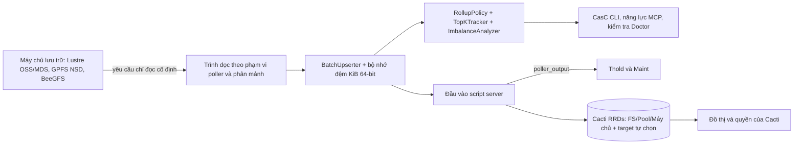

<!-- Source: README.md; SHA256: e88d6875d113220a91cfc0a9d230c829a78477b17e6aa7e44dda38c9591c86ad -->

<!-- translations:start -->
[English](../../../README.md) | [简体中文](../zh-CN/README.md) | [हिन्दी](../hi-IN/README.md) | [Español (España)](../es-ES/README.md) | [Español (Latinoamérica)](../es-419/README.md) | [العربية (السعودية)](../ar-SA/README.md) | [Afrikaans](../af-ZA/README.md) | [አማርኛ](../am-ET/README.md) | [العربية (مصر)](../ar-EG/README.md) | [العربية (المغرب)](../ar-MA/README.md) | [বাংলা](../bn-BD/README.md) | [Bosanski](../bs-BA/README.md) | [Deutsch](../de-DE/README.md) | [فارسی](../fa-IR/README.md) | [Filipino](../fil-PH/README.md) | [Français](../fr-FR/README.md) | [Français (Maroc)](../fr-MA/README.md) | [Français (Sénégal)](../fr-SN/README.md) | [Hausa](../ha-NG/README.md) | [עברית](../he-IL/README.md) | [Hrvatski](../hr-HR/README.md) | [Bahasa Indonesia](../id-ID/README.md) | [Igbo](../ig-NG/README.md) | [Italiano](../it-IT/README.md) | [日本語](../ja-JP/README.md) | [한국어](../ko-KR/README.md) | [Malagasy](../mg-MG/README.md) | [मराठी](../mr-IN/README.md) | [Bahasa Melayu](../ms-MY/README.md) | [Nederlands](../nl-NL/README.md) | [Polski](../pl-PL/README.md) | [Português (Brasil)](../pt-BR/README.md) | [Русский](../ru-RU/README.md) | [Kinyarwanda](../rw-RW/README.md) | [Soomaali](../so-SO/README.md) | [Српски](../sr-RS/README.md) | [Svenska](../sv-SE/README.md) | [Kiswahili](../sw-KE/README.md) | [தமிழ்](../ta-IN/README.md) | [తెలుగు](../te-IN/README.md) | [ไทย](../th-TH/README.md) | [Türkçe](../tr-TR/README.md) | [Українська](../uk-UA/README.md) | [اردو](../ur-PK/README.md) | [Tiếng Việt](README.md) | [isiXhosa](../xh-ZA/README.md) | [Yorùbá](../yo-NG/README.md) | [繁體中文](../zh-TW/README.md) | [isiZulu](../zu-ZA/README.md)
<!-- translations:end -->

# plugin_pfs

Một plugin Cacti 1.2 giúp đưa trạng thái sức khỏe, dung lượng, mức mất cân bằng lấp đầy, thông lượng trên từng target và tốc độ thao tác siêu dữ liệu của hệ thống tệp song song vào Cacti trên Lustre, IBM Storage Scale (GPFS) và BeeGFS phía sau một giao diện `Backend` thống nhất. Mỗi hệ thống tệp ánh xạ tới một thiết bị Cacti thông thường với các truy vấn dữ liệu, đồ thị tổng quan và đồ thị từng target theo yêu cầu cùng các chỉ số dạng gauge tóm tắt, vì vậy Thold và Maint cảnh báo và tạm ẩn cảnh báo trên đó mà không cần sửa đổi.

> **Trạng thái: các giai đoạn từ 1 đến 3 và các thành phần mở rộng quy mô exascale đã được triển khai trong mã nguồn, chưa phát hành.** Nền tảng, giám sát Lustre, cảnh báo và tạm ẩn Maint, các trình điều khiển chỉ đọc cho GPFS và BeeGFS, phân tích mất cân bằng OST/MDT tích hợp Maint, khoanh vùng trình thu thập dữ liệu từ xa (`replicate_out`, `remote_agent`), các thành phần mở rộng quy mô 100+ PB / exascale (`FramedReportParser`, Schema v4 `value_kib`, `RollupPolicy`, `TopKTracker`, `ShardAssigner`, `BatchUpserter`), CasC CLI cho người vận hành (`cli/pfs.php`) và các hook hệ sinh thái (`abilities_register`, `doctor_register_checks`, `casc_register_providers`) đã được triển khai và kiểm chứng bằng các bài kiểm thử đơn vị, bảo mật và tích hợp trên Cacti dùng một lần. Mọi lượt chạy đến nay đều sử dụng đầu ra nút giả lập thay vì phần cứng Lustre, GPFS hoặc BeeGFS thực tế. Các hạng mục còn mở trước khi gắn thẻ phát hành: thử nghiệm trên hệ thống tệp thực tế ([kế hoạch thử nghiệm](../../pilot-plan.md)), đánh giá bảo mật từ bên ngoài ([tự đánh giá](../../security-review.md)) và đo đạc quy mô trên phần cứng đã được ghi nhận tài liệu ([quy mô](../../research/scale.md)). Phiên bản 0.1.0 đã được chuẩn bị trong `INFO` và [CHANGELOG.md](../../../CHANGELOG.md) nhưng chưa gắn thẻ phát hành.

## Vai trò truy cập

| Vùng quyền | Quyền truy cập |
| --- | --- |
| Parallel Filesystem View | Các trang giám sát hiện có. |
| Parallel Filesystem Operator | Quyền giám sát cộng thêm trang Operations và xác nhận phân loại sự cố cá nhân. |
| Parallel Filesystem Admin | Quyền Operator cộng thêm các thao tác cấu hình và quản trị hiện có. |

Sau khi sao chép các tệp nâng cấp, hãy mở trang Plugins với tư cách quản trị viên để đăng ký
vùng quyền mới. Gán vùng quyền Operator một cách tường minh trong **Configuration > Users** hoặc các nhóm người dùng.
Quá trình nâng cấp giữ nguyên ID vùng quyền và các quyền đã cấp của View và Admin hiện có. Quyền Admin
kế thừa quyền Operator, và quyền Operator kế thừa quyền View trên mỗi yêu cầu;
điều này không thêm quyền được lưu trữ vào người dùng hoặc nhóm. Cài đặt của plugin cũng yêu cầu
quyền Parallel Filesystem Admin ngoài quyền Settings của Cacti.

Quyền thiết bị của Cacti vẫn giới hạn các hàng và thao tác khả dụng đối với từng người dùng; các đối tượng chưa ánh xạ yêu cầu quản trị viên xử lý.
Thông tin xác thực, cấu hình, ánh xạ, xóa và các thay đổi quản trị khác
vẫn nằm trong các trang quản trị. Các xác nhận chỉ có hiệu lực trong phiên làm việc hiện tại
của người dùng, tối đa một giờ và chỉ khi cùng một quan sát đó vẫn còn
mới. Các quan sát mới hoặc đã thay đổi sẽ làm mất hiệu lực của chúng. Chúng không bao giờ đánh dấu một phép đo
thất bại là khỏe mạnh hoặc tạm ẩn cảnh báo.

## Lý do

Khi một hệ thống tệp dùng chung bị chậm, bằng chứng nằm rải rác trên nhiều máy chủ. Lustre lưu các bộ đếm theo từng nút: `lctl get_param` báo cáo giá trị "trên nút cục bộ", vì vậy mỗi máy chủ lưu trữ đối tượng (OSS) và máy chủ siêu dữ liệu (MDS) chỉ nắm giữ số liệu của riêng các target thuộc về mình. Một người vận hành điều tra hệ thống tệp bị chậm cần ba câu trả lời từ những nơi khác nhau:

- **Một target có đang đầy lên trong khi các target khác trống không?** Sự mất cân bằng lấp đầy làm thay đổi nơi các tệp mới được ghi vào và thời điểm một target đơn lẻ hết dung lượng.
- **Những target hoặc thao tác nào đang bận?** Bộ đếm byte trên từng target và bộ đếm thao tác trên từng MDT cho biết tải đang bị nghẽn do dữ liệu hay do siêu dữ liệu.
- **Bản thân việc giám sát có đang cập nhật không?** Một đồ thị phẳng chỉ mang lại sự yên tâm nếu plugin có thể nhìn thấy các máy chủ.

Cacti vẽ đồ thị cho máy chủ và thiết lập ngưỡng giá trị bằng Thold, và tổ chức GitHub của Cacti chưa có kho lưu trữ nào để giám sát Lustre, GPFS hoặc BeeGFS (tìm kiếm ngày 2026-11-14). Plugin này lấp đầy khoảng trống đó bằng cách đọc các giá trị chỉ đọc nằm trong danh sách cho phép từ các nút lưu trữ và biểu diễn mỗi hệ thống tệp như một thiết bị Cacti với các target là các chỉ mục của một truy vấn dữ liệu. Plugin tái sử dụng cơ chế vẽ đồ thị, phân quyền, trình thu thập dữ liệu từ xa, Thold và Maint của Cacti thay vì xây dựng các phiên bản song song của chúng.

## Phạm vi dự kiến

| Giai đoạn | Phạm vi | Trạng thái | Cột mốc |
|---|---|---|---|
| 0, nghiên cứu | Ma trận phát hành, quyết định truy cập nút, xác nhận hành vi phía upstream, hành vi bộ đếm và chuyển đổi dự phòng, đo đạc quy mô | Hoàn tất | [M1](https://github.com/somethingwithproof/plugin_pfs/milestone/1) |
| 1, quan sát | Danh mục tài nguyên Lustre, dung lượng và mức lấp đầy, mất cân bằng OST/MDT (`lib/ImbalanceAnalyzer.php`), tích hợp Maint (`lib/HealthPage.php`), thông lượng OST, tốc độ thao tác MDT, đồ thị, cảnh báo Thold, trang sức khỏe | Đã triển khai (kiểm thử với dữ liệu giả lập) | [M2](https://github.com/somethingwithproof/plugin_pfs/milestone/2), [M3](https://github.com/somethingwithproof/plugin_pfs/milestone/3), [M4](https://github.com/somethingwithproof/plugin_pfs/milestone/4) |
| 2, từ xa và mở rộng | Thu thập từ xa theo phạm vi poller (`lib/Reader.php`, `lib/ReplicationRepository.php`, `replicate_out`, `remote_agent`), thành phần mở rộng 100+ PB (chuẩn KiB 64-bit + Schema v4 `value_kib`, `lib/RollupPolicy.php`, `lib/TopKTracker.php`, `lib/ShardAssigner.php` + `poller_pfs.php --shard=K/N`, `lib/BatchUpserter.php`), CasC CLI (`cli/pfs.php`), hook MCP/Doctor/CasC | Đã triển khai (kiểm thử đơn vị và tích hợp CI) | [M5](https://github.com/somethingwithproof/plugin_pfs/milestone/5) |
| 3, backend | Các trình điều khiển chỉ đọc IBM Storage Scale (GPFS) (`lib/GpfsBackend.php`) và BeeGFS (`lib/BeegfsBackend.php`) được đăng ký trong `BackendRegistry::production()` | Đã triển khai (kiểm thử đơn vị) | [M6](https://github.com/somethingwithproof/plugin_pfs/milestone/6) |

Các thành phần vận hành và mở rộng quy mô chính đã triển khai:

- **Trình điều khiển chỉ đọc đa hệ thống tệp:** `LustreBackend`, `GpfsBackend` (chỉ dùng `mmpmon` `fs_io_s`/`io_s` có khung, cấm `reset`, cùng dung lượng/trạng thái pool từ `mmdf` và tóm tắt hàng đợi) và `BeegfsBackend` (các target lưu trữ/siêu dữ liệu BeeGFS 7.4 và 8.x với chuyển đổi byte sang KiB chính xác, ánh xạ điều kiện khả dụng/nhất quán và ngữ nghĩa gauge theo khoảng thời gian) cùng dùng chung `lib/FramedReportParser.php`.
- **Phân tích mất cân bằng, dung lượng dự phòng và tích hợp Maint:** `lib/ImbalanceAnalyzer.php` tính toán tỷ lệ lấp đầy OST/MDT, độ chênh lệch, chỉ số mất cân bằng theo độ lệch chuẩn tổng thể, dung lượng dự phòng, kiểm soát độ mới theo 1 khoảng thời gian (`missing_targets`), cờ trạng thái từng target và danh sách Top-K target lệch nhiều nhất bị giới hạn. `HealthPage` (`pfs_health.php`) và `CascProvider::health()` hiển thị các khung bảo trì `Maint` của Cacti và tạm ẩn các cảnh báo lỗi đang hoạt động trong thời gian bảo trì theo lịch.
- **Mở rộng quy mô 100+ PB và exascale** ([docs/architecture/exascale-scaling.md](../../architecture/exascale-scaling.md)): chuyển đổi thập phân byte sang KiB chính xác (`FramedReportParser::bytesToKibInt()`) đã được kiểm chứng ở mức 500 PB và 2 EB cùng các cột `BIGINT UNSIGNED value_kib` (Schema v4); tổng hợp RRD phân cấp `Filesystem -> Pool -> Storage Server` với cơ chế thăng hạng có giới hạn cho các target tự chọn, nóng hoặc lệch (`lib/RollupPolicy.php`); Top-K target lệch giới hạn $O(K)$ và tóm tắt tác vụ/máy khách nặng tổng hợp sẵn (`lib/TopKTracker.php`, không bao giờ tạo thiết bị hoặc RRD cho từng máy khách); phân mảnh trình thu thập CRC32 tất định (`lib/ShardAssigner.php`, `php plugins/pfs/poller_pfs.php [--poller=N] [--shard=K/N] [--force] [--debug]`); và cập nhật chèn SQL theo lô 500 hàng cùng phân trang theo keyset (`lib/BatchUpserter.php`, `CacheRepository::upsertObservationsBatch()`, `TargetRepository::forFilesystemPage()`).
- **CasC CLI cho người vận hành và hook hệ sinh thái:** `cli/pfs.php` hỗ trợ `export [--format=yaml|xml]`, `validate <file> [--format=yaml|xml]`, `plan <file> [--format=yaml|xml] [--output=text|json]`, `apply <file> --confirm=<PLAN_HASH> [--format=yaml|xml]` và `health [--format=text|json]` không phụ thuộc Composer bên ngoài. `setup.php` và `lib/EcosystemIntegration.php` đăng ký `abilities_register` (`pfs-list-filesystems`, `pfs-get-imbalance`, `pfs-get-health`; chỉ đọc, kiểm soát bởi `Parallel Filesystem View` và quyền thiết bị Cacti), `doctor_register_checks` (`pfs_schema`, `pfs_reader_freshness`, `pfs_capacity_imbalance`), `casc_register_providers`, `replicate_out` và `remote_agent`.

Ngoài phạm vi: mọi thao tác ghi, xóa, đặt lại hoặc tinh chỉnh trên nút hoặc hệ thống tệp; bộ máy cảnh báo riêng của plugin; daemon hoặc giao thức mạng tùy chỉnh; thiết bị/RRD Cacti theo từng công việc hoặc từng máy khách; các thay đổi đối với lõi Cacti, Thold hoặc Maint.

## Mục tiêu tương thích

| Thành phần | Mục tiêu |
|---|---|
| Cacti | 1.2.31 trở lên, không vá lõi |
| PHP | 8.2 trở lên; `setup.php`, `poller_pfs.php` và `cli/pfs.php` vẫn giữ khả năng phân tích cú pháp trên 8.0 để môi trường thực thi không được hỗ trợ nhận được thông báo từ chối thay vì làm hỏng giao diện Cacti |
| Lustre | Mã nguồn và tài liệu hướng dẫn được kiểm tra ở phiên bản 2.17.0; đã kiểm thử với dữ liệu giả lập |
| GPFS, BeeGFS | Đã triển khai và kiểm thử với dữ liệu giả lập cho trình điều khiển chỉ đọc IBM Storage Scale (GPFS) 5.x `mmpmon`/`mmdf` và BeeGFS 7.4 / 8.x |
| Thold, Maint | Thold 1.8.2 và Maint 1.3, không sửa đổi |

## Thiết kế

- [docs/architecture/exascale-scaling.md](../../architecture/exascale-scaling.md) ghi nhận kiến trúc đo từ xa hai tầng cho quy mô 100+ PB / exascale (tầng máy chủ + tổng hợp + Top-K của Cacti/`plugin_pfs` kết hợp với đo từ xa phía máy khách ngoài băng tần LDMS/Darshan/TOKIO) và bối cảnh tài liệu học thuật của nó.
- [docs/PLAN.md](../../PLAN.md) là kế hoạch đầy đủ: kiến trúc, các dữ kiện phía upstream mà thiết kế phụ thuộc vào (kèm nguồn và những điểm chưa được xác minh), ngữ nghĩa bộ đếm, mô hình trạng thái, ranh giới bảo mật, tính toán hiệu năng, kiểm thử và rủi ro.
- [docs/operator-guide.md](../../operator-guide.md) trình bày việc cài đặt, các đồ thị và giá trị, nâng cấp, sao lưu và khôi phục, gỡ cài đặt và xử lý sự cố; [docs/alerting.md](../../alerting.md) trình bày về Thold và Maint.
- [docs/node-setup.md](../../node-setup.md) mô tả cách chuẩn bị một máy chủ Lustre và một poller cho trình đọc.
- [docs/decisions/](../../decisions) lưu giữ các hồ sơ quyết định kiến trúc cho những lựa chọn đã được đưa ra.
- [docs/REQUIREMENTS.md](../../REQUIREMENTS.md) ánh xạ từng mã yêu cầu tới issue tương ứng.

## Cách theo dõi công việc

- **Các cột mốc** tuân theo các cột mốc của kế hoạch. Mỗi cột mốc có một epic issue liệt kê các sub-issue và bằng chứng hoàn thành.
- **Các issue** được phân loại theo nhãn: `type: requirement`, `type: research`, `type: decision`, `type: epic`. Các issue yêu cầu nêu rõ các yêu cầu được đánh số và có thể kiểm thử (`REQ-AREA-NNN`) cùng tiêu chí nghiệm thu.
- **Các nhãn** cũng mang tiền tố `area:`, `phase:`, `priority:` và `status:`. Xem [CONTRIBUTING.md](../../../CONTRIBUTING.md#labels).
- [Bảng dự án](https://github.com/users/somethingwithproof/projects/11) hiển thị toàn bộ các issue xuyên suốt các cột mốc.

## Đóng góp

Hãy đọc [CONTRIBUTING.md](../../../CONTRIBUTING.md). Các commit cần có xác nhận DCO sign-off. Thảo luận thiết kế diễn ra trên các issue; các quyết định đang mở mang nhãn `type: decision`.

## Bảo mật

Báo cáo lỗ hổng bảo mật một cách riêng tư; xem [SECURITY.md](../../../SECURITY.md).

## Giấy phép

GNU General Public License v2.0, cùng giấy phép với Cacti và các plugin của Cacti. Xem [LICENSE](../../../LICENSE).
