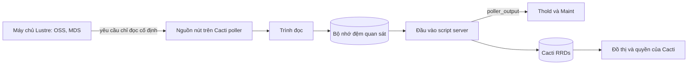

<!-- Source: README.md; SHA256: 40f2c5a5e9be97e4bd2b05a9ebab2a77de51de3af1b1c21dbeb5ee7f936cdd3b -->

<!-- translations:start -->
[English](../../../README.md) | [简体中文](../zh-CN/README.md) | [हिन्दी](../hi-IN/README.md) | [Español (España)](../es-ES/README.md) | [Español (Latinoamérica)](../es-419/README.md) | [العربية (السعودية)](../ar-SA/README.md) | [Afrikaans](../af-ZA/README.md) | [አማርኛ](../am-ET/README.md) | [العربية (مصر)](../ar-EG/README.md) | [العربية (المغرب)](../ar-MA/README.md) | [বাংলা](../bn-BD/README.md) | [Bosanski](../bs-BA/README.md) | [Deutsch](../de-DE/README.md) | [فارسی](../fa-IR/README.md) | [Filipino](../fil-PH/README.md) | [Français](../fr-FR/README.md) | [Français (Maroc)](../fr-MA/README.md) | [Français (Sénégal)](../fr-SN/README.md) | [Hausa](../ha-NG/README.md) | [עברית](../he-IL/README.md) | [Hrvatski](../hr-HR/README.md) | [Bahasa Indonesia](../id-ID/README.md) | [Igbo](../ig-NG/README.md) | [Italiano](../it-IT/README.md) | [日本語](../ja-JP/README.md) | [한국어](../ko-KR/README.md) | [Malagasy](../mg-MG/README.md) | [मराठी](../mr-IN/README.md) | [Bahasa Melayu](../ms-MY/README.md) | [Nederlands](../nl-NL/README.md) | [Polski](../pl-PL/README.md) | [Português (Brasil)](../pt-BR/README.md) | [Русский](../ru-RU/README.md) | [Kinyarwanda](../rw-RW/README.md) | [Soomaali](../so-SO/README.md) | [Српски](../sr-RS/README.md) | [Svenska](../sv-SE/README.md) | [Kiswahili](../sw-KE/README.md) | [தமிழ்](../ta-IN/README.md) | [తెలుగు](../te-IN/README.md) | [ไทย](../th-TH/README.md) | [Türkçe](../tr-TR/README.md) | [Українська](../uk-UA/README.md) | [اردو](../ur-PK/README.md) | [Tiếng Việt](README.md) | [isiXhosa](../xh-ZA/README.md) | [Yorùbá](../yo-NG/README.md) | [繁體中文](../zh-TW/README.md) | [isiZulu](../zu-ZA/README.md)
<!-- translations:end -->

# plugin_pfs

Một plugin Cacti 1.2 giúp đưa trạng thái sức khỏe và tải của hệ thống tệp song song vào Cacti: dung lượng và mức mất cân bằng lấp đầy giữa các target, thông lượng trên từng target và tốc độ thao tác siêu dữ liệu. Lustre là backend đầu tiên. GPFS (IBM Storage Scale) và BeeGFS sẽ theo sau thông qua một giao diện backend. Dữ liệu được đưa vào các thiết bị, nguồn dữ liệu và đồ thị Cacti thông thường, vì vậy Thold và Maint có thể cảnh báo và tạm ẩn cảnh báo mà không cần sửa đổi.

> **Trạng thái: cột mốc 4, đã hoàn thành mã nguồn cho giai đoạn 1, chưa phát hành.** Các cột mốc 2 (nền tảng), 3 (giám sát Lustre) và 4 (cảnh báo và chuẩn bị phát hành) đã hoàn tất trên nhánh `main` hoặc đang được rà soát. Plugin cài đặt, nâng cấp và gỡ cài đặt thông qua API plugin của Cacti và từ chối phiên bản PHP thấp hơn 8.2. Một trình đọc chạy nền trên mỗi poller sẽ đọc các máy chủ Lustre qua SSH thông qua một tập lệnh forced-command cố định ([node/pfs-read.sh](../../../node/pfs-read.sh)) và lưu đệm danh mục tài nguyên, tình trạng, dung lượng và bộ đếm kèm độ mới của dữ liệu. Mỗi hệ thống tệp trở thành một thiết bị Cacti với các truy vấn dữ liệu OST và MDT, năm đồ thị tổng quan, đồ thị cho từng target theo yêu cầu và một nguồn dữ liệu tóm tắt cho Thold. Thold v1.8.2 và Maint v1.3 nguyên bản sẽ cảnh báo và tạm ẩn cảnh báo trên các chỉ số tóm tắt dạng gauge trong lần chạy kiểm thử đầu-cuối; ngưỡng Thold trên bộ đếm không được hỗ trợ với Thold 1.8.2 ([docs/alerting.md](../../alerting.md)). Mọi bài kiểm thử cho đến nay đều chạy trên đầu ra nút giả lập trong một môi trường Cacti dùng một lần: plugin chưa chạy trên nút Lustre thực tế. Các hạng mục còn mở trước khi phát hành: thử nghiệm trên hệ thống tệp thực tế ([kế hoạch thử nghiệm](../../pilot-plan.md)), đánh giá bảo mật từ bên ngoài ([tự đánh giá](../../security-review.md)) và đo đạc quy mô trên phần cứng đã được ghi nhận tài liệu ([quy mô](../../research/scale.md)). Phiên bản 0.1.0 đã được chuẩn bị trong `INFO` và [CHANGELOG.md](../../../CHANGELOG.md) nhưng chưa gắn thẻ phát hành.

## Vai trò truy cập

| Vùng quyền | Quyền truy cập |
| --- | --- |
| Parallel Filesystem View | Các trang giám sát hiện có. |
| Parallel Filesystem Operator | Quyền giám sát cộng thêm trang Operations và xác nhận phân loại sự cố cá nhân. |
| Parallel Filesystem Admin | Quyền Operator cộng thêm các thao tác cấu hình và quản trị hiện có. |

Sau khi sao chép các tệp nâng cấp, hãy mở trang Plugins với tư cách quản trị viên để đăng ký
vùng quyền mới. Gán vùng quyền Operator một cách tường minh trong **Configuration > Users** hoặc các nhóm người dùng.
Quá trình nâng cấp giữ nguyên ID vùng quyền và các quyền đã cấp của View và Admin hiện có. Quyền Admin
kế thừa quyền Operator, và quyền Operator kế thừa quyền View trên mỗi yêu cầu;
điều này không thêm quyền được lưu trữ vào người dùng hoặc nhóm. Cài đặt của plugin cũng yêu cầu
quyền Parallel Filesystem Admin ngoài quyền Settings của Cacti.

Quyền thiết bị của Cacti vẫn giới hạn các hàng và thao tác khả dụng đối với từng người dùng; các đối tượng chưa ánh xạ yêu cầu quản trị viên xử lý.
Thông tin xác thực, cấu hình, ánh xạ, xóa và các thay đổi quản trị khác
vẫn nằm trong các trang quản trị. Các xác nhận chỉ có hiệu lực trong phiên làm việc hiện tại
của người dùng, tối đa một giờ và chỉ khi cùng một quan sát đó vẫn còn
mới. Các quan sát mới hoặc đã thay đổi sẽ làm mất hiệu lực của chúng. Chúng không bao giờ đánh dấu một phép đo
thất bại là khỏe mạnh hoặc tạm ẩn cảnh báo.

## Lý do

Khi một hệ thống tệp dùng chung bị chậm, bằng chứng nằm rải rác trên nhiều máy chủ. Lustre lưu các bộ đếm theo từng nút: `lctl get_param` báo cáo giá trị "trên nút cục bộ", vì vậy mỗi máy chủ lưu trữ đối tượng (OSS) và máy chủ siêu dữ liệu (MDS) chỉ nắm giữ số liệu của riêng các target thuộc về mình. Một người vận hành điều tra hệ thống tệp bị chậm cần ba câu trả lời từ những nơi khác nhau:

- **Một target có đang đầy lên trong khi các target khác trống không?** Sự mất cân bằng lấp đầy làm thay đổi nơi các tệp mới được ghi vào và thời điểm một target đơn lẻ hết dung lượng.
- **Những target hoặc thao tác nào đang bận?** Bộ đếm byte trên từng target và bộ đếm thao tác trên từng MDT cho biết tải đang bị nghẽn do dữ liệu hay do siêu dữ liệu.
- **Bản thân việc giám sát có đang cập nhật không?** Một đồ thị phẳng chỉ mang lại sự yên tâm nếu plugin có thể nhìn thấy các máy chủ.

Cacti vẽ đồ thị cho máy chủ và thiết lập ngưỡng giá trị bằng Thold, và tổ chức GitHub của Cacti chưa có kho lưu trữ nào để giám sát Lustre, GPFS hoặc BeeGFS (tìm kiếm ngày 2026-11-14). Plugin này lấp đầy khoảng trống đó bằng cách đọc các giá trị chỉ đọc nằm trong danh sách cho phép từ các nút lưu trữ và biểu diễn mỗi hệ thống tệp như một thiết bị Cacti với các target là các chỉ mục của một truy vấn dữ liệu. Plugin tái sử dụng cơ chế vẽ đồ thị, phân quyền, trình thu thập dữ liệu từ xa, Thold và Maint của Cacti thay vì xây dựng các phiên bản song song của chúng.

## Phạm vi dự kiến

| Giai đoạn | Phạm vi | Cột mốc |
|---|---|---|
| 0, nghiên cứu | Ma trận phát hành, quyết định truy cập nút, xác nhận hành vi phía upstream, hành vi bộ đếm và chuyển đổi dự phòng, đo đạc quy mô | [M1](https://github.com/somethingwithproof/plugin_pfs/milestone/1) |
| 1, quan sát | Danh mục tài nguyên Lustre, dung lượng và mức lấp đầy, thông lượng OST, tốc độ thao tác MDT, đồ thị, cảnh báo Thold, tạm ẩn Maint, trang sức khỏe | [M2](https://github.com/somethingwithproof/plugin_pfs/milestone/2), [M3](https://github.com/somethingwithproof/plugin_pfs/milestone/3), [M4](https://github.com/somethingwithproof/plugin_pfs/milestone/4) |
| 2, chuyên sâu | Trình thu thập dữ liệu từ xa của Cacti, chế độ xem cấp công việc và cấp máy khách trong giới hạn số lượng đối tượng | [M5](https://github.com/somethingwithproof/plugin_pfs/milestone/5) |
| 3, backend | Các backend GPFS (IBM Storage Scale) và BeeGFS | [M6](https://github.com/somethingwithproof/plugin_pfs/milestone/6) |

Ngoài phạm vi: mọi thao tác ghi, xóa, đặt lại hoặc tinh chỉnh trên nút hoặc hệ thống tệp; bộ máy cảnh báo riêng của plugin; daemon hoặc giao thức mạng tùy chỉnh; nguồn dữ liệu theo từng công việc; các thay đổi đối với lõi Cacti, Thold hoặc Maint.

## Mục tiêu tương thích

| Thành phần | Mục tiêu |
|---|---|
| Cacti | 1.2.31 trở lên, không vá lõi |
| PHP | 8.2 trở lên; `setup.php` vẫn giữ khả năng phân tích cú pháp trên 8.0 để môi trường thực thi không được hỗ trợ nhận được thông báo từ chối thay vì làm hỏng giao diện Cacti |
| Lustre | Các nhánh phát hành sẽ được chốt ở cột mốc 1; mã nguồn và tài liệu hướng dẫn đã kiểm tra đến nay ở phiên bản 2.17.0 |
| GPFS, BeeGFS | Giai đoạn 3; các bản phát hành sẽ được chốt thông qua nghiên cứu |
| Thold, Maint | Không yêu cầu thay đổi |

## Thiết kế

- [docs/PLAN.md](../../PLAN.md) là kế hoạch đầy đủ: kiến trúc, các dữ kiện phía upstream mà thiết kế phụ thuộc vào (kèm nguồn và những điểm chưa được xác minh), ngữ nghĩa bộ đếm, mô hình trạng thái, ranh giới bảo mật, tính toán hiệu năng, kiểm thử và rủi ro.
- [docs/operator-guide.md](../../operator-guide.md) trình bày việc cài đặt, các đồ thị và giá trị, nâng cấp, sao lưu và khôi phục, gỡ cài đặt và xử lý sự cố; [docs/alerting.md](../../alerting.md) trình bày về Thold và Maint.
- [docs/node-setup.md](../../node-setup.md) mô tả cách chuẩn bị một máy chủ Lustre và một poller cho trình đọc.
- [docs/decisions/](../../decisions) lưu giữ các hồ sơ quyết định kiến trúc cho những lựa chọn đã được đưa ra.
- [docs/REQUIREMENTS.md](../../REQUIREMENTS.md) ánh xạ từng mã yêu cầu tới issue tương ứng.

## Cách theo dõi công việc

- **Các cột mốc** tuân theo các cột mốc của kế hoạch. Mỗi cột mốc có một epic issue liệt kê các sub-issue và bằng chứng hoàn thành.
- **Các issue** được phân loại theo nhãn: `type: requirement`, `type: research`, `type: decision`, `type: epic`. Các issue yêu cầu nêu rõ các yêu cầu được đánh số và có thể kiểm thử (`REQ-AREA-NNN`) cùng tiêu chí nghiệm thu.
- **Các nhãn** cũng mang tiền tố `area:`, `phase:`, `priority:` và `status:`. Xem [CONTRIBUTING.md](../../../CONTRIBUTING.md#labels).
- [Bảng dự án](https://github.com/users/somethingwithproof/projects/11) hiển thị toàn bộ các issue xuyên suốt các cột mốc.

## Đóng góp

Hãy đọc [CONTRIBUTING.md](../../../CONTRIBUTING.md). Các commit cần có xác nhận DCO sign-off. Thảo luận thiết kế diễn ra trên các issue; các quyết định đang mở mang nhãn `type: decision`.

## Bảo mật

Báo cáo lỗ hổng bảo mật một cách riêng tư; xem [SECURITY.md](../../../SECURITY.md).

## Giấy phép

GNU General Public License v2.0, cùng giấy phép với Cacti và các plugin của Cacti. Xem [LICENSE](../../../LICENSE).
