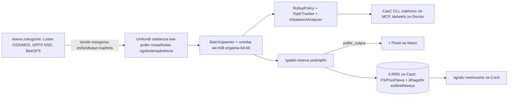

<!-- Source: README.md; SHA256: e88d6875d113220a91cfc0a9d230c829a78477b17e6aa7e44dda38c9591c86ad -->

<!-- translations:start -->
[English](../../../README.md) | [简体中文](../zh-CN/README.md) | [हिन्दी](../hi-IN/README.md) | [Español (España)](../es-ES/README.md) | [Español (Latinoamérica)](../es-419/README.md) | [العربية (السعودية)](../ar-SA/README.md) | [Afrikaans](../af-ZA/README.md) | [አማርኛ](../am-ET/README.md) | [العربية (مصر)](../ar-EG/README.md) | [العربية (المغرب)](../ar-MA/README.md) | [Български](../bg-BG/README.md) | [বাংলা](../bn-BD/README.md) | [Bosanski](../bs-BA/README.md) | [Deutsch](../de-DE/README.md) | [Ελληνικά](../el-GR/README.md) | [فارسی](../fa-IR/README.md) | [Filipino](../fil-PH/README.md) | [Français](../fr-FR/README.md) | [Français (Maroc)](../fr-MA/README.md) | [Français (Sénégal)](../fr-SN/README.md) | [Hausa](../ha-NG/README.md) | [עברית](../he-IL/README.md) | [Hrvatski](../hr-HR/README.md) | [Bahasa Indonesia](../id-ID/README.md) | [Igbo](../ig-NG/README.md) | [Italiano](../it-IT/README.md) | [日本語](../ja-JP/README.md) | [ქართული](../ka-GE/README.md) | [한국어](../ko-KR/README.md) | [Latviešu](../lv-LV/README.md) | [Malagasy](../mg-MG/README.md) | [मराठी](../mr-IN/README.md) | [Bahasa Melayu](../ms-MY/README.md) | [Nederlands](../nl-NL/README.md) | [Polski](../pl-PL/README.md) | [Português (Brasil)](../pt-BR/README.md) | [Português (Portugal)](../pt-PT/README.md) | [Русский](../ru-RU/README.md) | [Kinyarwanda](../rw-RW/README.md) | [Soomaali](../so-SO/README.md) | [Српски](../sr-RS/README.md) | [Svenska](../sv-SE/README.md) | [Kiswahili](../sw-KE/README.md) | [தமிழ்](../ta-IN/README.md) | [తెలుగు](../te-IN/README.md) | [ไทย](../th-TH/README.md) | [Türkçe](../tr-TR/README.md) | [Українська](../uk-UA/README.md) | [اردو](../ur-PK/README.md) | [Tiếng Việt](../vi-VN/README.md) | [isiXhosa](README.md) | [Yorùbá](../yo-NG/README.md) | [繁體中文](../zh-TW/README.md) | [isiZulu](../zu-ZA/README.md)
<!-- translations:end -->

# plugin_pfs

Iplagin ye-Cacti 1.2 ezisa impilo yesistimu yeefayile ehambisanayo, umthamo, ukungalingani kokuzaliswa, umthamo wedatha ogqithiswayo ngethagethi nganye, kunye namaxabiso emisebenzi yedatha echaza enye idatha (metadata) kwi-Cacti kwi-Lustre, kwi-IBM Storage Scale (GPFS), nakwi-BeeGFS ngasemva kojongano olumanyeneyo lwe-`Backend`. Isistimu nganye yeefayile imatshiswa kwisixhobo esiqhelekileyo se-Cacti esinemibuzo yedatha, iigrafu ezishwankathelayo nezethagethi xa zicelwa, kunye nezilinganisi ezishwankathelayo ukuze i-Thold ne-Maint zilumkise kwaye zithintele izilumkiso ngaphandle kotshintsho.

> **Imeko: izigaba zoku-1 ukuya kwesesi-3 nezinto ezisisiseko zokukhulisa isikali se-exascale ziphunyeziwe kwikhowudi, azikakhutshwa.** Isiseko, ukujongwa kwe-Lustre, izilumkiso nokuthintelwa kwe-Maint, abaqhubi abafundwayo kuphela be-GPFS nabe-BeeGFS, uhlalutyo lokungalingani kwe-OST/MDT oludityaniswe ne-Maint, ukumisela umda womqokeleli wedatha okude (`replicate_out`, `remote_agent`), izinto ezisisiseko zokukhulisa isikali se-100+ PB / exascale (`FramedReportParser`, i-Schema v4 `value_kib`, `RollupPolicy`, `TopKTracker`, `ShardAssigner`, `BatchUpserter`), i-CasC operator CLI (`cli/pfs.php`), kunye nee-hooks ze-ecosystem (`abilities_register`, `doctor_register_checks`, `casc_register_providers`) ziphunyeziwe kwaye zaqinisekiswa ngovavanyo lweyunithi, olokhuseleko, nolokudibanisa kwi-Cacti elahlayo. Lonke uqhutywo ukuza kuthi ga ngoku lusebenzisa iziphumo zendawo yovavanyo yemisebenzi (fixture) endaweni yehardware yokwenyani ye-Lustre, ye-GPFS, okanye ye-BeeGFS. Okuvulekileyo phambi kokufaka ithegi yokukhupha: iinkqubo zokuqala kwiisistimu zeefayile zokwenyani ([isicwangciso senkqubo yokuqala](../../pilot-plan.md)), uphononongo lwangaphandle lokhuseleko ([uziphononongo](../../security-review.md)), kunye nemilinganiselo yesikali kwihardware ebhaliweyo ([isikali](../../research/scale.md)). Uhlobo lwe-0.1.0 lulungiselelwe kwi-`INFO` nakwi-[CHANGELOG.md](../../../CHANGELOG.md) kodwa alukafakwa ithegi.

## Iindima zokufikelela

| Ummandla | Ufikelelo |
| --- | --- |
| Umboniso weSistimu yeeFayile eHambisanayo (Parallel Filesystem View) | Amaphepha okujonga asele ekhona. |
| Umsebenzisi weSistimu yeeFayile eHambisanayo (Parallel Filesystem Operator) | Ukujonga kunye nephepha leMisebenzi kunye neziqinisekiso zobuqu zokuhlela ngokubaluleka. |
| Umlawuli weSistimu yeeFayile eHambisanayo (Parallel Filesystem Admin) | Ufikelelo lomsebenzisi kunye noqwalaselo olukhoyo nezenzo zolawulo. |

Emva kokukopa iifayile zophuculo, vula iphepha leePlagin njengomlawuli ukubhalisa
ummandla omtsha. Yabela ummandla woMsebenzisi (Operator) ngokucacileyo phantsi ko-**Uqwalaselo > Abasebenzisi** okanye amaqela abasebenzisi.
Uphuculo lugcina ii-ID zemimandla yoMboniso (View) noMlawuli (Admin) kunye nezibonelelo ezisele zikhona. Ufikelelo loMlawuli
luzaza ufikelelo loMsebenzisi, kwaye ufikelelo loMsebenzisi luzuza ufikelelo loMboniso kwisicelo ngasinye;
oku akongezi zibonelelo zigciniweyo kubasebenzisi okanye kumaqela. Iisetingi zeplagin zikwafuna
ufikelelo loMlawuli weSistimu yeeFayile eHambisanayo (Parallel Filesystem Admin) ukongeza kwimvume yeSetingi ye-Cacti.

Iimvume zezixhobo ze-Cacti zisayinciphisa imigca nezenzo ezifumanekayo kumsebenzisi ngamnye; izinto ezingamaphiwanga zifuna umlawuli.
Iziqinisekiso zokungena, uqwalaselo, ukumapha, ukucima nolunye utshintsho lolawulo
zihlala kumaphepha olawulo. Iziqinisekiso zokuvuma zihlala kwiseshoni yangoku
yomsebenzisi kuphela, ubuninzi iyure enye kwaye kuphela ngelixa olo qaphelo lunye lusemtsha.
Iingqaphelo ezintsha okanye ezitshintshileyo ziyaziphelisa. Azize ziphawule umlinganiselo ohlulekileyo njengosempilweni okanye zithintele izilumkiso.

## Kutheni

Xa isistimu yeefayile ekwabelwanayo ngayo icotha, ubungqina busasazekile kwiiseva zonke. I-Lustre igcina izibali zayo kwindawo nganye: i-`lctl get_param` inika ingxelo ngamaxabiso "kwindawo yasekuhlaleni", ngoko ke iseva nganye yokugcina izinto (OSS) neseva nganye yedatha echaza enye idatha (MDS) igcina kuphela amanani eethagethi zayo. Umsebenzisi ophanda isistimu yeefayile ecothayo ufuna iimpendulo ezintathu ezivela kwiindawo ezahlukeneyo:

- **Ngaba ithagethi enye iyazala ngelixa ezinye zingenanto?** Ukungalingani kokuzaliswa kutshintsha apho iifayile ezintsha zifika khona kunye naxa ithagethi enye iphelelwa sisithuba.
- **Zeziphi iithagethi okanye imisebenzi exakekileyo?** Izibali zeebhayithi ngethagethi nganye nezibali zemisebenzi nge-MDT nganye zibonisa ukuba umthwalo uxhomekeke kwidatha okanye kwidatha echaza enye idatha.
- **Ngaba ukujonga ngokwako kusexesheni?** Igrafu ethe tyaba ithuthuzela kuphela ukuba iplagin ibikwazi ukubona iiseva.

I-Cacti yenza iigrafu zezixhobo kwaye imisele imida yexabiso nge-Thold, kwaye umbutho we-GitHub we-Cacti awunayo indawo yokugcina ikhowudi yokujonga i-Lustre, i-GPFS, okanye i-BeeGFS (khangelwe ngo-2026-11-14). Iplagin ivula eso sikhewu ngokufunda amaxabiso avunyelweyo, afundwayo kuphela kwiindawo zokugcina nokumela isistimu nganye yeefayile njengesixhobo se-Cacti esineethagethi ezizizalathisi zombuzo wedatha. Iphinda isebenzise ukwenziwa kweegrafu kwe-Cacti, iimvume, abaqokeleli bedatha abakude, i-Thold, kunye ne-Maint endaweni yokwakha iinguqulelo ezifanayo zazo.

## Umda ocetyiweyo

| Isigaba | Umda | Imeko | Amanqanaba aphambili |
|---|---|---|---|
| 0, uphando | Umatriksi wokukhutshwa, isigqibo sofikelelo kwindawo, ukuqinisekiswa kokuziphatha kwe-upstream, ukuziphatha kwesibali nokuthatha indawo xa kusilele (failover), imilinganiselo yesikali | Igqityiwe | [M1](https://github.com/somethingwithproof/plugin_pfs/milestone/1) |
| 1, ukujonga | Uluhlu lwezinto ze-Lustre, umthamo nokuzaliswa, ukungalingani kwe-OST/MDT (`lib/ImbalanceAnalyzer.php`), ukudityaniswa ne-Maint (`lib/HealthPage.php`), umthamo wedatha ogqithiswayo we-OST, amaxabiso emisebenzi ye-MDT, iigrafu, izilumkiso ze-Thold, iphepha lempilo | Iphunyeziwe (ivavanywe nge-fixture) | [M2](https://github.com/somethingwithproof/plugin_pfs/milestone/2), [M3](https://github.com/somethingwithproof/plugin_pfs/milestone/3), [M4](https://github.com/somethingwithproof/plugin_pfs/milestone/4) |
| 2, ukude nesikali | Uqokelelo olukude olusebenza kwi-poller (`lib/Reader.php`, `lib/ReplicationRepository.php`, `replicate_out`, `remote_agent`), izinto ezisisiseko zokukhulisa isikali se-100+ PB (ucoceko lwe-KiB engama-64-bit + i-Schema v4 `value_kib`, `lib/RollupPolicy.php`, `lib/TopKTracker.php`, `lib/ShardAssigner.php` + `poller_pfs.php --shard=K/N`, `lib/BatchUpserter.php`), i-CasC CLI (`cli/pfs.php`), ii-hooks ze-MCP/Doctor/CasC | Iphunyeziwe (ivavanywe ngeyunithi nangodibaniso lwe-CI) | [M5](https://github.com/somethingwithproof/plugin_pfs/milestone/5) |
| 3, iziseko zangasemva | Abaqhubi abafundwayo kuphela be-IBM Storage Scale (GPFS) (`lib/GpfsBackend.php`) nabe-BeeGFS (`lib/BeegfsBackend.php`) ababhaliswe kwi-`BackendRegistry::production()` | Iphunyeziwe (ivavanywe ngeyunithi) | [M6](https://github.com/somethingwithproof/plugin_pfs/milestone/6) |

Izinto eziphambili eziphunyeziweyo zomsebenzi nezokukhulisa isikali:

- **Abaqhubi abafundwayo kuphela beemveliso ezininzi zesistimu yeefayile:** `LustreBackend`, `GpfsBackend` (`mmpmon` `fs_io_s`/`io_s` enesakhelo kuphela apho `reset` igxothwe khona, umthamo/iimeko ze-pool ze-`mmdf`, kunye nezishwankathelo zabalindileyo), kunye ne-`BeegfsBackend` (iithagethi zokugcina neze-metadata ze-BeeGFS 7.4 neze-8.x ezinoguqulelo oluchanekileyo lwe-byte ukuya kwi-KiB, ukumaphwa kwemeko yokufikeleleka nokuhambelana, kunye nentsingiselo yesilinganisi ngexesha ngalinye) ezabelana nge-`lib/FramedReportParser.php`.
- **Ukungalingani, isithuba esishiyekileyo, nolwazi lwe-Maint:** `lib/ImbalanceAnalyzer.php` ibala imilinganiselo yokuzaliswa ye-OST/MDT, umahluko, isalathisi sokungalingani esisekelwe kwi-population standard deviation, isithuba esishiyekileyo, ukunyanzeliswa kobutsha bexesha eli-1 (`missing_targets`), iiflegi zemeko zethagethi nganye, kunye neethagethi ezishwankathelweyo ze-Top-K ezingalinganiyo. `HealthPage` (`pfs_health.php`) kunye ne-`CascProvider::health()` zibonisa iifestile zolondolozo lwe-Cacti `Maint` kwaye zithintele izilumkiso zokusilela ezisebenzayo ngexesha lolondolozo olucwangcisiweyo.
- **Ukukhuliswa kwesikali se-100+ PB ne-exascale** ([docs/architecture/exascale-scaling.md](../../architecture/exascale-scaling.md)): uguqulelo oluchanekileyo lwe-decimal byte ukuya kwi-KiB (`FramedReportParser::bytesToKibInt()`) oluqinisekiswe kwi-500 PB nakwi-2 EB kunye neekholamu ze-`BIGINT UNSIGNED value_kib` (i-Schema v4); iingqokelela ze-RRD ezilandelelanayo ze-`Filesystem -> Pool -> Storage Server` ezinokunyuselwa okuthintelweyo kweethagethi ezikhethiweyo/ezishushu/ezingalinganiyo (`lib/RollupPolicy.php`); iithagethi ezithintelweyo ze-$O(K)$ Top-K ezingalinganiyo kunye nezishwankathelo eziqokelelwe kwangaphambili zemisebenzi/abaxhasi abanomthwalo omkhulu (`lib/TopKTracker.php`, engaze yenze izixhobo okanye ii-RRD ngomxhasi ngamnye); ukwabiwa komqokeleli kwe-CRC32 okuzinzileyo (`lib/ShardAssigner.php`, `php plugins/pfs/poller_pfs.php [--poller=N] [--shard=K/N] [--force] [--debug]`); kunye nee-SQL upsert eziqokelelwe ngemiqolo engama-500 kunye nokwahlulwa kwamaphepha nge-keyset (`lib/BatchUpserter.php`, `CacheRepository::upsertObservationsBatch()`, `TargetRepository::forFilesystemPage()`).
- **I-CasC CLI yomsebenzi kunye nee-hooks ze-ecosystem:** `cli/pfs.php` ixhasa `export [--format=yaml|xml]`, `validate <file> [--format=yaml|xml]`, `plan <file> [--format=yaml|xml] [--output=text|json]`, `apply <file> --confirm=<PLAN_HASH> [--format=yaml|xml]`, kunye ne-`health [--format=text|json]` ngaphandle kokuxhomekeka kwi-Composer yangaphandle. `setup.php` kunye ne-`lib/EcosystemIntegration.php` zibhalisa `abilities_register` (`pfs-list-filesystems`, `pfs-get-imbalance`, `pfs-get-health`; ezifundwayo kuphela, ezikhuselwe ngu-`Parallel Filesystem View` kunye neemvume zezixhobo ze-Cacti), `doctor_register_checks` (`pfs_schema`, `pfs_reader_freshness`, `pfs_capacity_imbalance`), `casc_register_providers`, `replicate_out`, kunye ne-`remote_agent`.

Ngaphandle komda: nawuphi na umsebenzi wokubhala, ukucima, ukuseta kwakhona, okanye ukulungisa kwindawo okanye kwisistimu yeefayile; injini yezilumkiso ephantsi kweplagin; i-daemon eyenzelwe yona okanye umgaqo womnatha; izixhobo/ii-RRD ze-Cacti ngomsebenzi okanye ngomxhasi ngamnye; utshintsho kumbindi we-Cacti, kwi-Thold, okanye kwi-Maint.

## Iithagethi zokuhambelana

| Ilungu | Ithagethi |
|---|---|
| Cacti | 1.2.31 okanye entsha, akukho zilungiso zombindi |
| PHP | 8.2 okanye entsha; i-`setup.php`, `poller_pfs.php`, kunye ne-`cli/pfs.php` zihlala zicazululeka kwi-8.0 ukuze ixesha lokusebenza elingaxhaswayo lifumane ukwaliwa endaweni yojongano lwe-Cacti olwaphukileyo |
| Lustre | Umthombo neencwadana zokusebenzisa zikhangelwe ku-2.17.0; zivavanywe nge-fixture |
| GPFS, BeeGFS | Abaqhubi abafundwayo kuphela be-IBM Storage Scale (GPFS) 5.x `mmpmon`/`mmdf` nabe-BeeGFS 7.4 / 8.x baphunyeziwe kwaye bavavanywa nge-fixture |
| Thold, Maint | I-Thold 1.8.2 ne-Maint 1.3, azitshintshwanga |

## Uyilo

- [docs/architecture/exascale-scaling.md](../../architecture/exascale-scaling.md) ibhala uyilo lwe-telemetry olunamanqanaba amabini lwe-100+ PB / exascale (umgangatho weseva ye-Cacti/`plugin_pfs` + ingqokelela + i-Top-K udityaniswe ne-telemetry yomxhasi engaphandle kwebhendi ye-LDMS/Darshan/TOKIO) kunye nomxholo walo woncwadi lwezemfundo.

- [docs/PLAN.md](../../PLAN.md) sisicwangciso esipheleleyo: uyilo lwenkqubo, iinyaniso ze-upstream ezixhomekeke kuzo (kunye nemithombo noko kungekaqinisekiswa), intsingiselo yezibali, imodeli yemeko, imida yokhuseleko, izibalo zokusebenza, uvavanyo, nemingcipheko.
- [docs/operator-guide.md](../../operator-guide.md) igubungela ukufakwa, iigrafu namaxabiso, uphuculo, ugcino lwakhona nokubuyiselwa, ukukhutshwa, kunye nokusombulula iingxaki; [docs/alerting.md](../../alerting.md) igubungela i-Thold ne-Maint.
- [docs/node-setup.md](../../node-setup.md) ichaza indlela yokulungiselela iseva ye-Lustre kunye ne-poller yomfundi.
- [docs/decisions/](../../decisions) igcina iirekhodi zezigqibo zoyilo lwenkqubo zokhetho olusele lwenziwe.
- [docs/REQUIREMENTS.md](../../REQUIREMENTS.md) imapha i-ID nganye yemfuneko kumbandela wayo.

## Indlela umsebenzi olandelelwa ngayo

- **Amanqanaba aphambili** alandela amanqanaba aphambili esicwangciso. Linye ngalinye linombandela omkhulu (epic) odwelisa imibandela yawo engaphantsi nobungqina bokuphuma.
- **Imibandela** yahlulwa ngeelebhile: `type: requirement`, `type: research`, `type: decision`, `type: epic`. Imibandela yeemfuno ichaza iimfuno ezinamanani nezinokuvavanywa (`REQ-AREA-NNN`) kunye nemigaqo yokwamkelwa.
- **Iilebhile** zikwathwala u-`area:`, `phase:`, `priority:`, kunye no-`status:`. Jonga ku-[CONTRIBUTING.md](../../../CONTRIBUTING.md#labels).
- [Ibhodi yeprojekthi](https://github.com/users/somethingwithproof/projects/11) ibonisa yonke imibandela kuwo onke amanqanaba aphambili.

## Ukufaka isandla

Funda i-[CONTRIBUTING.md](../../../CONTRIBUTING.md). Ii-commit zifuna ukusayinwa nge-DCO. Ingxoxo yoyilo yenzeka kwimibandela; izigqibo ezivulekileyo zithwala ilebhile ethi `type: decision`.

## Ukhuseleko

Xela ubuthathaka bokhuseleko ngasese; jonga ku-[SECURITY.md](../../../SECURITY.md).

## Ilayisensi

I-GNU General Public License v2.0, ilayisensi efanayo neye-Cacti neeplagin zayo. Jonga ku-[LICENSE](../../../LICENSE).
