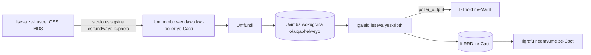

<!-- Source: README.md; SHA256: 40f2c5a5e9be97e4bd2b05a9ebab2a77de51de3af1b1c21dbeb5ee7f936cdd3b -->

<!-- translations:start -->
[English](../../../README.md) | [简体中文](../zh-CN/README.md) | [हिन्दी](../hi-IN/README.md) | [Español (España)](../es-ES/README.md) | [Español (Latinoamérica)](../es-419/README.md) | [العربية (السعودية)](../ar-SA/README.md) | [Afrikaans](../af-ZA/README.md) | [አማርኛ](../am-ET/README.md) | [العربية (مصر)](../ar-EG/README.md) | [العربية (المغرب)](../ar-MA/README.md) | [বাংলা](../bn-BD/README.md) | [Bosanski](../bs-BA/README.md) | [Deutsch](../de-DE/README.md) | [فارسی](../fa-IR/README.md) | [Filipino](../fil-PH/README.md) | [Français](../fr-FR/README.md) | [Français (Maroc)](../fr-MA/README.md) | [Français (Sénégal)](../fr-SN/README.md) | [Hausa](../ha-NG/README.md) | [עברית](../he-IL/README.md) | [Hrvatski](../hr-HR/README.md) | [Bahasa Indonesia](../id-ID/README.md) | [Igbo](../ig-NG/README.md) | [Italiano](../it-IT/README.md) | [日本語](../ja-JP/README.md) | [한국어](../ko-KR/README.md) | [Malagasy](../mg-MG/README.md) | [मराठी](../mr-IN/README.md) | [Bahasa Melayu](../ms-MY/README.md) | [Nederlands](../nl-NL/README.md) | [Polski](../pl-PL/README.md) | [Português (Brasil)](../pt-BR/README.md) | [Русский](../ru-RU/README.md) | [Kinyarwanda](../rw-RW/README.md) | [Soomaali](../so-SO/README.md) | [Српски](../sr-RS/README.md) | [Svenska](../sv-SE/README.md) | [Kiswahili](../sw-KE/README.md) | [தமிழ்](../ta-IN/README.md) | [తెలుగు](../te-IN/README.md) | [ไทย](../th-TH/README.md) | [Türkçe](../tr-TR/README.md) | [Українська](../uk-UA/README.md) | [اردو](../ur-PK/README.md) | [Tiếng Việt](../vi-VN/README.md) | [isiXhosa](README.md) | [Yorùbá](../yo-NG/README.md) | [繁體中文](../zh-TW/README.md) | [isiZulu](../zu-ZA/README.md)
<!-- translations:end -->

# plugin_pfs

Iplagin ye-Cacti 1.2 ezisa impilo nomthwalo wesistimu yeefayile ehambisanayo kwi-Cacti: umthamo nokungalingani kokuzaliswa kwiithagethi zonke, umthamo wedatha ogqithiswayo ngethagethi nganye, kunye namaxabiso emisebenzi yedatha echaza enye idatha (metadata). I-Lustre sisiseko sangasemva (backend) sokuqala. I-GPFS (IBM Storage Scale) ne-BeeGFS ziyalandela ngasemva kojongano lwesiseko sangasemva. Idatha ifika kwizixhobo ze-Cacti eziqhelekileyo, kwimithombo yedatha, nakwiigrafu, ngoko ke i-Thold ne-Maint zilumkisa kwaye zithintele izilumkiso kuyo ngaphandle kotshintsho.

> **Imeko: inqanaba eliphambili lesi-4, ikhowudi igqityiwe kwisigaba soku-1, ayikakhutshwa.** Amanqanaba aphambili ama-2 (isiseko), ama-3 (ukujongwa kwe-Lustre), nama-4 (izilumkiso nolungiselelo lokukhutshwa) agqityiwe kwi-`main` okanye akuphononongo. Iplagin iyafakwa, iyaphuculwa, kwaye iyakhutshwa nge-API yeplagin ye-Cacti kwaye iyayala i-PHP engaphantsi kwe-8.2. Umfundi ongasemva kwipoller nganye ufunda iiseva ze-Lustre nge-SSH ngokusebenzisa iskripthi somyalelo onyanzelisiweyo osisigxina ([node/pfs-read.sh](../../../node/pfs-read.sh)) kwaye ugcina okwesikhashana uluhlu lwezinto, imeko, umthamo, nezibali kunye nobutsha bazo. Isistimu nganye yeefayile iba sisixhobo se-Cacti esinemibuzo yedatha ye-OST neye-MDT, iigrafu ezintlanu ezishwankathelayo, iigrafu zethagethi nganye xa zicelwa, kunye nomthombo wedatha oshwankathelayo we-Thold. I-Thold v1.8.2 ne-Maint v1.3, ezingatshintshwanga, zilumkisa kwaye zithintele izilinganisi ezishwankathelayo kuqhutywo olupheleleyo ukusuka ekuqaleni ukuya ekugqibeleni; imida yokulinganisa ye-Thold kwizibali ayixhaswa nge-Thold 1.8.2 ([docs/alerting.md](../../alerting.md)). Lonke uvavanyo ukuza kuthi ga ngoku lusebenza kwisiphumo sendawo yovavanyo yemisebenzi (fixture) kwi-Cacti elahlayo: iplagin ayikasebenzi kwindawo yokwenyani ye-Lustre. Okuvulekileyo phambi kokukhutshwa: iinkqubo zokuqala kwiisistimu zeefayile zokwenyani ([isicwangciso senkqubo yokuqala](../../pilot-plan.md)), uphononongo lwangaphandle lokhuseleko ([uziphononongo](../../security-review.md)), kunye nemilinganiselo yesikali kwihardware ebhaliweyo ([isikali](../../research/scale.md)). Uhlobo lwe-0.1.0 lulungiselelwe kwi-`INFO` nakwi-[CHANGELOG.md](../../../CHANGELOG.md) kodwa alukafakwa ithegi.

## Iindima zokufikelela

| Ummandla | Ufikelelo |
| --- | --- |
| Umboniso weSistimu yeeFayile eHambisanayo (Parallel Filesystem View) | Amaphepha okujonga asele ekhona. |
| Umsebenzisi weSistimu yeeFayile eHambisanayo (Parallel Filesystem Operator) | Ukujonga kunye nephepha leMisebenzi kunye neziqinisekiso zobuqu zokuhlela ngokubaluleka. |
| Umlawuli weSistimu yeeFayile eHambisanayo (Parallel Filesystem Admin) | Ufikelelo lomsebenzisi kunye noqwalaselo olukhoyo nezenzo zolawulo. |

Emva kokukopa iifayile zophuculo, vula iphepha leePlagin njengomlawuli ukubhalisa
ummandla omtsha. Yabela ummandla woMsebenzisi (Operator) ngokucacileyo phantsi ko-**Uqwalaselo > Abasebenzisi** okanye amaqela abasebenzisi.
Uphuculo lugcina ii-ID zemimandla yoMboniso (View) noMlawuli (Admin) kunye nezibonelelo ezisele zikhona. Ufikelelo loMlawuli
luzaza ufikelelo loMsebenzisi, kwaye ufikelelo loMsebenzisi luzuza ufikelelo loMboniso kwisicelo ngasinye;
oku akongezi zibonelelo zigciniweyo kubasebenzisi okanye kumaqela. Iisetingi zeplagin zikwafuna
ufikelelo loMlawuli weSistimu yeeFayile eHambisanayo (Parallel Filesystem Admin) ukongeza kwimvume yeSetingi ye-Cacti.

Iimvume zezixhobo ze-Cacti zisayinciphisa imigca nezenzo ezifumanekayo kumsebenzisi ngamnye; izinto ezingamaphiwanga zifuna umlawuli.
Iziqinisekiso zokungena, uqwalaselo, ukumapha, ukucima nolunye utshintsho lolawulo
zihlala kumaphepha olawulo. Iziqinisekiso zokuvuma zihlala kwiseshoni yangoku
yomsebenzisi kuphela, ubuninzi iyure enye kwaye kuphela ngelixa olo qaphelo lunye lusemtsha.
Iingqaphelo ezintsha okanye ezitshintshileyo ziyaziphelisa. Azize ziphawule umlinganiselo ohlulekileyo njengosempilweni okanye zithintele izilumkiso.

## Kutheni

Xa isistimu yeefayile ekwabelwanayo ngayo icotha, ubungqina busasazekile kwiiseva zonke. I-Lustre igcina izibali zayo kwindawo nganye: i-`lctl get_param` inika ingxelo ngamaxabiso "kwindawo yasekuhlaleni", ngoko ke iseva nganye yokugcina izinto (OSS) neseva nganye yedatha echaza enye idatha (MDS) igcina kuphela amanani eethagethi zayo. Umsebenzisi ophanda isistimu yeefayile ecothayo ufuna iimpendulo ezintathu ezivela kwiindawo ezahlukeneyo:

- **Ngaba ithagethi enye iyazala ngelixa ezinye zingenanto?** Ukungalingani kokuzaliswa kutshintsha apho iifayile ezintsha zifika khona kunye naxa ithagethi enye iphelelwa sisithuba.
- **Zeziphi iithagethi okanye imisebenzi exakekileyo?** Izibali zeebhayithi ngethagethi nganye nezibali zemisebenzi nge-MDT nganye zibonisa ukuba umthwalo uxhomekeke kwidatha okanye kwidatha echaza enye idatha.
- **Ngaba ukujonga ngokwako kusexesheni?** Igrafu ethe tyaba ithuthuzela kuphela ukuba iplagin ibikwazi ukubona iiseva.

I-Cacti yenza iigrafu zezixhobo kwaye imisele imida yexabiso nge-Thold, kwaye umbutho we-GitHub we-Cacti awunayo indawo yokugcina ikhowudi yokujonga i-Lustre, i-GPFS, okanye i-BeeGFS (khangelwe ngo-2026-11-14). Iplagin ivula eso sikhewu ngokufunda amaxabiso avunyelweyo, afundwayo kuphela kwiindawo zokugcina nokumela isistimu nganye yeefayile njengesixhobo se-Cacti esineethagethi ezizizalathisi zombuzo wedatha. Iphinda isebenzise ukwenziwa kweegrafu kwe-Cacti, iimvume, abaqokeleli bedatha abakude, i-Thold, kunye ne-Maint endaweni yokwakha iinguqulelo ezifanayo zazo.

## Umda ocetyiweyo

| Isigaba | Umda | Amanqanaba aphambili |
|---|---|---|
| 0, uphando | Umatriksi wokukhutshwa, isigqibo sofikelelo kwindawo, ukuqinisekiswa kokuziphatha kwe-upstream, ukuziphatha kwesibali nokuthatha indawo xa kusilele (failover), imilinganiselo yesikali | [M1](https://github.com/somethingwithproof/plugin_pfs/milestone/1) |
| 1, ukujonga | Uluhlu lwezinto ze-Lustre, umthamo nokuzaliswa, umthamo wedatha ogqithiswayo we-OST, amaxabiso emisebenzi ye-MDT, iigrafu, izilumkiso ze-Thold, ukuthintelwa kwe-Maint, iphepha lempilo | [M2](https://github.com/somethingwithproof/plugin_pfs/milestone/2), [M3](https://github.com/somethingwithproof/plugin_pfs/milestone/3), [M4](https://github.com/somethingwithproof/plugin_pfs/milestone/4) |
| 2, ubunzulu | Abaqokeleli bedatha abakude be-Cacti, iimboniselo zenqanaba lomsebenzi nezenqanaba lomxumi phakathi kwenani elithintelweyo lezinto | [M5](https://github.com/somethingwithproof/plugin_pfs/milestone/5) |
| 3, iziseko zangasemva | Iziseko zangasemva ze-GPFS (IBM Storage Scale) neze-BeeGFS | [M6](https://github.com/somethingwithproof/plugin_pfs/milestone/6) |

Ngaphandle komda: nawuphi na umsebenzi wokubhala, ukucima, ukuseta kwakhona, okanye ukulungisa kwindawo okanye kwisistimu yeefayile; injini yezilumkiso ephantsi kweplagin; i-daemon eyenzelwe yona okanye umgaqo womnatha; imithombo yedatha ngomsebenzi ngamnye; utshintsho kumbindi we-Cacti, kwi-Thold, okanye kwi-Maint.

## Iithagethi zokuhambelana

| Ilungu | Ithagethi |
|---|---|
| Cacti | 1.2.31 okanye entsha, akukho zilungiso zombindi |
| PHP | 8.2 okanye entsha; i-`setup.php` ihlala icazululeka kwi-8.0 ukuze ixesha lokusebenza elingaxhaswayo lifumane ukwaliwa endaweni yojongano lwe-Cacti olwaphukileyo |
| Lustre | Imigca yokukhutshwa iza kumiselwa linqanaba eliphambili loku-1; umthombo neencwadana zokusebenzisa ezikhangelweyo ukuza kuthi ga ngoku ziku-2.17.0 |
| GPFS, BeeGFS | Isigaba sesi-3; iinguqulelo ziza kumiselwa luphando |
| Thold, Maint | Akukho tshintsho lufunekayo |

## Uyilo

- [docs/PLAN.md](../../PLAN.md) sisicwangciso esipheleleyo: uyilo lwenkqubo, iinyaniso ze-upstream ezixhomekeke kuzo (kunye nemithombo noko kungekaqinisekiswa), intsingiselo yezibali, imodeli yemeko, imida yokhuseleko, izibalo zokusebenza, uvavanyo, nemingcipheko.
- [docs/operator-guide.md](../../operator-guide.md) igubungela ukufakwa, iigrafu namaxabiso, uphuculo, ugcino lwakhona nokubuyiselwa, ukukhutshwa, kunye nokusombulula iingxaki; [docs/alerting.md](../../alerting.md) igubungela i-Thold ne-Maint.
- [docs/node-setup.md](../../node-setup.md) ichaza indlela yokulungiselela iseva ye-Lustre kunye ne-poller yomfundi.
- [docs/decisions/](../../decisions) igcina iirekhodi zezigqibo zoyilo lwenkqubo zokhetho olusele lwenziwe.
- [docs/REQUIREMENTS.md](../../REQUIREMENTS.md) imapha i-ID nganye yemfuneko kumbandela wayo.

## Indlela umsebenzi olandelelwa ngayo

- **Amanqanaba aphambili** alandela amanqanaba aphambili esicwangciso. Linye ngalinye linombandela omkhulu (epic) odwelisa imibandela yawo engaphantsi nobungqina bokuphuma.
- **Imibandela** yahlulwa ngeelebhile: `type: requirement`, `type: research`, `type: decision`, `type: epic`. Imibandela yeemfuno ichaza iimfuno ezinamanani nezinokuvavanywa (`REQ-AREA-NNN`) kunye nemigaqo yokwamkelwa.
- **Iilebhile** zikwathwala u-`area:`, `phase:`, `priority:`, kunye no-`status:`. Jonga ku-[CONTRIBUTING.md](../../../CONTRIBUTING.md#labels).
- [Ibhodi yeprojekthi](https://github.com/users/somethingwithproof/projects/11) ibonisa yonke imibandela kuwo onke amanqanaba aphambili.

## Ukufaka isandla

Funda i-[CONTRIBUTING.md](../../../CONTRIBUTING.md). Ii-commit zifuna ukusayinwa nge-DCO. Ingxoxo yoyilo yenzeka kwimibandela; izigqibo ezivulekileyo zithwala ilebhile ethi `type: decision`.

## Ukhuseleko

Xela ubuthathaka bokhuseleko ngasese; jonga ku-[SECURITY.md](../../../SECURITY.md).

## Ilayisensi

I-GNU General Public License v2.0, ilayisensi efanayo neye-Cacti neeplagin zayo. Jonga ku-[LICENSE](../../../LICENSE).
