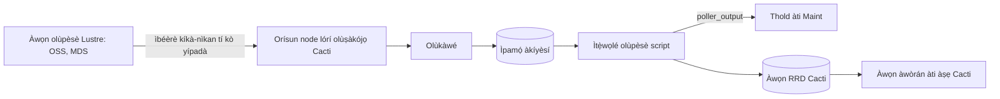

<!-- Source: README.md; SHA256: e88d6875d113220a91cfc0a9d230c829a78477b17e6aa7e44dda38c9591c86ad -->

<!-- translations:start -->
[English](../../../README.md) | [简体中文](../zh-CN/README.md) | [हिन्दी](../hi-IN/README.md) | [Español (España)](../es-ES/README.md) | [Español (Latinoamérica)](../es-419/README.md) | [العربية (السعودية)](../ar-SA/README.md) | [Afrikaans](../af-ZA/README.md) | [አማርኛ](../am-ET/README.md) | [العربية (مصر)](../ar-EG/README.md) | [العربية (المغرب)](../ar-MA/README.md) | [বাংলা](../bn-BD/README.md) | [Bosanski](../bs-BA/README.md) | [Deutsch](../de-DE/README.md) | [فارسی](../fa-IR/README.md) | [Filipino](../fil-PH/README.md) | [Français](../fr-FR/README.md) | [Français (Maroc)](../fr-MA/README.md) | [Français (Sénégal)](../fr-SN/README.md) | [Hausa](../ha-NG/README.md) | [עברית](../he-IL/README.md) | [Hrvatski](../hr-HR/README.md) | [Bahasa Indonesia](../id-ID/README.md) | [Igbo](../ig-NG/README.md) | [Italiano](../it-IT/README.md) | [日本語](../ja-JP/README.md) | [한국어](../ko-KR/README.md) | [Malagasy](../mg-MG/README.md) | [मराठी](../mr-IN/README.md) | [Bahasa Melayu](../ms-MY/README.md) | [Nederlands](../nl-NL/README.md) | [Polski](../pl-PL/README.md) | [Português (Brasil)](../pt-BR/README.md) | [Русский](../ru-RU/README.md) | [Kinyarwanda](../rw-RW/README.md) | [Soomaali](../so-SO/README.md) | [Српски](../sr-RS/README.md) | [Svenska](../sv-SE/README.md) | [Kiswahili](../sw-KE/README.md) | [தமிழ்](../ta-IN/README.md) | [తెలుగు](../te-IN/README.md) | [ไทย](../th-TH/README.md) | [Türkçe](../tr-TR/README.md) | [Українська](../uk-UA/README.md) | [اردو](../ur-PK/README.md) | [Tiếng Việt](../vi-VN/README.md) | [isiXhosa](../xh-ZA/README.md) | [Yorùbá](README.md) | [繁體中文](../zh-TW/README.md) | [isiZulu](../zu-ZA/README.md)
<!-- translations:end -->

# plugin_pfs

Àfikún Cacti 1.2 kan tí ó ń mú ìlera àti ẹrù iṣẹ́ ètò fáìlì alásopọ̀ wọ inú Cacti: agbára ìpamọ́ àti àìdọ́gba ìkún láàárín àwọn ibi-àfojúsùn, ìwọ̀n ìṣàn dátà fún ibi-àfojúsùn kọ̀ọ̀kan, àti ìwọ̀n iṣẹ́ metadata. Lustre ni ẹ̀rọ àtìlẹ́yìn àkọ́kọ́. GPFS (IBM Storage Scale) àti BeeGFS tẹ̀lé e lẹ́yìn ìsopọ̀ àtìlẹ́yìn kan. Dátà náà ń lọ sínú àwọn ẹ̀rọ Cacti, orísun dátà, àti àwòrán ìṣirò déédéé, nítorí náà Thold àti Maint ń ṣe ìkìlọ̀ àti ìdádúró rẹ̀ láìyípadà.

> **Ipò: ìpele 4, kóòdù ti parí fún abala 1, a kò tíì tú u jáde.** Àwọn ìpele 2 (ìpìlẹ̀), 3 (àkíyèsí Lustre), àti 4 (ìkìlọ̀ àti ìpalẹ̀mọ́ ìtújáde) ti parí lórí `main` tàbí wọ́n wà lábẹ́ àyẹ̀wò. Àfikún náà ń fi sórí ẹ̀rọ, ṣe àtúnṣe ìgbéga, ó sì ń yọ kúrò nípasẹ̀ API àfikún Cacti, ó sì ń kọ PHP tí ó kéré sí 8.2. Olùkàwé abẹ́lẹ̀ lórí olùṣàkójọ kọ̀ọ̀kan ń ka àwọn olùpèsè Lustre lórí SSH nípasẹ̀ ìwé àṣẹ tí a fi ipá mú tí kò yípadà ([node/pfs-read.sh](../../../node/pfs-read.sh)), ó sì ń fi àkójọ ohun ìní, ipò, agbára ìpamọ́, àti àwọn oníṣirò pamọ́ pẹ̀lú ìtútù wọn. Ètò fáìlì kọ̀ọ̀kan di ẹ̀rọ Cacti kan pẹ̀lú ìbéèrè dátà OST àti MDT, àwòrán àkópọ̀ márùn-ún, àwòrán fún ibi-àfojúsùn kọ̀ọ̀kan nígbà tí a bá béèrè, àti orísun dátà àkópọ̀ fún Thold. Thold v1.8.2 àti Maint v1.3, láìyípadà, ń ṣe ìkìlọ̀ àti ìdádúró lórí àwọn òṣùwọ̀n àkópọ̀ nínú ìṣiṣẹ́ láti ìbẹ̀rẹ̀ dé òpin; àwọn ààlà Thold lórí àwọn oníṣirò kò ní àtìlẹ́yìn pẹ̀lú Thold 1.8.2 ([docs/alerting.md](../../alerting.md)). Gbogbo ìdánwò títí di ìsinsìnyí ń ṣiṣẹ́ lórí àbájáde node àpẹẹrẹ nínú Cacti aláìdúró: àfikún náà kò tíì ṣiṣẹ́ lòdì sí node Lustre gidi kan. Ohun tí ó ṣì ṣí sílẹ̀ kí ìtújáde tó wáyé: àwọn ìdánwò àkọ́kọ́ lórí àwọn ètò fáìlì gidi ([ètò ìdánwò àkọ́kọ́](../../pilot-plan.md)), àyẹ̀wò ààbò láti òde ([àtúnyẹ̀wò ara-ẹni](../../security-review.md)), àti àwọn ìwọ̀n ìgbòòrò lórí ohun èlò tí a kọ sílẹ̀ ([ìwọ̀n ìgbòòrò](../../research/scale.md)). A ti pèsè ẹ̀yà 0.1.0 nínú `INFO` àti [CHANGELOG.md](../../../CHANGELOG.md) ṣùgbọ́n a kò tíì fi àmì sí i.

## Àwọn ipa ìwọ̀lé

| Agbègbè Àṣẹ | Ìwọ̀lé |
| --- | --- |
| Parallel Filesystem View | Àwọn ojú-ewé àbójútó tí ó wà tẹ́lẹ̀. |
| Parallel Filesystem Operator | Àbójútó pẹ̀lú ojú-ewé Operations àti àwọn ìfọwọ́sí ìtọ́jú ara-ẹni. |
| Parallel Filesystem Admin | Ìwọ̀lé Operator pẹ̀lú ìṣètò tí ó wà tẹ́lẹ̀ àti àwọn ìṣe ìṣàkóso. |

Lẹ́yìn dídà àwọn fáìlì ìgbéga, ṣí ojú-ewé Plugins gẹ́gẹ́ bí alámòójútó láti forúkọsílẹ̀
agbègbè àṣẹ tuntun náà. Yan agbègbè Operator ní pàtó lábẹ́ **Configuration > Users** tàbí àwọn ẹgbẹ́ olùṣàmúlò.
Àwọn ìgbéga ń pa àwọn ID agbègbè àṣẹ View àti Admin tí ó wà tẹ́lẹ̀ àti àwọn ìfúnni-láṣẹ wọn mọ́. Ìwọ̀lé Admin
ń jogún ìwọ̀lé Operator, ìwọ̀lé Operator sì ń jogún ìwọ̀lé View lórí ìbéèrè kọ̀ọ̀kan;
èyí kò fi àwọn ìfúnni-láṣẹ tí a fi pamọ́ kún fún àwọn olùṣàmúlò tàbí àwọn ẹgbẹ́. Àwọn ìṣètò àfikún tún nílò
ìwọ̀lé Parallel Filesystem Admin ní àfikún sí àṣẹ Settings ti Cacti.

Àwọn àṣẹ ẹ̀rọ Cacti ṣì ń dín àwọn ìlà àti àwọn ìṣe tí ó wà fún olùṣàmúlò kọ̀ọ̀kan kù; àwọn ohun tí a kò so pọ̀ nílò alámòójútó.
Àwọn ìwé-ẹ̀rí ìwọ̀lé, ìṣètò, ìsopọ̀, ìparẹ́ àti àwọn àyípadà ìṣàkóso mìíràn
ṣì wà ní àwọn ojú-ewé ìṣàkóso. Àwọn ìfọwọ́sí ń wà ní ìgbà ìṣiṣẹ́ olùṣàmúlò
lọ́wọ́lọ́wọ́ nìkan, fún wákàtí kan ní púpọ̀ jùlọ àti níwọ̀n ìgbà tí àkíyèsí kan náà bá ṣì wà ní
tútù. Àwọn àkíyèsí tuntun tàbí tí ó yípadà ń sọ wọ́n di aláìníláárí. Wọn kì í ṣàmì sí ìwọ̀n tí ó kùnà
gẹ́gẹ́ bí èyí tí ó ní ìlera tàbí dẹ́kun àwọn ìkìlọ̀.

## Ìdí

Nígbà tí ètò fáìlì alájọpín bá lọ́ra, ẹ̀rí náà máa ń fọ́nká káàkiri àwọn olùpèsè. Lustre ń pa àwọn oníṣirò rẹ̀ mọ́ fún node kọ̀ọ̀kan: `lctl get_param` ń ròyìn àwọn iye "lórí node ìbílẹ̀", nítorí náà olùpèsè ìpamọ́ ohun (OSS) àti olùpèsè metadata (MDS) kọ̀ọ̀kan ń di nọ́ńbà àwọn ibi-àfojúsùn tirẹ̀ nìkan mú. Olùṣàkóso kan tí ó ń ṣe ìwádìí ètò fáìlì tí ó lọ́ra nílò ìdáhùn mẹ́ta láti àwọn ibi ọ̀tọ̀ọ̀tọ̀:

- **Ṣé ibi-àfojúsùn kan ń kún nígbà tí àwọn mìíràn ṣófo?** Àìdọ́gba ìkún ń yí ibi tí àwọn fáìlì tuntun ń bà sí padà àti ìgbà tí ibi-àfojúsùn kan ṣoṣo bá kún tán.
- **Àwọn ibi-àfojúsùn tàbí iṣẹ́ wo ni ó ń ṣiṣẹ́ jù?** Àwọn oníṣirò byte fún ibi-àfojúsùn kọ̀ọ̀kan àti àwọn oníṣirò iṣẹ́ fún MDT kọ̀ọ̀kan ń fi hàn bóyá ẹrù iṣẹ́ náà jẹ́ ti dátà tàbí ti metadata.
- **Ṣé àbójútó náà fúnra rẹ̀ wà lọ́wọ́lọ́wọ́?** Àwòrán tí ó tẹ́jú jẹ́ ohun ìfọ̀kànbalẹ̀ nìkan tí àfikún náà bá lè rí àwọn olùpèsè náà.

Cacti ń ya àwòrán àwọn olùgbàlejò ó sì ń ṣètò ààlà àwọn iye pẹ̀lú Thold, àjọ GitHub ti Cacti kò sì ní ibi ìpamọ́ kóòdù kankan fún àbójútó Lustre, GPFS, tàbí BeeGFS (tí a wá ní 2026-11-14). Àfikún náà ń dí àlàfo yẹn nípa kíkà àwọn iye tí a fọwọ́ sí, tí ó jẹ́ kíkà-nìkan láti inú àwọn node ìpamọ́ àti ṣíṣe àpèjúwe ètò fáìlì kọ̀ọ̀kan gẹ́gẹ́ bí ẹ̀rọ Cacti tí àwọn ibi-àfojúsùn rẹ̀ jẹ́ àwọn atọ́ka ti ìbéèrè dátà kan. Ó ń tún àwòrán ìṣirò Cacti, àwọn àṣẹ, àwọn olùkójọ dátà òkèèrè, Thold, àti Maint lò dípò kíkọ́ àwọn ẹ̀dà alásopọ̀ tiwọn.

## Àkójọpọ̀ ètò tí a gbèrò

| Abala | Àkójọpọ̀ | Àwọn ìpele |
|---|---|---|
| 0, ìwádìí | Àtẹ ìtújáde, ìpinnu ìwọ̀lé node, ìjẹ́rìísí ìhùwàsí orísun òkè, ìhùwàsí oníṣirò àti ìyípadà ìkùnà, àwọn ìwọ̀n ìgbòòrò | [M1](https://github.com/somethingwithproof/plugin_pfs/milestone/1) |
| 1, àkíyèsí | Àkójọ ohun ìní Lustre, agbára ìpamọ́ àti ìkún, ìṣàn dátà OST, ìwọ̀n iṣẹ́ MDT, àwọn àwòrán, ìkìlọ̀ Thold, ìdádúró Maint, ojú-ewé ìlera | [M2](https://github.com/somethingwithproof/plugin_pfs/milestone/2), [M3](https://github.com/somethingwithproof/plugin_pfs/milestone/3), [M4](https://github.com/somethingwithproof/plugin_pfs/milestone/4) |
| 2, ìjìnlẹ̀ | Àwọn olùkójọ dátà òkèèrè Cacti, àwọn ìwò ìpele-iṣẹ́ àti ìpele-oníbàárà láàárín iye ohun tí ó ní ààlà | [M5](https://github.com/somethingwithproof/plugin_pfs/milestone/5) |
| 3, àwọn ẹ̀rọ àtìlẹ́yìn | Àwọn ẹ̀rọ àtìlẹ́yìn GPFS (IBM Storage Scale) àti BeeGFS | [M6](https://github.com/somethingwithproof/plugin_pfs/milestone/6) |

Lóde àkójọpọ̀: èyíkéyìí iṣẹ́ kíkọ, pípàrẹ́, títún-ṣètò, tàbí ṣíṣàtúnṣe lórí node kan tàbí ètò fáìlì; ẹ̀rọ ìkìlọ̀ tí àfikún ní; daemon àdáni tàbí ìlànà nẹ́tíwọ́ọ̀kì; àwọn orísun dátà fún iṣẹ́ kọ̀ọ̀kan; àwọn àyípadà sí kòkó Cacti, Thold, tàbí Maint.

## Àwọn àfojúsùn ìbámu

| Èròjà | Àfojúsùn |
|---|---|
| Cacti | 1.2.31 tàbí lẹ́yìn rẹ̀, kò sí àtúnṣe kòkó |
| PHP | 8.2 tàbí lẹ́yìn rẹ̀; `setup.php` dúró láti ṣe é kà lórí 8.0 kí àyíká ìṣiṣẹ́ tí kò ní àtìlẹ́yìn lè gba ìkọ̀sílẹ̀ dípò ojú-ìwò Cacti tí ó bàjẹ́ |
| Lustre | Àwọn ìlà ìtújáde láti yanjú nípa ìpele 1; orísun àti àwọn ìwé ìtọ́ni tí a yẹ̀wò títí di ìsinsìnyí wà ní 2.17.0 |
| GPFS, BeeGFS | Abala 3; àwọn ìtújáde láti yanjú nípa ìwádìí |
| Thold, Maint | Kò nílò àyípadà kankan |

## Àpẹẹrẹ ìṣètò

- [docs/PLAN.md](../../PLAN.md) ni ètò kíkún: àpẹẹrẹ ètò, àwọn òtítọ́ orísun òkè tí ó gbára lé (pẹ̀lú àwọn orísun àti ohun tí a kò tíì fìdí rẹ̀ múlẹ̀), ìtumọ̀ oníṣirò, àwòṣe ipò, àwọn ààlà ààbò, ìṣirò ìṣiṣẹ́, ìdánwò, àti àwọn ewu.
- [docs/operator-guide.md](../../operator-guide.md) bo fífi sórí ẹ̀rọ, àwọn àwòrán àti àwọn iye, ìgbéga, ìpamọ́ àti ìpadàbọ̀sípò, yíyọ kúrò, àti yíyanjú ìṣòro; [docs/alerting.md](../../alerting.md) bo Thold àti Maint.
- [docs/node-setup.md](../../node-setup.md) ṣàpèjúwe bí a ṣe lè pèsè olùpèsè Lustre kan àti olùṣàkójọ kan fún olùkàwé náà.
- [docs/decisions/](../../decisions) ní àwọn àkọsílẹ̀ ìpinnu àpẹẹrẹ ètò fún àwọn ìyàn tí a ti ṣe tẹ́lẹ̀.
- [docs/REQUIREMENTS.md](../../REQUIREMENTS.md) so ID ìbéèrè kọ̀ọ̀kan pọ̀ mọ́ ìṣòro rẹ̀.

## Bí a ṣe ń tọpa iṣẹ́

- **Àwọn ìpele** ń tẹ̀lé àwọn ìpele ètò náà. Kọ̀ọ̀kan ní ìṣòro pàtàkì kan tí ó ṣàkójọ àwọn ìṣòro abẹ́ rẹ̀ àti ẹ̀rí ìparí.
- **Àwọn ìṣòro** jẹ́ pípín nípa àmì-ìdámọ̀: `type: requirement`, `type: research`, `type: decision`, `type: epic`. Àwọn ìṣòro ìbéèrè ń sọ àwọn ìbéèrè tí a lè dán wò tí ó ní nọ́ńbà (`REQ-AREA-NNN`) àti àwọn ìlànà ìtẹ́wọ́gbà.
- **Àwọn àmì-ìdámọ̀** tún ní `area:`, `phase:`, `priority:`, àti `status:`. Wo [CONTRIBUTING.md](../../../CONTRIBUTING.md#labels).
- [Pátákó iṣẹ́](https://github.com/users/somethingwithproof/projects/11) ń fi gbogbo àwọn ìṣòro hàn káàkiri àwọn ìpele.

## Ìkópa

Ka [CONTRIBUTING.md](../../../CONTRIBUTING.md). Àwọn ìfiránṣẹ́ nílò ìfọwọ́sí ìforúkọsílẹ̀ DCO. Ìjíròrò àpẹẹrẹ ń wáyé lórí àwọn ìṣòro; àwọn ìpinnu tí ó ṣí sílẹ̀ ní àmì-ìdámọ̀ `type: decision`.

## Ààbò

Ròyìn àwọn àléébù ààbò ní ìkọ̀kọ̀; wo [SECURITY.md](../../../SECURITY.md).

## Ìwé-àṣẹ

GNU General Public License v2.0, ìwé-àṣẹ kan náà pẹ̀lú Cacti àti àwọn àfikún rẹ̀. Wo [LICENSE](../../../LICENSE).
