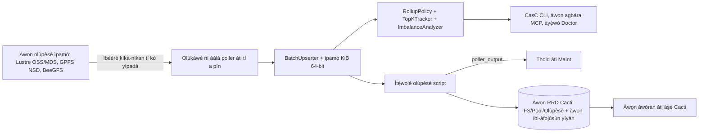

<!-- Source: README.md; SHA256: e88d6875d113220a91cfc0a9d230c829a78477b17e6aa7e44dda38c9591c86ad -->

<!-- translations:start -->
[English](../../../README.md) | [简体中文](../zh-CN/README.md) | [हिन्दी](../hi-IN/README.md) | [Español (España)](../es-ES/README.md) | [Español (Latinoamérica)](../es-419/README.md) | [العربية (السعودية)](../ar-SA/README.md) | [Afrikaans](../af-ZA/README.md) | [አማርኛ](../am-ET/README.md) | [العربية (مصر)](../ar-EG/README.md) | [العربية (المغرب)](../ar-MA/README.md) | [Български](../bg-BG/README.md) | [বাংলা](../bn-BD/README.md) | [Bosanski](../bs-BA/README.md) | [Deutsch](../de-DE/README.md) | [Ελληνικά](../el-GR/README.md) | [فارسی](../fa-IR/README.md) | [Filipino](../fil-PH/README.md) | [Français](../fr-FR/README.md) | [Français (Maroc)](../fr-MA/README.md) | [Français (Sénégal)](../fr-SN/README.md) | [Hausa](../ha-NG/README.md) | [עברית](../he-IL/README.md) | [Hrvatski](../hr-HR/README.md) | [Bahasa Indonesia](../id-ID/README.md) | [Igbo](../ig-NG/README.md) | [Italiano](../it-IT/README.md) | [日本語](../ja-JP/README.md) | [ქართული](../ka-GE/README.md) | [한국어](../ko-KR/README.md) | [Latviešu](../lv-LV/README.md) | [Malagasy](../mg-MG/README.md) | [मराठी](../mr-IN/README.md) | [Bahasa Melayu](../ms-MY/README.md) | [Nederlands](../nl-NL/README.md) | [Polski](../pl-PL/README.md) | [Português (Brasil)](../pt-BR/README.md) | [Português (Portugal)](../pt-PT/README.md) | [Русский](../ru-RU/README.md) | [Kinyarwanda](../rw-RW/README.md) | [Soomaali](../so-SO/README.md) | [Српски](../sr-RS/README.md) | [Svenska](../sv-SE/README.md) | [Kiswahili](../sw-KE/README.md) | [தமிழ்](../ta-IN/README.md) | [తెలుగు](../te-IN/README.md) | [ไทย](../th-TH/README.md) | [Türkçe](../tr-TR/README.md) | [Українська](../uk-UA/README.md) | [اردو](../ur-PK/README.md) | [Tiếng Việt](../vi-VN/README.md) | [isiXhosa](../xh-ZA/README.md) | [Yorùbá](README.md) | [繁體中文](../zh-TW/README.md) | [isiZulu](../zu-ZA/README.md)
<!-- translations:end -->

# plugin_pfs

Àfikún Cacti 1.2 kan tí ó ń mú ìlera ètò fáìlì alásopọ̀, agbára ìpamọ́, àìdọ́gba ìkún, ìwọ̀n ìṣàn dátà fún ibi-àfojúsùn kọ̀ọ̀kan, àti ìwọ̀n iṣẹ́ metadata wọ inú Cacti káàkiri Lustre, IBM Storage Scale (GPFS), àti BeeGFS lẹ́yìn ìsopọ̀ `Backend` kan ṣoṣo. Ètò fáìlì kọ̀ọ̀kan ń so mọ́ ẹ̀rọ Cacti déédéé kan pẹ̀lú àwọn ìbéèrè dátà, àwọn àwòrán àkópọ̀ àti ti ibi-àfojúsùn nígbà tí a bá béèrè, àti àwọn òṣùwọ̀n àkópọ̀ kí Thold àti Maint lè ṣe ìkìlọ̀ kí wọ́n sì dá wọn dúró láìyípadà.

> **Ipò: àwọn abala 1 sí 3 àti àwọn ìpìlẹ̀ ìgbòòrò exascale ti wà ní kíkọ́ nínú kóòdù, a kò tíì tú wọn jáde.** Ìpìlẹ̀, àkíyèsí Lustre, ìkìlọ̀ àti ìdádúró Maint, àwọn awakọ̀ kíkà-nìkan ti GPFS àti BeeGFS, àyẹ̀wò àìdọ́gba OST/MDT pẹ̀lú ìṣọ̀kan Maint, ìṣàkóso agbègbè olùkójọ dátà òkèèrè (`replicate_out`, `remote_agent`), àwọn ìpìlẹ̀ ìgbòòrò 100+ PB / exascale (`FramedReportParser`, Schema v4 `value_kib`, `RollupPolicy`, `TopKTracker`, `ShardAssigner`, `BatchUpserter`), CasC CLI fún olùṣàkóso (`cli/pfs.php`), àti àwọn hook ètò àyíká (`abilities_register`, `doctor_register_checks`, `casc_register_providers`) ti wà ní ìṣe, a sì ti fìdí wọn múlẹ̀ pẹ̀lú àwọn ìdánwò ẹyọkan, ti ààbò, àti ti ìṣọ̀kan nínú Cacti aláìdúró. Gbogbo ìṣiṣẹ́ títí di ìsinsìnyí ń lo àbájáde node àpẹẹrẹ dípò ohun èlò Lustre, GPFS, tàbí BeeGFS gidi. Ohun tí ó ṣì ṣí sílẹ̀ kí a tó fi àmì sí ìtújáde: àwọn ìdánwò àkọ́kọ́ lórí àwọn ètò fáìlì gidi ([ètò ìdánwò àkọ́kọ́](../../pilot-plan.md)), àyẹ̀wò ààbò láti òde ([àtúnyẹ̀wò ara-ẹni](../../security-review.md)), àti àwọn ìwọ̀n ìgbòòrò lórí ohun èlò tí a kọ sílẹ̀ ([ìwọ̀n ìgbòòrò](../../research/scale.md)). A ti pèsè ẹ̀yà 0.1.0 nínú `INFO` àti [CHANGELOG.md](../../../CHANGELOG.md) ṣùgbọ́n a kò tíì fi àmì sí i.

## Àwọn ipa ìwọ̀lé

| Agbègbè Àṣẹ | Ìwọ̀lé |
| --- | --- |
| Parallel Filesystem View | Àwọn ojú-ewé àbójútó tí ó wà tẹ́lẹ̀. |
| Parallel Filesystem Operator | Àbójútó pẹ̀lú ojú-ewé Operations àti àwọn ìfọwọ́sí ìtọ́jú ara-ẹni. |
| Parallel Filesystem Admin | Ìwọ̀lé Operator pẹ̀lú ìṣètò tí ó wà tẹ́lẹ̀ àti àwọn ìṣe ìṣàkóso. |

Lẹ́yìn dídà àwọn fáìlì ìgbéga, ṣí ojú-ewé Plugins gẹ́gẹ́ bí alámòójútó láti forúkọsílẹ̀
agbègbè àṣẹ tuntun náà. Yan agbègbè Operator ní pàtó lábẹ́ **Configuration > Users** tàbí àwọn ẹgbẹ́ olùṣàmúlò.
Àwọn ìgbéga ń pa àwọn ID agbègbè àṣẹ View àti Admin tí ó wà tẹ́lẹ̀ àti àwọn ìfúnni-láṣẹ wọn mọ́. Ìwọ̀lé Admin
ń jogún ìwọ̀lé Operator, ìwọ̀lé Operator sì ń jogún ìwọ̀lé View lórí ìbéèrè kọ̀ọ̀kan;
èyí kò fi àwọn ìfúnni-láṣẹ tí a fi pamọ́ kún fún àwọn olùṣàmúlò tàbí àwọn ẹgbẹ́. Àwọn ìṣètò àfikún tún nílò
ìwọ̀lé Parallel Filesystem Admin ní àfikún sí àṣẹ Settings ti Cacti.

Àwọn àṣẹ ẹ̀rọ Cacti ṣì ń dín àwọn ìlà àti àwọn ìṣe tí ó wà fún olùṣàmúlò kọ̀ọ̀kan kù; àwọn ohun tí a kò so pọ̀ nílò alámòójútó.
Àwọn ìwé-ẹ̀rí ìwọ̀lé, ìṣètò, ìsopọ̀, ìparẹ́ àti àwọn àyípadà ìṣàkóso mìíràn
ṣì wà ní àwọn ojú-ewé ìṣàkóso. Àwọn ìfọwọ́sí ń wà ní ìgbà ìṣiṣẹ́ olùṣàmúlò
lọ́wọ́lọ́wọ́ nìkan, fún wákàtí kan ní púpọ̀ jùlọ àti níwọ̀n ìgbà tí àkíyèsí kan náà bá ṣì wà ní
tútù. Àwọn àkíyèsí tuntun tàbí tí ó yípadà ń sọ wọ́n di aláìníláárí. Wọn kì í ṣàmì sí ìwọ̀n tí ó kùnà
gẹ́gẹ́ bí èyí tí ó ní ìlera tàbí dẹ́kun àwọn ìkìlọ̀.

## Ìdí

Nígbà tí ètò fáìlì alájọpín bá lọ́ra, ẹ̀rí náà máa ń fọ́nká káàkiri àwọn olùpèsè. Lustre ń pa àwọn oníṣirò rẹ̀ mọ́ fún node kọ̀ọ̀kan: `lctl get_param` ń ròyìn àwọn iye "lórí node ìbílẹ̀", nítorí náà olùpèsè ìpamọ́ ohun (OSS) àti olùpèsè metadata (MDS) kọ̀ọ̀kan ń di nọ́ńbà àwọn ibi-àfojúsùn tirẹ̀ nìkan mú. Olùṣàkóso kan tí ó ń ṣe ìwádìí ètò fáìlì tí ó lọ́ra nílò ìdáhùn mẹ́ta láti àwọn ibi ọ̀tọ̀ọ̀tọ̀:

- **Ṣé ibi-àfojúsùn kan ń kún nígbà tí àwọn mìíràn ṣófo?** Àìdọ́gba ìkún ń yí ibi tí àwọn fáìlì tuntun ń bà sí padà àti ìgbà tí ibi-àfojúsùn kan ṣoṣo bá kún tán.
- **Àwọn ibi-àfojúsùn tàbí iṣẹ́ wo ni ó ń ṣiṣẹ́ jù?** Àwọn oníṣirò byte fún ibi-àfojúsùn kọ̀ọ̀kan àti àwọn oníṣirò iṣẹ́ fún MDT kọ̀ọ̀kan ń fi hàn bóyá ẹrù iṣẹ́ náà jẹ́ ti dátà tàbí ti metadata.
- **Ṣé àbójútó náà fúnra rẹ̀ wà lọ́wọ́lọ́wọ́?** Àwòrán tí ó tẹ́jú jẹ́ ohun ìfọ̀kànbalẹ̀ nìkan tí àfikún náà bá lè rí àwọn olùpèsè náà.

Cacti ń ya àwòrán àwọn olùgbàlejò ó sì ń ṣètò ààlà àwọn iye pẹ̀lú Thold, àjọ GitHub ti Cacti kò sì ní ibi ìpamọ́ kóòdù kankan fún àbójútó Lustre, GPFS, tàbí BeeGFS (tí a wá ní 2026-11-14). Àfikún náà ń dí àlàfo yẹn nípa kíkà àwọn iye tí a fọwọ́ sí, tí ó jẹ́ kíkà-nìkan láti inú àwọn node ìpamọ́ àti ṣíṣe àpèjúwe ètò fáìlì kọ̀ọ̀kan gẹ́gẹ́ bí ẹ̀rọ Cacti tí àwọn ibi-àfojúsùn rẹ̀ jẹ́ àwọn atọ́ka ti ìbéèrè dátà kan. Ó ń tún àwòrán ìṣirò Cacti, àwọn àṣẹ, àwọn olùkójọ dátà òkèèrè, Thold, àti Maint lò dípò kíkọ́ àwọn ẹ̀dà alásopọ̀ tiwọn.

## Àkójọpọ̀ ètò tí a gbèrò

| Abala | Àkójọpọ̀ | Ipò | Àwọn ìpele |
|---|---|---|---|
| 0, ìwádìí | Àtẹ ìtújáde, ìpinnu ìwọ̀lé node, ìjẹ́rìísí ìhùwàsí orísun òkè, ìhùwàsí oníṣirò àti ìyípadà ìkùnà, àwọn ìwọ̀n ìgbòòrò | Ti parí | [M1](https://github.com/somethingwithproof/plugin_pfs/milestone/1) |
| 1, àkíyèsí | Àkójọ ohun ìní Lustre, agbára ìpamọ́ àti ìkún, àìdọ́gba OST/MDT (`lib/ImbalanceAnalyzer.php`), ìṣọ̀kan Maint (`lib/HealthPage.php`), ìṣàn dátà OST, ìwọ̀n iṣẹ́ MDT, àwọn àwòrán, ìkìlọ̀ Thold, ojú-ewé ìlera | Ti ṣe (a dán wò pẹ̀lú àpẹẹrẹ) | [M2](https://github.com/somethingwithproof/plugin_pfs/milestone/2), [M3](https://github.com/somethingwithproof/plugin_pfs/milestone/3), [M4](https://github.com/somethingwithproof/plugin_pfs/milestone/4) |
| 2, òkèèrè àti ìgbòòrò | Ìkójọ òkèèrè ní ààlà poller (`lib/Reader.php`, `lib/ReplicationRepository.php`, `replicate_out`, `remote_agent`), àwọn ìpìlẹ̀ ìgbòòrò 100+ PB (ìmọ́tótó KiB 64-bit + Schema v4 `value_kib`, `lib/RollupPolicy.php`, `lib/TopKTracker.php`, `lib/ShardAssigner.php` + `poller_pfs.php --shard=K/N`, `lib/BatchUpserter.php`), CasC CLI (`cli/pfs.php`), àwọn hook MCP/Doctor/CasC | Ti ṣe (a dán wò ní ẹyọkan àti ìṣọ̀kan CI) | [M5](https://github.com/somethingwithproof/plugin_pfs/milestone/5) |
| 3, àwọn ẹ̀rọ àtìlẹ́yìn | Àwọn awakọ̀ kíkà-nìkan ti IBM Storage Scale (GPFS) (`lib/GpfsBackend.php`) àti BeeGFS (`lib/BeegfsBackend.php`) tí a forúkọsílẹ̀ nínú `BackendRegistry::production()` | Ti ṣe (a dán wò ní ẹyọkan) | [M6](https://github.com/somethingwithproof/plugin_pfs/milestone/6) |

Àwọn ìpìlẹ̀ pàtàkì fún olùṣàkóso àti ìgbòòrò tí a ti ṣe:

- **Àwọn awakọ̀ kíkà-nìkan fún ọ̀pọ̀ ètò fáìlì:** `LustreBackend`, `GpfsBackend` (`mmpmon` `fs_io_s`/`io_s` tí a dì mọ́ nìkan pẹ̀lú ìdènà `reset`, agbára/ipò pool `mmdf`, àti àkópọ̀ olùdúró), àti `BeegfsBackend` (àwọn ibi-àfojúsùn ìpamọ́/metadata ti BeeGFS 7.4 àti 8.x pẹ̀lú ìyípadà byte-sí-KiB pípé, ìsopọ̀ ipò ìdébà/ìbámu, àti ìtumọ̀ òṣùwọ̀n fún àkókò kọ̀ọ̀kan) tí wọ́n ń lo `lib/FramedReportParser.php` pọ̀.
- **Ìmọ̀ àìdọ́gba, ààyè tó kù, àti Maint:** `lib/ImbalanceAnalyzer.php` ń ṣírò ìpín ìkún OST/MDT, ìtànkálẹ̀, atọ́ka àìdọ́gba ti ìyapa ìwọ̀n gbogbogbò, ààyè tó kù, ìfipámú ìtútù àkókò-1 (`missing_targets`), àwọn àsíá ipò fún ibi-àfojúsùn kọ̀ọ̀kan, àti àwọn ibi-àfojúsùn Top-K tí ó yípadà jù tí ó ní ààlà. `HealthPage` (`pfs_health.php`) àti `CascProvider::health()` ń fi àwọn fèrèsé ìtọ́jú Cacti `Maint` hàn, wọ́n sì ń dẹ́kun àwọn ìkìlọ̀ ìkùnà tí ń ṣiṣẹ́ ní àkókò ìtọ́jú tí a ṣètò.
- **Ìgbòòrò 100+ PB àti exascale** ([docs/architecture/exascale-scaling.md](../../architecture/exascale-scaling.md)): ìyípadà dígítà byte-sí-KiB pípé (`FramedReportParser::bytesToKibInt()`) tí a fìdí rẹ̀ múlẹ̀ ní 500 PB àti 2 EB pẹ̀lú àwọn òpó `BIGINT UNSIGNED value_kib` (Schema v4); àwọn àkójọpọ̀ RRD onípele `Filesystem -> Pool -> Storage Server` pẹ̀lú ìgbéga tí ó ní ààlà fún àwọn ibi-àfojúsùn yíyàn/gbígbóná/títẹ̀ (`lib/RollupPolicy.php`); àwọn ibi-àfojúsùn títẹ̀ Top-K tí ó ní ààlà $O(K)$ àti àkópọ̀ tí a ti ṣètò tẹ́lẹ̀ fún iṣẹ́/oníbàárà tó lágbára (`lib/TopKTracker.php`, tí kì í ṣẹ̀dá àwọn ẹ̀rọ tàbí RRD fún oníbàárà kọ̀ọ̀kan láé); ìpín olùkójọ CRC32 tí ó dájú (`lib/ShardAssigner.php`, `php plugins/pfs/poller_pfs.php [--poller=N] [--shard=K/N] [--force] [--debug]`); àti àwọn àfikún-àtúnṣe SQL ní ìdìpọ̀ ìlà 500 pẹ̀lú ìṣàtò ojú-ewé keyset (`lib/BatchUpserter.php`, `CacheRepository::upsertObservationsBatch()`, `TargetRepository::forFilesystemPage()`).
- **CasC CLI olùṣàkóso àti àwọn hook ètò àyíká:** `cli/pfs.php` ṣe àtìlẹ́yìn fún `export [--format=yaml|xml]`, `validate <file> [--format=yaml|xml]`, `plan <file> [--format=yaml|xml] [--output=text|json]`, `apply <file> --confirm=<PLAN_HASH> [--format=yaml|xml]`, àti `health [--format=text|json]` láìsí ìgbẹ́kẹ̀lé Composer kankan láti òde. `setup.php` àti `lib/EcosystemIntegration.php` forúkọsílẹ̀ `abilities_register` (`pfs-list-filesystems`, `pfs-get-imbalance`, `pfs-get-health`; kíkà-nìkan, tí a ṣàkóso pẹ̀lú `Parallel Filesystem View` àti àwọn àṣẹ ẹ̀rọ Cacti), `doctor_register_checks` (`pfs_schema`, `pfs_reader_freshness`, `pfs_capacity_imbalance`), `casc_register_providers`, `replicate_out`, àti `remote_agent`.

Lóde àkójọpọ̀: èyíkéyìí iṣẹ́ kíkọ, pípàrẹ́, títún-ṣètò, tàbí ṣíṣàtúnṣe lórí node kan tàbí ètò fáìlì; ẹ̀rọ ìkìlọ̀ tí àfikún ní; daemon àdáni tàbí ìlànà nẹ́tíwọ́ọ̀kì; àwọn ẹ̀rọ/RRD Cacti fún iṣẹ́ kọ̀ọ̀kan tàbí oníbàárà kọ̀ọ̀kan; àwọn àyípadà sí kòkó Cacti, Thold, tàbí Maint.

## Àwọn àfojúsùn ìbámu

| Èròjà | Àfojúsùn |
|---|---|
| Cacti | 1.2.31 tàbí lẹ́yìn rẹ̀, kò sí àtúnṣe kòkó |
| PHP | 8.2 tàbí lẹ́yìn rẹ̀; `setup.php`, `poller_pfs.php`, àti `cli/pfs.php` dúró láti ṣe é kà lórí 8.0 kí àyíká ìṣiṣẹ́ tí kò ní àtìlẹ́yìn lè gba ìkọ̀sílẹ̀ dípò ojú-ìwò Cacti tí ó bàjẹ́ |
| Lustre | Orísun àti àwọn ìwé ìtọ́ni tí a yẹ̀wò ní 2.17.0; a dán wò pẹ̀lú àpẹẹrẹ |
| GPFS, BeeGFS | Àwọn awakọ̀ kíkà-nìkan ti IBM Storage Scale (GPFS) 5.x `mmpmon`/`mmdf` àti BeeGFS 7.4 / 8.x ti ṣe a sì dán wọn wò pẹ̀lú àpẹẹrẹ |
| Thold, Maint | Thold 1.8.2 àti Maint 1.3, láìyípadà |

## Àpẹẹrẹ ìṣètò

- [docs/architecture/exascale-scaling.md](../../architecture/exascale-scaling.md) ṣàkọsílẹ̀ àpẹẹrẹ ìwọ̀n òkèèrè eléte méjì ti 100+ PB / exascale (olùpèsè Cacti/`plugin_pfs` + àkójọpọ̀ + ìpele Top-K tí a so pọ̀ mọ́ ìwọ̀n òkèèrè oníbàárà LDMS/Darshan/TOKIO lóde bándì) àti àyíká ìwé ẹ̀kọ́ rẹ̀.
- [docs/PLAN.md](../../PLAN.md) ni ètò kíkún: àpẹẹrẹ ètò, àwọn òtítọ́ orísun òkè tí ó gbára lé (pẹ̀lú àwọn orísun àti ohun tí a kò tíì fìdí rẹ̀ múlẹ̀), ìtumọ̀ oníṣirò, àwòṣe ipò, àwọn ààlà ààbò, ìṣirò ìṣiṣẹ́, ìdánwò, àti àwọn ewu.
- [docs/operator-guide.md](../../operator-guide.md) bo fífi sórí ẹ̀rọ, àwọn àwòrán àti àwọn iye, ìgbéga, ìpamọ́ àti ìpadàbọ̀sípò, yíyọ kúrò, àti yíyanjú ìṣòro; [docs/alerting.md](../../alerting.md) bo Thold àti Maint.
- [docs/node-setup.md](../../node-setup.md) ṣàpèjúwe bí a ṣe lè pèsè olùpèsè Lustre kan àti olùṣàkójọ kan fún olùkàwé náà.
- [docs/decisions/](../../decisions) ní àwọn àkọsílẹ̀ ìpinnu àpẹẹrẹ ètò fún àwọn ìyàn tí a ti ṣe tẹ́lẹ̀.
- [docs/REQUIREMENTS.md](../../REQUIREMENTS.md) so ID ìbéèrè kọ̀ọ̀kan pọ̀ mọ́ ìṣòro rẹ̀.

## Bí a ṣe ń tọpa iṣẹ́

- **Àwọn ìpele** ń tẹ̀lé àwọn ìpele ètò náà. Kọ̀ọ̀kan ní ìṣòro pàtàkì kan tí ó ṣàkójọ àwọn ìṣòro abẹ́ rẹ̀ àti ẹ̀rí ìparí.
- **Àwọn ìṣòro** jẹ́ pípín nípa àmì-ìdámọ̀: `type: requirement`, `type: research`, `type: decision`, `type: epic`. Àwọn ìṣòro ìbéèrè ń sọ àwọn ìbéèrè tí a lè dán wò tí ó ní nọ́ńbà (`REQ-AREA-NNN`) àti àwọn ìlànà ìtẹ́wọ́gbà.
- **Àwọn àmì-ìdámọ̀** tún ní `area:`, `phase:`, `priority:`, àti `status:`. Wo [CONTRIBUTING.md](../../../CONTRIBUTING.md#labels).
- [Pátákó iṣẹ́](https://github.com/users/somethingwithproof/projects/11) ń fi gbogbo àwọn ìṣòro hàn káàkiri àwọn ìpele.

## Ìkópa

Ka [CONTRIBUTING.md](../../../CONTRIBUTING.md). Àwọn ìfiránṣẹ́ nílò ìfọwọ́sí ìforúkọsílẹ̀ DCO. Ìjíròrò àpẹẹrẹ ń wáyé lórí àwọn ìṣòro; àwọn ìpinnu tí ó ṣí sílẹ̀ ní àmì-ìdámọ̀ `type: decision`.

## Ààbò

Ròyìn àwọn àléébù ààbò ní ìkọ̀kọ̀; wo [SECURITY.md](../../../SECURITY.md).

## Ìwé-àṣẹ

GNU General Public License v2.0, ìwé-àṣẹ kan náà pẹ̀lú Cacti àti àwọn àfikún rẹ̀. Wo [LICENSE](../../../LICENSE).
