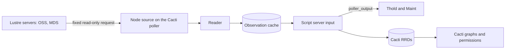

<!-- Source: README.md; SHA256: 40f2c5a5e9be97e4bd2b05a9ebab2a77de51de3af1b1c21dbeb5ee7f936cdd3b -->

<!-- translations:start -->
[English](../../../README.md) | [简体中文](README.md) | [हिन्दी](../hi-IN/README.md) | [Español (España)](../es-ES/README.md) | [Español (Latinoamérica)](../es-419/README.md) | [العربية (السعودية)](../ar-SA/README.md) | [Afrikaans](../af-ZA/README.md) | [አማርኛ](../am-ET/README.md) | [العربية (مصر)](../ar-EG/README.md) | [العربية (المغرب)](../ar-MA/README.md) | [বাংলা](../bn-BD/README.md) | [Deutsch](../de-DE/README.md) | [فارسی](../fa-IR/README.md) | [Filipino](../fil-PH/README.md) | [Français](../fr-FR/README.md) | [Français (Maroc)](../fr-MA/README.md) | [Français (Sénégal)](../fr-SN/README.md) | [Hausa](../ha-NG/README.md) | [עברית](../he-IL/README.md) | [Bahasa Indonesia](../id-ID/README.md) | [Igbo](../ig-NG/README.md) | [Italiano](../it-IT/README.md) | [日本語](../ja-JP/README.md) | [한국어](../ko-KR/README.md) | [Malagasy](../mg-MG/README.md) | [मराठी](../mr-IN/README.md) | [Bahasa Melayu](../ms-MY/README.md) | [Nederlands](../nl-NL/README.md) | [Polski](../pl-PL/README.md) | [Português (Brasil)](../pt-BR/README.md) | [Русский](../ru-RU/README.md) | [Kinyarwanda](../rw-RW/README.md) | [Soomaali](../so-SO/README.md) | [Svenska](../sv-SE/README.md) | [Kiswahili](../sw-KE/README.md) | [தமிழ்](../ta-IN/README.md) | [తెలుగు](../te-IN/README.md) | [ไทย](../th-TH/README.md) | [Türkçe](../tr-TR/README.md) | [Українська](../uk-UA/README.md) | [اردو](../ur-PK/README.md) | [Tiếng Việt](../vi-VN/README.md) | [isiXhosa](../xh-ZA/README.md) | [Yorùbá](../yo-NG/README.md) | [繁體中文](../zh-TW/README.md) | [isiZulu](../zu-ZA/README.md)
<!-- translations:end -->

# plugin_pfs

一个 Cacti 1.2 插件，将并行文件系统健康和负载引入 Cacti：各目标的容量与填充不均衡、逐目标吞吐量和元数据操作速率。Lustre 是首个后端，GPFS（IBM Storage Scale）和 BeeGFS 将通过后端接口随后提供。数据进入普通 Cacti 设备、数据源和图表，因此 Thold 和 Maint 无需修改即可告警和抑制。

> **状态：里程碑 4，阶段 1 代码完成，尚未发布。** 里程碑 2（基础）、3（Lustre 观测）和 4（告警及发布准备）已在 `main` 完成或正在审查。插件通过 Cacti 插件 API 安装、升级和卸载，拒绝 PHP 低于 8.2。每个轮询器上的后台读取器通过 SSH 使用固定强制命令脚本（[node/pfs-read.sh](../../../node/pfs-read.sh)）读取 Lustre 服务器，缓存清单、状态、容量和计数器及其新鲜度。每个文件系统成为一个 Cacti 设备，带 OST 和 MDT 数据查询、五个概览图表、按需逐目标图表及供 Thold 使用的汇总数据源。未经修改的 Thold v1.8.2 和 Maint v1.3 已在端到端运行中对汇总 gauge 告警和抑制；Thold 1.8.2 不支持计数器阈值（[docs/alerting.md](docs/alerting.md)）。目前全部测试均在一次性 Cacti 中使用节点输出样本；插件尚未连接真实 Lustre 节点运行。发布前仍需完成：真实文件系统试点（[试点计划](../../pilot-plan.md)）、外部安全审查（[自审](../../security-review.md)）及在有文档记录的硬件上进行规模测量（[规模](../../research/scale.md)）。`INFO` 和 [CHANGELOG.md](../../../CHANGELOG.md) 已准备版本 0.1.0，但尚未打标签。

## 访问角色

| 权限域 | 访问范围 |
| --- | --- |
| Parallel Filesystem View | 现有监控页面。 |
| Parallel Filesystem Operator | 监控，加上操作页面和个人分诊确认。 |
| Parallel Filesystem Admin | Operator 访问，加上现有配置和管理操作。 |

复制升级文件后，以管理员身份打开插件页面以注册新权限域。在 **配置 > 用户** 或用户组中显式分配 Operator 权限域。升级保留现有 View 和 Admin 权限域 ID 及授权。每个请求中，Admin 继承 Operator，Operator 继承 View；这不会为用户或组添加持久授权。插件设置除要求 Cacti 的 Settings 权限外，还要求 Parallel Filesystem Admin。

Cacti 设备权限继续限制每位用户可见的行和可执行操作；未映射对象需要管理员。凭据、配置、映射、删除及其他管理变更仍位于管理页面。确认仅持续于当前用户会话，最多一小时，且仅在同一观测仍新鲜时有效。新的或变化的观测会使其失效。确认绝不将失败测量标为健康，也不抑制告警。

## 为什么需要它

共享文件系统缓慢时，证据分散在各服务器。Lustre 按节点保存计数器：`lctl get_param` 报告“本地节点”的值，所以每个对象存储服务器（OSS）和元数据服务器（MDS）只持有自身目标的数值。调查缓慢文件系统的操作员需要从不同位置获得三个答案：

- **是否某个目标正在填满，而其他目标为空？** 填充不均衡影响新文件落点以及单个目标何时耗尽空间。
- **哪些目标或操作繁忙？** 逐目标字节计数器和逐 MDT 操作计数器揭示负载受数据还是元数据限制。
- **监控本身是否当前？** 只有插件能看到服务器时，平直图线才令人放心。

Cacti 为主机绘图并通过 Thold 设置值阈值，但 Cacti GitHub 组织没有 Lustre、GPFS 或 BeeGFS 监控仓库（搜索于 2026-11-14）。插件通过从存储节点读取允许列表中的只读值，并将每个文件系统表示为 Cacti 设备、目标表示为数据查询索引，填补此缺口。它复用 Cacti 的图表、权限、远程数据采集器、Thold 和 Maint，而不建立平行版本。

## 计划范围

| 阶段 | 范围 | 里程碑 |
|---|---|---|
| 0，研究 | 版本矩阵、节点访问决策、上游行为确认、计数器和故障转移行为、规模测量 | [M1](https://github.com/somethingwithproof/plugin_pfs/milestone/1) |
| 1，观测 | Lustre 清单、容量和填充、OST 吞吐量、MDT 操作速率、图表、Thold 告警、Maint 抑制、健康页面 | [M2](https://github.com/somethingwithproof/plugin_pfs/milestone/2)、[M3](https://github.com/somethingwithproof/plugin_pfs/milestone/3)、[M4](https://github.com/somethingwithproof/plugin_pfs/milestone/4) |
| 2，深入 | Cacti 远程数据采集器、对象数量受限的作业级和客户端级视图 | [M5](https://github.com/somethingwithproof/plugin_pfs/milestone/5) |
| 3，后端 | GPFS（IBM Storage Scale）和 BeeGFS 后端 | [M6](https://github.com/somethingwithproof/plugin_pfs/milestone/6) |

范围外：对节点或文件系统的任何写入、清除、重置或调优操作；插件自有告警引擎；自定义守护进程或网络协议；逐作业数据源；修改 Cacti 核心、Thold 或 Maint。

## 兼容性目标

| 组件 | 目标 |
|---|---|
| Cacti | 1.2.31 或更高，无需核心补丁 |
| PHP | 8.2 或更高；`setup.php` 保持可在 8.0 解析，使不支持的运行时得到拒绝而非损坏 Cacti 界面 |
| Lustre | 版本系列待里程碑 1 确定；目前检查的源码和手册为 2.17.0 |
| GPFS、BeeGFS | 阶段 3；版本待研究确定 |
| Thold、Maint | 无需修改 |

## 设计

- [docs/PLAN.md](../../PLAN.md) 为完整计划：架构、所依赖上游事实（含来源及仍未验证的内容）、计数器语义、状态模型、安全边界、性能计算、测试和风险。
- [docs/operator-guide.md](docs/operator-guide.md) 包括安装、图表和值、升级、备份恢复、卸载及故障排除；[docs/alerting.md](docs/alerting.md) 介绍 Thold 和 Maint。
- [docs/node-setup.md](docs/node-setup.md) 说明如何为读取器准备 Lustre 服务器及轮询器。
- [docs/decisions/](../../decisions) 保存已做选择的架构决策记录。
- [docs/REQUIREMENTS.md](../../REQUIREMENTS.md) 将每个需求 ID 映射到其议题。

## 工作跟踪方式

- **里程碑** 遵循计划中的里程碑。每个有一项 epic 议题，列出子议题和完成依据。
- **议题** 用标签分类：`type: requirement`、`type: research`、`type: decision`、`type: epic`。需求议题给出带编号、可测试的需求（`REQ-AREA-NNN`）及验收标准。
- **标签** 还包括 `area:`、`phase:`、`priority:` 和 `status:`。见 [CONTRIBUTING.md](../../../CONTRIBUTING.md#labels)。
- [项目看板](https://github.com/users/somethingwithproof/projects/11) 显示各里程碑的全部议题。

## 贡献

阅读 [CONTRIBUTING.md](../../../CONTRIBUTING.md)。提交需要 DCO 签署。设计讨论在议题中进行；未决决策带 `type: decision` 标签。

## 安全

请私下报告漏洞；见 [SECURITY.md](../../../SECURITY.md)。

## 许可证

GNU 通用公共许可证 v2.0，与 Cacti 及其插件相同。见 [LICENSE](../../../LICENSE)。
