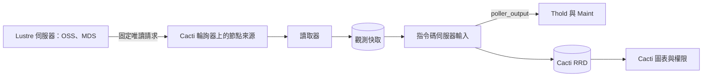

<!-- Source: README.md; SHA256: 40f2c5a5e9be97e4bd2b05a9ebab2a77de51de3af1b1c21dbeb5ee7f936cdd3b -->

<!-- translations:start -->
[English](../../../README.md) | [简体中文](../zh-CN/README.md) | [हिन्दी](../hi-IN/README.md) | [Español (España)](../es-ES/README.md) | [Español (Latinoamérica)](../es-419/README.md) | [العربية (السعودية)](../ar-SA/README.md) | [Afrikaans](../af-ZA/README.md) | [አማርኛ](../am-ET/README.md) | [العربية (مصر)](../ar-EG/README.md) | [العربية (المغرب)](../ar-MA/README.md) | [বাংলা](../bn-BD/README.md) | [Bosanski](../bs-BA/README.md) | [Deutsch](../de-DE/README.md) | [فارسی](../fa-IR/README.md) | [Filipino](../fil-PH/README.md) | [Français](../fr-FR/README.md) | [Français (Maroc)](../fr-MA/README.md) | [Français (Sénégal)](../fr-SN/README.md) | [Hausa](../ha-NG/README.md) | [עברית](../he-IL/README.md) | [Hrvatski](../hr-HR/README.md) | [Bahasa Indonesia](../id-ID/README.md) | [Igbo](../ig-NG/README.md) | [Italiano](../it-IT/README.md) | [日本語](../ja-JP/README.md) | [한국어](../ko-KR/README.md) | [Malagasy](../mg-MG/README.md) | [मराठी](../mr-IN/README.md) | [Bahasa Melayu](../ms-MY/README.md) | [Nederlands](../nl-NL/README.md) | [Polski](../pl-PL/README.md) | [Português (Brasil)](../pt-BR/README.md) | [Русский](../ru-RU/README.md) | [Kinyarwanda](../rw-RW/README.md) | [Soomaali](../so-SO/README.md) | [Српски](../sr-RS/README.md) | [Svenska](../sv-SE/README.md) | [Kiswahili](../sw-KE/README.md) | [தமிழ்](../ta-IN/README.md) | [తెలుగు](../te-IN/README.md) | [ไทย](../th-TH/README.md) | [Türkçe](../tr-TR/README.md) | [Українська](../uk-UA/README.md) | [اردو](../ur-PK/README.md) | [Tiếng Việt](../vi-VN/README.md) | [isiXhosa](../xh-ZA/README.md) | [Yorùbá](../yo-NG/README.md) | [繁體中文](README.md) | [isiZulu](../zu-ZA/README.md)
<!-- translations:end -->

# plugin_pfs

一個將平行檔案系統健康狀態與負載整合進 Cacti 的 Cacti 1.2 外掛程式：包含跨目標的容量與填充不平衡、各目標吞吐量，以及中繼資料操作速率。Lustre 是第一個後端。GPFS（IBM Storage Scale）與 BeeGFS 則會透過後端介面陸續支援。資料會匯入至一般的 Cacti 裝置、資料來源與圖表中，因此無須修改 Thold 與 Maint 即可進行警報通知與維護抑制。

> **狀態：里程碑 4，第 1 階段程式碼已完成，尚未釋出。** 里程碑 2（基礎架構）、3（Lustre 觀測）與 4（警報與釋出準備）已在 `main` 分支完成或正進行審查。此外掛程式透過 Cacti 的外掛 API 進行安裝、升級與解除安裝，並拒絕低於 8.2 版本的 PHP。每個輪詢器上的背景讀取器會透過固定的強制指令碼（[node/pfs-read.sh](../../../node/pfs-read.sh)）經由 SSH 讀取 Lustre 伺服器，並快取清單、狀態、容量、計數器及其新鮮度。每個檔案系統都會成為一個 Cacti 裝置，具備 OST 與 MDT 資料查詢、五張概覽圖表、依需求產生的個別目標圖表，以及供 Thold 使用的摘要資料來源。在端對端測試執行中，未經修改的 Thold v1.8.2 與 Maint v1.3 可針對摘要量表進行警報與抑制；Thold 1.8.2 不支援針對計數器設定 Thold 閾值（[docs/alerting.md](../../alerting.md)）。目前為止的所有測試皆是在拋棄式 Cacti 環境中使用固定節點輸出執行：此外掛程式尚未在真實的 Lustre 節點上執行過。釋出前仍待完成的項目包括：在真實檔案系統上進行前導測試（[前導測試計畫](../../pilot-plan.md)）、外部安全性審查（[自我審查](../../security-review.md)），以及在已記錄規格的硬體上進行規模量測（[規模量測](../../research/scale.md)）。版本 0.1.0 已在 `INFO` 與 [CHANGELOG.md](../../../CHANGELOG.md) 中準備就緒，但尚未建立標籤（tag）。

## 存取角色

| 權限領域 | 存取權限 |
| --- | --- |
| Parallel Filesystem View（平行檔案系統檢視） | 現有的監控頁面。 |
| Parallel Filesystem Operator（平行檔案系統操作員） | 監控頁面，外加操作頁面與個人分類確認（triage acknowledgments）。 |
| Parallel Filesystem Admin（平行檔案系統管理員） | 操作員權限，外加現有的設定與管理操作。 |

複製升級檔案後，請以管理員身分開啟 Plugins（外掛程式）頁面以註冊新的權限領域。請在 **Configuration > Users**（設定 > 使用者）或使用者群組中明確指派 Operator 權限領域。升級會保留現有的 View 與 Admin 權限領域 ID 及授權。在每次請求時，Admin 權限會繼承 Operator 權限，而 Operator 權限會繼承 View 權限；這不會對使用者或群組新增儲存的授權。外掛程式設定除了需要 Cacti 的 Settings 權限外，還需要 Parallel Filesystem Admin 權限。

Cacti 裝置權限仍會限制每位使用者可檢視的資料列與可用操作；未對應的物件需要管理員處理。憑證、設定、對應、刪除與其他管理變更仍保留在管理頁面中。確認標記（acknowledgments）僅在目前使用者的工作階段中有效，最長持續一小時，且僅在相同觀測結果仍維持新鮮時有效。新的或已變更的觀測結果會使其失效。確認標記絕不會將失敗的量測標記為健康或抑制警報。

## 開發動機

當共享檔案系統變慢時，相關證據分散在多台伺服器上。Lustre 將計數器保存在各個節點上：`lctl get_param` 會回報「本機節點上」的值，因此每台物件儲存伺服器（OSS）與中繼資料伺服器（MDS）僅保有各自目標的數值。調查檔案系統變慢的操作人員需要從不同位置取得三個問題的答案：

- **是否有單一目標正在填滿，而其他目標卻是空的？** 填充不平衡會改變新檔案的寫入落點，並影響單一目標何時會耗盡空間。
- **哪些目標或操作正處於忙碌狀態？** 各目標的位元組計數器與各 MDT 的操作計數器可顯示負載是受限於資料傳輸還是中繼資料處理。
- **監控本身是否為最新狀態？** 只有在確認外掛程式能夠順利讀取伺服器時，平穩的圖表才令人安心。

Cacti 擅長繪製主機圖表並透過 Thold 設定閾值警報，而 Cacti 的 GitHub 組織中並沒有用於監控 Lustre、GPFS 或 BeeGFS 的儲存庫（於 2026-11-14 搜尋確認）。此外掛程式透過從儲存節點讀取允許清單中的唯讀數值，並將每個檔案系統表示為一個 Cacti 裝置（其目標作為資料查詢的索引），藉此填補該缺口。它重複使用 Cacti 的圖表繪製、權限控管、遠端資料收集器、Thold 與 Maint，而非另外建置平行替代方案。

## 規劃範圍

| 階段 | 範圍 | 里程碑 |
|---|---|---|
| 0，研究 | 發行版本矩陣、節點存取決策、上游行為確認、計數器與容錯移轉行為、規模量測 | [M1](https://github.com/somethingwithproof/plugin_pfs/milestone/1) |
| 1，觀測 | Lustre 清單、容量與填充量、OST 吞吐量、MDT 操作速率、圖表、Thold 警報、Maint 抑制、健康狀態頁面 | [M2](https://github.com/somethingwithproof/plugin_pfs/milestone/2), [M3](https://github.com/somethingwithproof/plugin_pfs/milestone/3), [M4](https://github.com/somethingwithproof/plugin_pfs/milestone/4) |
| 2，深度 | Cacti 遠端資料收集器、在有限物件數量內的作業層級與用戶端層級檢視 | [M5](https://github.com/somethingwithproof/plugin_pfs/milestone/5) |
| 3，後端 | GPFS（IBM Storage Scale）與 BeeGFS 後端 | [M6](https://github.com/somethingwithproof/plugin_pfs/milestone/6) |

不在規劃範圍內的項目：對節點或檔案系統進行任何寫入、清除、重設或調校操作；外掛程式自有的警報引擎；自訂背景服務（daemon）或網路通訊協定；各作業（per-job）的資料來源；對 Cacti 核心、Thold 或 Maint 的修改。

## 相容性目標

| 元件 | 目標 |
|---|---|
| Cacti | 1.2.31 或更新版本，無需修改核心程式碼 |
| PHP | 8.2 或更新版本；`setup.php` 仍可在 8.0 上正常解析，使不支援的執行環境收到拒絕訊息而非導致 Cacti 介面損毀 |
| Lustre | 將由里程碑 1 確定支援的發行版本系列；目前檢查過的原始碼與手冊版本為 2.17.0 |
| GPFS, BeeGFS | 第 3 階段；將透過研究確定支援的發行版本 |
| Thold, Maint | 無需任何修改 |

## 設計

- [docs/PLAN.md](../../PLAN.md) 為完整計畫書：包含架構、所依據的上游事實（含來源及尚未驗證的項目）、計數器語意、狀態模型、安全邊界、效能算術、測試與風險。
- [docs/operator-guide.md](../../operator-guide.md) 涵蓋安裝、圖表與數值、升級、備份與還原、解除安裝以及疑難排解；[docs/alerting.md](../../alerting.md) 涵蓋 Thold 與 Maint。
- [docs/node-setup.md](../../node-setup.md) 說明如何為讀取器準備 Lustre 伺服器與輪詢器。
- [docs/decisions/](../../decisions) 存放已做出的架構決策記錄（ADR）。
- [docs/REQUIREMENTS.md](../../REQUIREMENTS.md) 將每個需求 ID 對應至其議題。

## 工作追蹤方式

- **里程碑（Milestones）** 遵循計畫中的里程碑劃分。每個里程碑皆設有一個 Epic 議題，列出其子議題與結束驗證證據。
- **議題（Issues）** 依標籤分類：`type: requirement`、`type: research`、`type: decision`、`type: epic`。需求議題會敘明經過編號、可測試的需求（`REQ-AREA-NNN`）與驗收標準。
- **標籤（Labels）** 亦包含 `area:`、`phase:`、`priority:` 與 `status:`。請參閱 [CONTRIBUTING.md](../../../CONTRIBUTING.md#labels)。
- [專案看板](https://github.com/users/somethingwithproof/projects/11) 顯示所有里程碑中的全部議題。

## 參與貢獻

請閱讀 [CONTRIBUTING.md](../../../CONTRIBUTING.md)。提交（commits）需要包含 DCO 簽署（sign-off）。設計討論會在議題中進行；尚未定案的決策會帶有 `type: decision` 標籤。

## 安全性

請私下回報安全漏洞；詳情請參閱 [SECURITY.md](../../../SECURITY.md)。

## 授權條款

採用 GNU General Public License v2.0，與 Cacti 及其外掛程式相同之授權條款。請參閱 [LICENSE](../../../LICENSE)。
