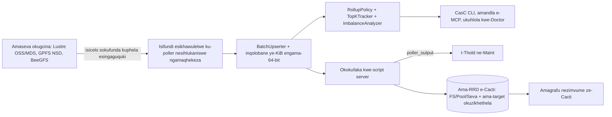

<!-- Source: README.md; SHA256: e88d6875d113220a91cfc0a9d230c829a78477b17e6aa7e44dda38c9591c86ad -->

<!-- translations:start -->
[English](../../../README.md) | [简体中文](../zh-CN/README.md) | [हिन्दी](../hi-IN/README.md) | [Español (España)](../es-ES/README.md) | [Español (Latinoamérica)](../es-419/README.md) | [العربية (السعودية)](../ar-SA/README.md) | [Afrikaans](../af-ZA/README.md) | [አማርኛ](../am-ET/README.md) | [العربية (مصر)](../ar-EG/README.md) | [العربية (المغرب)](../ar-MA/README.md) | [বাংলা](../bn-BD/README.md) | [Bosanski](../bs-BA/README.md) | [Deutsch](../de-DE/README.md) | [فارسی](../fa-IR/README.md) | [Filipino](../fil-PH/README.md) | [Français](../fr-FR/README.md) | [Français (Maroc)](../fr-MA/README.md) | [Français (Sénégal)](../fr-SN/README.md) | [Hausa](../ha-NG/README.md) | [עברית](../he-IL/README.md) | [Hrvatski](../hr-HR/README.md) | [Bahasa Indonesia](../id-ID/README.md) | [Igbo](../ig-NG/README.md) | [Italiano](../it-IT/README.md) | [日本語](../ja-JP/README.md) | [한국어](../ko-KR/README.md) | [Malagasy](../mg-MG/README.md) | [मराठी](../mr-IN/README.md) | [Bahasa Melayu](../ms-MY/README.md) | [Nederlands](../nl-NL/README.md) | [Polski](../pl-PL/README.md) | [Português (Brasil)](../pt-BR/README.md) | [Русский](../ru-RU/README.md) | [Kinyarwanda](../rw-RW/README.md) | [Soomaali](../so-SO/README.md) | [Српски](../sr-RS/README.md) | [Svenska](../sv-SE/README.md) | [Kiswahili](../sw-KE/README.md) | [தமிழ்](../ta-IN/README.md) | [తెలుగు](../te-IN/README.md) | [ไทย](../th-TH/README.md) | [Türkçe](../tr-TR/README.md) | [Українська](../uk-UA/README.md) | [اردو](../ur-PK/README.md) | [Tiếng Việt](../vi-VN/README.md) | [isiXhosa](../xh-ZA/README.md) | [Yorùbá](../yo-NG/README.md) | [繁體中文](../zh-TW/README.md) | [isiZulu](README.md)
<!-- translations:end -->

# plugin_pfs

I-plugin ye-Cacti 1.2 eletha impilo ye-parallel filesystem, umthamo, ukungalingani kokugcwaliswa, izinga lokudluliswa kwedatha nge-target ngayinye, kanye namazinga okusebenza kwe-metadata ku-Cacti ku-Lustre, i-IBM Storage Scale (GPFS), ne-BeeGFS ngemuva kwe-interface eyodwa ye-`Backend`. I-filesystem ngayinye imepha kudivayisi ejwayelekile ye-Cacti enemibuzo yedatha, amagrafu okubuka konke nawama-target lapho edingeka, kanye nezikali zesifinyezo ukuze i-Thold ne-Maint zixwayise futhi zithulise izexwayiso ngaphandle kokushintshwa.

> **Isimo: izigaba zoku-1 kuya kwesesi-3 nezinto eziyisisekelo zokukhulisa isikali se-exascale sezisetshenzisiwe kukhodi, azikakhululwa.** Isisekelo, ukubhekisisa i-Lustre, ukuxwayisa nokuthulisa kwe-Maint, abashayeli bokufunda kuphela be-GPFS ne-BeeGFS, ukuhlaziya ukungalingani kwe-OST/MDT okudidiyelwe ne-Maint, ukukhawulela indawo yomqoqi wedatha okude (`replicate_out`, `remote_agent`), izinto eziyisisekelo zokukhulisa isikali se-100+ PB / exascale (`FramedReportParser`, i-Schema v4 `value_kib`, `RollupPolicy`, `TopKTracker`, `ShardAssigner`, `BatchUpserter`), i-CasC operator CLI (`cli/pfs.php`), kanye nama-hook e-ecosystem (`abilities_register`, `doctor_register_checks`, `casc_register_providers`) sezisetshenzisiwe futhi zaqinisekiswa ngokuhlolwa kweyunithi, okokuphepha, nokokudidiyela ku-Cacti elahlwayo. Konke ukugijima kuze kube manje kusebenzisa okukhishwa kwe-node eyisibonelo (fixture) esikhundleni se-hardware yangempela ye-Lustre, i-GPFS, noma i-BeeGFS. Okusavulekile ngaphambi kokufaka ithegi yokukhulula: ukuhlolwa kuma-filesystem angempela ([uhlelo lokuhlola](../../pilot-plan.md)), ukubuyekezwa kokuphepha kwangaphandle ([ukuzibuyekeza](../../security-review.md)), kanye nezilinganiso zesikali ku-hardware ebhalwe phansi ([isikali](../../research/scale.md)). Inguqulo 0.1.0 ilungisiwe ku-`INFO` naku-[CHANGELOG.md](../../../CHANGELOG.md) kodwa ayikabhalwa ithegi.

## Izindima zokufinyelela

| Isigaba | Ukufinyelela |
| --- | --- |
| Parallel Filesystem View | Amakhasi okubhekisisa akhona. |
| Parallel Filesystem Operator | Ukubhekisisa kanye nekhasi le-Operations kanye nezivumelwano zomuntu siqu zokuhlola inkinga. |
| Parallel Filesystem Admin | Ukufinyelela kwe-Operator kanye nezilungiselelo ezikhona nezenzo zokuphatha. |

Ngemva kokukopisha amafayela okuthuthukisa, vula ikhasi le-Plugins njengomlawuli ukuze ubhalise
isigaba esisha. Yabela isigaba se-Operator ngokucacile ngaphansi kwe-**Configuration > Users** noma amaqembu abasebenzisi.
Ukuthuthukiswa kugcina ama-ID esigaba akhona e-View ne-Admin kanye nezimvume zokunikezwa. Ukufinyelela kwe-Admin
kudla ifa lokufinyelela kwe-Operator, futhi ukufinyelela kwe-Operator kudla ifa lokufinyelela kwe-View esicelweni ngasinye;
lokhu akungezi izimvume ezigciniwe kubasebenzisi noma emaqenjini. Izilungiselelo ze-plugin zidinga futhi
ukufinyelela kwe-Parallel Filesystem Admin ngaphezu kwemvume ye-Settings ye-Cacti.

Izimvume zedivayisi ye-Cacti zisakhawulela imigqa nezenzo ezitholakalayo kumsebenzisi ngamunye; izinto ezingamephiwe zidinga umlawuli.
Izifakazelo, ukulungiselelwa, ukumepha, ukususa nezinye izinqubo zokuphatha
zihlala emakhasini okuphatha. Izivumelwano zohlolo zihlala kuphela kuseshini yomsebenzisi yamanje,
okungenani ihora elilodwa futhi kuphela ngenkathi ukubhekisisa okufanayo kusekusha.
Ukubhekisisa okusha noma okushintshiwe kuyaziqeda amandla. Azikaze zimake isilinganiso esehlulekile
njengesinempilo noma zithulise izexwayiso.

## Kungani

Lapho i-filesystem eyabiwe ihamba kancane, ubufakazi busakazeke emaseveni. I-Lustre igcina izibali zayo nge-node ngayinye: `lctl get_param` ibika amanani "ku-node yendawo", ngakho iseva ngayinye yokugcina izinto (OSS) neseva ye-metadata (MDS) iphethe kuphela izinombolo zama-target ayo. Umsebenzisi ophenya nge-filesystem ehamba kancane udinga izimpendulo ezintathu ezivela ezindaweni ezahlukene:

- **Ingabe i-target eyodwa iyagcwala ngenkathi ezinye zingenalutho?** Ukungalingani kokugcwaliswa kushintsha lapho amafayela amasha ehlala khona nalapho i-target eyodwa iphelelwa yindawo khona.
- **Yimaphi ama-target noma imisebenzi ematasa?** Izibali zama-byte ze-target ngayinye kanye nezibali zokusebenza ze-MDT ngayinye zibonisa ukuthi umthwalo uncike kudatha noma ku-metadata.
- **Ingabe ukubhekisisa uqobo lwako kusesikhathini?** Igrafu eyisicaba iduduza kuphela uma i-plugin ikwazile ukubona amaseva.

I-Cacti idweba amagrafu ama-host futhi ibeke imikhawulo yamanani nge-Thold, kanti inhlangano ye-Cacti ku-GitHub ayinayo i-repository yokubhekisisa i-Lustre, i-GPFS, noma i-BeeGFS (kuseshwe ngo-2026-11-14). I-plugin ivela lolo gebe ngokufunda amanani avunyelwe, okufunda kuphela kuma-node okugcina futhi imele i-filesystem ngayinye njengedivayisi ye-Cacti ema-target ayo ayizinkomba zombuzo wedatha. Isebenzisa kabusha ukudweba amagrafu kwe-Cacti, izimvume, abaqoqi bedatha abakude, i-Thold, ne-Maint kunokwakha izinhlelo zayo ezifanayo.

## Ububanzi obuhleliwe

| Isigaba | Ububanzi | Isimo | Izingqophamlando |
|---|---|---|---|
| 0, ucwaningo | Uhlu lokukhishwa, isinqumo sokufinyelela ku-node, ukuqinisekiswa kokuziphatha kwe-upstream, ukuziphatha kwezibali nokwehluleka, izilinganiso zesikali | Kuqediwe | [M1](https://github.com/somethingwithproof/plugin_pfs/milestone/1) |
| 1, ukubhekisisa | Uhlu lwempahla ye-Lustre, umthamo nokugcwaliswa, ukungalingani kwe-OST/MDT (`lib/ImbalanceAnalyzer.php`), ukudidiyela ne-Maint (`lib/HealthPage.php`), izinga lokudluliswa kwe-OST, amazinga okusebenza kwe-MDT, amagrafu, ukuxwayisa kwe-Thold, ikhasi lempilo | Kusetshenzisiwe (kuhlolwe nge-fixture) | [M2](https://github.com/somethingwithproof/plugin_pfs/milestone/2), [M3](https://github.com/somethingwithproof/plugin_pfs/milestone/3), [M4](https://github.com/somethingwithproof/plugin_pfs/milestone/4) |
| 2, okukude nesikali | Ukuqoqa okukude okukhawulelwe ku-poller (`lib/Reader.php`, `lib/ReplicationRepository.php`, `replicate_out`, `remote_agent`), izinto eziyisisekelo zokukhulisa isikali se-100+ PB (ukuhlanzeka kwe-KiB engama-64-bit + i-Schema v4 `value_kib`, `lib/RollupPolicy.php`, `lib/TopKTracker.php`, `lib/ShardAssigner.php` + `poller_pfs.php --shard=K/N`, `lib/BatchUpserter.php`), i-CasC CLI (`cli/pfs.php`), ama-hook e-MCP/Doctor/CasC | Kusetshenzisiwe (kuhlolwe ngeyunithi nangokudidiyela kwe-CI) | [M5](https://github.com/somethingwithproof/plugin_pfs/milestone/5) |
| 3, ama-backend | Abashayeli bokufunda kuphela be-IBM Storage Scale (GPFS) (`lib/GpfsBackend.php`) ne-BeeGFS (`lib/BeegfsBackend.php`) ababhaliswe ku-`BackendRegistry::production()` | Kusetshenzisiwe (kuhlolwe ngeyunithi) | [M6](https://github.com/somethingwithproof/plugin_pfs/milestone/6) |

Izinto eziyinhloko ezisetshenzisiwe zokusebenza nezokukhulisa isikali:

- **Abashayeli bokufunda kuphela bama-filesystem amaningi:** `LustreBackend`, `GpfsBackend` (`mmpmon` `fs_io_s`/`io_s` enesakhelo kuphela lapho `reset` ivinjelwe khona, umthamo/izimo ze-pool ze-`mmdf`, kanye nezifinyezo zabalindile), kanye ne-`BeegfsBackend` (ama-target okugcina nawe-metadata e-BeeGFS 7.4 nawe-8.x anokuguqulwa okunembile kwe-byte kuya ku-KiB, ukumepha kwesimo sokufinyeleleka nokuhambisana, kanye nencazelo yesikali ngesikhathi ngasinye) okwabelana nge-`lib/FramedReportParser.php`.
- **Ukungalingani, isikhala esisele, nolwazi lwe-Maint:** `lib/ImbalanceAnalyzer.php` ibala izilinganiso zokugcwaliswa ze-OST/MDT, ukusabalala, inkomba yokungalingani esekelwe ku-population standard deviation, isikhala esisele, ukuphoqelelwa kobusha besikhathi esiyi-1 (`missing_targets`), amafulegi esimo se-target ngayinye, kanye nama-target aphendukile akhawulelwe we-Top-K. `HealthPage` (`pfs_health.php`) kanye ne-`CascProvider::health()` zibonisa amafasitela okulungisa e-Cacti `Maint` futhi zithulisa izexwayiso zokwehluleka ezisebenzayo ngesikhathi sokulungisa okuhleliwe.
- **Ukukhuliswa kwesikali se-100+ PB ne-exascale** ([docs/architecture/exascale-scaling.md](../../architecture/exascale-scaling.md)): ukuguqulwa okunembile kwedesimali ye-byte kuya ku-KiB (`FramedReportParser::bytesToKibInt()`) okuqinisekiswe ku-500 PB naku-2 EB kanye namakholamu e-`BIGINT UNSIGNED value_kib` (i-Schema v4); ama-rollup e-RRD alandelanayo e-`Filesystem -> Pool -> Storage Server` anokuphakanyiswa okukhawulelwe kwama-target okuzikhethela/ashisayo/aphendukile (`lib/RollupPolicy.php`); ama-target aphendukile akhawulelwe we-$O(K)$ Top-K kanye nezifinyezo ezihlanganiswe ngaphambili zemisebenzi/amaklayenti asindayo (`lib/TopKTracker.php`, engakhi amadivayisi noma ama-RRD eklayenti ngalinye nanini); ukwehlukaniswa komqoqi nge-CRC32 okunemiphumela efanayo (`lib/ShardAssigner.php`, `php plugins/pfs/poller_pfs.php [--poller=N] [--shard=K/N] [--force] [--debug]`); kanye nama-SQL upsert aqoqwe ngemigqa engama-500 kanye nokwehlukaniswa kwamakhasi nge-keyset (`lib/BatchUpserter.php`, `CacheRepository::upsertObservationsBatch()`, `TargetRepository::forFilesystemPage()`).
- **I-CasC CLI yomsebenzi kanye nama-hook e-ecosystem:** `cli/pfs.php` isekela `export [--format=yaml|xml]`, `validate <file> [--format=yaml|xml]`, `plan <file> [--format=yaml|xml] [--output=text|json]`, `apply <file> --confirm=<PLAN_HASH> [--format=yaml|xml]`, kanye ne-`health [--format=text|json]` ngaphandle kokuncika ku-Composer yangaphandle. `setup.php` kanye ne-`lib/EcosystemIntegration.php` zibhalisa `abilities_register` (`pfs-list-filesystems`, `pfs-get-imbalance`, `pfs-get-health`; okokufunda kuphela, okulawulwa yi-`Parallel Filesystem View` nezimvume zedivayisi ye-Cacti), `doctor_register_checks` (`pfs_schema`, `pfs_reader_freshness`, `pfs_capacity_imbalance`), `casc_register_providers`, `replicate_out`, kanye ne-`remote_agent`.

Okungaphandle kobubanzi: noma yimuphi umsebenzi wokubhala, ukusula, ukusetha kabusha, noma wokulungisa ku-node noma ku-filesystem; injini yokuxwayisa ephethwe yi-plugin; i-daemon eyenziwe ngokwezifiso noma i-protocol yenethiwekhi; amadivayisi noma ama-RRD e-Cacti omsebenzi ngamunye noma eklayenti ngalinye; izinguquko ku-Cacti core, i-Thold, noma i-Maint.

## Okuhlosiwe kokuhambisana

| Ingxenye | Okuhlosiwe |
|---|---|
| Cacti | 1.2.31 noma kamuva, azikho izichibi ze-core |
| PHP | 8.2 noma kamuva; i-`setup.php`, `poller_pfs.php`, ne-`cli/pfs.php` zihlala zifundeka ku-8.0 ukuze i-runtime engasekelwe ithole ukwenqatshwa esikhundleni se-Cacti UI ephukile |
| Lustre | Umthombo nezincwadi zihlolwe ku-2.17.0; kuhlolwe nge-fixture |
| GPFS, BeeGFS | Abashayeli bokufunda kuphela be-IBM Storage Scale (GPFS) 5.x `mmpmon`/`mmdf` ne-BeeGFS 7.4 / 8.x basetshenzisiwe futhi bahlolwa nge-fixture |
| Thold, Maint | I-Thold 1.8.2 ne-Maint 1.3, azishintshiwe |

## Umklamo

- [docs/architecture/exascale-scaling.md](../../architecture/exascale-scaling.md) ibhala ukwakheka kwe-telemetry enezigaba ezimbili ye-100+ PB / exascale (isigaba seseva ye-Cacti/`plugin_pfs` + i-rollup + i-Top-K sihlanganiswe ne-telemetry yeklayenti engaphandle kwebhendi ye-LDMS/Darshan/TOKIO) kanye nomongo walo wemibhalo yezemfundo.
- [docs/PLAN.md](../../PLAN.md) iwuhlelo olupheleleyo: ukwakheka, amaqiniso e-upstream encike kuwo (enemithombo nalokho okungakaqinisekiswa), incazelo yezibali, imodeli yesimo, imingcele yokuphepha, izibalo zokusebenza, ukuhlola, nezingozi.
- [docs/operator-guide.md](../../operator-guide.md) ihlanganisa ukufakwa, amagrafu namanani, ukuthuthukiswa, ukwenza isipele nokubuyisela, ukukhishwa, kanye nokuxazulula izinkinga; [docs/alerting.md](../../alerting.md) ihlanganisa i-Thold ne-Maint.
- [docs/node-setup.md](../../node-setup.md) ichaza indlela yokulungisa iseva ye-Lustre kanye ne-poller yesifundi.
- [docs/decisions/](../../decisions) igcina amarekhodi ezinqumo zokwakheka ezivele zenziwe.
- [docs/REQUIREMENTS.md](../../REQUIREMENTS.md) imepha i-ID yesidingo ngayinye endabeni yayo.

## Indlela umsebenzi olandelelwa ngayo

- **Izingqophamlando** zilandela izingqophamlando zohlelo. Ngayinye inendaba enkulu (epic issue) efaka uhlu lwezindaba zayo ezingaphansi nobufakazi bokuphuma.
- **Izindaba** zihlukaniswe ngamathegi: `type: requirement`, `type: research`, `type: decision`, `type: epic`. Izindaba zezidingo zisho izidingo ezinenombolo, ezihlolekayo (`REQ-AREA-NNN`) kanye nemibandela yokwamukelwa.
- **Amathegi** nawo aphatha `area:`, `phase:`, `priority:`, kanye no-`status:`. Bheka ku-[CONTRIBUTING.md](../../../CONTRIBUTING.md#labels).
- [Ibhodi lephrojekthi](https://github.com/users/somethingwithproof/projects/11) libonisa zonke izindaba kuzo zonke izingqophamlando.

## Ukufaka isandla

Funda ku-[CONTRIBUTING.md](../../../CONTRIBUTING.md). Ama-commit adinga isiginesha ye-DCO. Ingxoxo yomklamo yenzeka ezindabeni; izinqumo ezivulekile zithwala ithegi elithi `type: decision`.

## Ukuphepha

Bika izinkinga zokuphepha ngasese; bheka ku-[SECURITY.md](../../../SECURITY.md).

## Ilayisense

I-GNU General Public License v2.0, ilayisense efanayo neye-Cacti nama-plugin ayo. Bheka ku-[LICENSE](../../../LICENSE).
