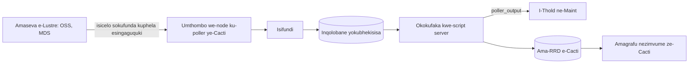

<!-- Source: README.md; SHA256: e88d6875d113220a91cfc0a9d230c829a78477b17e6aa7e44dda38c9591c86ad -->

<!-- translations:start -->
[English](../../../README.md) | [简体中文](../zh-CN/README.md) | [हिन्दी](../hi-IN/README.md) | [Español (España)](../es-ES/README.md) | [Español (Latinoamérica)](../es-419/README.md) | [العربية (السعودية)](../ar-SA/README.md) | [Afrikaans](../af-ZA/README.md) | [አማርኛ](../am-ET/README.md) | [العربية (مصر)](../ar-EG/README.md) | [العربية (المغرب)](../ar-MA/README.md) | [বাংলা](../bn-BD/README.md) | [Bosanski](../bs-BA/README.md) | [Deutsch](../de-DE/README.md) | [فارسی](../fa-IR/README.md) | [Filipino](../fil-PH/README.md) | [Français](../fr-FR/README.md) | [Français (Maroc)](../fr-MA/README.md) | [Français (Sénégal)](../fr-SN/README.md) | [Hausa](../ha-NG/README.md) | [עברית](../he-IL/README.md) | [Hrvatski](../hr-HR/README.md) | [Bahasa Indonesia](../id-ID/README.md) | [Igbo](../ig-NG/README.md) | [Italiano](../it-IT/README.md) | [日本語](../ja-JP/README.md) | [한국어](../ko-KR/README.md) | [Malagasy](../mg-MG/README.md) | [मराठी](../mr-IN/README.md) | [Bahasa Melayu](../ms-MY/README.md) | [Nederlands](../nl-NL/README.md) | [Polski](../pl-PL/README.md) | [Português (Brasil)](../pt-BR/README.md) | [Русский](../ru-RU/README.md) | [Kinyarwanda](../rw-RW/README.md) | [Soomaali](../so-SO/README.md) | [Српски](../sr-RS/README.md) | [Svenska](../sv-SE/README.md) | [Kiswahili](../sw-KE/README.md) | [தமிழ்](../ta-IN/README.md) | [తెలుగు](../te-IN/README.md) | [ไทย](../th-TH/README.md) | [Türkçe](../tr-TR/README.md) | [Українська](../uk-UA/README.md) | [اردو](../ur-PK/README.md) | [Tiếng Việt](../vi-VN/README.md) | [isiXhosa](../xh-ZA/README.md) | [Yorùbá](../yo-NG/README.md) | [繁體中文](../zh-TW/README.md) | [isiZulu](README.md)
<!-- translations:end -->

# plugin_pfs

I-plugin ye-Cacti 1.2 eletha isimo sempilo nomthwalo we-parallel filesystem ku-Cacti: umthamo nokungalingani kokugcwaliswa kuwo wonke ama-target, izinga lokudluliswa kwedatha nge-target ngayinye, kanye namazinga okusebenza kwe-metadata. I-Lustre iyisizinda sokuqala (backend). I-GPFS (IBM Storage Scale) ne-BeeGFS ziyalandela ngemuva kwe-backend interface. Idatha ingena kumadivayisi ajwayelekile e-Cacti, imithombo yedatha, namagrafu, ngakho i-Thold ne-Maint zixwayisa futhi zithulise izexwayiso ngayo ngaphandle kokushintshwa.

> **Isimo: ingqophamlando yesi-4 (milestone 4), ikhodi iphelele esigabeni soku-1, ayikakhululwa.** Izingqophamlando zesi-2 (isisekelo), zesi-3 (ukubhekisisa i-Lustre), nezesi-4 (ukuxwayisa nokulungiselela ukukhululwa) seziqediwe ku-`main` noma zisabuyekezwa. I-plugin iyafakwa, ithuthukiswe, futhi ikhishwe nge-plugin API ye-Cacti futhi yenqaba i-PHP engaphansi kuka-8.2. Isifundi sangemuva ku-poller ngayinye sifunda amaseva e-Lustre nge-SSH ngombhalo womyalo ophoqelelwe ongaguquki ([node/pfs-read.sh](../../../node/pfs-read.sh)) bese sigcina enqolobaneni uhlu lwempahla, isimo, umthamo, nezibali kanye nobusha bazo. I-filesystem ngayinye iba idivayisi ye-Cacti enemibuzo yedatha ye-OST ne-MDT, amagrafu ayisihlanu okubuka konke, amagrafu e-target ngayinye lapho edingeka, kanye nomthombo wedatha wesifinyezo we-Thold. I-Thold v1.8.2 ne-Maint v1.3, zingashintshiwe, zixwayisa futhi zithulise izikali zesifinyezo ekusebenzeni kokuphela-kuya-ekupheleni; imikhawulo ye-Thold ezibalini ayisekelwa nge-Thold 1.8.2 ([docs/alerting.md](../../alerting.md)). Zonke izivivinyo kuze kube manje zisebenza ngokukhipha kwe-node eyisibonelo ku-Cacti elahlwayo: i-plugin ayikasebenzi ngokumelene ne-node ye-Lustre yangempela. Okusavulekile ngaphambi kokukhululwa: ukuhlolwa kuma-filesystem angempela ([uhlelo lokuhlola](../../pilot-plan.md)), ukubuyekezwa kokuphepha kwangaphandle ([ukuzibuyekeza](../../security-review.md)), kanye nezilinganiso zesikali ku-hardware ebhalwe phansi ([isikali](../../research/scale.md)). Inguqulo 0.1.0 ilungisiwe ku-`INFO` naku-[CHANGELOG.md](../../../CHANGELOG.md) kodwa ayikabhalwa ithegi.

## Izindima zokufinyelela

| Isigaba | Ukufinyelela |
| --- | --- |
| Parallel Filesystem View | Amakhasi okubhekisisa akhona. |
| Parallel Filesystem Operator | Ukubhekisisa kanye nekhasi le-Operations kanye nezivumelwano zomuntu siqu zokuhlola inkinga. |
| Parallel Filesystem Admin | Ukufinyelela kwe-Operator kanye nezilungiselelo ezikhona nezenzo zokuphatha. |

Ngemva kokukopisha amafayela okuthuthukisa, vula ikhasi le-Plugins njengomlawuli ukuze ubhalise
isigaba esisha. Yabela isigaba se-Operator ngokucacile ngaphansi kwe-**Configuration > Users** noma amaqembu abasebenzisi.
Ukuthuthukiswa kugcina ama-ID esigaba akhona e-View ne-Admin kanye nezimvume zokunikezwa. Ukufinyelela kwe-Admin
kudla ifa lokufinyelela kwe-Operator, futhi ukufinyelela kwe-Operator kudla ifa lokufinyelela kwe-View esicelweni ngasinye;
lokhu akungezi izimvume ezigciniwe kubasebenzisi noma emaqenjini. Izilungiselelo ze-plugin zidinga futhi
ukufinyelela kwe-Parallel Filesystem Admin ngaphezu kwemvume ye-Settings ye-Cacti.

Izimvume zedivayisi ye-Cacti zisakhawulela imigqa nezenzo ezitholakalayo kumsebenzisi ngamunye; izinto ezingamephiwe zidinga umlawuli.
Izifakazelo, ukulungiselelwa, ukumepha, ukususa nezinye izinqubo zokuphatha
zihlala emakhasini okuphatha. Izivumelwano zohlolo zihlala kuphela kuseshini yomsebenzisi yamanje,
okungenani ihora elilodwa futhi kuphela ngenkathi ukubhekisisa okufanayo kusekusha.
Ukubhekisisa okusha noma okushintshiwe kuyaziqeda amandla. Azikaze zimake isilinganiso esehlulekile
njengesinempilo noma zithulise izexwayiso.

## Kungani

Lapho i-filesystem eyabiwe ihamba kancane, ubufakazi busakazeke emaseveni. I-Lustre igcina izibali zayo nge-node ngayinye: `lctl get_param` ibika amanani "ku-node yendawo", ngakho iseva ngayinye yokugcina izinto (OSS) neseva ye-metadata (MDS) iphethe kuphela izinombolo zama-target ayo. Umsebenzisi ophenya nge-filesystem ehamba kancane udinga izimpendulo ezintathu ezivela ezindaweni ezahlukene:

- **Ingabe i-target eyodwa iyagcwala ngenkathi ezinye zingenalutho?** Ukungalingani kokugcwaliswa kushintsha lapho amafayela amasha ehlala khona nalapho i-target eyodwa iphelelwa yindawo khona.
- **Yimaphi ama-target noma imisebenzi ematasa?** Izibali zama-byte ze-target ngayinye kanye nezibali zokusebenza ze-MDT ngayinye zibonisa ukuthi umthwalo uncike kudatha noma ku-metadata.
- **Ingabe ukubhekisisa uqobo lwako kusesikhathini?** Igrafu eyisicaba iduduza kuphela uma i-plugin ikwazile ukubona amaseva.

I-Cacti idweba amagrafu ama-host futhi ibeke imikhawulo yamanani nge-Thold, kanti inhlangano ye-Cacti ku-GitHub ayinayo i-repository yokubhekisisa i-Lustre, i-GPFS, noma i-BeeGFS (kuseshwe ngo-2026-11-14). I-plugin ivela lolo gebe ngokufunda amanani avunyelwe, okufunda kuphela kuma-node okugcina futhi imele i-filesystem ngayinye njengedivayisi ye-Cacti ema-target ayo ayizinkomba zombuzo wedatha. Isebenzisa kabusha ukudweba amagrafu kwe-Cacti, izimvume, abaqoqi bedatha abakude, i-Thold, ne-Maint kunokwakha izinhlelo zayo ezifanayo.

## Ububanzi obuhleliwe

| Isigaba | Ububanzi | Izingqophamlando |
|---|---|---|
| 0, ucwaningo | Uhlu lokukhishwa, isinqumo sokufinyelela ku-node, ukuqinisekiswa kokuziphatha kwe-upstream, ukuziphatha kwezibali nokwehluleka, izilinganiso zesikali | [M1](https://github.com/somethingwithproof/plugin_pfs/milestone/1) |
| 1, ukubhekisisa | Uhlu lwempahla ye-Lustre, umthamo nokugcwaliswa, izinga lokudluliswa kwe-OST, amazinga okusebenza kwe-MDT, amagrafu, ukuxwayisa kwe-Thold, ukuthulisa kwe-Maint, ikhasi lempilo | [M2](https://github.com/somethingwithproof/plugin_pfs/milestone/2), [M3](https://github.com/somethingwithproof/plugin_pfs/milestone/3), [M4](https://github.com/somethingwithproof/plugin_pfs/milestone/4) |
| 2, ukujula | Abaqoqi bedatha abakude be-Cacti, ukubukwa kwezinga lomsebenzi nezinga leklayenti ngaphakathi kwenani lezinto elikhawulelwe | [M5](https://github.com/somethingwithproof/plugin_pfs/milestone/5) |
| 3, ama-backend | Ama-backend e-GPFS (IBM Storage Scale) ne-BeeGFS | [M6](https://github.com/somethingwithproof/plugin_pfs/milestone/6) |

Okungaphandle kobubanzi: noma yimuphi umsebenzi wokubhala, ukusula, ukusetha kabusha, noma wokulungisa ku-node noma ku-filesystem; injini yokuxwayisa ephethwe yi-plugin; i-daemon eyenziwe ngokwezifiso noma i-protocol yenethiwekhi; imithombo yedatha yomsebenzi ngamunye; izinguquko ku-Cacti core, i-Thold, noma i-Maint.

## Okuhlosiwe kokuhambisana

| Ingxenye | Okuhlosiwe |
|---|---|
| Cacti | 1.2.31 noma kamuva, azikho izichibi ze-core |
| PHP | 8.2 noma kamuva; i-`setup.php` ihlala ifundeka ku-8.0 ukuze i-runtime engasekelwe ithole ukwenqatshwa esikhundleni se-Cacti UI ephukile |
| Lustre | Imigqa yokukhishwa izonqunywa yingqophamlando yoku-1; umthombo nezincwadi ezihlolwe kuze kube manje ziku-2.17.0 |
| GPFS, BeeGFS | Isigaba sesi-3; ukukhishwa kuzonqunywa ngocwaningo |
| Thold, Maint | Azikho izinguquko ezidingekayo |

## Umklamo

- [docs/PLAN.md](../../PLAN.md) iwuhlelo oluphelele: ukwakheka, amaqiniso e-upstream encike kuwo (enemithombo nalokho okungakaqinisekiswa), incazelo yezibali, imodeli yesimo, imingcele yokuphepha, izibalo zokusebenza, ukuhlola, nezingozi.
- [docs/operator-guide.md](../../operator-guide.md) ihlanganisa ukufakwa, amagrafu namanani, ukuthuthukiswa, ukwenza isipele nokubuyisela, ukukhishwa, kanye nokuxazulula izinkinga; [docs/alerting.md](../../alerting.md) ihlanganisa i-Thold ne-Maint.
- [docs/node-setup.md](../../node-setup.md) ichaza indlela yokulungisa iseva ye-Lustre kanye ne-poller yesifundi.
- [docs/decisions/](../../decisions) igcina amarekhodi ezinqumo zokwakheka ezivele zenziwe.
- [docs/REQUIREMENTS.md](../../REQUIREMENTS.md) imepha i-ID yesidingo ngayinye endabeni yayo.

## Indlela umsebenzi olandelelwa ngayo

- **Izingqophamlando** zilandela izingqophamlando zohlelo. Ngayinye inendaba enkulu (epic issue) efaka uhlu lwezindaba zayo ezingaphansi nobufakazi bokuphuma.
- **Izindaba** zihlukaniswe ngamathegi: `type: requirement`, `type: research`, `type: decision`, `type: epic`. Izindaba zezidingo zisho izidingo ezinenombolo, ezihlolekayo (`REQ-AREA-NNN`) kanye nemibandela yokwamukelwa.
- **Amathegi** nawo aphatha `area:`, `phase:`, `priority:`, kanye no-`status:`. Bheka ku-[CONTRIBUTING.md](../../../CONTRIBUTING.md#labels).
- [Ibhodi lephrojekthi](https://github.com/users/somethingwithproof/projects/11) libonisa zonke izindaba kuzo zonke izingqophamlando.

## Ukufaka isandla

Funda ku-[CONTRIBUTING.md](../../../CONTRIBUTING.md). Ama-commit adinga isiginesha ye-DCO. Ingxoxo yomklamo yenzeka ezindabeni; izinqumo ezivulekile zithwala ithegi elithi `type: decision`.

## Ukuphepha

Bika izinkinga zokuphepha ngasese; bheka ku-[SECURITY.md](../../../SECURITY.md).

## Ilayisense

I-GNU General Public License v2.0, ilayisense efanayo neye-Cacti nama-plugin ayo. Bheka ku-[LICENSE](../../../LICENSE).
